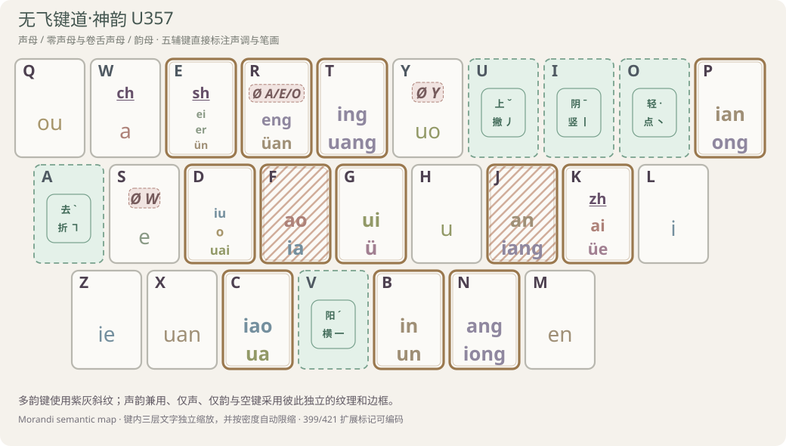
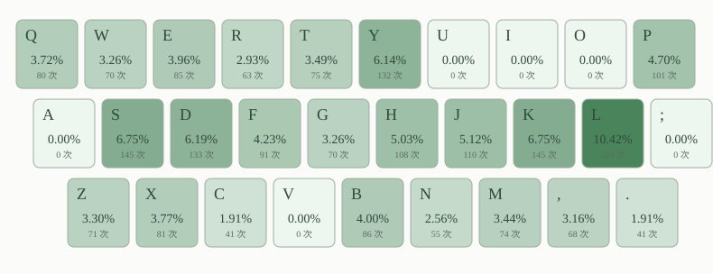

# [冰雪拼音](https://input.tansongchen.com)

> 优雅、高效、个性化的中文输入体验

[简体中文](#简体中文) · [English](#english) · [繁體中文](#繁體中文) · [下载 Release](https://github.com/ChenZhu-Xie/rime-snow-pinyin/releases/latest)

<a id="简体中文"></a>
## 简体中文

配方： ℞ **snow-pinyin**

开发脚本与维护约定见 [AGENTS.md](AGENTS.md)。

[冰雪拼音](https://input.tansongchen.com)是一系列以普通话拼音为基础的中文输入方案。它们充分利用汉字的字音信息来实现自然优雅的编码；它们使用先进的离散优化技术和顶功技术来设计，使得编码十分高效；它们配备了智能算法，通过学习用户的语言习惯来个性化输入体验。

[冰雪拼音](https://input.tansongchen.com)包括[冰雪四拼](https://input.tansongchen.com/snow4/)、[冰雪三拼](https://input.tansongchen.com/snow3/)、[冰雪一拼](https://input.tansongchen.com/snow1/)、[冰雪键道](https://input.tansongchen.com/snow-jiandao/)和[冰雪清韵](https://input.tansongchen.com/snow-qingyun/)输入方案。您可以阅读[冰雪奇缘](https://input.tansongchen.com/snow.html)来概览各个方案，了解它们的设计理念及优缺点。您还可以点击上述各个方案的链接以进一步了解并选择适合您的输入方案。

发布页面同时提供同文（Android）的 `.trime.yaml` 皮肤包和元书（iOS、Android）的 `.cskin` 皮肤包；皮肤需与输入方案分别安装，布局预览、选择与导入说明见[手机皮肤](https://input.tansongchen.com/#手机皮肤)。触屏布局暂不提供冰雪一拼专用的并击键盘。

### 无[飞键](https://pingshunhuangalex.gitbook.io/rime-xkjd/advance-in-xkjd/alt-code)道·神韵 U357 综合人体工学前沿（编码方案）

[冰雪键道](https://input.tansongchen.com/snow-jiandao/)和[冰雪三拼](https://input.tansongchen.com/snow3/)现共用 **无[飞键](https://pingshunhuangalex.gitbook.io/rime-xkjd/advance-in-xkjd/alt-code)道·神韵 U357 综合人体工学前沿**，使用 21×21 声韵键域和 5 个互斥辅键 `IVUAO`；本仓库采用并实现该方案，其布局横评与复算口径见[双拼布局 Benchmark](https://github.com/more-14-different/shuangpin-layout-benchmark/blob/main/README_CN.md)。

> [!NOTE]
> 由于作者也是[冰雪四拼](https://input.tansongchen.com/snow4/)用户，因此[冰雪三拼](https://input.tansongchen.com/snow3/)的五调辅键按照与[冰雪四拼](https://input.tansongchen.com/snow4/)相近的顺序排列。

**声韵映射**

[](https://pingshunhuangalex.gitbook.io/rime-xkjd/advance-in-xkjd/alt-code)

**神韵 U357 日常八场景文稿 纯双拼键频图（含标点）**



双拼热力图基于日常八场景文稿的 2149 次击键。

> [!NOTE]
> 注意：只包含双拼部分，5 辅键未参与评估。

#### 声韵编码规则

普通声母均使用固定首键：

| 声母 | 首键 | 声母 | 首键 | 声母 | 首键 |
| --- | :---: | --- | :---: | --- | :---: |
| b | B | p | P | m | M |
| f | F | d | D | t | T |
| n | N | l | L | g | G |
| k | K | h | H | j | J |
| q | Q | x | X | zh | K |
| ch | W | sh | E | r | R |
| z | Z | c | C | s | S |

零声母完整码如下：

| 前导组 | 首键 | 完整音节编码 |
| --- | :---: | --- |
| ØA | R | a=RW · ai=RK · an=RJ · ang=RN · ao=RF |
| ØE | R | e=RS · ei=RE · en=RM · eng=RR · er=RE |
| ØO | R | o=RD · ou=RQ |
| ØY | Y | ya=YW · yan=YJ · yang=YN · yao=YF · ye=YS · yi=YL · yin=YB · ying=YT · yo=YD · yong=YP · you=YQ · yu=YG · yuan=YR · yue=YK · yun=YE |
| ØW | S | wa=SW · wai=SK · wan=SJ · wang=SN · wei=SE · wen=SM · weng=SR · wo=SD · wu=SH |

韵母使用第二键；`v` 表示 `ü`，`ve` 表示 `üe`：

| 第二键 | 韵母 | 第二键 | 韵母 | 第二键 | 韵母 |
| :---: | --- | :---: | --- | :---: | --- |
| W | a | K | ai / ve（üe） | J | an / iang |
| N | ang / iong | F | ao / ia | S | e |
| E | ei / er / vn | M | en | R | eng / van |
| L | i | P | ian / ong | C | iao / ua |
| Z | ie | B | in / un | T | ing / uang |
| D | iu / o / uai | Q | ou | H | u |
| X | uan | G | ui / v（ü） | Y | uo |

- `zh/ch/sh → K/W/E`；零声母载体 `AOE/Y/W → R/Y/S`。
- `j/q/x` 的 `u/uan/ue/un` 与零声母 YU 系列统一按 `v/van/ve/vn` 编码。
- 三拼声调 `I/V/U/A/O → 一/二/三/四/轻`；键道形码 `A/V/U/I/O → 折/横/撇/竖/点`。
- 神韵 U357 的 [Common399](https://wwwhomes.uni-bielefeld.de/gibbon/Syllables/Mandarin) 全覆盖，形成 357 个唯一音节码与 42 个二元重码桶；实现另按同一规则推导 17 个扩展音节，扩展域共有 366 个唯一音码与 75 个空码。`hng、m、n、ng、ê` 不编码。

#### 神韵 U357 与 [星空键道 S005](https://pingshunhuangalex.gitbook.io/rime-xkjd/learn-xkjd/layouts)、[首道 B04](https://sspai.com/post/108949)的公平比较

三方案共用 Common399、冻结 20 合同、字词/形码数据、CKT v4 模型和日常八场景文稿；S005 是 21×21 的同键域基线，B04 是 26×26 的同环境基线。

**粗体** ★ 表示神韵 U357 与原键道／星空键道 S005 两个 21×21 同口径方案中的较优值；🥇 表示三方案全局最优值。

| 指标 | 神韵 U357 | 原键道 S005 | 首道 B04 | 何为好 |
| --- | ---: | ---: | ---: | --- |
| M-R2 记忆项[^zh-mr2] | **40** ★ 🥇 | 44 | 51 | 越低越好 |
| 飞键成分（声母／零声母组／韵母）[^zh-fly] | **0 / 0 / 0** ★ 🥇 | 2 / 0 / 1 | 0 / 1 / 7 | 越少越好 |
| FA-1 逻辑审计[^zh-logic] | **98.298315** ★ | 97.708694 | 99.763391 🥇 | 越高越一致 |
| LU-v1r 逻辑均匀度[^zh-logic] | 73.529803 | **78.897555** ★ | 83.107434 🥇 | 越高越统一 |
| Common399 唯一码／唯一率[^zh-collision] | 357 / 89.474% | **372 / 93.233%** ★ | 399 / 100% 🥇 | 越高越少重码 |
| 重码盈余／盈余率[^zh-collision] | 42 / 10.526% | **27 / 6.767%** ★ | 0 / 0% 🥇 | 越低越好 |
| 重码桶／受影响音节[^zh-collision] | 42×二元 / 84（21.053%） | **27×二元 / 54（13.534%）** ★ | 0 / 0（0%）🥇 | 越少越好 |
| 频率加权 S2 miss[^zh-s2] | 3.270% | **0.929%** ★ | 0% 🥇 | 越低越好 |
| S2 补全平均码长[^zh-s2] | 2.1474 | **2.0725** ★ | 2.0000 🥇 | 越低越好 |
| S2 补全中心时间（ms）[^zh-s2] | **89.917** ★ | 90.257 | 79.890 🥇 | 越低越好 |
| 综合补全 CKT v3[^zh-ckt3] | **9.782135** ★ | 10.000000 | 9.461105 🥇 | 越低越好；历史固定延迟情景 |
| 综合补全 CKT v4[^zh-ckt4] | **9.716421** ★ | 10.000000 | 9.184607 🥇 | 越低越好；现行主指标 |
| A7E-v3 系综当量[^zh-ensemble34] | **10.737188** ★ | 10.740028 | 10.519452 🥇 | 越低越好；冻结历史轴 |
| A7E-v4 系综当量[^zh-ensemble34] | **10.804598** ★ | 10.805830 | 10.583290 🥇 | 越低越好；冻结历史轴 |
| A7E-v5 系综当量[^zh-ensemble5] | **10.473306** ★ 🥇 | 11.478960 | 11.091225 | 越低越好；CKT-only |
| A7E-v6-CW150[^zh-ensemble6] | **9.512904** ★ 🥇 | 10.000000 | 9.589632 | 越低越好；情景指标 |
| 八轨综合选重率[^zh-rates] | **1.443%** ★ | 1.532% | 0.572% 🥇 | 越低越好 |
| 八轨第一辅键率[^zh-rates] | **26.150%** ★ | 26.413% | 19.746% 🥇 | 越低额外击键越少 |
| 八轨第二辅键率[^zh-rates] | **7.040%** ★ | 7.201% | 4.158% 🥇 | 越低额外击键越少 |
| 日常左右手负载／左手占比[^zh-daily] | **1091:1058 / 50.768%** ★ 🥇 | 1121:1028 / 52.164% | 1004:1145 / 46.719% | 越接近 50% 越平衡 |
| 日常同手率[^zh-daily] | 46.533% | **45.882%** ★ | 45.416% 🥇 | 越低越好；非独立速度结论 |
| 日常平均有效距离[^zh-daily] | **0.6555** ★ 🥇 | 0.6796 | 0.7012 | 同模型越低越好 |
| 20 合同 QAZ 左小指组峰值[^zh-load] | **16.3119%** ★ 🥇 | 17.1601% | 16.6615% | 越低越好；三者均在 W6-Snow |
| 20 合同 P 区右小指组峰值[^zh-load] | 5.1045% | **2.7738%** ★ | 1.8881% 🥇 | 越低越好 |
| 20 合同最大单指峰值[^zh-load] | **25.2149%** ★ 🥇 | 29.5312% | 29.2707% | 越低越好 |
| S2 主键区占比[^zh-home] | **52.0307%** ★ 🥇 | 49.0006% | 36.5996% | 越高越集中 |
| 20 合同主键区下限[^zh-load] | **37.6204%** ★ 🥇 | 30.8146% | 24.2427% | 越高越好 |
| 20 合同 TYB 双食指组峰值[^zh-load] | **14.0920%** ★ | 14.7331% | 12.3581% 🥇 | 越低越好 |
| 日常纯双拼移动手分数（含标点）[^zh-daily] | **143.380** ★ 🥇 | 138.672 | 135.310 | 同文稿越高越好 |

[^zh-mr2]: [M-R2](https://github.com/more-14-different/shuangpin-layout-benchmark/blob/main/README_CN.md) 在 Common399 口径下逐项计数非原键声韵映射和额外路由规则，是记忆／路由复杂度账本。
[^zh-fly]: 飞键按 Common399 实际二键码统计：同一逻辑成分分布在两个或更多物理键上时计 1；不同成分共用一个键、或成分整体移到非本位键均不计。韵母沿用 M-R2 的规范化书写韵尾，`j/q/x/Y` 后的 `u` 还原为 `v`。神韵 U357 无飞键；S005 为声母 `ch→J/W`、`zh→F/Q` 与韵母 `uang→M/X`；B04 的普通声母无飞键，零声母 `E→E/U`，韵母为 `ai→I/L`、`an→J/N`、`ao→D/O`、`en→K/N`、`ou→S/U`、`v→U/V`、`ve→B/L`，其中 `v/ve` 即 `ü/üe` 规范组。
[^zh-logic]: [FA-1 与 LU-v1r](https://github.com/more-14-different/shuangpin-layout-benchmark/blob/main/README_CN.md) 分别衡量映射可因式分解的一致性，以及声韵拆分、韵类规则支持和声母规律性的综合统一度；两者不是速度分。
[^zh-collision]: [Common399](https://wwwhomes.uni-bielefeld.de/gibbon/Syllables/Mandarin) 的“重码盈余”为 `399−U`；“受影响音节”按所有非单例桶成员计数。三方案的重码桶均为二元桶。
[^zh-s2]: [S2 补全](https://github.com/more-14-different/shuangpin-layout-benchmark/blob/main/README_CN.md) 按音节频率给桶成员追加固定宽度五进制后缀；miss 是非首项频率权重，平均码长和中心时间只描述该规则补全情景。
[^zh-ckt3]: [CKT v3](https://github.com/more-14-different/shuangpin-layout-benchmark/blob/main/README_CN.md) 在八条字词轨上采用固定 `τ=600 ms`、第一／第二辅键各 `300 ms` 的历史敏感性情景；仍可横向复算，但不作为现行主排名。
[^zh-ckt4]: [CKT v4](https://github.com/more-14-different/shuangpin-layout-benchmark/blob/main/README_CN.md) 是当前补全主指标：默认第一／第二辅键各 `300 ms`；非首选时固定决策 `600 ms`、每排除一个更高位候选 `50 ms`、每跨 9 个候选翻页 `300 ms`，独立选重动作项当前为 `0 ms`。八轨按单／二／三／四字 `1:3:1:1`、两模式等权后，以 S005＝10 做四次幂聚合。B04 按 26×26 四码顶合同，U357、S005 按 21×21 合同，因此 B04 不是同键域基线。
[^zh-ensemble34]: [A7E-v3/v4](https://github.com/more-14-different/shuangpin-layout-benchmark/blob/main/README_CN.md) 是冻结的公开击键当量＋几何模型历史轴；v4 在 v3 上补齐至对称的 20 合同。它们保留作模型敏感性对照，不覆盖 v5/v6/CKT v4。
[^zh-ensemble5]: [A7E-v5](https://github.com/more-14-different/shuangpin-layout-benchmark/blob/main/README_CN.md) 在冻结 20 合同上只以 CKT 计时模型归一并取四次幂均值；分数越低越好，但不含候选名次决策成本。
[^zh-ensemble6]: [A7E-v6-CW150](https://github.com/more-14-different/shuangpin-layout-benchmark/blob/main/README_CN.md) 排除抽象 S2，在 19 合同的 CKT 上加入 `150 ms × 非首选率`，以 S005＝10 归一化；是情景指数，不是真人标定速度。
[^zh-rates]: 八轨综合率在冰雪键道／冰雪三拼各四条单字、二／三／四字词轨上按 `1:3:1:1` 加权，两种模式等权；“第一／第二辅键率”是进入相应辅键阶段的加权比例。
[^zh-daily]: 日常指标在同一八场景、2149 击键文稿上回放纯双拼与标点；不含五辅键、空格和选重。移动手分数、同手率及有效距离都只在该冻结文稿和同一 [moving-hand](https://github.com/macroxue/shuangpin) 模型内比较。
[^zh-load]: 负载指标先在每个冻结合同内合计相应键／手指，再取 20 合同峰值；`QAZ` 为左小指组，P 区沿用 `P[]\\;'/`，`TYB` 为双食指组。它们衡量最差合同负载，不等同日常平均。
[^zh-home]: S2 主键区占比只看 Common399 裸声韵二键；“20 合同主键区下限”则取所有含辅字词合同的最低主行占比，二者不可混用。

`QAZ`、`TYB` 均取三键负载之和在冻结 20 合同中的最大值；P 区右小指组沿用 HTML 原始定义 `P[]\;'/`。CKT v4 的 B04 键道轨使用统一 `snowshape` 字形源，三拼轨使用统一笔画源，并非首道自身辅码；但 B04 按 26×26 四码顶合同计分，U357、S005 按 21×21 合同计分，因此 B04 保留更大双拼码域和三字词 AAA/AAAU 路由的结构优势。

CKT v4 不是八条重码率的简单平均。S005 虽在单字、二字词终局选重率略低，U357 在键道／三拼三字词却分别低约 `0.550/0.662` 个百分点，远大于二字词约 `0.066/0.068` 个百分点的劣势，再加上四字词优势，即使二字词权重为 3，八轨综合仍为 `1.443% < 1.532%`。主因是字词候选池的残余碰撞与排名；对 21×21 两方案，二字词与四字词共享联合池，三字词使用独立池。冻结主分实际纳入键道／三拼单字 `6,233/6,238` 条、二字词全量 `132,814` 条、三字词 99% 频率质量 `72,923` 条、四字词 99% 频率质量 `77,674` 条。[完整对比](reports/shenyun-u357-comparison.md#ckt-v4-的权重与额外时间如何进入主分)给出逐轨贡献、语料规模、终局碰撞桶和 CKT v4 成本分解。

日常八场景移动手分数不含五辅键、空格和选重。神韵 U357 的优势集中在记忆项、QAZ 左小指组峰值、合同主键区下限和日常文稿路径，TYB 双食指组峰值低于 S005、高于 B04；代价是音节重码与 P 区右小指负载。B04 的 CKT v4 领先不是同键域下的辅码胜负；S005 才提供同键域直接参照。U357 是面向冰雪键道与冰雪三拼的综合折中，不是全指标支配；模型分数也不等同真人测速。

[完整公平对比](reports/shenyun-u357-comparison.md)另列冰雪键道、冰雪三拼的八轨加权非首选率；[原始 JSON](reports/shenyun-u357-comparison.json)可供机器复核。

```powershell
bun scripts/生成神韵键盘图.ts "路径/a7_CKT_R11.html"
bun scripts/导出神韵热力图.ts "路径/a7_CKT_R11.html"
```

#### 神韵固顶与二字词简码

固顶表与简码概况：

- `AA` 的 441 个位置由 366 个二码单字和 75 个二简完整覆盖；75 个二简全部使用 U357 扩展域的天然空码，不再让音码下沉。
- 三拼 630 当前为 105 个二码位＋505 个三码位；键道 630 为 105＋525。低质量槽位允许留空，每码只固定一个候选，父子码不重复固定同一词。
- 三拼二字词二、三码候选清单见 [`snow_sanpin.fixed.630.txt`](snow_sanpin.fixed.630.txt)：630 个理论码位中 550 个有合法候选，每码最多列 10 项，供逐级选词复核，不直接替代一码一候选的固顶表。
- [二字词逐级排序结果](reports/sipin-bigram-ranking-research.md)覆盖 133,205 条可编码读音。
- 多字轻声 `de/le` 尾词改走 `;`/`/` 尾字键；已有结构略码、完整码首选或日常收益不足的词不强占固顶位。

```powershell
bun scripts/生成神韵固顶词.ts
bun scripts/生成神韵固顶词.ts --check
bun scripts/生成神韵映射.ts --check
bun scripts/生成三拼简词.ts
bun scripts/生成三拼简词.ts --check
bun scripts/验证神韵双拼.ts
```

批量校验覆盖布局快照、421 音节、规则分支、空间数量、编码公式、一码一候选、父子码/词语重复、生成结果时效，以及尾字键和结构略码约束。

### 快捷键

以下只列[冰雪键道](https://input.tansongchen.com/snow-jiandao/)、[冰雪四拼](https://input.tansongchen.com/snow4/)、[冰雪清韵](https://input.tansongchen.com/snow-qingyun/)和[冰雪三拼](https://input.tansongchen.com/snow3/)均可使用的快捷键。

#### 候选选择与翻页

| 功能 | 快捷键 |
| --- | --- |
| 确认当前高亮候选 | `Space` |
| 选择当前页第 2～6 候选 | `2 / 3 / 8 / 9 / 0` |
| 上移/下移一个候选 | `Up` / `Down`，或 `Ctrl+K` / `Ctrl+J` |
| 上移/下移两个候选 | `Ctrl+H` / `Ctrl+L` |
| 下一页 | `Tab`、`Ctrl+V` 或 `Page_Down` |
| 上一页 | `Ctrl+M`、`Alt+V` 或 `Page_Up`；翻页后也可用 `Shift+Tab` |

#### 输入码编辑与定位

| 功能 | 快捷键 |
| --- | --- |
| 光标左移/右移一位 | `Left` / `Right` |
| 光标移到输入码开头/末尾 | `Home` / `End`，或 `Ctrl+A` / `Ctrl+E` |
| 从输入码开头右移两位 | `Ctrl+P`（`Home → Right → Right`） |
| 输入码物理左移/右移一位并在边界循环 | `Ctrl+Y` / `Ctrl+O` |
| 上一个/下一个逻辑字位或音节 | `Ctrl+U` / `Ctrl+I` |
| 定位或推进到第 1～4 字位/输入末尾 | `1 / 4 / 5 / 6 / 7` |
| 撤销最近一次选词，否则删除光标前一个输入码 | `BackSpace` |
| 回退一个音节 | `Ctrl+BackSpace` |
| 删除光标后的输入码 | `Delete` 或 `Ctrl+D` |
| 清空当前输入 | `Escape`、`Ctrl+G` 或 `Ctrl+[` |
| 以词定字：上屏当前多字候选的首字/末字 | `[` / `]` |

#### 上屏方式

| 功能 | 快捷键 |
| --- | --- |
| 上屏原始输入码 | `Enter` |
| 上屏转换后的脚本文本 | `Ctrl+Enter` |
| 上屏当前候选的注释 | `Ctrl+Shift+Enter` |

#### 输入模式与方案开关

| 功能 | 快捷键 |
| --- | --- |
| 切换结束/缓冲 | `Ctrl+.` |
| 切换到下一个输入方案 | `Ctrl+Shift+1` |
| 切换中/西文 | `Ctrl+Shift+2` |
| 切换半角/全角 | `Ctrl+Shift+3` |
| 切换简体/繁体 | `Ctrl+Shift+4` |
| 切换中文/西文标点 | `Ctrl+Shift+5` |

#### 历史、删词与方案固定词

| 功能 | 快捷键 |
| --- | --- |
| 在历史面板选择第 2～6 项 | `Ctrl+2/3/8/9/0` 或 `Alt+2/3/8/9/0` |
| 删除高亮的普通 Rime 用户词 | `Ctrl+Delete` |
| 固定/取消固定当前候选 | `Ctrl+,` |
| 开始手动加词；再次按下完成添加 | `Ctrl+'`；过程中可按 `Escape` 取消 |
| 将已固定候选上移/下移一位 | `Ctrl+[` / `Ctrl+]` |
| 重置当前编码下的方案固定候选 | `Ctrl+\` |

普通 Rime 用户词和方案固定词是两套机制：前者使用 `Ctrl+Delete` 删除；通过 `Ctrl+'` 手动加入的方案固定词，选中后使用 `Ctrl+,` 取消或禁用。静态 YAML 词典中的正式词条不能通过快捷键删除。

### 研究报告与审计资料

[`reports/`](reports/) 集中保存布局评测、固顶证据与功能审计，便于复核正文中的结论：

- [固顶候选语料摘要](reports/fixed-corpus-summary.md)：公开候选来源、独立家族、缺失来源和关注词覆盖情况。
- [神韵与原冰雪键道双拼碰撞对比](reports/shenyun-collision-comparison.md)：按 Top 500～全量比较二字内部、四字内部及跨词长碰撞。
- [神韵 R9 与原键道碰撞解读及双拼设计启发](reports/shenyun-collision-design-notes.md)：解释碰撞数据的取舍、结构原因和布局设计启发。
- [神韵 R9 固顶受约束选优报告](reports/shenyun-fixed-optimization.md)：记录二简、AA 单字、三拼/键道 630 和去冗余约束。
- [神韵 U357 公平对比](reports/shenyun-u357-comparison.md)：与 S005、B04 的现行 CKT v4、人体工学及八轨非首选率比较。
- [神韵 U357 公平对比原始 JSON](reports/shenyun-u357-comparison.json)：上述现行对比的机器可复核数据。
- [神韵 R9 公平对比](reports/shenyun-r9-comparison.md)：与 S005、B04 的历史 Benchmark 指标、分场景结果和边界说明。
- [神韵 R9 公平对比原始 JSON](reports/shenyun-r9-comparison.json)：上述对比的机器可复核数据快照。
- [当前方案快捷键审计与上游对照](reports/shortcut-audit.md)：四个方案的共享、专属及相对上游变化的快捷键。
- [四拼二字词逐级排序对神韵固顶的参考调研](reports/sipin-bigram-ranking-research.md)：以四拼逐级候选名次为键道、三拼固顶提供有限旁证，不把四拼视为 R9 的组成部分。
- [神韵双拼八方案 500 字最短键码实战测评](reports/神韵双拼八方案_500字_最短键码实战测评.txt)：同一篇 500 字赛文下八条冻结或现行回放轨的实际按键比较。

### 关于词库的说明

[冰雪拼音](https://input.tansongchen.com)词库收词范围与[雾凇拼音](https://github.com/iDvel/rime-ice)相同。其特点为：

1. 大词库：与[雾凇拼音](https://github.com/iDvel/rime-ice)共享 180 万词库
2. 持续更新：上游[雾凇拼音](https://github.com/iDvel/rime-ice)更新后，本仓库也会随之更新
3. 单字读音遵循《通用规范汉字字典》规范
4. 词语读音尽可能使用单字已有的读音，便于自动造词。这意味着
    - 不考虑因弱化产生的轻声，如「知识」为 `zhī shí`，不为 `zhī shi`
    - 不考虑连读变调，如「一个」为 `yī gè`，不为 `yí gè`
    - 部分专有名词中的专用音允许例外，例如「冒顿」可以是 `mò dú`

---

<a id="english"></a>
## English

Recipe: ℞ **snow-pinyin**

[Snow Pinyin](https://input.tansongchen.com) is a family of Mandarin-based Chinese input methods. It combines phonetic information, discrete optimization, top-up coding, and adaptive learning for natural, efficient, and personalized input. The family includes [Snow Four-Code](https://input.tansongchen.com/snow4/), [Snow Three-Code](https://input.tansongchen.com/snow3/), [Snow One-Code](https://input.tansongchen.com/snow1/), [Snow KeyTao](https://input.tansongchen.com/snow-jiandao/), and [Snow Qingyun](https://input.tansongchen.com/snow-qingyun/).

### Wufei KeyTao·Shenyun U357 ergonomic frontier (coding scheme)

[Snow KeyTao](https://input.tansongchen.com/snow-jiandao/) and [Snow Three-Code](https://input.tansongchen.com/snow3/) now share **Wufei KeyTao·Shenyun U357 ergonomic frontier**, using a 21×21 sound-code domain and five disjoint auxiliary keys, `IVUAO`. This repository implements that layout; its cross-layout results and reproducible metric definitions are documented in [Shuangpin Layout Benchmark](https://github.com/more-14-different/shuangpin-layout-benchmark/blob/main/README.md).

> [!NOTE]
> Because the author also uses [Snow Four-Code](https://input.tansongchen.com/snow4/), [Snow Three-Code](https://input.tansongchen.com/snow3/)'s five tone auxiliary keys are arranged in an order similar to [Snow Four-Code](https://input.tansongchen.com/snow4/)'s.

**Initial/final mapping**

[](https://pingshunhuangalex.gitbook.io/rime-xkjd/advance-in-xkjd/alt-code)

**Shenyun U357 pure-double-pinyin key-frequency map over the daily eight-scenario prose corpus (punctuation included)**


The heat map contains 2,149 double-pinyin keystrokes from the daily eight-scenario prose corpus.

> [!NOTE]
> Only the double-pinyin layer is included; the five auxiliary keys are excluded.

#### Coding rules

All ordinary initials have a fixed first key; the exceptions to the letter itself are `zh/ch/sh → K/W/E`. Zero-onset carriers are `AOE/Y/W → R/Y/S`. Finals are mapped as follows (`v` means `ü`):

| Key | Finals | Key | Finals | Key | Finals |
| :---: | --- | :---: | --- | :---: | --- |
| W | a | K | ai / ve | J | an / iang |
| N | ang / iong | F | ao / ia | S | e |
| E | ei / er / vn | M | en | R | eng / van |
| L | i | P | ian / ong | C | iao / ua |
| Z | ie | B | in / un | T | ing / uang |
| D | iu / o / uai | Q | ou | H | u |
| X | uan | G | ui / v | Y | uo |

The `j/q/x` u-series and the zero-onset YU series normalize to `v/van/ve/vn`. [Three-Code](https://input.tansongchen.com/snow3/) tone keys are `I/V/U/A/O → 1/2/3/4/neutral`; [KeyTao](https://input.tansongchen.com/snow-jiandao/) shape keys are `A/V/U/I/O → bend/horizontal/left-falling/vertical/dot`. [Common399](https://wwwhomes.uni-bielefeld.de/gibbon/Syllables/Mandarin) is fully covered with 357 unique codes and 42 collision buckets. The 17 derived extension syllables bring the implementation domain to 366 unique sound codes and 75 vacant codes; `hng/m/n/ng/ê` remain unencoded.

#### Fair comparison with [Starry KeyTao S005](https://pingshunhuangalex.gitbook.io/rime-xkjd/learn-xkjd/layouts) and [Shoudao B04](https://sspai.com/post/108949)

All three layouts use Common399, the frozen 20 contracts, the same word/shape data, CKT v4, and the daily eight-scenario corpus. S005 is the same-domain 21×21 baseline; B04 is a same-environment 26×26 baseline.

**Bold** ★ marks the better value between the two like-for-like 21×21 layouts, Shenyun U357 and original KeyTao S005; 🥇 marks the overall best among all three layouts.

| Metric | Shenyun U357 | KeyTao S005 | Shoudao B04 | Better |
| --- | ---: | ---: | ---: | --- |
| M-R2 memory items[^en-mr2] | **40** ★ 🥇 | 44 | 51 | Lower |
| Flying-key components (initials / zero-initial groups / finals)[^en-fly] | **0 / 0 / 0** ★ 🥇 | 2 / 0 / 1 | 0 / 1 / 7 | Fewer is better |
| FA-1 logic audit[^en-logic] | **98.298315** ★ | 97.708694 | 99.763391 🥇 | Higher consistency |
| LU-v1r logic uniformity[^en-logic] | 73.529803 | **78.897555** ★ | 83.107434 🥇 | Higher uniformity |
| Common399 unique codes / rate[^en-collision] | 357 / 89.474% | **372 / 93.233%** ★ | 399 / 100% 🥇 | Higher, fewer collisions |
| Collision excess / rate[^en-collision] | 42 / 10.526% | **27 / 6.767%** ★ | 0 / 0% 🥇 | Lower |
| Collision buckets / affected syllables[^en-collision] | 42 binary / 84 (21.053%) | **27 binary / 54 (13.534%)** ★ | 0 / 0 (0%) 🥇 | Lower |
| Frequency-weighted S2 miss[^en-s2] | 3.270% | **0.929%** ★ | 0% 🥇 | Lower |
| S2-completion mean code length[^en-s2] | 2.1474 | **2.0725** ★ | 2.0000 🥇 | Lower |
| S2-completion center time (ms)[^en-s2] | **89.917** ★ | 90.257 | 79.890 🥇 | Lower |
| Completion CKT v3[^en-ckt3] | **9.782135** ★ | 10.000000 | 9.461105 🥇 | Lower; historical fixed-delay scenario |
| Completion CKT v4[^en-ckt4] | **9.716421** ★ | 10.000000 | 9.184607 🥇 | Lower; current primary metric |
| A7E-v3 ensemble equivalent[^en-ensemble34] | **10.737188** ★ | 10.740028 | 10.519452 🥇 | Lower; frozen historical axis |
| A7E-v4 ensemble equivalent[^en-ensemble34] | **10.804598** ★ | 10.805830 | 10.583290 🥇 | Lower; frozen historical axis |
| A7E-v5 ensemble equivalent[^en-ensemble5] | **10.473306** ★ 🥇 | 11.478960 | 11.091225 | Lower; CKT-only |
| A7E-v6-CW150[^en-ensemble6] | **9.512904** ★ 🥇 | 10.000000 | 9.589632 | Lower; scenario index |
| Eight-track aggregate selection rate[^en-rates] | **1.443%** ★ | 1.532% | 0.572% 🥇 | Lower |
| Eight-track first-auxiliary rate[^en-rates] | **26.150%** ★ | 26.413% | 19.746% 🥇 | Lower means fewer extra keys |
| Eight-track second-auxiliary rate[^en-rates] | **7.040%** ★ | 7.201% | 4.158% 🥇 | Lower means fewer extra keys |
| Daily left:right load / left share[^en-daily] | **1091:1058 / 50.768%** ★ 🥇 | 1121:1028 / 52.164% | 1004:1145 / 46.719% | Closer to 50% is more balanced |
| Daily same-hand rate[^en-daily] | 46.533% | **45.882%** ★ | 45.416% 🥇 | Lower; not a standalone speed result |
| Daily mean effective distance[^en-daily] | **0.6555** ★ 🥇 | 0.6796 | 0.7012 | Lower in the same model |
| 20-contract QAZ left-pinky-group peak[^en-load] | **16.3119%** ★ 🥇 | 17.1601% | 16.6615% | Lower; W6-Snow for all three |
| 20-contract P-zone right-pinky-group peak[^en-load] | 5.1045% | **2.7738%** ★ | 1.8881% 🥇 | Lower |
| 20-contract maximum single-finger peak[^en-load] | **25.2149%** ★ 🥇 | 29.5312% | 29.2707% | Lower |
| S2 home-row share[^en-home] | **52.0307%** ★ 🥇 | 49.0006% | 36.5996% | Higher concentration |
| 20-contract home-row floor[^en-load] | **37.6204%** ★ 🥇 | 30.8146% | 24.2427% | Higher |
| 20-contract TYB two-index-finger peak[^en-load] | **14.0920%** ★ | 14.7331% | 12.3581% 🥇 | Lower |
| Daily pure-double-pinyin moving-hand score, with punctuation[^en-daily] | **143.380** ★ 🥇 | 138.672 | 135.310 | Higher on the same corpus |

[^en-mr2]: [M-R2](https://github.com/more-14-different/shuangpin-layout-benchmark/blob/main/README.md) counts non-native initial/final mappings and extra routing rules under Common399; it is a memory/routing-complexity ledger.
[^en-fly]: Flying-key components are counted from the actual Common399 two-key codes: one logical component counts once when it uses two or more physical keys. Co-locating different components on one key, or moving an entire component away from its native key, does not count. Finals follow M-R2 normalized written tails, with `u` after `j/q/x/Y` restored to `v`. Shenyun U357 has none; S005 splits initials `ch→J/W` and `zh→F/Q` plus final `uang→M/X`; B04 has no split ordinary initial, but splits zero-initial group `E→E/U` and finals `ai→I/L`, `an→J/N`, `ao→D/O`, `en→K/N`, `ou→S/U`, `v→U/V`, and `ve→B/L`. Here `v/ve` are the normalized `ü/üe` groups.
[^en-logic]: [FA-1 and LU-v1r](https://github.com/more-14-different/shuangpin-layout-benchmark/blob/main/README.md) measure mapping factorization consistency and broader uniformity across sound/rhyme decomposition, rhyme-rule support, and onset regularity. Neither is a speed score.
[^en-collision]: Under [Common399](https://wwwhomes.uni-bielefeld.de/gibbon/Syllables/Mandarin), collision excess is `399−U`; affected syllables count every member of a non-singleton bucket. Every collision bucket here is binary.
[^en-s2]: [S2 completion](https://github.com/more-14-different/shuangpin-layout-benchmark/blob/main/README.md) appends fixed-width base-5 suffixes to collision-bucket members. Miss is the frequency weight outside the first item; mean length and center time describe only this rule-completion scenario.
[^en-ckt3]: [CKT v3](https://github.com/more-14-different/shuangpin-layout-benchmark/blob/main/README.md) uses the historical fixed `τ=600 ms` and `300 ms` first-/second-auxiliary penalties over eight character/word tracks. It remains reproducible as a sensitivity axis, not the current primary ranking.
[^en-ckt4]: [CKT v4](https://github.com/more-14-different/shuangpin-layout-benchmark/blob/main/README.md) is the current primary completion metric. Its defaults charge `300 ms` for each auxiliary stage; a non-first terminal candidate incurs a fixed `600 ms`, `50 ms` per higher-ranked candidate rejected, and `300 ms` per nine-candidate page crossed, while the separate selection-action term is currently `0 ms`. Character/two-/three-/four-character tracks are weighted `1:3:1:1`, the two modes equally, then aggregated by a fourth-power mean anchored at S005＝10. B04 uses a 26×26 four-code-top contract, while U357 and S005 use 21×21, so B04 is not a same-domain baseline.
[^en-ensemble34]: [A7E-v3/v4](https://github.com/more-14-different/shuangpin-layout-benchmark/blob/main/README.md) are frozen historical axes combining public keystroke equivalents and geometry; v4 extends v3 to symmetric 20-contract coverage. They are model-sensitivity references, not replacements for v5/v6/CKT v4.
[^en-ensemble5]: [A7E-v5](https://github.com/more-14-different/shuangpin-layout-benchmark/blob/main/README.md) aggregates CKT-only timing over the frozen 20 contracts with a fourth-power mean. It omits rank-dependent candidate-choice costs.
[^en-ensemble6]: [A7E-v6-CW150](https://github.com/more-14-different/shuangpin-layout-benchmark/blob/main/README.md) excludes abstract S2, adds `150 ms × non-first rate` to CKT over 19 contracts, and normalizes S005 to 10. It is a scenario index, not human-calibrated speed.
[^en-rates]: Aggregate rates weight character/two-/three-/four-character tracks `1:3:1:1` within both Snow KeyTao and Snow Three-Code, with the two modes weighted equally. First-/second-auxiliary rates are the weighted proportions reaching those stages.
[^en-daily]: Daily metrics replay the same 2,149-keystroke eight-scenario corpus with double pinyin and punctuation, excluding the five auxiliaries, spaces, and selection. Score, same-hand rate, and effective distance are comparable only within that corpus and the same [moving-hand](https://github.com/macroxue/shuangpin) model.
[^en-load]: Load metrics sum the responsible keys/finger inside each frozen contract, then take the peak over 20 contracts: `QAZ` is the left-pinky group, the P zone is `P[]\\;'/`, and `TYB` is the two-index-finger group. They measure worst-contract load, not daily average.
[^en-home]: S2 home-row share covers only bare Common399 sound pairs; the 20-contract home-row floor is the minimum across auxiliary-bearing character/word contracts. They are distinct metrics.

`QAZ` and `TYB` are each the maximum, over the frozen 20 contracts, of the summed load of those three keys. The P-zone group follows the HTML's original `P[]\;'/` definition. For CKT v4, B04's KeyTao track uses the shared `snowshape` source and its Three-Code track uses the shared stroke source, not Shoudao's native auxiliary code. B04 is nevertheless scored under the 26×26 four-code-top contract, while U357 and S005 use the 21×21 contract, preserving B04's larger double-pinyin domain and AAA/AAAU routing advantage for three-character words.

CKT v4 is not a simple average of eight collision rates. S005 is slightly better on terminal character and two-character-word selection, but U357 is about `0.550/0.662` percentage points better on KeyTao/Three-Code three-character words—far larger than its roughly `0.066/0.068`-point two-character deficits—and also leads on four-character words. Hence U357 still reaches `1.443%` versus S005's `1.532%` after the threefold two-character weight. Residual word-pool competition and rank are the main cause: for the two 21×21 layouts, two- and four-character words share joint pools, while three-character words use a separate pool. The frozen score includes `6,233/6,238` KeyTao/Three-Code character entries, all `132,814` two-character entries, `72,923` three-character entries covering 99% frequency mass, and `77,674` four-character entries covering 99%. The [full comparison](reports/shenyun-u357-comparison.md#ckt-v4-的权重与额外时间如何进入主分) provides per-track contributions, corpus sizes, terminal collision buckets, and the CKT v4 cost decomposition.

The daily moving-hand score excludes the five auxiliary keys, spaces, and candidate selection. U357 leads in memory cost, the QAZ left-pinky-group peak, home-area floor, and the daily-prose path; its TYB peak is below S005 but above B04, at the cost of more syllable collisions and higher P-zone right-pinky load. B04's CKT v4 lead is therefore not an auxiliary-code contest within the same key domain; S005 supplies the direct same-domain baseline. U357 is a balanced choice for Snow KeyTao and Snow Three-Code, not an all-metric dominator, and model scores are not human typing-speed results.

The [full comparison](reports/shenyun-u357-comparison.md) also lists the eight weighted non-first rates for Snow KeyTao and Snow Three-Code; the [raw JSON](reports/shenyun-u357-comparison.json) is machine-reviewable.

```powershell
bun scripts/生成神韵键盘图.ts "path/to/a7_CKT_R11.html"
bun scripts/导出神韵热力图.ts "path/to/a7_CKT_R11.html"
```

#### Fixed candidates and staged two-character abbreviations

The current layout fills all 441 AA positions with 366 two-key characters and 75 two-key abbreviations; all abbreviations use naturally vacant U357 extension-domain codes. Three-Code has 105+505 candidates in its 630 space, while KeyTao has 105+525. [`snow_sanpin.fixed.630.txt`](snow_sanpin.fixed.630.txt) separately records up to ten two-character candidates for each populated two- and three-key Three-Code slot: 550 of 630 theoretical slots are populated. This audit list does not replace the one-candidate-per-code fixed tables.

The [staged bigram ranking study](reports/sipin-bigram-ranking-research.md) also checks 133,205 encodable readings along the real [Four-Code](https://input.tansongchen.com/snow4/) completion path. It found no automatic replacement that both improves multiple stages and remains non-first at full code, so the evidence is retained without forcing extra fixed-candidate changes.

```powershell
bun scripts/生成神韵固顶词.ts --check
bun scripts/生成三拼简词.ts --check
bun scripts/验证神韵双拼.ts
```

### Reports and audits

[`reports/`](reports/) collects reproducible layout measurements, fixed-candidate evidence, and feature audits:

- [Fixed-candidate corpus summary](reports/fixed-corpus-summary.md): public sources, independent families, missing inputs, and coverage of selected words.
- [Shenyun versus original Snow KeyTao collision comparison](reports/shenyun-collision-comparison.md): two-character, four-character, and cross-length collisions from Top 500 through the full corpus.
- [Shenyun R9 collision interpretation and design lessons](reports/shenyun-collision-design-notes.md): tradeoffs, structural causes, and implications for double-pinyin layout design.
- [Shenyun R9 constrained fixed-candidate optimization](reports/shenyun-fixed-optimization.md): two-key abbreviations, AA characters, Three-Code/KeyTao 630 spaces, and redundancy constraints.
- [Complete Shenyun U357 comparison](reports/shenyun-u357-comparison.md): current CKT v4, ergonomics, and eight-track non-first rates against S005 and B04.
- [Raw Shenyun U357 comparison JSON](reports/shenyun-u357-comparison.json): machine-reviewable data behind the current comparison.
- [Complete Shenyun R9 benchmark comparison](reports/shenyun-r9-comparison.md): historical metrics and scenario results against S005 and B04, with scope limits.
- [Raw Shenyun R9 comparison JSON](reports/shenyun-r9-comparison.json): machine-reviewable snapshot underlying the comparison.
- [Shortcut audit and upstream comparison](reports/shortcut-audit.md): shared and scheme-specific shortcuts plus local changes from upstream.
- [Four-Code staged bigram ranking study](reports/sipin-bigram-ranking-research.md): limited ranking evidence for KeyTao and Three-Code fixed candidates; Four-Code itself is not part of R9.
- [Eight-scheme 500-character shortest-code replay](reports/神韵双拼八方案_500字_最短键码实战测评.txt): actual keystroke comparison over one shared 500-character text.

### Dictionaries

[Snow Pinyin](https://input.tansongchen.com) follows the vocabulary scope of [Rime Ice](https://github.com/iDvel/rime-ice): roughly 1.8 million shared entries, continuous upstream synchronization, standard single-character readings, and predictable word pronunciations suitable for user-defined words.

---

<a id="繁體中文"></a>
## 繁體中文

配方： ℞ **snow-pinyin**

[冰雪拼音](https://input.tansongchen.com)是一系列以普通話拼音為基礎的中文輸入方案，結合字音資訊、離散最佳化、頂功技術與使用習慣學習，提供自然、高效且個人化的輸入體驗。系列包含[冰雪四拼](https://input.tansongchen.com/snow4/)、[冰雪三拼](https://input.tansongchen.com/snow3/)、[冰雪一拼](https://input.tansongchen.com/snow1/)、[冰雪鍵道](https://input.tansongchen.com/snow-jiandao/)及[冰雪清韻](https://input.tansongchen.com/snow-qingyun/)。

### 無[飛鍵](https://pingshunhuangalex.gitbook.io/rime-xkjd/advance-in-xkjd/alt-code)道·神韻 U357 綜合人體工學前沿（編碼方案）

[冰雪鍵道](https://input.tansongchen.com/snow-jiandao/)與[冰雪三拼](https://input.tansongchen.com/snow3/)現共用 **無[飛鍵](https://pingshunhuangalex.gitbook.io/rime-xkjd/advance-in-xkjd/alt-code)道·神韻 U357 綜合人體工學前沿**，使用 21×21 聲韻鍵域與 5 個互斥輔鍵 `IVUAO`；本倉庫採用並實作該方案，其佈局橫評與複算口徑見[雙拼佈局 Benchmark](https://github.com/more-14-different/shuangpin-layout-benchmark/blob/main/README_CN.md)。

> [!NOTE]
> 由於作者也是[冰雪四拼](https://input.tansongchen.com/snow4/)使用者，因此[冰雪三拼](https://input.tansongchen.com/snow3/)的五調輔鍵按照與[冰雪四拼](https://input.tansongchen.com/snow4/)相近的順序排列。

**聲韻映射**

[](https://pingshunhuangalex.gitbook.io/rime-xkjd/advance-in-xkjd/alt-code)

**神韻 U357 日常八場景文稿 純雙拼鍵頻圖（含標點）**


雙拼熱力圖基於日常八場景文稿的 2149 次擊鍵。

> [!NOTE]
> 注意：只包含雙拼部分，5 輔鍵未參與評估。

#### 聲韻規則

普通聲母均使用固定首鍵，`zh/ch/sh → K/W/E`；零聲母載體為 `AOE/Y/W → R/Y/S`。韻母映射如下（`v` 表示 `ü`）：

| 第二鍵 | 韻母 | 第二鍵 | 韻母 | 第二鍵 | 韻母 |
| :---: | --- | :---: | --- | :---: | --- |
| W | a | K | ai / ve | J | an / iang |
| N | ang / iong | F | ao / ia | S | e |
| E | ei / er / vn | M | en | R | eng / van |
| L | i | P | ian / ong | C | iao / ua |
| Z | ie | B | in / un | T | ing / uang |
| D | iu / o / uai | Q | ou | H | u |
| X | uan | G | ui / v | Y | uo |

`j/q/x` 的 u 系列與零聲母 YU 系列統一成 `v/van/ve/vn`。[三拼](https://input.tansongchen.com/snow3/)聲調鍵為 `I/V/U/A/O → 一/二/三/四/輕`，[鍵道](https://input.tansongchen.com/snow-jiandao/)形碼鍵為 `A/V/U/I/O → 折/橫/撇/豎/點`。Common399 全覆蓋並形成 357 個唯一碼、42 個重碼桶；加上 17 個擴充音節後共有 366 個唯一音碼與 75 個空碼。`hng、m、n、ng、ê` 不編碼。

#### 神韻 U357 與[星空鍵道 S005](https://pingshunhuangalex.gitbook.io/rime-xkjd/learn-xkjd/layouts)、[首道 B04](https://sspai.com/post/108949)的公平比較

三方案共用 Common399、凍結 20 合同、字詞／形碼資料、CKT v4 模型及日常八場景文稿；S005 是 21×21 的同鍵域基線，B04 是 26×26 的同環境基線。

**粗體** ★ 表示神韻 U357 與原鍵道 S005 兩個 21×21 同口徑方案中的較優值；🥇 表示三方案全域最優值。

| 指標 | 神韻 U357 | 原鍵道 S005 | 首道 B04 | 何為好 |
| --- | ---: | ---: | ---: | --- |
| M-R2 記憶項[^zht-mr2] | **40** ★ 🥇 | 44 | 51 | 越低越好 |
| 飛鍵成分（聲母／零聲母組／韻母）[^zht-fly] | **0 / 0 / 0** ★ 🥇 | 2 / 0 / 1 | 0 / 1 / 7 | 越少越好 |
| FA-1 邏輯審計[^zht-logic] | **98.298315** ★ | 97.708694 | 99.763391 🥇 | 越高越一致 |
| LU-v1r 邏輯均勻度[^zht-logic] | 73.529803 | **78.897555** ★ | 83.107434 🥇 | 越高越統一 |
| Common399 唯一碼／唯一率[^zht-collision] | 357 / 89.474% | **372 / 93.233%** ★ | 399 / 100% 🥇 | 越高越少重碼 |
| 重碼盈餘／盈餘率[^zht-collision] | 42 / 10.526% | **27 / 6.767%** ★ | 0 / 0% 🥇 | 越低越好 |
| 重碼桶／受影響音節[^zht-collision] | 42×二元 / 84（21.053%） | **27×二元 / 54（13.534%）** ★ | 0 / 0（0%）🥇 | 越少越好 |
| 頻率加權 S2 miss[^zht-s2] | 3.270% | **0.929%** ★ | 0% 🥇 | 越低越好 |
| S2 補全平均碼長[^zht-s2] | 2.1474 | **2.0725** ★ | 2.0000 🥇 | 越低越好 |
| S2 補全中心時間（ms）[^zht-s2] | **89.917** ★ | 90.257 | 79.890 🥇 | 越低越好 |
| 綜合補全 CKT v3[^zht-ckt3] | **9.782135** ★ | 10.000000 | 9.461105 🥇 | 越低越好；歷史固定延遲情景 |
| 綜合補全 CKT v4[^zht-ckt4] | **9.716421** ★ | 10.000000 | 9.184607 🥇 | 越低越好；現行主指標 |
| A7E-v3 系綜當量[^zht-ensemble34] | **10.737188** ★ | 10.740028 | 10.519452 🥇 | 越低越好；凍結歷史軸 |
| A7E-v4 系綜當量[^zht-ensemble34] | **10.804598** ★ | 10.805830 | 10.583290 🥇 | 越低越好；凍結歷史軸 |
| A7E-v5 系綜當量[^zht-ensemble5] | **10.473306** ★ 🥇 | 11.478960 | 11.091225 | 越低越好；CKT-only |
| A7E-v6-CW150[^zht-ensemble6] | **9.512904** ★ 🥇 | 10.000000 | 9.589632 | 越低越好；情景指標 |
| 八軌綜合選重率[^zht-rates] | **1.443%** ★ | 1.532% | 0.572% 🥇 | 越低越好 |
| 八軌第一輔鍵率[^zht-rates] | **26.150%** ★ | 26.413% | 19.746% 🥇 | 越低額外擊鍵越少 |
| 八軌第二輔鍵率[^zht-rates] | **7.040%** ★ | 7.201% | 4.158% 🥇 | 越低額外擊鍵越少 |
| 日常左右手負載／左手占比[^zht-daily] | **1091:1058 / 50.768%** ★ 🥇 | 1121:1028 / 52.164% | 1004:1145 / 46.719% | 越接近 50% 越平衡 |
| 日常同手率[^zht-daily] | 46.533% | **45.882%** ★ | 45.416% 🥇 | 越低越好；非獨立速度結論 |
| 日常平均有效距離[^zht-daily] | **0.6555** ★ 🥇 | 0.6796 | 0.7012 | 同模型越低越好 |
| 20 合同 QAZ 左小指組峰值[^zht-load] | **16.3119%** ★ 🥇 | 17.1601% | 16.6615% | 越低越好；三者均在 W6-Snow |
| 20 合同 P 區右小指組峰值[^zht-load] | 5.1045% | **2.7738%** ★ | 1.8881% 🥇 | 越低越好 |
| 20 合同最大單指峰值[^zht-load] | **25.2149%** ★ 🥇 | 29.5312% | 29.2707% | 越低越好 |
| S2 主鍵區占比[^zht-home] | **52.0307%** ★ 🥇 | 49.0006% | 36.5996% | 越高越集中 |
| 20 合同主鍵區下限[^zht-load] | **37.6204%** ★ 🥇 | 30.8146% | 24.2427% | 越高越好 |
| 20 合同 TYB 雙食指組峰值[^zht-load] | **14.0920%** ★ | 14.7331% | 12.3581% 🥇 | 越低越好 |
| 日常純雙拼移動手分數（含標點）[^zht-daily] | **143.380** ★ 🥇 | 138.672 | 135.310 | 同文稿越高越好 |

[^zht-mr2]: [M-R2](https://github.com/more-14-different/shuangpin-layout-benchmark/blob/main/README_CN.md) 在 Common399 口徑下逐項計數非原鍵聲韻映射與額外路由規則，是記憶／路由複雜度帳本。
[^zht-fly]: 飛鍵按 Common399 實際二鍵碼統計：同一邏輯成分分佈在兩個或更多物理鍵上時計 1；不同成分共用一鍵，或成分整體移到非本位鍵均不計。韻母沿用 M-R2 的規範化書寫韻尾，`j/q/x/Y` 後的 `u` 還原為 `v`。神韻 U357 無飛鍵；S005 為聲母 `ch→J/W`、`zh→F/Q` 與韻母 `uang→M/X`；B04 的普通聲母無飛鍵，零聲母 `E→E/U`，韻母為 `ai→I/L`、`an→J/N`、`ao→D/O`、`en→K/N`、`ou→S/U`、`v→U/V`、`ve→B/L`，其中 `v/ve` 即 `ü/üe` 規範組。
[^zht-logic]: [FA-1 與 LU-v1r](https://github.com/more-14-different/shuangpin-layout-benchmark/blob/main/README_CN.md) 分別衡量映射可因式分解的一致性，以及聲韻拆分、韻類規則支援與聲母規律性的綜合統一度；兩者不是速度分。
[^zht-collision]: [Common399](https://wwwhomes.uni-bielefeld.de/gibbon/Syllables/Mandarin) 的「重碼盈餘」為 `399−U`；「受影響音節」按所有非單例桶成員計數。三方案的重碼桶均為二元桶。
[^zht-s2]: [S2 補全](https://github.com/more-14-different/shuangpin-layout-benchmark/blob/main/README_CN.md) 按音節頻率為桶成員追加固定寬度五進位後綴；miss 是非首項頻率權重，平均碼長與中心時間只描述此規則補全情景。
[^zht-ckt3]: [CKT v3](https://github.com/more-14-different/shuangpin-layout-benchmark/blob/main/README_CN.md) 在八條字詞軌採用固定 `τ=600 ms`、第一／第二輔鍵各 `300 ms` 的歷史敏感性情景；仍可橫向複算，但不作現行主排名。
[^zht-ckt4]: [CKT v4](https://github.com/more-14-different/shuangpin-layout-benchmark/blob/main/README_CN.md) 是現行補全主指標：預設第一／第二輔鍵各 `300 ms`；非首選時固定決策 `600 ms`、每排除一個較高位候選 `50 ms`、每跨 9 個候選翻頁 `300 ms`，獨立選重動作項目前為 `0 ms`。八軌按單／二／三／四字 `1:3:1:1`、兩模式等權後，以 S005＝10 作四次冪聚合。B04 按 26×26 四碼頂合同，U357、S005 按 21×21 合同，故 B04 不是同鍵域基線。
[^zht-ensemble34]: [A7E-v3/v4](https://github.com/more-14-different/shuangpin-layout-benchmark/blob/main/README_CN.md) 是凍結的公開擊鍵當量＋幾何模型歷史軸；v4 在 v3 上補齊對稱 20 合同，保留作模型敏感性對照。
[^zht-ensemble5]: [A7E-v5](https://github.com/more-14-different/shuangpin-layout-benchmark/blob/main/README_CN.md) 在凍結 20 合同上只以 CKT 計時模型歸一並取四次冪均值，不含候選名次決策成本。
[^zht-ensemble6]: [A7E-v6-CW150](https://github.com/more-14-different/shuangpin-layout-benchmark/blob/main/README_CN.md) 排除抽象 S2，在 19 合同 CKT 上加入 `150 ms × 非首選率` 並以 S005＝10 歸一化；它是情景指數，不是真人標定速度。
[^zht-rates]: 八軌綜合率在冰雪鍵道／冰雪三拼各四條單字、二／三／四字詞軌按 `1:3:1:1` 加權，兩模式等權；第一／第二輔鍵率是進入相應階段的加權比例。
[^zht-daily]: 日常指標以同一八場景、2149 擊鍵文稿回放純雙拼與標點，不含五輔鍵、空格及選重；只可在該文稿與同一 [moving-hand](https://github.com/macroxue/shuangpin) 模型內比較。
[^zht-load]: 負載指標先在每個凍結合同合計相應鍵／手指，再取 20 合同峰值；`QAZ` 為左小指組，P 區沿用 `P[]\\;'/`，`TYB` 為雙食指組。
[^zht-home]: S2 主鍵區占比只看 Common399 裸聲韻二鍵；20 合同主鍵區下限則取所有含輔字詞合同的最低主行占比，兩者不可混用。

`QAZ`、`TYB` 均取三鍵負載之和在凍結 20 合同中的最大值；P 區右小指組沿用 HTML 原始定義 `P[]\;'/`。CKT v4 的 B04 鍵道軌使用統一 `snowshape` 字形源，三拼軌使用統一筆畫源，並非首道自身輔碼；但 B04 按 26×26 四碼頂合同計分，U357、S005 按 21×21 合同計分，因此 B04 保留更大雙拼碼域和三字詞 AAA/AAAU 路由的結構優勢。

CKT v4 不是八條重碼率的簡單平均。S005 雖在單字、二字詞終局選重率略低，U357 在鍵道／三拼三字詞卻分別低約 `0.550/0.662` 個百分點，遠大於二字詞約 `0.066/0.068` 個百分點的劣勢，再加上四字詞優勢，即使二字詞權重為 3，八軌綜合仍為 `1.443% < 1.532%`。主因是字詞候選池的殘餘碰撞與排名；對 21×21 兩方案，二字詞與四字詞共享聯合池，三字詞使用獨立池。凍結主分實際納入鍵道／三拼單字 `6,233/6,238` 條、二字詞全量 `132,814` 條、三字詞 99% 頻率質量 `72,923` 條、四字詞 99% 頻率質量 `77,674` 條。[完整比較](reports/shenyun-u357-comparison.md#ckt-v4-的权重与额外时间如何进入主分)列出逐軌貢獻、語料規模、終局碰撞桶與 CKT v4 成本分解。

日常八場景移動手分數不含五輔鍵、空格和選重。神韻 U357 的優勢集中在記憶項、QAZ 左小指組峰值、合同主鍵區下限和日常文稿路徑，TYB 雙食指組峰值低於 S005、高於 B04；代價是音節重碼與 P 區右小指負載。B04 的 CKT v4 領先不是同鍵域下的輔碼勝負；S005 才提供同鍵域直接參照。U357 是面向冰雪鍵道與冰雪三拼的綜合折中，不是全指標支配；模型分數也不等同真人測速。

[完整公平比較](reports/shenyun-u357-comparison.md)另列冰雪鍵道、冰雪三拼的八軌加權非首選率；[原始 JSON](reports/shenyun-u357-comparison.json)可供機器複核。

```powershell
bun scripts/生成神韵键盘图.ts "路徑/a7_CKT_R11.html"
bun scripts/导出神韵热力图.ts "路徑/a7_CKT_R11.html"
```

#### 固頂與二字詞逐級簡碼

目前方案以 366 個二碼單字與 75 個二簡完整覆蓋 441 個 AA 位置，二簡全部使用 U357 擴充域的自然空碼；三拼 630 為 105＋505，鍵道 630 為 105＋525。[`snow_sanpin.fixed.630.txt`](snow_sanpin.fixed.630.txt)另列三拼二字詞二、三碼候選：630 個理論碼位中 550 個有候選，每碼最多 10 項，供逐級複核，不取代「一碼一候選」固頂表。

[二字詞逐級排序結果](reports/sipin-bigram-ranking-research.md)覆蓋 133,205 條可編碼讀音。

```powershell
bun scripts/生成神韵固顶词.ts --check
bun scripts/生成三拼简词.ts --check
bun scripts/验证神韵双拼.ts
```

### 研究報告與稽核資料

[`reports/`](reports/) 集中保存布局評測、固頂證據與功能稽核，方便複核正文結論：

- [固頂候選語料摘要](reports/fixed-corpus-summary.md)：公開候選來源、獨立家族、缺失來源與關注詞覆蓋。
- [神韻與原冰雪鍵道雙拼碰撞對比](reports/shenyun-collision-comparison.md)：按 Top 500 至全量比較二字內部、四字內部及跨詞長碰撞。
- [神韻 R9 與原鍵道碰撞解讀及雙拼設計啟發](reports/shenyun-collision-design-notes.md)：解釋碰撞資料的取捨、結構原因與布局設計啟發。
- [神韻 R9 固頂受約束選優報告](reports/shenyun-fixed-optimization.md)：記錄二簡、AA 單字、三拼/鍵道 630 與去冗餘約束。
- [神韻 U357 公平比較](reports/shenyun-u357-comparison.md)：與 S005、B04 的現行 CKT v4、人體工學及八軌非首選率比較。
- [神韻 U357 公平比較原始 JSON](reports/shenyun-u357-comparison.json)：上述現行比較的機器可複核資料。
- [神韻 R9 公平對比](reports/shenyun-r9-comparison.md)：與 S005、B04 的歷史 Benchmark 指標、分場景結果與邊界說明。
- [神韻 R9 公平對比原始 JSON](reports/shenyun-r9-comparison.json)：上述對比的機器可複核資料快照。
- [目前方案快捷鍵稽核與上游對照](reports/shortcut-audit.md)：四個方案的共用、專屬及相對上游變更的快捷鍵。
- [四拼二字詞逐級排序對神韻固頂的參考調研](reports/sipin-bigram-ranking-research.md)：以四拼逐級候選名次為鍵道、三拼固頂提供有限旁證，不把四拼視為 R9 的組成部分。
- [神韻雙拼八方案 500 字最短鍵碼實戰測評](reports/神韵双拼八方案_500字_最短键码实战测评.txt)：同一篇 500 字賽文下八條凍結或現行回放軌的實際按鍵比較。

### 詞庫說明

[冰雪拼音](https://input.tansongchen.com)的收詞範圍與[霧凇拼音](https://github.com/iDvel/rime-ice)相同，包含約 180 萬共享詞條、持續上游同步、規範單字讀音，以及適合自動造詞的穩定詞語讀音。
