# [冰雪拼音](https://input.tansongchen.com)

> 优雅、高效、个性化的中文输入体验

[简体中文](#简体中文) · [English](#english) · [繁體中文](#繁體中文) · [下载 Release](https://github.com/ChenZhu-Xie/rime-snow-pinyin/releases/latest)

## 简体中文

配方： ℞ **snow-pinyin**

开发脚本与维护约定见 [AGENTS.md](AGENTS.md)。

六套现行双拼使用四份冻结布局：无调 21×21 的冰雪兰道／冰雪兰拼（UED）、无调 21×26 的冰雪鹤道／冰雪鹤拼（RC26），以及新增的带调[冰雪莲道](docs/liandao.md)（CR-REF）与[冰雪鹮道](docs/zhudao.md)（T2126）。布局、辅序、键位图与 benchmark 已按当前生产配置更新，历史结果在 reports 中保留并追加对照。

[^zh-ckt5]: [CKT v5](research-notes/2026-11-01-ckt-v4-word-aux-order.md#方案级-ckt-v5)沿用 [CKT v4](https://github.com/more-14-different/shuangpin-layout-benchmark/blob/main/docs/CKT_v4_SPEC.md) 的运动与认知耗时，候选页改为 6 项；21×26 的形／调语义映射为“折横撇竖点→`AEUIO`、一二三四轻→`IEUAO`”，21×21 为“折横撇竖点→`AVUIO`、一二三四轻→`IVUAO`”，两者按形义序观察声调均为 `42310`。历史 v5 快照（非当前生产辅序）为：神韵 `12/21/42`、`12/21/13`，U357 `12/23/24`、`12/21/23`；[S005](https://pingshunhuangalex.gitbook.io/rime-xkjd/learn-xkjd/layouts) 锚点固定为 `12/21/24`、`12/21/23`。[首道 B04](https://github.com/more-14-different/shuangpin-layout-benchmark/blob/main/README.md#探索阶段) 按其原生 `AEUIO`／`IEUAO` 辅键，在五项认知系数 0%～500% 的独立扰动网格中对 144 套完整规则按平均名次取稳健综合第一，形辅／调辅分别为 `12/12/23`、`21/12/23`。八轨按单／二／三／四字 `1:3:1:1`、两个成员 `1:1`，逐轨相对 [S005](https://pingshunhuangalex.gitbook.io/rime-xkjd/learn-xkjd/layouts) 取四次幂均值并固定 [S005](https://pingshunhuangalex.gitbook.io/rime-xkjd/learn-xkjd/layouts)＝10。
[^en-ckt5]: [CKT v5](research-notes/2026-11-01-ckt-v4-word-aux-order.md#方案级-ckt-v5) retains the [CKT v4](https://github.com/more-14-different/shuangpin-layout-benchmark/blob/main/docs/CKT_v4_SPEC.md) motor and cognitive costs but uses six-candidate pages. The 21×26 semantic mappings are bend/horizontal/left-falling/vertical/dot→`AEUIO` and tones 1/2/3/4/neutral→`IEUAO`; 21×21 uses `AVUIO` and `IVUAO`, respectively. Both therefore read as `42310` tones in shape-meaning order. Historical v5 policies (not current production policies) are Shenyun `12/21/42`, `12/21/13` and U357 `12/23/24`, `12/21/23`; the [S005](https://pingshunhuangalex.gitbook.io/rime-xkjd/learn-xkjd/layouts) anchor remains fixed at `12/21/24`, `12/21/23`. With its native `AEUIO`/`IEUAO` auxiliaries, Shoudao [B04](https://github.com/more-14-different/shuangpin-layout-benchmark/blob/main/README.md#探索阶段) ranks all 144 complete policies over the independent 0%–500% five-coefficient perturbation grid and selects the lowest-mean-rank robust policies `12/12/23` for shape and `21/12/23` for tone. The eight tracks use `1:3:1:1` character-length weights and `1:1` member weights, then take a fourth-power mean of trackwise ratios anchored at [S005](https://pingshunhuangalex.gitbook.io/rime-xkjd/learn-xkjd/layouts)＝10.
[^zht-ckt5]: [CKT v5](research-notes/2026-11-01-ckt-v4-word-aux-order.md#方案级-ckt-v5)沿用 [CKT v4](https://github.com/more-14-different/shuangpin-layout-benchmark/blob/main/docs/CKT_v4_SPEC.md) 的運動與認知耗時，候選頁改為 6 項；21×26 的形／調語義映射為「折橫撇豎點→`AEUIO`、一二三四輕→`IEUAO`」，21×21 為「折橫撇豎點→`AVUIO`、一二三四輕→`IVUAO`」，兩者按形義序觀察聲調均為 `42310`。歷史 v5 快照（非目前生產輔序）為：神韻 `12/21/42`、`12/21/13`，U357 `12/23/24`、`12/21/23`；[S005](https://pingshunhuangalex.gitbook.io/rime-xkjd/learn-xkjd/layouts) 錨點固定為 `12/21/24`、`12/21/23`。[首道 B04](https://github.com/more-14-different/shuangpin-layout-benchmark/blob/main/README.md#探索阶段) 按其原生 `AEUIO`／`IEUAO` 輔鍵，在五項認知係數 0%～500% 的獨立擾動網格中對 144 套完整規則按平均名次取穩健綜合第一，形輔／調輔分別為 `12/12/23`、`21/12/23`。八軌按單／二／三／四字 `1:3:1:1`、兩個成員 `1:1`，逐軌相對 [S005](https://pingshunhuangalex.gitbook.io/rime-xkjd/learn-xkjd/layouts) 取四次冪均值並固定 [S005](https://pingshunhuangalex.gitbook.io/rime-xkjd/learn-xkjd/layouts)＝10。

[^zh-ckt51]: [CKT v5.1](research-notes/2026-11-02-ckt-v5.1-six-code.md)保留各布局原生主码路由并统一最长六码：传统 21×21 三字词补足第三辅，四码顶仍为 `AAAU+BB`；六项参数在 0%～500% 的 `11⁶` 网格中选最低平均名次辅序。
[^en-ckt51]: [CKT v5.1](research-notes/2026-11-02-ckt-v5.1-six-code.md) preserves each layout family's native main-code route while making six the maximum length: traditional 21×21 three-character words gain a third auxiliary, whereas four-code-top remains `AAAU+BB`; source orders are selected by mean rank over the six-parameter `11⁶` grid from 0% to 500%.
[^zht-ckt51]: [CKT v5.1](research-notes/2026-11-02-ckt-v5.1-six-code.md)保留各布局原生主碼路由並統一最長六碼：傳統 21×21 三字詞補足第三輔，四碼頂仍為 `AAAU+BB`；六項參數在 0%～500% 的 `11⁶` 網格中選最低平均名次輔序。

[冰雪拼音](https://input.tansongchen.com)是一系列以普通话拼音为基础的中文输入方案。它们充分利用汉字的字音信息来实现自然优雅的编码；它们使用先进的离散优化技术和顶功技术来设计，使得编码十分高效；它们配备了智能算法，通过学习用户的语言习惯来个性化输入体验。

[冰雪拼音](https://input.tansongchen.com)的发布列表包括[冰雪四拼](https://input.tansongchen.com/snow4/)、[冰雪兰拼](https://input.tansongchen.com/snow3/)、[冰雪一拼](https://input.tansongchen.com/snow1/)、[冰雪兰道](https://input.tansongchen.com/snow-jiandao/)、[冰雪清韵](https://input.tansongchen.com/snow-qingyun/)、[冰雪鹤道](snow_shenyun_shape.schema.yaml)、[冰雪鹤拼](snow_shenyun_tone.schema.yaml)，以及[冰雪鹮道](docs/zhudao.md)、[冰雪莲道](docs/liandao.md)和经典的[冰雪键道](snow_jiandao_classic.schema.yaml)和[冰雪三拼](snow_sanpin_classic.schema.yaml)。您可以阅读[冰雪奇缘](https://input.tansongchen.com/snow.html)来概览各个方案，了解它们的设计理念及优缺点。您还可以点击上述各个方案的链接以进一步了解并选择适合您的输入方案。

六套双拼顶功方案覆盖四份布局：冰雪兰道／冰雪兰拼共用 UED 21×21，冰雪鹤道／冰雪鹤拼共用 RC26 21×26（M=40、无飞键、无音节重码、无 630），每组分别用形辅、调辅；冰雪莲道、冰雪鹮道分别使用带调 21×21、21×26，主码已含调，后置为纯形辅。schema_id 保持兼容。

双拼迁移前最后一个完整版本 `3658e22` 的冰雪键道与冰雪三拼已作为[经典 benchmark 快照](scripts/data/legacy-schemes/3658e22/README.md)纳入仓库，包含当时的 schema、fixed 表和影响动态码长、首选后置、辅码过滤及顶功的 Lua 合同；两者也以独立 schema_id 进入发布列表，与现行方案共享系统词典及对应的现有用户词典，并可按同一模型独立复算。

经典发布版只保留迁移前声韵布局，不冻结旧功能：冰雪键道与冰雪兰道共用辅序 `12/231/24`，冰雪三拼与冰雪兰拼共用辅序 `12/213/23`；AA/AAB 动态空桶、三字及以上简拼大写补韵、630、字母、临时数字、生僻字补空及上游通用修复均按经典音码重新迁移，详见[上游迁移审计](reports/经典键道三拼上游迁移审计.md)。

发布页面同时提供同文（Android）的 `.trime.yaml` 皮肤包和元书（iOS、Android）的 `.cskin` 皮肤包；皮肤需与输入方案分别安装，布局预览、选择与导入说明见[手机皮肤](https://input.tansongchen.com/#手机皮肤)。触屏布局暂不提供冰雪一拼专用的并击键盘。

九个需要记忆布局的方案内置[键位图](docs/keymaps.md)：桌面端在空输入时以独立的 `e`／`v` 切换 SVG 浮窗；本项目的元书皮肤上滑工具栏“中文”、同文主题长按“中文”即可进入九方案 PNG 键位图页。桌面浮窗由无控制台的跨平台常驻 helper 显示，不再启动 PowerShell。

### 反查入口

以下引导键均为小写。拼音反查输入普通话全拼；笔画码按“横、竖、撇、点、折”的顺序列出；部件反查连续输入各部件的全拼，不加分隔符。反查码末尾可选加 `'` 结束当前反查段。

| 方案 | 拼音反查 | 笔画反查 | 部件全拼反查 |
| --- | --- | --- | --- |
| 冰雪四拼 | `a`＋全拼 | `u`＋`eiuoa` | `u`＋连续部件全拼 |
| 冰雪兰拼、冰雪三拼 | `a`＋全拼 | `u`＋`ivuao` | `u`＋连续部件全拼 |
| 冰雪兰道、冰雪莲道、冰雪键道 | `a`＋全拼 | `u`＋`viuoa` | `u`＋连续部件全拼 |
| 冰雪鹤道、冰雪鹤拼、冰雪鹮道 | `a`＋全拼 | `u`＋`eiuoa` | `u`＋连续部件全拼 |
| 冰雪清韵 | 反引号＋全拼 | 反引号＋`eiuoa` | 反引号＋连续部件全拼 |
| 冰雪一拼 | 不提供 | 不提供 | 不提供 |

例如，部件“王＋炎”连续写成 `wangyan`，在冰雪四拼、冰雪兰拼、冰雪兰道、冰雪键道、冰雪三拼、冰雪鹤道、冰雪鹤拼中输入 `uwangyan` 可查“琰”；冰雪清韵输入 `` `wangyan``。候选注释显示目标字拼音，如 `yan3`。上述以 `a` 引导的方案可输入 `ashi` 按拼音反查“是”；`ueiuoa` 是使用 `eiuoa` 笔画序方案的“横竖撇点折”反查。冰雪清韵对应输入 `` `shi`` 与 `` `eiuoa``。

部件词库来自 [rime-radical-pinyin](https://github.com/mirtlecn/rime-radical-pinyin)，发布包已包含所需文件。直接把源码仓库作为 Rime 用户目录时，先初始化子模块并运行 `bun scripts/link.ts link`，再重新部署以生成部件词典。

### RC26-39a5bfdc045342cd 21×26 双拼

冰雪鹤道（[`snow_shenyun_shape`](snow_shenyun_shape.schema.yaml)）与冰雪鹤拼（[`snow_shenyun_tone`](snow_shenyun_tone.schema.yaml)）现共用 [RC26-39a5bfdc045342cd 21×26 布局](https://github.com/more-14-different/shuangpin-layout-benchmark/blob/main/research/notes/2026-11-09-rc26-ckt-v51-soft-balance-aux-order-robustness.md)，仓库标识为 `RC26-39a5bfdc045342cd`，来源冻结、迁移审计与验证步骤见 [RC26 布局说明](docs/hedao.md)。布局在 [Common399](https://github.com/more-14-different/shuangpin-layout-benchmark/blob/main/README.md#common399) 上无音节重码，M-R2 `40`，全声母／字母声母／传统声母／韵母乱序度 A/I/D/V `8/5/3/1`；按 21×26 原生四码封顶、跨词长联合候选池与 `soft-page-fill-v2` 计分，方案专属稳健结果为 CKT v5.1 `9.082777229838413`。

五辅语义保持“折横撇竖点→`AEUIO`、一二三四轻→`IEUAO`”，按形义序观察声调仍为 `42310`。冰雪鹤道的二／三／四字词形辅序为 `12/12/24`，冰雪鹤拼的调辅序为 `12/21/13`；记号表示从各字位依次取辅码，运行规则以方案文件为准。

**声母—韵母映射**

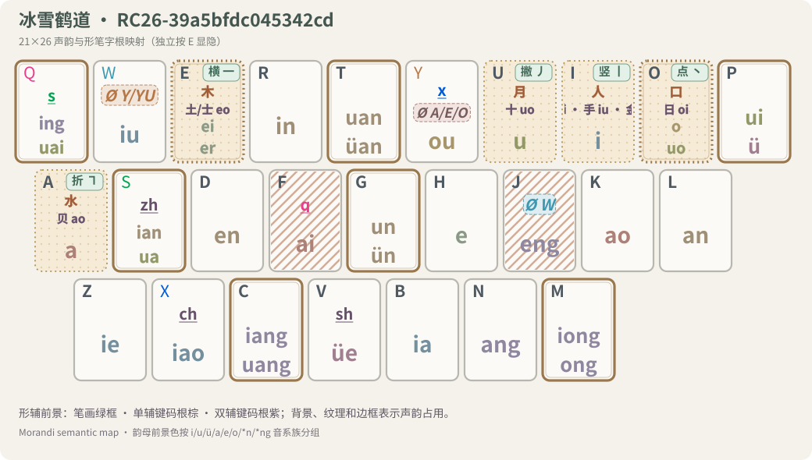

**日常八场景文稿纯双拼键频图（含标点）**

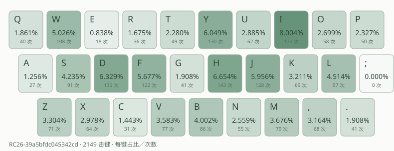

键频图由 benchmark 页面内置的 `r9MacroHeat` 从现行布局直接导出，使用 2149 击键的日常八场景文稿，只统计纯双拼与文稿标点，不含五辅键、空格和选重。

<!-- benchmark-heatmaps:shenyun-rc26 -->

**十一场景 5500 字最优路径全按键键频图**

按当前最优路径统计全部实际按键，包含辅码、Space、Shift、标点、词长直选与选重；每键显示次数及占总按键的百分比，颜色按本图最高键频归一化。第十篇与独立赛文按两个场景计入。

**冰雪鹤道（RC26-39a5bfdc045342cd 21×26）** · 9615 键；Space 395、Shift 158、选重 0。

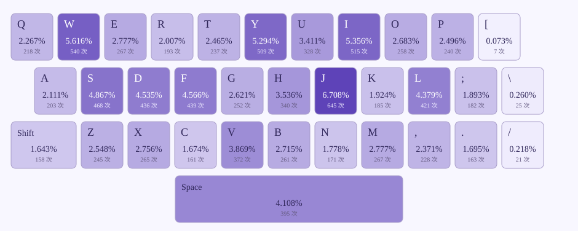

**冰雪鹤拼（RC26-39a5bfdc045342cd 21×26）** · 9684 键；Space 374、Shift 168、选重 0。

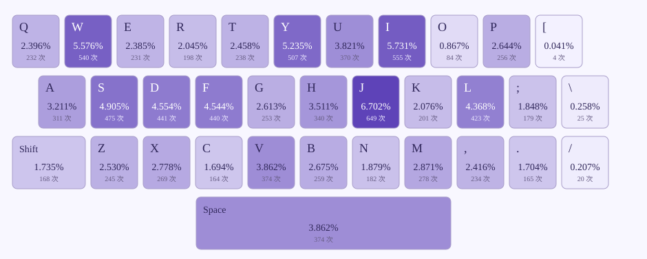

[十二方案完整热力图](reports/十一场景_5500字_当前十二方案对比评测.md#实际击键热力图) · [原始键频数据](reports/5500字_当前十二方案最优切分实测结果.json)

<!-- /benchmark-heatmaps -->

#### 声韵编码规则

声母及零声母载体使用下列首键：

| 声母／载体 | 首键 | 声母／载体 | 首键 | 声母／载体 | 首键 |
| --- | :---: | --- | :---: | --- | :---: |
| `b` | `B` | `p` | `P` | `m` | `M` |
| `f` | `F` | `d` | `D` | `t` | `T` |
| `n` | `N` | `l` | `L` | `g` | `G` |
| `k` | `K` | `h` | `H` | `j` | `J` |
| `q` | `F` | `x` | `Y` | `zh` | `S` |
| `ch` | `X` | `sh` | `V` | `r` | `R` |
| `z` | `Z` | `c` | `C` | `s` | `Q` |
| `A` | `Y` | `E` | `Y` | `O` | `Y` |
| `W` | `J` | `Y` | `W` | `YU` | `W` |

韵母使用下列次键；`v/van/ve/vn` 表示 ü 系：

| 韵母 | 次键 | 韵母 | 次键 | 韵母 | 次键 |
| --- | :---: | --- | :---: | --- | :---: |
| `a` | `A` | `ai` | `F` | `an` | `L` |
| `ang` | `N` | `ao` | `K` | `e` | `H` |
| `ei` | `E` | `en` | `D` | `eng` | `J` |
| `er` | `E` | `i` | `I` | `ia` | `B` |
| `ian` | `S` | `iang` | `C` | `iao` | `X` |
| `ie` | `Z` | `in` | `R` | `ing` | `Q` |
| `iong` | `M` | `iu` | `W` | `o` | `O` |
| `ong` | `M` | `ou` | `Y` | `u` | `U` |
| `ua` | `S` | `uai` | `Q` | `uan` | `T` |
| `uang` | `C` | `ui` | `P` | `un` | `G` |
| `uo` | `O` | `v` | `P` | `van` | `T` |
| `ve` | `V` | `vn` | `G` |  |  |

- [Common399](https://github.com/more-14-different/shuangpin-layout-benchmark/blob/main/README.md#common399) 的 399 个音节全部拥有唯一双拼码；静态 21×26 键域有 147 个空码。按当前系统词典的实际占用口径运行时有 142 个 `AU` 空码，其中 129 个为 `AA`、13 个为 `AB`。
- 单字主码为 `AU`。继续输入声母可进入 `AUA/AAA` 等词语路由，辅码只在相应阶段追加；二／三／四字词的方案专属辅序以上文 `12/12/24` 与 `12/21/13` 为准。
- 冰雪鹤道的形辅键为 `A/E/U/I/O = 折/横/撇/竖/点`；冰雪鹤拼的调辅键为 `I/E/U/A/O = 一/二/三/四/轻`。空码补字只查询系统词典，不受个人词频影响。

#### 英数入口

两个 21×26 方案共用同一套字母入口。21 个辅音字母通常使用“字母原键 + `n`”，其中 `D/J/X` 分别使用 `db/jm/xo`；五个元音字母使用 `x` 载体。入口只借用已有汉字候选的占用桶，不消耗空码；原汉字保持首选，大写、小写字母固定为第 2、3 候选。下表的“原首选”由当前冻结词典与映射计算，完整审计数据见 [字母桶配置](config/shenyun-21x26-letter-buckets.json)。

| 字母 | 输入码 | 原首选 | 字母 | 输入码 | 原首选 |
| --- | :---: | :---: | --- | :---: | :---: |
| A | `xq` | 踹 | N | `nn` | 囊 |
| B | `bn` | 帮 | O | `xi` | 吃 |
| C | `cn` | 藏 | P | `pn` | 胖 |
| D | `db` | 嗲 | Q | `qn` | 桑 |
| E | `xp` | 吹 | R | `rn` | 让 |
| F | `fn` | 放 | S | `sn` | 张 |
| G | `gn` | 刚 | T | `tn` | 躺 |
| H | `hn` | 行 | U | `xc` | 床 |
| I | `xf` | 拆 | V | `vn` | 上 |
| J | `jm` | 炅 | W | `wn` | 养 |
| K | `kn` | 扛 | X | `xo` | 戳 |
| L | `ln` | 狼 | Y | `yn` | 昂 |
| M | `mn` | 忙 | Z | `zn` | 脏 |

三套 21×26 方案的 0～10 数字固顶别名均已启用。优先复用对应汉字数字已有的最短固顶码；没有三码以内固顶时，使用该字的主码加第一形辅／调辅。已有汉字首选与字母第 2、3 位保持不变，数字追加在其后；不占用声声空桶。

| 数字 | 冰雪鹤道 | 冰雪鹤拼 | 冰雪鹮道 |
| --- | :---: | :---: | :---: |
| 零／0 | `lq` | `lq` | `wre` |
| 一／1 | `wie` | `wii` | `lz` |
| 二／2 | `yee` | `yea` | `rf` |
| 三／3 | `q` | `q` | `sm` |
| 四／4 | `qi` | `qi` | `sk` |
| 五／5 | `ju` | `ju` | `pu` |
| 六／6 | `lwo` | `lwa` | `wd` |
| 七／7 | `fie` | `fii` | `qz` |
| 八／8 | `bau` | `bai` | `bcu` |
| 九／9 | `jwu` | `jwu` | `jtu` |
| 十／10 | `viu` | `vie` | `vou` |

字母和数字均不侵占 `ABA` 的 `21×5×21=2205` 个状态，既有 `AAB`、`AAAB` 路由也保持不变。

### UED-3158ce08b5bc 21×21 双拼

冰雪兰道（`snow_jiandao`）与冰雪兰拼（`snow_sanpin`）现共用 [UED-3158ce08b5bc 21×21 布局](https://github.com/more-14-different/shuangpin-layout-benchmark/blob/main/research/notes/2026-11-21-u7e-pinky-r11-scores-UED-3158ce08b5bc.json)，仓库标识为 `UED-3158ce08b5bc`。布局指标为 M-R2 `41`、全声母／字母声母／传统声母／韵母乱序度 A/I/D/V `5/2/2/5`；按传统 21×21 原生路由与方案专属稳健辅序计分，CKT v5.1 `9.565504107623386`。

五辅语义保持“折横撇竖点→`AVUIO`、一二三四轻→`IVUAO`”，按形义序观察声调同为 `42310`。冰雪兰道的二／三／四字词形辅序为 `12/231/23`，冰雪兰拼的调辅序为 `12/213/23`；三字词保留完整三辅键路由，二字词与四字词共享四码主码候选竞争池。

**声母—韵母映射**

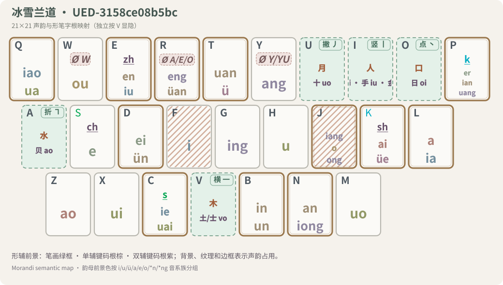

**日常八场景文稿纯双拼键频图（含标点）**

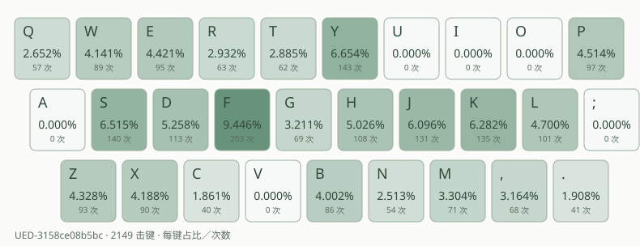

键频图由 benchmark 页面内置的 `r9MacroHeat` 从现行布局直接导出，使用 2149 击键的日常八场景文稿，只统计纯双拼与文稿标点，不含五辅键、空格和选重。

<!-- benchmark-heatmaps:shenyun-ued-3158ce08b5bc -->

**十一场景 5500 字最优路径全按键键频图**

按当前最优路径统计全部实际按键，包含辅码、Space、Shift、标点、词长直选与选重；每键显示次数及占总按键的百分比，颜色按本图最高键频归一化。第十篇与独立赛文按两个场景计入。

**冰雪兰道（UED-3158ce08b5bc 21×21）** · 9404 键；Space 343、Shift 259、选重 0。

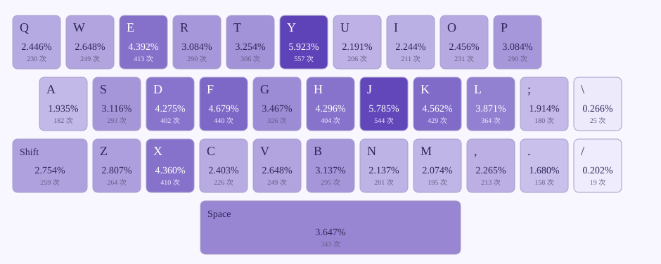

**冰雪兰拼（UED-3158ce08b5bc 21×21）** · 9471 键；Space 365、Shift 271、选重 0。

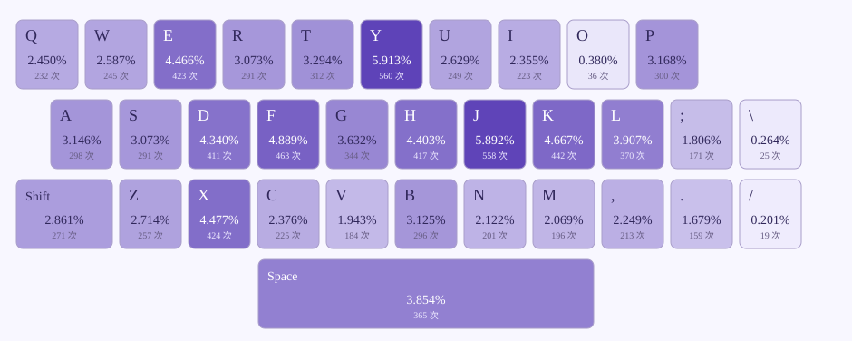

[十二方案完整热力图](reports/十一场景_5500字_当前十二方案对比评测.md#实际击键热力图) · [原始键频数据](reports/5500字_当前十二方案最优切分实测结果.json)

<!-- /benchmark-heatmaps -->

#### 声韵编码规则

声母及零声母载体使用下列首键：

| 声母／载体 | 首键 | 声母／载体 | 首键 | 声母／载体 | 首键 |
| --- | :---: | --- | :---: | --- | :---: |
| `b` | `B` | `p` | `P` | `m` | `M` |
| `f` | `F` | `d` | `D` | `t` | `T` |
| `n` | `N` | `l` | `L` | `g` | `G` |
| `k` | `P` | `h` | `H` | `j` | `J` |
| `q` | `Q` | `x` | `X` | `zh` | `E` |
| `ch` | `S` | `sh` | `K` | `r` | `R` |
| `z` | `Z` | `c` | `C` | `s` | `C` |
| `A` | `R` | `E` | `R` | `O` | `R` |
| `W` | `W` | `Y` | `Y` | `YU` | `Y` |

韵母使用下列次键；`v/van/ve/vn` 表示 ü 系：

| 韵母 | 次键 | 韵母 | 次键 | 韵母 | 次键 |
| --- | :---: | --- | :---: | --- | :---: |
| `a` | `L` | `ai` | `K` | `an` | `N` |
| `ang` | `Y` | `ao` | `Z` | `e` | `S` |
| `ei` | `D` | `en` | `E` | `eng` | `R` |
| `er` | `P` | `i` | `F` | `ia` | `L` |
| `ian` | `P` | `iang` | `J` | `iao` | `Q` |
| `ie` | `C` | `in` | `B` | `ing` | `G` |
| `iong` | `N` | `iu` | `E` | `o` | `J` |
| `ong` | `J` | `ou` | `W` | `u` | `H` |
| `ua` | `Q` | `uai` | `C` | `uan` | `T` |
| `uang` | `P` | `ui` | `X` | `un` | `B` |
| `uo` | `M` | `v` | `T` | `van` | `R` |
| `ve` | `K` | `vn` | `D` |  |  |

- [Common399](https://github.com/more-14-different/shuangpin-layout-benchmark/blob/main/README.md#common399) 形成 351 个唯一码和 48 个双音节重码桶，静态键域有 90 个空码；按当前系统词典的实际占用口径运行时有 87 个 `AA` 空码，包含保留码 `qz`、`zq`。
- 冰雪兰道使用形辅键 `A/V/U/I/O = 折/横/撇/竖/点`，冰雪兰拼使用调辅键 `I/V/U/A/O = 一/二/三/四/轻`；`j/q/x` 后的 ü 系按 `v/van/ve/vn` 统一编码。
- 两个方案的 630 固顶区都完整覆盖 630 个码位且词项不重复；大写补韵、动态空桶和多字词辅码按各方案文件中的现行规则运行。

#### 英数入口

冰雪兰道与冰雪兰拼共用字母基码：21 个辅音字母使用“字母原键 + `c`”，五个元音使用 `A=xw、I=xl、O=xd、U=xh、V=xg`。冰雪兰道直接使用基码，原汉字保持首选，大写、小写字母为第 2、3 候选；冰雪兰拼在基码后追加轻声键 `o`，大写、小写字母为第 1、2 候选。即使字母码与真实音节重合，固定候选顺序也保持不变。

数字与对应汉字共用码位；存在汉字候选时数字追加在其后，不占用额外空码。

| 数字 | 冰雪兰道 | 冰雪兰拼 |
| --- | :---: | :---: |
| 零／0 | `lgv` | `lgv` |
| 一／1 | `y` | `y` |
| 二／2 | `rp` | `rp` |
| 三／3 | `cn` | `cn` |
| 四／4 | `cfi` | `cfa` |
| 五／5 | `whv` | `whu` |
| 六／6 | `leo` | `lea` |
| 七／7 | `qfv` | `qfi` |
| 八／8 | `blu` | `bli` |
| 九／9 | `jeu` | `jeu` |
| 十／10 | `kfu` | `kfv` |

### 带调双拼：冰雪莲道与冰雪鹮道

冰雪莲道沿用冰雪兰道的主码路由、630 与大写补韵；冰雪鹮道沿用冰雪鹤道的四码顶、三键简拼与候选处理。两者都把声调融入第二码，随后只补键道形辅；二、三声同区，一声、轻声同区，并非五声各自完全分离。单字最多四辅，标准一至四字词最长六码。声声空桶按各自标准二字词辅序的反序，逐字取两辅至六码。

| 属性 | 冰雪鹮道 | 冰雪莲道 |
| --- | --- | --- |
| schema_id | `snow_zhudao` | `snow_jiandao_toned` |
| Layout ID | `T2126-V52-M4-ec60a3637a99` | `CR-REF-7e650f7a4c` |
| 宿主键域 | 21×26 | 21×21 |
| 声调位置 | 第二码内，不追加独立调辅 | 第二码内，不追加独立调辅 |
| 形辅序（二／三／四字） | `21/12/23` | `21/231/14` |
| 形义序（折横撇竖点） | `AEUIO` | `AVUIO` |
| 研究音节／占用桶／静态空桶 | 1407 / 526 / 20 | 1407 / 433 / 8 |
| 运行时可用声声空桶 | 14 | 7 |
| 记忆下限／守门 M-T1 | 18 / 21[^zh-benchmark-toned] | 21 / 24[^zh-benchmark-toned] |
| CKT v5.2 | 8.640932[^zh-benchmark-v52] | 9.132009[^zh-benchmark-v52] |
| 键位图 | [SVG](lua/snow/keymaps/snow_zhudao.svg) | [SVG](lua/snow/keymaps/snow_jiandao_toned.svg) |

#### 冰雪莲道 · CR-REF-7e650f7a4c

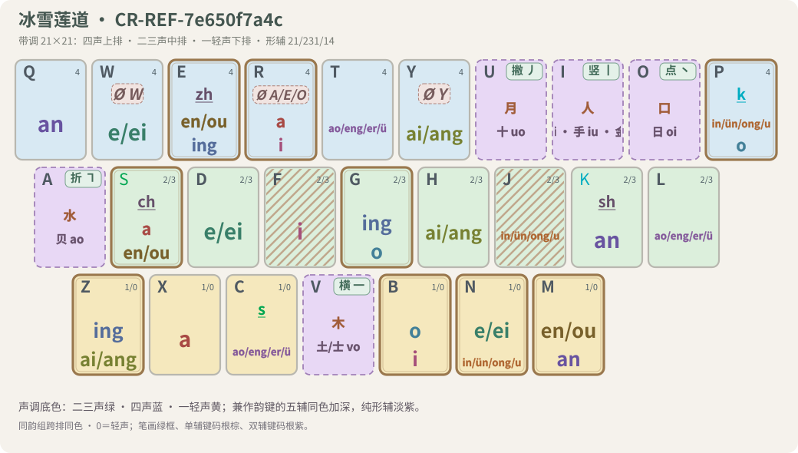

**日常八场景连续双拼键频图（含标点）**

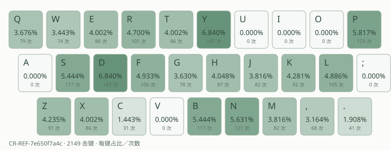

直接读取 benchmark 中同一篇 2149 击键日常文稿的带调主码键频；声调已合入第二码，不另计调键。不含后置形辅、空格与选重。

<!-- benchmark-heatmaps:liandao -->

**十一场景 5500 字最优路径全按键键频图**

按当前最优路径统计全部实际按键，包含辅码、Space、Shift、标点、词长直选与选重；每键显示次数及占总按键的百分比，颜色按本图最高键频归一化。第十篇与独立赛文按两个场景计入。

**冰雪莲道（CR-REF-7e650f7a4c 21×21 带调）** · 9437 键；Space 341、Shift 301、选重 0。

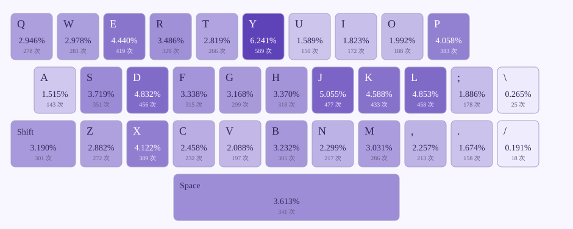

[十二方案完整热力图](reports/十一场景_5500字_当前十二方案对比评测.md#实际击键热力图) · [原始键频数据](reports/5500字_当前十二方案最优切分实测结果.json)

<!-- /benchmark-heatmaps -->

声母／零声母、输入示例、字母占用桶、固顶同码和运行时空桶规则见[冰雪莲道](docs/liandao.md)。研究音节域的静态空码与运行时声声空桶使用不同词典和口径，不能互相替代。配置是生成来源。

| 韵母组 | 4 声 | 2/3 声 | 1/5 声 |
| --- | --- | --- | --- |
| a / ia / ua | `R` | `S` | `X` |
| en / iou / ou / uen | `E` | `S` | `M` |
| ing | `E` | `G` | `Z` |
| ao / eng / er / iao / ueng / v | `T` | `L` | `C` |
| e / ei / ie / uei / ve | `W` | `D` | `N` |
| in / iong / ong / u / vn | `P` | `J` | `N` |
| io / o / uo | `P` | `G` | `B` |
| i | `R` | `F` | `B` |
| ai / ang / iang / uai / uang | `Y` | `H` | `Z` |
| an / ian / uan / van | `Q` | `K` | `M` |

#### 冰雪鹮道 · T2126-V52-M4-ec60a3637a99

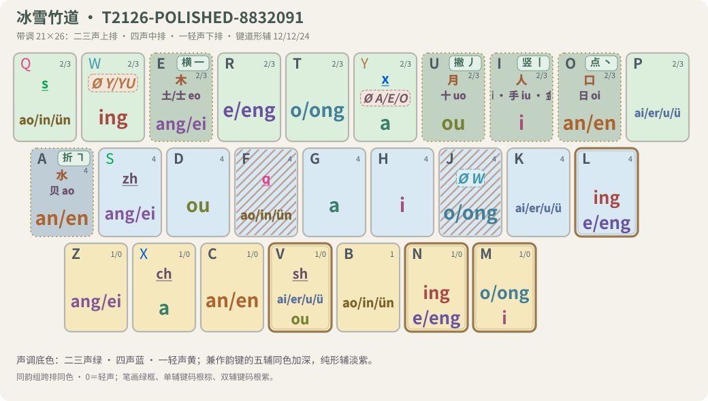

**日常八场景连续双拼键频图（含标点）**

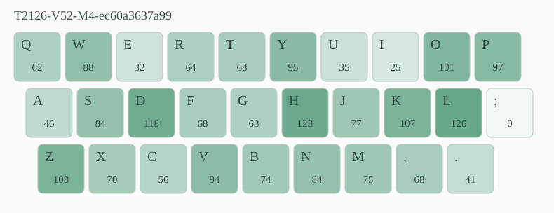

直接读取 benchmark 中同一篇 2149 击键日常文稿的带调主码键频；声调已合入第二码，不另计调键。不含后置形辅、空格与选重。

<!-- benchmark-heatmaps:zhudao -->

**十一场景 5500 字最优路径全按键键频图**

按当前最优路径统计全部实际按键，包含辅码、Space、Shift、标点、词长直选与选重；每键显示次数及占总按键的百分比，颜色按本图最高键频归一化。第十篇与独立赛文按两个场景计入。

**冰雪鹮道（T2126-V52-M4-ec60a3637a99 21×26 带调）** · 9598 键；Space 387、Shift 177、选重 0。

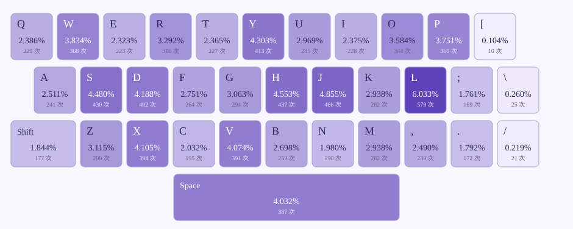

[十二方案完整热力图](reports/十一场景_5500字_当前十二方案对比评测.md#实际击键热力图) · [原始键频数据](reports/5500字_当前十二方案最优切分实测结果.json)

<!-- /benchmark-heatmaps -->

声母／零声母、输入示例、字母占用桶、固顶同码和运行时空桶规则见[冰雪鹮道](docs/zhudao.md)。研究音节域的静态空码与运行时声声空桶使用不同词典和口径，不能互相替代。配置是生成来源。

| 韵母组 | 2/3 声 | 4 声 | 1/5 声 |
| --- | --- | --- | --- |
| ie / e / ve | `W` | `J` | `N` |
| ao / iao | `Q` | `G` | `B` |
| ai / u / uai / v | `U` | `H` | `V` |
| ang / ei / uang / uei / iang | `E` | `S` | `X` |
| a / in / ong / er / ua / ia / iong / vn | `P` | `F` | `C` |
| an / ian / uan / van | `I` | `A` | `M` |
| en / uen | `Y` | `L` | `M` |
| i / o / uo / io | `O` | `K` | `Z` |
| ou / iou | `T` | `D` | `B` |
| eng / ing / ueng | `R` | `L` | `N` |

### 固顶、空桶与逐级简码

- 冰雪鹤道、冰雪鹤拼的现行 fixed 表各含 21 个一级简码、378 个二码单字、108 个二简词和 26 个字母入口；二简词只占不与单字音节冲突的码位，两个方案没有 630 区。
- 冰雪鹤道另有 1,648 个三级单字固顶，冰雪鹮道另有 2,022 个，均为两码主码加第一形辅，与短码固定单字不重复；参考四拼单字偏好，现有读音权重只作兜底，见[选字原则](docs/fixed-candidates.md)。
- 冰雪兰道、冰雪兰拼以 360 个二码单字和 81 个二简词完整覆盖 441 个 `AA` 位置。两方案的 630 区均由 105 个二码位与 525 个三码位组成，每码固定一个不重复词项。
- 冰雪兰道、冰雪兰拼及对应经典方案的大写字母用于三字及以上简拼补韵：前三字可写成 `A[U]A[U]A[U]`，第四字起只取声母；已有四个小写声母后，大写字母恢复为下一字声母。
- [二字词逐级排序研究](reports/sipin-bigram-ranking-research.md)覆盖 133,205 条可编码读音及 1,372 个二简／630 槽位。它作为候选常用度证据保留，不把“完整码已是首选”的词重复塞入短码。

### 现行双拼与原键道 [S005](https://pingshunhuangalex.gitbook.io/rime-xkjd/learn-xkjd/layouts)、[首道 B04](https://github.com/more-14-different/shuangpin-layout-benchmark/blob/main/README.md#探索阶段) benchmark

下表用当前 RC26-39a5bfdc045342cd 与 UED-3158ce08b5bc 直接替代 README 历史表中的 Overall-17 与 U357，并继续以同一冻结 payload 和原键道 [S005](https://pingshunhuangalex.gitbook.io/rime-xkjd/learn-xkjd/layouts)、[首道 B04](https://github.com/more-14-different/shuangpin-layout-benchmark/blob/main/README.md#探索阶段) 作参照。

无调除首道外评星；全部方案比较金牌；除首道外全部方案按排名标蓝色菱形（含无调与带调）。并列及可比性见表后图例和脚注。

| 指标 | 冰雪鹮道 T2126-V52-M4-ec60a3637a99 21×26 | 冰雪莲道 CR-REF-7e650f7a4c 21×21 | RC26-39a5bfdc045342cd 21×26 | UED-3158ce08b5bc 21×21 | 原键道 [S005](https://pingshunhuangalex.gitbook.io/rime-xkjd/learn-xkjd/layouts) | [首道 B04](https://github.com/more-14-different/shuangpin-layout-benchmark/blob/main/README.md#探索阶段) | 何为好 |
| --- | --- | --- | --- | --- | --- | --- | --- |
| M-R2 记忆项 | **18 / 21 (M-T1)**[^zh-benchmark-toned] 🔷 🥇 | **21 / 24 (M-T1)**[^zh-benchmark-toned] 🔹 | **40** ★★ | **41** ★ | 44 | 51 | 越低越好 |
| 全声母／字母声母／传统声母／韵母乱序度 A/I/D/V | 7 / 4 / 2 / 5[^zh-benchmark-toned] | 5 / 2 / 2 / 5[^zh-benchmark-toned] | **8 / 5 / 3 / 1** ★★ 🔷 | 5 / 2 / 2 / 5 | **3 / 0 / 0 / 4** ★★ 🔷 | 1 / 0 / 0 / 0 🥇 | A、I 为诊断；仍按 D+V 越低越好 |
| 飞键成分（声母／零声母组／韵母） | **0 / 0 / 0**[^zh-benchmark-toned] 🔷 🥇 | **0 / 0 / 0**[^zh-benchmark-toned] 🔷 🥇 | **0 / 0 / 0** ★★ 🔷 🥇 | **0 / 0 / 0** ★★ 🔷 🥇 | 2 / 0 / 1 | 0 / 1 / 7 | 越少越好 |
| [FA-1](https://github.com/more-14-different/shuangpin-layout-benchmark/blob/main/README.md#代表方案性能) 逻辑审计 | **100.000000**[^zh-benchmark-toned] 🔷 🥇 | **100.000000**[^zh-benchmark-toned] 🔷 🥇 | **98.999608** ★★ | **98.298315** ★ | 97.708694 | 99.763391 | 越高越一致 |
| [LU-v1r](https://github.com/more-14-different/shuangpin-layout-benchmark/blob/main/README.md#代表方案性能) 逻辑均匀度 | 76.196066[^zh-benchmark-toned] | 73.671261[^zh-benchmark-toned] | **83.470667** ★★ 🔷 🥇 | 74.087239 | **78.897555** ★ 🔹 | 83.107434 | 越高越统一 |
| [Common399](https://github.com/more-14-different/shuangpin-layout-benchmark/blob/main/README.md#common399) 唯一码／唯一率 | **526 / 37.385%**[^zh-benchmark-toned] 🔷 🥇 | **433 / 30.775%**[^zh-benchmark-toned] 🔹 | **399 / 100.000%** ★★ | 351 / 87.970% | **372 / 93.233%** ★ | 399 / 100.000% | 越高越好 |
| [Common399](https://github.com/more-14-different/shuangpin-layout-benchmark/blob/main/README.md#common399) 重码桶 | 420[^zh-benchmark-toned] | 392[^zh-benchmark-toned] | **0** ★★ 🔷 🥇 | 48 | **27** ★ 🔹 | 0 🥇 | 越低越好 |
| [Common399](https://github.com/more-14-different/shuangpin-layout-benchmark/blob/main/README.md#common399) 受影响音节／占比 | 1301 / 92.466%[^zh-benchmark-toned] | 1366 / 97.086%[^zh-benchmark-toned] | **0 / 0.000%** ★★ 🔷 🥇 | 96 / 24.060% | **54 / 13.534%** ★ 🔹 | 0 / 0.000% 🥇 | 越低越好 |
| 频率加权 S2 miss | 15.596%[^zh-benchmark-toned] | 17.994%[^zh-benchmark-toned] | **0.000%** ★★ 🔷 🥇 | 1.894% | **0.929%** ★ 🔹 | 0.000% 🥇 | 越低越好 |
| S2 补全平均码长 | 2.944921[^zh-benchmark-toned] | 3.126652[^zh-benchmark-toned] | **2.000000** ★★ 🔷 🥇 | 2.096813 | **2.072546** ★ 🔹 | 2.000000 🥇 | 越低越好 |
| S2 补全中心时间（ms） | 191.629[^zh-benchmark-toned] | 218.245[^zh-benchmark-toned] | **69.031** ★★ 🔷 🥇 | **84.118** ★ 🔹 | 90.257 | 79.890 | 越低越好 |
| S2 异键同指率 | 7.459%[^zh-benchmark-toned] | **4.736%**[^zh-benchmark-toned] 🔹 | **4.845%** ★ | **4.021%** ★★ 🔷 🥇 | 11.638% | 11.343% | 越低越好 |
| 综合补全 [CKT v3](https://github.com/more-14-different/shuangpin-layout-benchmark/blob/main/docs/POST_R11_EXPLORATION.md) | **8.602473**[^zh-benchmark-toned] 🔷 🥇 | **8.874945**[^zh-benchmark-toned] 🔹 | **9.570690** ★★ | **9.668465** ★ | 10.000000 | 9.461105 | 越低越好 |
| 综合补全 [CKT v4](https://github.com/more-14-different/shuangpin-layout-benchmark/blob/main/docs/CKT_v4_SPEC.md) | **8.679715**[^zh-benchmark-toned] 🔷 🥇 | 9.158204[^zh-benchmark-toned] | **9.062885** ★★ 🔹 | **9.564204** ★ | 10.000000 | 9.184607 | 越低越好 |
| 综合补全 CKT v5 | **8.619628**[^zh-benchmark-toned] 🔷 🥇 | 9.127910[^zh-benchmark-toned] | **9.072789** ★★ 🔹 | **9.562144** ★ | 10.000000 | 9.195422 | 越低越好 |
| 综合补全 CKT v5.1 | **8.628673**[^zh-benchmark-toned] 🔷 🥇 | 9.127012[^zh-benchmark-toned] | **9.082777** ★★ 🔹 | **9.565504** ★ | 9.999357 | 9.202834 | 越低越好 |
| [A7E-v3](https://github.com/more-14-different/shuangpin-layout-benchmark/blob/main/README.md#代表方案性能) 系综当量 | 10.777219[^zh-benchmark-toned] | 10.884939[^zh-benchmark-toned] | **10.587565** ★★ 🔷 | **10.730903** ★ 🔹 | 10.740028 | 10.519452 🥇 | 越低越好 |
| [A7E-v4](https://github.com/more-14-different/shuangpin-layout-benchmark/blob/main/README.md#代表方案性能) 系综当量 | 10.823787[^zh-benchmark-toned] | 10.944558[^zh-benchmark-toned] | **10.651302** ★★ 🔷 | **10.795932** ★ 🔹 | 10.805830 | 10.583290 🥇 | 越低越好 |
| [A7E-v5](https://github.com/more-14-different/shuangpin-layout-benchmark/blob/main/README.md#代表方案性能) 系综当量 | **10.163691**[^zh-benchmark-toned] 🔹 | **10.143940**[^zh-benchmark-toned] 🔷 🥇 | **10.203925** ★★ | **10.607833** ★ | 11.478960 | 11.091225 | 越低越好 |
| [A7E-v6-CW150](https://github.com/more-14-different/shuangpin-layout-benchmark/blob/main/README.md#代表方案性能) | **8.447277**[^zh-benchmark-toned] 🔷 🥇 | **8.646306**[^zh-benchmark-toned] 🔹 | **9.252817** ★★ | **9.647440** ★ | 10.000000 | 9.589632 | 越低越好 |
| 八轨综合选重率 | —[^zh-benchmark-missing] | —[^zh-benchmark-missing] | **0.622%** ★★ 🔷 | **1.227%** ★ 🔹 | 1.532% | 0.572% 🥇 | 越低越好 |
| 八轨第一辅键率 | —[^zh-benchmark-missing] | —[^zh-benchmark-missing] | **20.962%** ★★ 🔷 | **24.772%** ★ 🔹 | 26.413% | 19.746% 🥇 | 越低越好 |
| 八轨第二辅键率 | —[^zh-benchmark-missing] | —[^zh-benchmark-missing] | **4.489%** ★★ 🔷 | **6.303%** ★ 🔹 | 7.201% | 4.158% 🥇 | 越低越好 |
| 日常左右手负载／左手占比 | **1095:1054 / 50.954%**[^zh-benchmark-toned] 🔷 🥇 | 1199:950 / 55.793%[^zh-benchmark-toned] | **997:1152 / 46.394%** ★ | 1200:949 / 55.840% | **1121:1028 / 52.164%** ★★ 🔹 | 1004:1145 / 46.719% | 越接近 50% 越平衡 |
| 日常同手率 | **42.531%**[^zh-benchmark-toned] 🔹 | 46.719%[^zh-benchmark-toned] | **39.739%** ★★ 🔷 🥇 | 47.278% | **45.882%** ★ | 45.416% | 越低越好；非独立速度结论 |
| 日常平均有效距离 | **0.667001**[^zh-benchmark-toned] 🔹 | 0.758448[^zh-benchmark-toned] | **0.649234** ★★ 🔷 🥇 | 0.693857 | **0.679555** ★ | 0.701172 | 越低越好 |
| 20 合同 QAZ 左小指组峰值 | **11.808%**[^zh-benchmark-toned] 🔹 | **10.923%**[^zh-benchmark-toned] 🔷 🥇 | **16.967%** ★ | **16.717%** ★★ | 17.160% | 16.661% | 越低越好 |
| 20 合同 P 区右小指组峰值 | 7.125%[^zh-benchmark-toned] | 5.524%[^zh-benchmark-toned] | **3.150%** ★ 🔹 | 4.841% | **2.774%** ★★ 🔷 | 1.888% 🥇 | 越低越好 |
| 20 合同最大单指峰值 | **26.581%**[^zh-benchmark-toned] 🔷 🥇 | 27.929%[^zh-benchmark-toned] | 35.359% | **26.952%** ★★ 🔹 | **29.531%** ★ | 29.271% | 越低越好 |
| 日常纯双拼移动手分数（含标点） | 138.089[^zh-benchmark-toned] | 121.658[^zh-benchmark-toned] | **145.320** ★★ 🔷 🥇 | 134.318 | **138.672** ★ 🔹 | 135.310 | 越高越好 |
| S2 主键区占比 | 40.048%[^zh-benchmark-toned] | 41.069%[^zh-benchmark-toned] | 44.118% | **51.279%** ★★ 🔷 🥇 | **49.001%** ★ 🔹 | 36.600% | 越高越好 |
| 20 合同 TYB 双食指组峰值 | **10.828%**[^zh-benchmark-toned] 🔷 🥇 | 15.484%[^zh-benchmark-toned] | **12.012%** ★★ 🔹 | **14.281%** ★ | 14.733% | 12.358% | 越低越好 |
| 20 合同主键区下限 | 24.699%[^zh-benchmark-toned] | 28.399%[^zh-benchmark-toned] | **32.563%** ★ 🔹 | **36.536%** ★★ 🔷 🥇 | 30.815% | 24.243% | 越高越好 |
| 音节域大小（无调／带调） | 1407[^zh-benchmark-toned] | 1407[^zh-benchmark-toned] | 399 | 399 | 399 | 399 | 观察分布，不单独判优 |
| 静态空码（399／1407 音节域） | 20[^zh-benchmark-toned] | 8[^zh-benchmark-toned] | **147** ★★ 🔷 | **90** ★ 🔹 | 69 | 277 🥇 | 越高越好 |
| 综合补全 CKT v5.2[^zh-benchmark-v52] | **8.640932**[^zh-benchmark-toned] 🔷 🥇 | 9.132009[^zh-benchmark-toned] | **9.086538** ★★ 🔹 | **9.566359** ★ | 10.000000 | 9.208870 | 越低越好 |
| CKT v5.2 认知成本 ×2 | **8.234489**[^zh-benchmark-toned] 🔷 🥇 | **8.861456**[^zh-benchmark-toned] 🔹 | **9.043952** ★★ | **9.543307** ★ | 10.000000 | 9.120877 | 越低越好 |
| CKT v5.2 认知成本 ×3 | **7.961052**[^zh-benchmark-toned] 🔷 🥇 | **8.666715**[^zh-benchmark-toned] 🔹 | **9.039404** ★★ | **9.529308** ★ | 10.000000 | 9.082275 | 越低越好 |
| CKT v5.2 认知成本 ×5 | **7.598958**[^zh-benchmark-toned] 🔷 🥇 | **8.402959**[^zh-benchmark-toned] 🔹 | **9.051557** ★★ | **9.513962** ★ | 10.000000 | 9.048291 | 越低越好 |
| v5.2 加权运动耗时（ms） | **340.196**[^zh-benchmark-toned] 🔹 | 343.661[^zh-benchmark-toned] | **338.392** ★★ 🔷 🥇 | **347.023** ★ | 358.648 | 344.268 | 越低越好 |
| v5.2 加权认知耗时（ms） | **54.935**[^zh-benchmark-toned] 🔷 🥇 | 81.230[^zh-benchmark-toned] | **80.377** ★★ 🔹 | **98.621** ★ | 107.694 | 75.256 | 越低越好 |
| v5.2 加权有效耗时（ms） | **395.130**[^zh-benchmark-toned] 🔷 🥇 | 424.891[^zh-benchmark-toned] | **418.768** ★★ 🔹 | **445.644** ★ | 466.343 | 419.524 | 越低越好 |
| v5.2 第一辅键率 | **15.652%**[^zh-benchmark-toned] 🔷 🥇 | 21.376%[^zh-benchmark-toned] | **20.962%** ★★ 🔹 | **24.772%** ★ | 26.413% | 19.746% | 越低越好 |
| v5.2 第二辅键率 | **2.272%**[^zh-benchmark-toned] 🔷 🥇 | 4.608%[^zh-benchmark-toned] | **4.484%** ★★ 🔹 | **6.191%** ★ | 7.087% | 4.116% | 越低越好 |
| v5.2 第三辅键率 | **0.000%**[^zh-benchmark-toned] 🔷 🥇 | 0.666%[^zh-benchmark-toned] | **0.000%** ★★ 🔷 🥇 | **0.806%** ★ | 1.060% | 0.000% 🥇 | 越低越好 |
| v5.2 终局选重率 | **0.176%**[^zh-benchmark-toned] 🔷 🥇 | **0.193%**[^zh-benchmark-toned] 🔹 | 0.607% | **0.500%** ★★ | **0.604%** ★ | 0.553% | 越低越好 |
| v5.2 平均扫描排除候选数 | **0.002036**[^zh-benchmark-toned] 🔷 🥇 | **0.002364**[^zh-benchmark-toned] 🔹 | 0.007806 | **0.006292** ★★ | **0.007673** ★ | 0.007006 | 越低越好 |
| v5.2 平均翻页次数 | **0.000000**[^zh-benchmark-toned] 🔷 🥇 | 0.000007[^zh-benchmark-toned] | 0.000019 | **0.000007** ★★ 🔹 | **0.000011** ★ | 0.000009 | 越低越好 |
| v5.2 平均编码按键数 | **3.761028**[^zh-benchmark-toned] 🔷 🥇 | **3.766503**[^zh-benchmark-toned] 🔹 | **3.841567** ★ | **3.817685** ★★ | 3.845605 | 3.816075 | 越低越好 |
| v5.2 单倍成本点最优（非生产辅序） | 未重选辅序[^zh-benchmark-missing] | 未重选辅序[^zh-benchmark-missing] | 未重选辅序[^zh-benchmark-missing] | **9.566342** ★★ 🔷 🥇 | 未重选辅序[^zh-benchmark-missing] | 未重选辅序[^zh-benchmark-missing] | 越低越好 |
| v5.2 加倍成本点最优（非生产辅序） | 未重选辅序[^zh-benchmark-missing] | 未重选辅序[^zh-benchmark-missing] | 未重选辅序[^zh-benchmark-missing] | **9.543307** ★★ 🔷 🥇 | 未重选辅序[^zh-benchmark-missing] | 未重选辅序[^zh-benchmark-missing] | 越低越好 |
| v5.2 终局主键区占比 | 39.923%[^zh-benchmark-toned] | 40.747%[^zh-benchmark-toned] | 42.817% | **44.534%** ★ 🔹 | **44.760%** ★★ 🔷 🥇 | 36.394% | 越高越好 |
| v5.2 终局上排占比 | 33.792%[^zh-benchmark-toned] | 35.711%[^zh-benchmark-toned] | 36.063% | 33.333% | 32.858% | 40.950% | 观察分布，不单独判优 |
| v5.2 终局下排占比 | 26.285%[^zh-benchmark-toned] | 23.542%[^zh-benchmark-toned] | 21.120% | 22.133% | 22.382% | 22.656% | 观察分布，不单独判优 |
| v5.2 终局左小指负载 | 8.758%[^zh-benchmark-toned] | **7.670%**[^zh-benchmark-toned] 🔷 🥇 | **7.968%** ★★ 🔹 | **8.484%** ★ | 9.785% | 8.520% | 越低越好 |
| v5.2 终局右小指负载 | 4.485%[^zh-benchmark-toned] | 4.302%[^zh-benchmark-toned] | **2.507%** ★ 🔹 | 3.897% | **2.004%** ★★ 🔷 | 1.539% 🥇 | 越低越好 |
| v5.2 终局最大单指负载 | **24.081%**[^zh-benchmark-toned] 🔷 🥇 | **25.575%**[^zh-benchmark-toned] 🔹 | 27.997% | **25.783%** ★★ | **26.453%** ★ | 27.032% | 越低越好 |
| v5.2 终局左手占比 | **54.962%**[^zh-benchmark-toned] 🔹 | 55.914%[^zh-benchmark-toned] | **53.711%** ★★ 🔷 🥇 | **56.630%** ★ | 57.638% | 53.750% | 越接近 50% 越平衡 |
| v5.2 终局异键同指率 | 9.439%[^zh-benchmark-toned] | **9.305%**[^zh-benchmark-toned] 🔹 | **9.326%** ★ | **8.796%** ★★ 🔷 🥇 | 10.536% | 10.581% | 越低越好 |
| v5.2 终局同指率 | 13.159%[^zh-benchmark-toned] | 13.643%[^zh-benchmark-toned] | **13.003%** ★ 🔹 | **12.914%** ★★ 🔷 🥇 | 16.442% | 15.933% | 越低越好 |
| v5.2 终局同手率 | **47.242%**[^zh-benchmark-toned] 🔹 | 48.524%[^zh-benchmark-toned] | **43.199%** ★★ 🔷 🥇 | **47.893%** ★ | 49.134% | 47.045% | 越低越好 |
| v5.2 终局交替率 | **52.758%**[^zh-benchmark-toned] 🔹 | 51.476%[^zh-benchmark-toned] | **56.801%** ★★ 🔷 🥇 | **52.107%** ★ | 50.866% | 52.955% | 越高越好 |
| 带调原生四轨主键区下限 | **35.185%**[^zh-benchmark-toned] 🔹 | **38.229%**[^zh-benchmark-toned] 🔷 🥇 | 不适用[^zh-benchmark-missing] | 不适用[^zh-benchmark-missing] | 不适用[^zh-benchmark-missing] | 不适用[^zh-benchmark-missing] | 越高越好 |
| 带调原生四轨左小指峰值 | **10.080%**[^zh-benchmark-toned] 🔹 | **9.032%**[^zh-benchmark-toned] 🔷 🥇 | 不适用[^zh-benchmark-missing] | 不适用[^zh-benchmark-missing] | 不适用[^zh-benchmark-missing] | 不适用[^zh-benchmark-missing] | 越低越好 |
| 带调原生四轨右小指峰值 | **5.095%**[^zh-benchmark-toned] 🔷 🥇 | **5.331%**[^zh-benchmark-toned] 🔹 | 不适用[^zh-benchmark-missing] | 不适用[^zh-benchmark-missing] | 不适用[^zh-benchmark-missing] | 不适用[^zh-benchmark-missing] | 越低越好 |
| 带调原生四轨最大单指峰值 | **26.946%**[^zh-benchmark-toned] 🔷 🥇 | **27.830%**[^zh-benchmark-toned] 🔹 | 不适用[^zh-benchmark-missing] | 不适用[^zh-benchmark-missing] | 不适用[^zh-benchmark-missing] | 不适用[^zh-benchmark-missing] | 越低越好 |
| 带调原生四轨 TYB 峰值 | **13.414%**[^zh-benchmark-toned] 🔷 🥇 | **15.468%**[^zh-benchmark-toned] 🔹 | 不适用[^zh-benchmark-missing] | 不适用[^zh-benchmark-missing] | 不适用[^zh-benchmark-missing] | 不适用[^zh-benchmark-missing] | 越低越好 |
| 四码五截面平均跨词长受影响率 | **4.066%**[^zh-benchmark-toned] 🔷 🥇 | 6.399%[^zh-benchmark-toned] | **5.428%** ★★ 🔹 | —[^zh-benchmark-missing] | —[^zh-benchmark-missing] | —[^zh-benchmark-missing] | 越低越好 |
| 四码五截面平均跨词长首选损失率 | **1.244%**[^zh-benchmark-toned] 🔷 🥇 | 2.002%[^zh-benchmark-toned] | **1.884%** ★★ 🔹 | —[^zh-benchmark-missing] | —[^zh-benchmark-missing] | —[^zh-benchmark-missing] | 越低越好 |

★★／★：仅在本表全部无调方案中评价，[首道 B04](https://github.com/more-14-different/shuangpin-layout-benchmark/blob/main/README.md#探索阶段) 除外，分别标记第一／第二名；🔷／🔹：比较本表除[首道 B04](https://github.com/more-14-different/shuangpin-layout-benchmark/blob/main/README.md#探索阶段) 外的全部方案，分别标记第一／第二名，无调与带调均可获标；🥇：比较本表所有有效数值的方案（含首道与带调）。三个范围独立，可同时标记；并列采用竞赛排名，缺测／不适用不参评，分布说明项不判优。跨合同排名比较所列模型值，边界见脚注。

[^zh-benchmark-toned]: 带调列为页面原列公式的带调适配：声调在双拼主码内贡献，后置只有纯形笔辅；无调列是形辅／调辅两个成员的八轨系综，带调 v5～v5.2 是形辅四轨，词长权重均为 1:3:1:1。数值可以观察任务成本与取舍，不能作为相同编码合同下的布局或辅码消融排名。记忆项为 M-T1 下限／守门，与 M-R2 定义不同；A/I/D/V 均按实际键集是否为同名字母单键统计：D 计 18 个传统单字母声母，I 再纳入 W/Y，A 再纳入 A/E/O；带调 V 计任一合法声调的普通元音偏移。A/I 仅诊断，仍按 D+V 排名。[Common399](https://github.com/more-14-different/shuangpin-layout-benchmark/blob/main/README.md#common399) 对应列在带调方案中改用实际 1407 带调音节，『唯一码』指占用码位而非无碰撞音节数，分母与碰撞数不能直接横比。FA/LU、S2、A7E 与 20 合同负载均使用页面的带调适配；主码已包含的声调不重复击键，S2 补全使用各自五键枚举后缀，时间列的带调值为页面 sound.upperMs。[CKT v3](https://github.com/more-14-different/shuangpin-layout-benchmark/blob/main/docs/POST_R11_EXPLORATION.md)/v4 使用页面 τ=600、首辅=300、次辅=300 ms 的适配八轨，v5 以后使用原生纯形四轨；20 合同负载与原生四轨终局负载分别列示。

[^zh-benchmark-missing]: 当前 v5.2 默认、×2／×3／×5、分轨耗时、前三辅率、选重及终局负载已覆盖全部八列：六个无调布局使用同一冻结语料和错误模型复算，两套带调布局使用其原生形辅四轨。[S005](https://pingshunhuangalex.gitbook.io/rime-xkjd/learn-xkjd/layouts) 的 v5.2 行是页面参考辅序（形 12/213/24、调 12/213/23），旧版行保留各自历史辅序。『不适用』表示不存在该生产合同（例如无调方案的带调原生四轨属性）；『未重选辅序』表示未另外搜索该方案的成本点最优值，不能用生产稳健辅序分数代填；其余『—』为来源未发布的审计量。以上均不等于 0，不参评。

[^zh-benchmark-v52]: CKT v5.2 保留 v5.1 的主码、辅序、候选池及词长权重，对长码采用分块成功／错误成本；认知成本 ×2／×3／×5 时同时缩放候选与同模式 [S005](https://pingshunhuangalex.gitbook.io/rime-xkjd/learn-xkjd/layouts) 参考的全部认知项，保留运动项及生产辅序，再逐轨取四次幂均值。[S005](https://pingshunhuangalex.gitbook.io/rime-xkjd/learn-xkjd/layouts) v5.2 归一化为 10；不是实际用户输入速度或 5000 字实测码长。

#### 完整测评报告

现行与历史布局的可复算比较见 [当前四布局／六生产方案与历史布局追加报告](reports/shenyun-comparison.md)。

当前校正后的测评：[5500 字十二方案与 11 个场景回放](reports/十一场景_5500字_当前十二方案对比评测.md)、[原 5000 字十二方案](reports/十篇五百字_当前十二方案最优切分及字词比率报告.md)。以下旧版测评仅保留在 Git 历史。

- [500 字冰雪十二方案实战测评](https://github.com/ChenZhu-Xie/rime-snow-pinyin/blob/362a041eb357b926fc0c2655e12351a19bddbd14/reports/冰雪十二方案_500字_最短键码实战测评.txt)
- [5000 字冰雪十二方案全量报告](https://github.com/ChenZhu-Xie/rime-snow-pinyin/blob/362a041eb357b926fc0c2655e12351a19bddbd14/reports/十篇五百字_十二方案最优切分及字词比率报告.md)
- [5000 字十三方案报告（加入声笔小鹤）](https://github.com/ChenZhu-Xie/rime-snow-pinyin/blob/362a041eb357b926fc0c2655e12351a19bddbd14/reports/十篇五百字_十三方案最优切分及字词比率报告.md)
- [5000 字十四方案报告（再加入小鹤音形）](https://github.com/ChenZhu-Xie/rime-snow-pinyin/blob/362a041eb357b926fc0c2655e12351a19bddbd14/reports/十篇五百字_十四方案最优切分及字词比率报告.md)

### 快捷键

以下集中列出方案层快捷键；公共编辑与翻页键由各方案继承，历史和方案固定词等功能只在加载相应模块的方案中出现。

#### 候选选择与翻页

| 功能 | 快捷键 |
| --- | --- |
| 确认当前高亮候选 | `Space` |
| 四主码阶段选择四字词首选 | `Shift+,`，即 `<`／《 |
| 四主码阶段按词长优先选择 | `Shift+.`，即 `>`／》；21×21 为五字及以上优先、二字兜底，21×26 为三字优先、五字及以上兜底 |
| 选择当前页第 2～6 候选 | `2 / 3 / 8 / 9 / 0` |
| 上移/下移一个候选 | `Up` / `Down`，或 `Ctrl+K` / `Ctrl+J` |
| 上移/下移两个候选 | `Ctrl+H` / `Ctrl+L` |
| 下一页 | `Tab`、`Ctrl+,` 或 `Page_Down` |
| 上一页 | `Ctrl+M` 或 `Page_Up`；翻页后也可用 `Shift+Tab` |

上述词长直选适用于八套双拼方案，补韵大写不计主码、补辅后仍可用；续写第五字后恢复书名号。21×26 同时支持四声母长词补全与大写续写长词，编码与完整边界见[四主码词长直选](docs/word-length-selection.md)。

#### 输入码编辑与定位

| 功能 | 快捷键 |
| --- | --- |
| 光标左移/右移一位 | `Left` / `Right` |
| 光标移到输入码开头/末尾 | `Home` / `End`，或 `Ctrl+N` / `Ctrl+E` |
| 从输入码开头右移两位 | `Ctrl+P`（`Home → Right → Right`） |
| 输入码物理左移/右移一位并在边界循环 | `Ctrl+Y` / `Ctrl+O` |
| 上一个/下一个逻辑字位或音节 | `Ctrl+U` / `Ctrl+I` |
| 定位或推进到第 1～4 字位/输入末尾 | `1 / 4 / 5 / 6 / 7` |
| 撤销最近一次选词，否则删除光标前一个输入码 | `BackSpace` |
| 回退一个音节 | `Ctrl+BackSpace` |
| 删除光标后的输入码 | `Delete` 或 `Ctrl+D` |
| 清空当前输入 | `Escape` |
| 以词定字：上屏当前多字候选的首字/末字 | `[` / `]` |

#### 上屏方式

| 功能 | 快捷键 |
| --- | --- |
| 上屏原始输入码 | `Enter` |
| 上屏转换后的脚本文本 | `Ctrl+Enter` |
| 上屏当前候选的注释 | `Ctrl+Shift+Enter` |
| 上屏当前首选并切换中/西文 | 单击左/右 `Shift`；右 `Shift` 与上游相同，左 `Shift` 相比上游由行内临时英文改为此功能，因而多了一个首选上屏入口 |

#### 输入模式与方案开关

| 功能 | 快捷键 |
| --- | --- |
| 切换结束/缓冲 | 所有方案用 `Ctrl+B`；除冰雪清韵、冰雪一拼外，也可输入 `o` 后选择「开启缓冲」或「关闭缓冲」；冰雪一拼的 `jio` 并击等效于 `Ctrl+B` |
| 可筛选方案菜单 | `F4` 或 `Ctrl+反引号`；输入 `ld` 同时显示冰雪兰道和冰雪莲道，输入 `dtld` 单独定位冰雪莲道，输入 `hd` 同时显示冰雪鹤道和冰雪鹮道，输入 `dthd` 单独定位冰雪鹮道。仅允许切换当前 `schema_list` 中已启用并部署的方案；未启用的方案仍显示名称与提示，旧编译文件不会使其重新可选 |
| 切换到下一个输入方案 | `Ctrl+Shift+1` |
| 切换中/西文 | `Ctrl+Shift+2` |
| 切换半角/全角 | `Ctrl+Shift+3` |
| 切换简体/繁体 | `Ctrl+Shift+4` |
| 切换中文/西文标点 | `Ctrl+Shift+5` |
| 显示/隐藏拆分提示 | `Ctrl+S`（冰雪兰道、冰雪键道、冰雪清韵） |

#### 历史、删词与方案固定词

| 功能 | 快捷键 |
| --- | --- |
| 在历史面板选择第 2～6 项 | `Ctrl+2/3/8/9/0` |
| 删除高亮的普通 Rime 用户词 | `Ctrl+Delete` |
| 固定/取消固定当前候选 | `Ctrl+/` |
| 开始手动加词；再次按下完成添加 | 所有方案使用 `Ctrl+.`；进入后方案状态显示「加词中」，过程中可按 `Escape` 取消 |
| 将已固定候选上移/下移一位 | `Ctrl+[` / `Ctrl+]` |
| 重置当前编码下的方案固定候选 | `Ctrl+\` |

普通 Rime 用户词和方案固定词是两套机制：前者使用 `Ctrl+Delete` 删除；通过 `Ctrl+.` 手动加入的方案固定词，选中后使用 `Ctrl+/` 取消或禁用。静态 YAML 词典中的正式词条不能通过快捷键删除。

手动加词是两段式操作：先输入以后用于查询新词的目标编码并按 `Ctrl+.`，再正常输入且上屏新词的全部文字，最后再次按 `Ctrl+.` 保存；第一下不是把当前候选直接加入词典，最后一段文字也须先上屏。

#### 方案专属编码键（含大写）

这些键属于编码规则而非 `Ctrl` 类快捷键，但会直接影响前四码内大写字母的含义，故与快捷键并列说明。

| 方案 | 大写字母在前四码附近的含义 |
| --- | --- |
| 冰雪四拼 | 保留结构略码：候选少于四字、当前输入尚未达到四个连续小写码时，`A/D/L/B/F/R/U/K/J/P/N/G/E/T/Y/I/O/W/Q` 等键可直接生成叠词或插字结构；达到四个小写码后，大写声母转为继续编码。 |
| 冰雪兰拼 | 不作结构略码。前三个声母后的大写字母用于补该字韵母；第四字起只取声母，已有四个小写声母后，大写字母作为下一字声母继续编码。 |
| 冰雪兰道 | 与冰雪兰拼相同：大写用于三字及以上简拼补韵，不作结构略码。 |
| 冰雪三拼 | 与冰雪兰拼功能相同，但按经典双拼布局解释大写韵键。 |
| 冰雪键道 | 与冰雪兰道功能相同，但按经典双拼布局解释大写韵键。 |
| 冰雪清韵 | 不作结构略码。大写声母或韵键用于四码后的继续编码及回头补码，随后按对应小写编码处理。 |

### 研究报告与审计资料

[`reports/`](reports/) 集中保存布局评测、固顶证据与功能审计，便于复核正文中的结论：

- [固顶候选语料摘要](reports/fixed-corpus-summary.md)：公开候选来源、独立家族、缺失来源和关注词覆盖情况。
- [神韵与原冰雪键道双拼碰撞对比](reports/shenyun-collision-comparison.md)：按 Top 500～全量比较二字内部、四字内部及跨词长碰撞。
- [神韵 R9 与原键道碰撞解读及双拼设计启发](reports/shenyun-collision-design-notes.md)：解释碰撞数据的取舍、结构原因和布局设计启发。
- [神韵 R9 固顶受约束选优报告](reports/shenyun-fixed-optimization.md)：记录二简、AA 单字、三拼/键道 630 和去冗余约束。
- [神韵四方案公平对比](reports/shenyun-comparison.md)：与 [S005](https://pingshunhuangalex.gitbook.io/rime-xkjd/learn-xkjd/layouts)、[B04](https://github.com/more-14-different/shuangpin-layout-benchmark/blob/main/README.md#探索阶段) 的现行 [CKT v4](https://github.com/more-14-different/shuangpin-layout-benchmark/blob/main/docs/CKT_v4_SPEC.md)、人体工学及八轨非首选率比较。
- [神韵四方案公平对比原始 JSON](reports/shenyun-comparison.json)：上述现行对比的机器可复核数据。
- [神韵 R9 公平对比](reports/shenyun-r9-comparison.md)：与 [S005](https://pingshunhuangalex.gitbook.io/rime-xkjd/learn-xkjd/layouts)、[B04](https://github.com/more-14-different/shuangpin-layout-benchmark/blob/main/README.md#探索阶段) 的历史 Benchmark 指标、分场景结果和边界说明。
- [神韵 R9 公平对比原始 JSON](reports/shenyun-r9-comparison.json)：上述对比的机器可复核数据快照。
- [当前方案快捷键审计与上游对照](reports/shortcut-audit.md)：七套方案的共享、专属及相对上游变化的快捷键。
- [四拼二字词逐级排序对神韵固顶的参考调研](reports/sipin-bigram-ranking-research.md)：以四拼逐级候选名次为键道、三拼固顶提供有限旁证，不把四拼视为 R9 的组成部分。
- [冰雪八方案 500 字最短键码实战测评](https://github.com/ChenZhu-Xie/rime-snow-pinyin/blob/362a041eb357b926fc0c2655e12351a19bddbd14/reports/冰雪八方案_500字_最短键码实战测评.txt)：同一篇 500 字赛文下八条仓库内可复算轨的实际按键比较，包含冰雪四拼与冰雪清韵；两条含已知错误的外部冻结轨不再导入或排名。
- [十方案 5000 字最优切分报告](https://github.com/ChenZhu-Xie/rime-snow-pinyin/blob/362a041eb357b926fc0c2655e12351a19bddbd14/reports/十篇五百字_十方案最优切分及字词比率报告.md)（[原始 JSON](https://github.com/ChenZhu-Xie/rime-snow-pinyin/blob/362a041eb357b926fc0c2655e12351a19bddbd14/reports/5000字_十方案最优切分实测结果.json)、[逐篇十轨回放](https://github.com/ChenZhu-Xie/rime-snow-pinyin/tree/362a041eb357b926fc0c2655e12351a19bddbd14/reports/十篇五百字_十方案逐键对齐回放/)、[十轨汇编](https://github.com/ChenZhu-Xie/rime-snow-pinyin/blob/362a041eb357b926fc0c2655e12351a19bddbd14/reports/十篇五百字_5000字_十方案最优切分实战测评对齐汇编.txt)）：在冰雪八方案同一基线上加入外部声笔小鹤与小鹤音形，分别使用自己的发布词库、编码规则和空白用户数据；这四项保留该次历史成果，六、八、九方案报告及单方案回放仅为生成链中的子集。

### 关于词库的说明

[冰雪拼音](https://input.tansongchen.com)词库收词范围与[雾凇拼音](https://github.com/iDvel/rime-ice)相同。其特点为：

1. 大词库：与[雾凇拼音](https://github.com/iDvel/rime-ice)共享 180 万词库
2. 持续更新：上游[雾凇拼音](https://github.com/iDvel/rime-ice)更新后，本仓库也会随之更新
3. 单字读音遵循《通用规范汉字字典》规范
4. 词语读音尽可能使用单字已有的读音，便于自动造词。这意味着
    - 不考虑因弱化产生的轻声，如「知识」为 `zhī shí`，不为 `zhī shi`
    - 不考虑连读变调，如「一个」为 `yī gè`，不为 `yí gè`
    - 部分专有名词中的专用音允许例外，例如「冒顿」可以是 `mò dú`

---

## English

Recipe: ℞ **snow-pinyin**

[Snow Pinyin](https://input.tansongchen.com) is a family of Mandarin-based Chinese input methods. It combines phonetic information, discrete optimization, top-up coding, and adaptive learning for natural, efficient, and personalized input. The release includes [Snow Four-Code](https://input.tansongchen.com/snow4/), [冰雪兰拼](https://input.tansongchen.com/snow3/), [Snow One-Code](https://input.tansongchen.com/snow1/), [冰雪兰道](https://input.tansongchen.com/snow-jiandao/), [Snow Qingyun](https://input.tansongchen.com/snow-qingyun/), [冰雪鹤道](snow_shenyun_shape.schema.yaml), [冰雪鹤拼](snow_shenyun_tone.schema.yaml), and the classic [冰雪键道](snow_jiandao_classic.schema.yaml) and [冰雪三拼](snow_sanpin_classic.schema.yaml).

### RC26-39a5bfdc045342cd 21×26 double pinyin

冰雪鹤道 ([`snow_shenyun_shape`](snow_shenyun_shape.schema.yaml)) and 冰雪鹤拼 ([`snow_shenyun_tone`](snow_shenyun_tone.schema.yaml)) now share the [RC26-39a5bfdc045342cd 21×26 layout](https://github.com/more-14-different/shuangpin-layout-benchmark/blob/main/research/notes/2026-11-09-rc26-ckt-v51-soft-balance-aux-order-robustness.md), identified in this repository as `RC26-39a5bfdc045342cd`. It has no [Common399](https://github.com/more-14-different/shuangpin-layout-benchmark/blob/main/README.md#common399) syllable collisions, M-R2 `40`, and all/written/traditional-initial/final disorder A/I/D/V `8/5/3/1`. Under the native 21×26 four-code-top contract, cross-length candidate pool, and `soft-page-fill-v2`, its scheme-specific robust score is CKT v5.1 `9.082777229838413`.

The five auxiliary semantics remain bend/horizontal/left-falling/vertical/dot→`AEUIO` and tones 1/2/3/4/neutral→`IEUAO`, yielding `42310` in shape-meaning order. 冰雪鹤道 uses shape order `12/12/24` and 冰雪鹤拼 uses tone order `12/21/13` for two-/three-/four-character words.

**Initial–final mapping**

**Pure-double-pinyin key-frequency map over the daily eight-scenario corpus (punctuation included)**

The map is exported directly from the current layout through the benchmark page's built-in `r9MacroHeat`. It uses the 2,149-keystroke daily eight-scenario corpus and includes only double-pinyin keys and corpus punctuation, excluding auxiliaries, spaces, and candidate selection.

<!-- benchmark-heatmaps:shenyun-rc26 -->

**All-key frequency maps over eleven scenarios and 5,500 Chinese characters**

Actual optimal-path keystrokes include auxiliaries, Space, Shift, punctuation and selection. Each key shows its count and share of all keystrokes; colors are normalized within each map. Article 10 is also counted as the standalone scenario.

**冰雪鹤道（RC26-39a5bfdc045342cd 21×26）** · 9615 keys; Space 395, Shift 158, selections 0.

**冰雪鹤拼（RC26-39a5bfdc045342cd 21×26）** · 9684 keys; Space 374, Shift 168, selections 0.

[All twelve schemes](reports/十一场景_5500字_当前十二方案对比评测.md#实际击键热力图) · [Raw key counts](reports/5500字_当前十二方案最优切分实测结果.json)

<!-- /benchmark-heatmaps -->

#### Initial and final coding rules

Initials and zero-initial carriers use these first keys:

| Initial/carrier | First key | Initial/carrier | First key | Initial/carrier | First key |
| --- | :---: | --- | :---: | --- | :---: |
| `b` | `B` | `p` | `P` | `m` | `M` |
| `f` | `F` | `d` | `D` | `t` | `T` |
| `n` | `N` | `l` | `L` | `g` | `G` |
| `k` | `K` | `h` | `H` | `j` | `J` |
| `q` | `F` | `x` | `Y` | `zh` | `S` |
| `ch` | `X` | `sh` | `V` | `r` | `R` |
| `z` | `Z` | `c` | `C` | `s` | `Q` |
| `A` | `Y` | `E` | `Y` | `O` | `Y` |
| `W` | `J` | `Y` | `W` | `YU` | `W` |

Finals use these second keys; `v/van/ve/vn` denote the ü series:

| Final | Second key | Final | Second key | Final | Second key |
| --- | :---: | --- | :---: | --- | :---: |
| `a` | `A` | `ai` | `F` | `an` | `L` |
| `ang` | `N` | `ao` | `K` | `e` | `H` |
| `ei` | `E` | `en` | `D` | `eng` | `J` |
| `er` | `E` | `i` | `I` | `ia` | `B` |
| `ian` | `S` | `iang` | `C` | `iao` | `X` |
| `ie` | `Z` | `in` | `R` | `ing` | `Q` |
| `iong` | `M` | `iu` | `W` | `o` | `O` |
| `ong` | `M` | `ou` | `Y` | `u` | `U` |
| `ua` | `S` | `uai` | `Q` | `uan` | `T` |
| `uang` | `C` | `ui` | `P` | `un` | `G` |
| `uo` | `O` | `v` | `P` | `van` | `T` |
| `ve` | `V` | `vn` | `G` |  |  |

- All 399 [Common399](https://github.com/more-14-different/shuangpin-layout-benchmark/blob/main/README.md#common399) syllables have unique double-pinyin codes. The static 21×26 domain has 147 vacant codes; under the current system-dictionary occupancy rule, 142 `AU` codes are vacant at runtime, comprising 129 `AA` and 13 `AB` codes.
- A single-character main code is `AU`. Further initials enter word routes such as `AUA/AAA`, and auxiliaries are appended only at the applicable stage; the scheme-specific two-/three-/four-character orders are `12/12/24` and `12/21/13` above.
- 冰雪鹤道 maps shape auxiliaries as `A/E/U/I/O = bend/horizontal/left-falling/vertical/dot`; 冰雪鹤拼 maps tone auxiliaries as `I/E/U/A/O = 1/2/3/4/neutral`. Vacant-code fallback queries system dictionaries only and is unaffected by personal frequency.

#### Letter and number entry

Both 21×26 schemes share one letter-entry map. The 21 consonant letters normally use their own key plus `n`; `D/J/X` instead use `db/jm/xo`. The five vowels use the `x` carrier. These entries reuse occupied Han-character buckets and consume no vacant codes: the existing Han candidate stays first, with uppercase and lowercase in positions 2 and 3. “Original first” below is calculated from the current frozen dictionaries and mapping; see the complete [letter-bucket configuration](config/shenyun-21x26-letter-buckets.json).

| Letter | Input | Original first | Letter | Input | Original first |
| --- | :---: | :---: | --- | :---: | :---: |
| A | `xq` | 踹 | N | `nn` | 囊 |
| B | `bn` | 帮 | O | `xi` | 吃 |
| C | `cn` | 藏 | P | `pn` | 胖 |
| D | `db` | 嗲 | Q | `qn` | 桑 |
| E | `xp` | 吹 | R | `rn` | 让 |
| F | `fn` | 放 | S | `sn` | 张 |
| G | `gn` | 刚 | T | `tn` | 躺 |
| H | `hn` | 行 | U | `xc` | 床 |
| I | `xf` | 拆 | V | `vn` | 上 |
| J | `jm` | 炅 | W | `wn` | 养 |
| K | `kn` | 扛 | X | `xo` | 戳 |
| L | `ln` | 狼 | Y | `yn` | 昂 |
| M | `mn` | 忙 | Z | `zn` | 脏 |

All three 21×26 schemes enable fixed numeral aliases from 0 through 10. They reuse the corresponding Han numeral’s shortest fixed code, or its main code plus the first shape or tone auxiliary when no fixed code of at most three keys exists. Existing Han first choices and letter positions 2 and 3 stay in place; digits follow them. No vacant initial-pair bucket is consumed.

| Number | 冰雪鹤道 | 冰雪鹤拼 | 冰雪鹮道 |
| --- | :---: | :---: | :---: |
| 零／0 | `lq` | `lq` | `wre` |
| 一／1 | `wie` | `wii` | `lz` |
| 二／2 | `yee` | `yea` | `rf` |
| 三／3 | `q` | `q` | `sm` |
| 四／4 | `qi` | `qi` | `sk` |
| 五／5 | `ju` | `ju` | `pu` |
| 六／6 | `lwo` | `lwa` | `wd` |
| 七／7 | `fie` | `fii` | `qz` |
| 八／8 | `bau` | `bai` | `bcu` |
| 九／9 | `jwu` | `jwu` | `jtu` |
| 十／10 | `viu` | `vie` | `vou` |

Neither the letters nor the numbers consume the `21×5×21=2205` `ABA` states; the existing `AAB` and `AAAB` routes are also preserved.

### UED-3158ce08b5bc 21×21 double pinyin

冰雪兰道 (`snow_jiandao`) and 冰雪兰拼 (`snow_sanpin`) now share the [UED-3158ce08b5bc 21×21 layout](https://github.com/more-14-different/shuangpin-layout-benchmark/blob/main/research/notes/2026-11-21-u7e-pinky-r11-scores-UED-3158ce08b5bc.json), identified as `UED-3158ce08b5bc`. Its layout metrics are M-R2 `41` and all/written/traditional-initial/final disorder A/I/D/V `5/2/2/5`; its traditional native 21×21 routing with scheme-specific robust auxiliary orders scores CKT v5.1 `9.565504107623386`.

The five auxiliary semantics remain bend/horizontal/left-falling/vertical/dot→`AVUIO` and tones 1/2/3/4/neutral→`IVUAO`, again yielding `42310`. 冰雪兰道 uses shape order `12/231/23`, while 冰雪兰拼 uses tone order `12/213/23`; three-character words retain the complete three-auxiliary route.

**Initial–final mapping**

**Pure-double-pinyin key-frequency map over the daily eight-scenario corpus (punctuation included)**

The map is exported directly from the current layout through the benchmark page's built-in `r9MacroHeat`. It uses the 2,149-keystroke daily eight-scenario corpus and includes only double-pinyin keys and corpus punctuation, excluding auxiliaries, spaces, and candidate selection.

<!-- benchmark-heatmaps:shenyun-ued-3158ce08b5bc -->

**All-key frequency maps over eleven scenarios and 5,500 Chinese characters**

Actual optimal-path keystrokes include auxiliaries, Space, Shift, punctuation and selection. Each key shows its count and share of all keystrokes; colors are normalized within each map. Article 10 is also counted as the standalone scenario.

**冰雪兰道（UED-3158ce08b5bc 21×21）** · 9404 keys; Space 343, Shift 259, selections 0.

**冰雪兰拼（UED-3158ce08b5bc 21×21）** · 9471 keys; Space 365, Shift 271, selections 0.

[All twelve schemes](reports/十一场景_5500字_当前十二方案对比评测.md#实际击键热力图) · [Raw key counts](reports/5500字_当前十二方案最优切分实测结果.json)

<!-- /benchmark-heatmaps -->

#### Initial and final coding rules

Initials and zero-initial carriers use these first keys:

| Initial/carrier | First key | Initial/carrier | First key | Initial/carrier | First key |
| --- | :---: | --- | :---: | --- | :---: |
| `b` | `B` | `p` | `P` | `m` | `M` |
| `f` | `F` | `d` | `D` | `t` | `T` |
| `n` | `N` | `l` | `L` | `g` | `G` |
| `k` | `P` | `h` | `H` | `j` | `J` |
| `q` | `Q` | `x` | `X` | `zh` | `E` |
| `ch` | `S` | `sh` | `K` | `r` | `R` |
| `z` | `Z` | `c` | `C` | `s` | `C` |
| `A` | `R` | `E` | `R` | `O` | `R` |
| `W` | `W` | `Y` | `Y` | `YU` | `Y` |

Finals use these second keys; `v/van/ve/vn` denote the ü series:

| Final | Second key | Final | Second key | Final | Second key |
| --- | :---: | --- | :---: | --- | :---: |
| `a` | `L` | `ai` | `K` | `an` | `N` |
| `ang` | `Y` | `ao` | `Z` | `e` | `S` |
| `ei` | `D` | `en` | `E` | `eng` | `R` |
| `er` | `P` | `i` | `F` | `ia` | `L` |
| `ian` | `P` | `iang` | `J` | `iao` | `Q` |
| `ie` | `C` | `in` | `B` | `ing` | `G` |
| `iong` | `N` | `iu` | `E` | `o` | `J` |
| `ong` | `J` | `ou` | `W` | `u` | `H` |
| `ua` | `Q` | `uai` | `C` | `uan` | `T` |
| `uang` | `P` | `ui` | `X` | `un` | `B` |
| `uo` | `M` | `v` | `T` | `van` | `R` |
| `ve` | `K` | `vn` | `D` |  |  |

- [Common399](https://github.com/more-14-different/shuangpin-layout-benchmark/blob/main/README.md#common399) forms 351 unique codes and 48 two-syllable collision buckets. The static domain has 90 vacant codes; the current system-dictionary occupancy rule leaves 94 runtime-vacant `AA` codes, including reserved `qz` and `zq`.
- 冰雪兰道 maps shape auxiliaries as `A/V/U/I/O = bend/horizontal/left-falling/vertical/dot`; 冰雪兰拼 maps tone auxiliaries as `I/V/U/A/O = 1/2/3/4/neutral`. The ü series after `j/q/x` is normalized to `v/van/ve/vn`.
- Both schemes fill all 630 fixed-candidate slots with no repeated entries. Uppercase final completion, dynamic vacant buckets, and multi-character auxiliary routes follow the current rules in each schema.

#### Letter and number entry

冰雪兰道 and 冰雪兰拼 share the same letter base codes. The 21 consonants use their own key plus `c`; the five vowels use `A=xw, I=xl, O=xd, U=xh, V=xg`. 冰雪兰道 uses each base code directly, keeping the original Han candidate first and uppercase/lowercase in positions 2/3. 冰雪兰拼 appends neutral-tone key `o`, with uppercase/lowercase in positions 1/2. The fixed order remains intact even when a letter code overlaps a real syllable.

Numbers share the codes of their corresponding Han numerals. When Han candidates exist, the digit follows them instead of consuming a separate vacant code.

| Number | 冰雪兰道 | 冰雪兰拼 |
| --- | :---: | :---: |
| 零／0 | `lgv` | `lgv` |
| 一／1 | `y` | `y` |
| 二／2 | `rp` | `rp` |
| 三／3 | `cn` | `cn` |
| 四／4 | `cfi` | `cfa` |
| 五／5 | `whv` | `whu` |
| 六／6 | `leo` | `lea` |
| 七／7 | `qfv` | `qfi` |
| 八／8 | `blu` | `bli` |
| 九／9 | `jeu` | `jeu` |
| 十／10 | `kfu` | `kfv` |

### Tone-in-main double pinyin: 冰雪莲道 and 冰雪鹮道

冰雪莲道 inherits 冰雪兰道's routing, 630 shortcuts and uppercase final completion; 冰雪鹮道 inherits 冰雪鹤道's four-code-top routing, three-key abbreviations and candidate behavior. Both encode tone in key 2 and append only KeyTao shape auxiliaries. Tones 2/3 share a region, as do 1/neutral. Single characters allow up to four auxiliaries and standard one-to-four-character codes stop at six. Vacant initial pairs take two auxiliaries per character in the reverse of the standard two-character order.

| Property | 冰雪鹮道 | 冰雪莲道 |
| --- | --- | --- |
| schema_id | `snow_zhudao` | `snow_jiandao_toned` |
| Layout ID | `T2126-V52-M4-ec60a3637a99` | `CR-REF-7e650f7a4c` |
| Host capacity | 21×26 | 21×21 |
| Tone position | Inside key 2; no independent tone auxiliary | Inside key 2; no independent tone auxiliary |
| Shape order (2/3/4 characters) | `21/12/23` | `21/231/14` |
| Shape keys (bend/horizontal/left-falling/vertical/dot) | `AEUIO` | `AVUIO` |
| Research syllables / occupied / vacant | 1407 / 526 / 20 | 1407 / 433 / 8 |
| Runtime vacant initial pairs | 14 | 7 |
| M-T1 lower / guard | 18 / 21[^en-benchmark-toned] | 21 / 24[^en-benchmark-toned] |
| CKT v5.2 | 8.640932[^en-benchmark-v52] | 9.132009[^en-benchmark-v52] |
| Keyboard map | [SVG](lua/snow/keymaps/snow_zhudao.svg) | [SVG](lua/snow/keymaps/snow_jiandao_toned.svg) |

#### 冰雪莲道 · CR-REF-7e650f7a4c

**Continuous double-pinyin key frequencies (daily corpus, punctuation included)**

The same frozen 2,149-keystroke daily corpus is used. Tone is embedded in the two-key main code; no independent tone key is counted. Shape auxiliaries, spaces and candidate selection are excluded.

<!-- benchmark-heatmaps:liandao -->

**All-key frequency maps over eleven scenarios and 5,500 Chinese characters**

Actual optimal-path keystrokes include auxiliaries, Space, Shift, punctuation and selection. Each key shows its count and share of all keystrokes; colors are normalized within each map. Article 10 is also counted as the standalone scenario.

**冰雪莲道（CR-REF-7e650f7a4c 21×21 带调）** · 9437 keys; Space 341, Shift 301, selections 0.

[All twelve schemes](reports/十一场景_5500字_当前十二方案对比评测.md#实际击键热力图) · [Raw key counts](reports/5500字_当前十二方案最优切分实测结果.json)

<!-- /benchmark-heatmaps -->

Initial/carrier mapping, examples, occupied letter buckets, shortcut collisions and runtime vacancy rules: [冰雪莲道](docs/liandao.md). Research inventory vacancies and runtime initial-pair vacancies use different dictionaries and scopes. The configuration is the generation source.

| Final group | Tone 4 | Tone 2/3 | Tone 1/5 |
| --- | --- | --- | --- |
| a / ia / ua | `R` | `S` | `X` |
| en / iou / ou / uen | `E` | `S` | `M` |
| ing | `E` | `G` | `Z` |
| ao / eng / er / iao / ueng / v | `T` | `L` | `C` |
| e / ei / ie / uei / ve | `W` | `D` | `N` |
| in / iong / ong / u / vn | `P` | `J` | `N` |
| io / o / uo | `P` | `G` | `B` |
| i | `R` | `F` | `B` |
| ai / ang / iang / uai / uang | `Y` | `H` | `Z` |
| an / ian / uan / van | `Q` | `K` | `M` |

#### 冰雪鹮道 · T2126-V52-M4-ec60a3637a99

**Continuous double-pinyin key frequencies (daily corpus, punctuation included)**

The same frozen 2,149-keystroke daily corpus is used. Tone is embedded in the two-key main code; no independent tone key is counted. Shape auxiliaries, spaces and candidate selection are excluded.

<!-- benchmark-heatmaps:zhudao -->

**All-key frequency maps over eleven scenarios and 5,500 Chinese characters**

Actual optimal-path keystrokes include auxiliaries, Space, Shift, punctuation and selection. Each key shows its count and share of all keystrokes; colors are normalized within each map. Article 10 is also counted as the standalone scenario.

**冰雪鹮道（T2126-V52-M4-ec60a3637a99 21×26 带调）** · 9598 keys; Space 387, Shift 177, selections 0.

[All twelve schemes](reports/十一场景_5500字_当前十二方案对比评测.md#实际击键热力图) · [Raw key counts](reports/5500字_当前十二方案最优切分实测结果.json)

<!-- /benchmark-heatmaps -->

Initial/carrier mapping, examples, occupied letter buckets, shortcut collisions and runtime vacancy rules: [冰雪鹮道](docs/zhudao.md). Research inventory vacancies and runtime initial-pair vacancies use different dictionaries and scopes. The configuration is the generation source.

| Final group | Tone 2/3 | Tone 4 | Tone 1/5 |
| --- | --- | --- | --- |
| ie / e / ve | `W` | `J` | `N` |
| ao / iao | `Q` | `G` | `B` |
| ai / u / uai / v | `U` | `H` | `V` |
| ang / ei / uang / uei / iang | `E` | `S` | `X` |
| a / in / ong / er / ua / ia / iong / vn | `P` | `F` | `C` |
| an / ian / uan / van | `I` | `A` | `M` |
| en / uen | `Y` | `L` | `M` |
| i / o / uo / io | `O` | `K` | `Z` |
| ou / iou | `T` | `D` | `B` |
| eng / ing / ueng | `R` | `L` | `N` |

### Fixed candidates, vacant buckets, and staged abbreviations

- Each current 冰雪鹤道/冰雪鹤拼 fixed table contains 21 one-key abbreviations, 378 two-key characters, 108 two-key word abbreviations, and 26 letter entries. Word abbreviations use only codes that do not collide with single-character syllables; neither scheme has a 630 section.
- 冰雪鹤道 additionally fixes 1,648 characters at three keys, and 冰雪鹮道 fixes 2,022. Each uses the two-key main code plus the first shape auxiliary, without repeating shorter fixed characters. Selection follows 四拼 character preferences with reading weights as fallback; see the [selection policy](docs/fixed-candidates.md).
- 冰雪兰道 and 冰雪兰拼 cover all 441 `AA` positions with 360 two-key characters and 81 two-key word abbreviations. Each 630 section comprises 105 two-key and 525 three-key slots, with one non-repeated word fixed per code.
- In 冰雪兰道, 冰雪兰拼, and their classic counterparts, uppercase letters complete finals only in three-or-more-character jianpin: the first three characters may use `A[U]A[U]A[U]`, later characters use initials only, and uppercase reverts to a following initial after four lowercase initials.
- The [staged bigram-ranking study](reports/sipin-bigram-ranking-research.md) covers 133,205 encodable readings and 1,372 two-key/630 slots. It remains frequency evidence without duplicating words that are already first at full code into shorter fixed slots.

### Current double-pinyin layouts versus KeyTao [S005](https://pingshunhuangalex.gitbook.io/rime-xkjd/learn-xkjd/layouts) and Shoudao [B04](https://github.com/more-14-different/shuangpin-layout-benchmark/blob/main/README.md#探索阶段)

This table directly replaces Overall-17 and U357 in the historical README comparison with the current RC26-39a5bfdc045342cd and UED-3158ce08b5bc results, using the same frozen payload and the original KeyTao [S005](https://pingshunhuangalex.gitbook.io/rime-xkjd/learn-xkjd/layouts) and Shoudao [B04](https://github.com/more-14-different/shuangpin-layout-benchmark/blob/main/README.md#探索阶段) references.

Stars rank untoned layouts except [B04](https://github.com/more-14-different/shuangpin-layout-benchmark/blob/main/README.md#探索阶段); gold medals compare all layouts. Blue diamonds mark first/second among all layouts except [B04](https://github.com/more-14-different/shuangpin-layout-benchmark/blob/main/README.md#探索阶段), both untoned and toned. See the legend and comparability footnotes.

| Metric | 冰雪鹮道 T2126-V52-M4-ec60a3637a99 21×26 | 冰雪莲道 CR-REF-7e650f7a4c 21×21 | RC26-39a5bfdc045342cd 21×26 | UED-3158ce08b5bc 21×21 | 原键道 [S005](https://pingshunhuangalex.gitbook.io/rime-xkjd/learn-xkjd/layouts) | [首道 B04](https://github.com/more-14-different/shuangpin-layout-benchmark/blob/main/README.md#探索阶段) | Better |
| --- | --- | --- | --- | --- | --- | --- | --- |
| M-R2 memory items | **18 / 21 (M-T1)**[^en-benchmark-toned] 🔷 🥇 | **21 / 24 (M-T1)**[^en-benchmark-toned] 🔹 | **40** ★★ | **41** ★ | 44 | 51 | Lower |
| All/written/traditional-initial/final disorder A/I/D/V | 7 / 4 / 2 / 5[^en-benchmark-toned] | 5 / 2 / 2 / 5[^en-benchmark-toned] | **8 / 5 / 3 / 1** ★★ 🔷 | 5 / 2 / 2 / 5 | **3 / 0 / 0 / 4** ★★ 🔷 | 1 / 0 / 0 / 0 🥇 | A/I diagnostic; ranking remains lower D+V |
| Flying-key components (initials/zero-initial groups/finals) | **0 / 0 / 0**[^en-benchmark-toned] 🔷 🥇 | **0 / 0 / 0**[^en-benchmark-toned] 🔷 🥇 | **0 / 0 / 0** ★★ 🔷 🥇 | **0 / 0 / 0** ★★ 🔷 🥇 | 2 / 0 / 1 | 0 / 1 / 7 | Lower |
| [FA-1](https://github.com/more-14-different/shuangpin-layout-benchmark/blob/main/README.md#代表方案性能) logic audit | **100.000000**[^en-benchmark-toned] 🔷 🥇 | **100.000000**[^en-benchmark-toned] 🔷 🥇 | **98.999608** ★★ | **98.298315** ★ | 97.708694 | 99.763391 | Higher |
| [LU-v1r](https://github.com/more-14-different/shuangpin-layout-benchmark/blob/main/README.md#代表方案性能) logic uniformity | 76.196066[^en-benchmark-toned] | 73.671261[^en-benchmark-toned] | **83.470667** ★★ 🔷 🥇 | 74.087239 | **78.897555** ★ 🔹 | 83.107434 | Higher |
| [Common399](https://github.com/more-14-different/shuangpin-layout-benchmark/blob/main/README.md#common399) unique codes/rate | **526 / 37.385%**[^en-benchmark-toned] 🔷 🥇 | **433 / 30.775%**[^en-benchmark-toned] 🔹 | **399 / 100.000%** ★★ | 351 / 87.970% | **372 / 93.233%** ★ | 399 / 100.000% | Higher |
| [Common399](https://github.com/more-14-different/shuangpin-layout-benchmark/blob/main/README.md#common399) collision buckets | 420[^en-benchmark-toned] | 392[^en-benchmark-toned] | **0** ★★ 🔷 🥇 | 48 | **27** ★ 🔹 | 0 🥇 | Lower |
| [Common399](https://github.com/more-14-different/shuangpin-layout-benchmark/blob/main/README.md#common399) affected syllables/rate | 1301 / 92.466%[^en-benchmark-toned] | 1366 / 97.086%[^en-benchmark-toned] | **0 / 0.000%** ★★ 🔷 🥇 | 96 / 24.060% | **54 / 13.534%** ★ 🔹 | 0 / 0.000% 🥇 | Lower |
| Frequency-weighted S2 miss | 15.596%[^en-benchmark-toned] | 17.994%[^en-benchmark-toned] | **0.000%** ★★ 🔷 🥇 | 1.894% | **0.929%** ★ 🔹 | 0.000% 🥇 | Lower |
| S2 completion mean code length | 2.944921[^en-benchmark-toned] | 3.126652[^en-benchmark-toned] | **2.000000** ★★ 🔷 🥇 | 2.096813 | **2.072546** ★ 🔹 | 2.000000 🥇 | Lower |
| S2 completion center time (ms) | 191.629[^en-benchmark-toned] | 218.245[^en-benchmark-toned] | **69.031** ★★ 🔷 🥇 | **84.118** ★ 🔹 | 90.257 | 79.890 | Lower |
| S2 different-key same-finger rate | 7.459%[^en-benchmark-toned] | **4.736%**[^en-benchmark-toned] 🔹 | **4.845%** ★ | **4.021%** ★★ 🔷 🥇 | 11.638% | 11.343% | Lower |
| [CKT v3](https://github.com/more-14-different/shuangpin-layout-benchmark/blob/main/docs/POST_R11_EXPLORATION.md) completion | **8.602473**[^en-benchmark-toned] 🔷 🥇 | **8.874945**[^en-benchmark-toned] 🔹 | **9.570690** ★★ | **9.668465** ★ | 10.000000 | 9.461105 | Lower |
| [CKT v4](https://github.com/more-14-different/shuangpin-layout-benchmark/blob/main/docs/CKT_v4_SPEC.md) completion | **8.679715**[^en-benchmark-toned] 🔷 🥇 | 9.158204[^en-benchmark-toned] | **9.062885** ★★ 🔹 | **9.564204** ★ | 10.000000 | 9.184607 | Lower |
| CKT v5 completion | **8.619628**[^en-benchmark-toned] 🔷 🥇 | 9.127910[^en-benchmark-toned] | **9.072789** ★★ 🔹 | **9.562144** ★ | 10.000000 | 9.195422 | Lower |
| CKT v5.1 completion | **8.628673**[^en-benchmark-toned] 🔷 🥇 | 9.127012[^en-benchmark-toned] | **9.082777** ★★ 🔹 | **9.565504** ★ | 9.999357 | 9.202834 | Lower |
| [A7E-v3](https://github.com/more-14-different/shuangpin-layout-benchmark/blob/main/README.md#代表方案性能) ensemble equivalent | 10.777219[^en-benchmark-toned] | 10.884939[^en-benchmark-toned] | **10.587565** ★★ 🔷 | **10.730903** ★ 🔹 | 10.740028 | 10.519452 🥇 | Lower |
| [A7E-v4](https://github.com/more-14-different/shuangpin-layout-benchmark/blob/main/README.md#代表方案性能) ensemble equivalent | 10.823787[^en-benchmark-toned] | 10.944558[^en-benchmark-toned] | **10.651302** ★★ 🔷 | **10.795932** ★ 🔹 | 10.805830 | 10.583290 🥇 | Lower |
| [A7E-v5](https://github.com/more-14-different/shuangpin-layout-benchmark/blob/main/README.md#代表方案性能) ensemble equivalent | **10.163691**[^en-benchmark-toned] 🔹 | **10.143940**[^en-benchmark-toned] 🔷 🥇 | **10.203925** ★★ | **10.607833** ★ | 11.478960 | 11.091225 | Lower |
| [A7E-v6-CW150](https://github.com/more-14-different/shuangpin-layout-benchmark/blob/main/README.md#代表方案性能) | **8.447277**[^en-benchmark-toned] 🔷 🥇 | **8.646306**[^en-benchmark-toned] 🔹 | **9.252817** ★★ | **9.647440** ★ | 10.000000 | 9.589632 | Lower |
| Eight-track aggregate selection rate | —[^en-benchmark-missing] | —[^en-benchmark-missing] | **0.622%** ★★ 🔷 | **1.227%** ★ 🔹 | 1.532% | 0.572% 🥇 | Lower |
| Eight-track first-auxiliary rate | —[^en-benchmark-missing] | —[^en-benchmark-missing] | **20.962%** ★★ 🔷 | **24.772%** ★ 🔹 | 26.413% | 19.746% 🥇 | Lower |
| Eight-track second-auxiliary rate | —[^en-benchmark-missing] | —[^en-benchmark-missing] | **4.489%** ★★ 🔷 | **6.303%** ★ 🔹 | 7.201% | 4.158% 🥇 | Lower |
| Daily left/right load and left share | **1095:1054 / 50.954%**[^en-benchmark-toned] 🔷 🥇 | 1199:950 / 55.793%[^en-benchmark-toned] | **997:1152 / 46.394%** ★ | 1200:949 / 55.840% | **1121:1028 / 52.164%** ★★ 🔹 | 1004:1145 / 46.719% | Closer to 50% |
| Daily same-hand rate | **42.531%**[^en-benchmark-toned] 🔹 | 46.719%[^en-benchmark-toned] | **39.739%** ★★ 🔷 🥇 | 47.278% | **45.882%** ★ | 45.416% | Lower; not a standalone speed claim |
| Daily mean effective distance | **0.667001**[^en-benchmark-toned] 🔹 | 0.758448[^en-benchmark-toned] | **0.649234** ★★ 🔷 🥇 | 0.693857 | **0.679555** ★ | 0.701172 | Lower |
| 20-contract QAZ left-pinky peak | **11.808%**[^en-benchmark-toned] 🔹 | **10.923%**[^en-benchmark-toned] 🔷 🥇 | **16.967%** ★ | **16.717%** ★★ | 17.160% | 16.661% | Lower |
| 20-contract P-area right-pinky peak | 7.125%[^en-benchmark-toned] | 5.524%[^en-benchmark-toned] | **3.150%** ★ 🔹 | 4.841% | **2.774%** ★★ 🔷 | 1.888% 🥇 | Lower |
| 20-contract maximum single-finger peak | **26.581%**[^en-benchmark-toned] 🔷 🥇 | 27.929%[^en-benchmark-toned] | 35.359% | **26.952%** ★★ 🔹 | **29.531%** ★ | 29.271% | Lower |
| Daily pure-double-pinyin moving-hand score (punctuation included) | 138.089[^en-benchmark-toned] | 121.658[^en-benchmark-toned] | **145.320** ★★ 🔷 🥇 | 134.318 | **138.672** ★ 🔹 | 135.310 | Higher |
| S2 home-zone share | 40.048%[^en-benchmark-toned] | 41.069%[^en-benchmark-toned] | 44.118% | **51.279%** ★★ 🔷 🥇 | **49.001%** ★ 🔹 | 36.600% | Higher |
| 20-contract TYB index-finger peak | **10.828%**[^en-benchmark-toned] 🔷 🥇 | 15.484%[^en-benchmark-toned] | **12.012%** ★★ 🔹 | **14.281%** ★ | 14.733% | 12.358% | Lower |
| 20-contract home-zone floor | 24.699%[^en-benchmark-toned] | 28.399%[^en-benchmark-toned] | **32.563%** ★ 🔹 | **36.536%** ★★ 🔷 🥇 | 30.815% | 24.243% | Higher |
| Inventory size (untoned / toned) | 1407[^en-benchmark-toned] | 1407[^en-benchmark-toned] | 399 | 399 | 399 | 399 | Distribution only |
| Static vacancies (399 / 1407 inventory) | 20[^en-benchmark-toned] | 8[^en-benchmark-toned] | **147** ★★ 🔷 | **90** ★ 🔹 | 69 | 277 🥇 | Higher |
| CKT v5.2 completion[^en-benchmark-v52] | **8.640932**[^en-benchmark-toned] 🔷 🥇 | 9.132009[^en-benchmark-toned] | **9.086538** ★★ 🔹 | **9.566359** ★ | 10.000000 | 9.208870 | Lower |
| CKT v5.2 cognitive costs ×2 | **8.234489**[^en-benchmark-toned] 🔷 🥇 | **8.861456**[^en-benchmark-toned] 🔹 | **9.043952** ★★ | **9.543307** ★ | 10.000000 | 9.120877 | Lower |
| CKT v5.2 cognitive costs ×3 | **7.961052**[^en-benchmark-toned] 🔷 🥇 | **8.666715**[^en-benchmark-toned] 🔹 | **9.039404** ★★ | **9.529308** ★ | 10.000000 | 9.082275 | Lower |
| CKT v5.2 cognitive costs ×5 | **7.598958**[^en-benchmark-toned] 🔷 🥇 | **8.402959**[^en-benchmark-toned] 🔹 | **9.051557** ★★ | **9.513962** ★ | 10.000000 | 9.048291 | Lower |
| v5.2 weighted motor time (ms) | **340.196**[^en-benchmark-toned] 🔹 | 343.661[^en-benchmark-toned] | **338.392** ★★ 🔷 🥇 | **347.023** ★ | 358.648 | 344.268 | Lower |
| v5.2 weighted cognitive time (ms) | **54.935**[^en-benchmark-toned] 🔷 🥇 | 81.230[^en-benchmark-toned] | **80.377** ★★ 🔹 | **98.621** ★ | 107.694 | 75.256 | Lower |
| v5.2 weighted effective time (ms) | **395.130**[^en-benchmark-toned] 🔷 🥇 | 424.891[^en-benchmark-toned] | **418.768** ★★ 🔹 | **445.644** ★ | 466.343 | 419.524 | Lower |
| v5.2 first auxiliary rate | **15.652%**[^en-benchmark-toned] 🔷 🥇 | 21.376%[^en-benchmark-toned] | **20.962%** ★★ 🔹 | **24.772%** ★ | 26.413% | 19.746% | Lower |
| v5.2 second auxiliary rate | **2.272%**[^en-benchmark-toned] 🔷 🥇 | 4.608%[^en-benchmark-toned] | **4.484%** ★★ 🔹 | **6.191%** ★ | 7.087% | 4.116% | Lower |
| v5.2 third auxiliary rate | **0.000%**[^en-benchmark-toned] 🔷 🥇 | 0.666%[^en-benchmark-toned] | **0.000%** ★★ 🔷 🥇 | **0.806%** ★ | 1.060% | 0.000% 🥇 | Lower |
| v5.2 terminal selection rate | **0.176%**[^en-benchmark-toned] 🔷 🥇 | **0.193%**[^en-benchmark-toned] 🔹 | 0.607% | **0.500%** ★★ | **0.604%** ★ | 0.553% | Lower |
| v5.2 mean rejected candidates | **0.002036**[^en-benchmark-toned] 🔷 🥇 | **0.002364**[^en-benchmark-toned] 🔹 | 0.007806 | **0.006292** ★★ | **0.007673** ★ | 0.007006 | Lower |
| v5.2 mean page actions | **0.000000**[^en-benchmark-toned] 🔷 🥇 | 0.000007[^en-benchmark-toned] | 0.000019 | **0.000007** ★★ 🔹 | **0.000011** ★ | 0.000009 | Lower |
| v5.2 mean code keys | **3.761028**[^en-benchmark-toned] 🔷 🥇 | **3.766503**[^en-benchmark-toned] 🔹 | **3.841567** ★ | **3.817685** ★★ | 3.845605 | 3.816075 | Lower |
| v5.2 point optimum ×1 (not production) | Policy search not repeated[^en-benchmark-missing] | Policy search not repeated[^en-benchmark-missing] | Policy search not repeated[^en-benchmark-missing] | **9.566342** ★★ 🔷 🥇 | Policy search not repeated[^en-benchmark-missing] | Policy search not repeated[^en-benchmark-missing] | Lower |
| v5.2 point optimum ×2 (not production) | Policy search not repeated[^en-benchmark-missing] | Policy search not repeated[^en-benchmark-missing] | Policy search not repeated[^en-benchmark-missing] | **9.543307** ★★ 🔷 🥇 | Policy search not repeated[^en-benchmark-missing] | Policy search not repeated[^en-benchmark-missing] | Lower |
| v5.2 terminal home-row share | 39.923%[^en-benchmark-toned] | 40.747%[^en-benchmark-toned] | 42.817% | **44.534%** ★ 🔹 | **44.760%** ★★ 🔷 🥇 | 36.394% | Higher |
| v5.2 terminal upper-row share | 33.792%[^en-benchmark-toned] | 35.711%[^en-benchmark-toned] | 36.063% | 33.333% | 32.858% | 40.950% | Distribution only |
| v5.2 terminal lower-row share | 26.285%[^en-benchmark-toned] | 23.542%[^en-benchmark-toned] | 21.120% | 22.133% | 22.382% | 22.656% | Distribution only |
| v5.2 terminal left-pinky load | 8.758%[^en-benchmark-toned] | **7.670%**[^en-benchmark-toned] 🔷 🥇 | **7.968%** ★★ 🔹 | **8.484%** ★ | 9.785% | 8.520% | Lower |
| v5.2 terminal right-pinky load | 4.485%[^en-benchmark-toned] | 4.302%[^en-benchmark-toned] | **2.507%** ★ 🔹 | 3.897% | **2.004%** ★★ 🔷 | 1.539% 🥇 | Lower |
| v5.2 terminal maximum finger load | **24.081%**[^en-benchmark-toned] 🔷 🥇 | **25.575%**[^en-benchmark-toned] 🔹 | 27.997% | **25.783%** ★★ | **26.453%** ★ | 27.032% | Lower |
| v5.2 terminal left-hand share | **54.962%**[^en-benchmark-toned] 🔹 | 55.914%[^en-benchmark-toned] | **53.711%** ★★ 🔷 🥇 | **56.630%** ★ | 57.638% | 53.750% | Closer to 50% |
| v5.2 terminal different-key same-finger rate | 9.439%[^en-benchmark-toned] | **9.305%**[^en-benchmark-toned] 🔹 | **9.326%** ★ | **8.796%** ★★ 🔷 🥇 | 10.536% | 10.581% | Lower |
| v5.2 terminal same-finger rate | 13.159%[^en-benchmark-toned] | 13.643%[^en-benchmark-toned] | **13.003%** ★ 🔹 | **12.914%** ★★ 🔷 🥇 | 16.442% | 15.933% | Lower |
| v5.2 terminal same-hand rate | **47.242%**[^en-benchmark-toned] 🔹 | 48.524%[^en-benchmark-toned] | **43.199%** ★★ 🔷 🥇 | **47.893%** ★ | 49.134% | 47.045% | Lower |
| v5.2 terminal hand alternation | **52.758%**[^en-benchmark-toned] 🔹 | 51.476%[^en-benchmark-toned] | **56.801%** ★★ 🔷 🥇 | **52.107%** ★ | 50.866% | 52.955% | Higher |
| Toned native four-track home-row floor | **35.185%**[^en-benchmark-toned] 🔹 | **38.229%**[^en-benchmark-toned] 🔷 🥇 | N/A[^en-benchmark-missing] | N/A[^en-benchmark-missing] | N/A[^en-benchmark-missing] | N/A[^en-benchmark-missing] | Higher |
| Toned native four-track left-pinky peak | **10.080%**[^en-benchmark-toned] 🔹 | **9.032%**[^en-benchmark-toned] 🔷 🥇 | N/A[^en-benchmark-missing] | N/A[^en-benchmark-missing] | N/A[^en-benchmark-missing] | N/A[^en-benchmark-missing] | Lower |
| Toned native four-track right-pinky peak | **5.095%**[^en-benchmark-toned] 🔷 🥇 | **5.331%**[^en-benchmark-toned] 🔹 | N/A[^en-benchmark-missing] | N/A[^en-benchmark-missing] | N/A[^en-benchmark-missing] | N/A[^en-benchmark-missing] | Lower |
| Toned native four-track maximum finger peak | **26.946%**[^en-benchmark-toned] 🔷 🥇 | **27.830%**[^en-benchmark-toned] 🔹 | N/A[^en-benchmark-missing] | N/A[^en-benchmark-missing] | N/A[^en-benchmark-missing] | N/A[^en-benchmark-missing] | Lower |
| Toned native four-track TYB peak | **13.414%**[^en-benchmark-toned] 🔷 🥇 | **15.468%**[^en-benchmark-toned] 🔹 | N/A[^en-benchmark-missing] | N/A[^en-benchmark-missing] | N/A[^en-benchmark-missing] | N/A[^en-benchmark-missing] | Lower |
| Four-code five-cut mean cross-length affected rate | **4.066%**[^en-benchmark-toned] 🔷 🥇 | 6.399%[^en-benchmark-toned] | **5.428%** ★★ 🔹 | —[^en-benchmark-missing] | —[^en-benchmark-missing] | —[^en-benchmark-missing] | Lower |
| Four-code five-cut mean cross-length first-choice loss | **1.244%**[^en-benchmark-toned] 🔷 🥇 | 2.002%[^en-benchmark-toned] | **1.884%** ★★ 🔹 | —[^en-benchmark-missing] | —[^en-benchmark-missing] | —[^en-benchmark-missing] | Lower |

★★/★ rank all untoned layouts shown except Shoudao [B04](https://github.com/more-14-different/shuangpin-layout-benchmark/blob/main/README.md#探索阶段). 🔷/🔹 mark first/second among every layout shown except [B04](https://github.com/more-14-different/shuangpin-layout-benchmark/blob/main/README.md#探索阶段), including both untoned and toned layouts. 🥇 compares every valid value, including [B04](https://github.com/more-14-different/shuangpin-layout-benchmark/blob/main/README.md#探索阶段) and toned layouts. Groups are independent, ties use competition ranking, and missing/inapplicable values and distribution-only rows do not compete. Cross-contract rankings compare the stated model values; see footnotes.

[^en-benchmark-toned]: Toned columns adapt the page's original formulas: tone contributes inside the two-key main code, followed only by shape auxiliaries. Untoned layouts use eight shape/tone ensemble tracks; toned v5–v5.2 use four shape-only tracks, with 1:3:1:1 length weights. Values describe task costs across contracts, not a controlled layout/auxiliary ablation ranking. M-T1 lower/guard differs from M-R2; A/I/D/V count components whose actual key set differs from the same-letter home key: D covers 18 traditional single-letter initials; I adds W/Y and A adds A/E/O. Toned V counts a vowel displaced in any legal tone. A/I are diagnostic; ranking still uses D+V. The [Common399](https://github.com/more-14-different/shuangpin-layout-benchmark/blob/main/README.md#common399) cells use 1407 legal toned syllables for toned layouts; distinct codes mean occupied buckets, so denominators and collision counts differ. FA/LU, S2, A7E and 20-contract loads use the page's tone-aware adaptations without repeating embedded tone strokes. S2 completion uses each five-key enumeration suffix; toned time is sound.upperMs. [CKT v3](https://github.com/more-14-different/shuangpin-layout-benchmark/blob/main/docs/POST_R11_EXPLORATION.md)/v4 use the page's adapted eight tracks with τ=600 and first/second auxiliary costs of 300 ms; v5 onwards use native four-track shape-only contracts. Twenty-contract and native terminal loads are reported separately.

[^en-benchmark-missing]: All eight columns now participate in v5.2 default/scaled costs, timing, auxiliary/selection rates and terminal loads. Six untoned layouts are replayed against the same frozen corpus and error model; toned layouts retain four native shape tracks. [S005](https://pingshunhuangalex.gitbook.io/rime-xkjd/learn-xkjd/layouts) v5.2 uses the frozen reference policies; earlier rows retain historical policies. N/A denotes a different/inapplicable contract. Policy search not repeated means no separate point-optimal policy search; production robust-policy scores are not substituted. Remaining dashes denote unpublished audit counts, not zero, and do not compete.

[^en-benchmark-v52]: CKT v5.2 preserves v5.1 routing, policies, pools and length weights while applying block success/error costs to long codes. Cost multipliers scale all cognitive terms for both candidate and same-mode [S005](https://pingshunhuangalex.gitbook.io/rime-xkjd/learn-xkjd/layouts) reference, keeping motor costs and production policies fixed, before trackwise fourth-power normalization. [S005](https://pingshunhuangalex.gitbook.io/rime-xkjd/learn-xkjd/layouts) v5.2 is 10. These are model costs, not human speed or 5000-character measured code lengths.

#### Complete benchmark reports

Reproducible current and historical layout comparisons are in the [appended five-/six-layout report](reports/shenyun-comparison.md).

- [500-character Snow twelve-scheme benchmark](https://github.com/ChenZhu-Xie/rime-snow-pinyin/blob/362a041eb357b926fc0c2655e12351a19bddbd14/reports/冰雪十二方案_500字_最短键码实战测评.txt)
- [5,000-character Snow twelve-scheme report](https://github.com/ChenZhu-Xie/rime-snow-pinyin/blob/362a041eb357b926fc0c2655e12351a19bddbd14/reports/十篇五百字_十二方案最优切分及字词比率报告.md)
- [5,000-character thirteen-scheme report with 声笔小鹤](https://github.com/ChenZhu-Xie/rime-snow-pinyin/blob/362a041eb357b926fc0c2655e12351a19bddbd14/reports/十篇五百字_十三方案最优切分及字词比率报告.md)
- [5,000-character fourteen-scheme report with 小鹤音形](https://github.com/ChenZhu-Xie/rime-snow-pinyin/blob/362a041eb357b926fc0c2655e12351a19bddbd14/reports/十篇五百字_十四方案最优切分及字词比率报告.md)

### Reports and audits

[`reports/`](reports/) collects reproducible layout measurements, fixed-candidate evidence, and feature audits:

- [Fixed-candidate corpus summary](reports/fixed-corpus-summary.md): public sources, independent families, missing inputs, and coverage of selected words.
- [Shenyun versus original 冰雪兰道 collision comparison](reports/shenyun-collision-comparison.md): two-character, four-character, and cross-length collisions from Top 500 through the full corpus.
- [Shenyun R9 collision interpretation and design lessons](reports/shenyun-collision-design-notes.md): tradeoffs, structural causes, and implications for double-pinyin layout design.
- [Shenyun R9 constrained fixed-candidate optimization](reports/shenyun-fixed-optimization.md): two-key abbreviations, AA characters, Three-Code/KeyTao 630 spaces, and redundancy constraints.
- [Complete four-scheme Shenyun comparison](reports/shenyun-comparison.md): current [CKT v4](https://github.com/more-14-different/shuangpin-layout-benchmark/blob/main/docs/CKT_v4_SPEC.md), ergonomics, and eight-track non-first rates against [S005](https://pingshunhuangalex.gitbook.io/rime-xkjd/learn-xkjd/layouts) and [B04](https://github.com/more-14-different/shuangpin-layout-benchmark/blob/main/README.md#探索阶段).
- [Raw four-scheme Shenyun comparison JSON](reports/shenyun-comparison.json): machine-reviewable data behind the current comparison.
- [Complete Shenyun R9 benchmark comparison](reports/shenyun-r9-comparison.md): historical metrics and scenario results against [S005](https://pingshunhuangalex.gitbook.io/rime-xkjd/learn-xkjd/layouts) and [B04](https://github.com/more-14-different/shuangpin-layout-benchmark/blob/main/README.md#探索阶段), with scope limits.
- [Raw Shenyun R9 comparison JSON](reports/shenyun-r9-comparison.json): machine-reviewable snapshot underlying the comparison.
- [Shortcut audit and upstream comparison](reports/shortcut-audit.md): shared and scheme-specific shortcuts across all seven schemes plus local changes from upstream.
- [Four-Code staged bigram ranking study](reports/sipin-bigram-ranking-research.md): limited ranking evidence for KeyTao and Three-Code fixed candidates; Four-Code itself is not part of R9.
- [Eight-scheme 500-character shortest-code replay](https://github.com/ChenZhu-Xie/rime-snow-pinyin/blob/362a041eb357b926fc0c2655e12351a19bddbd14/reports/冰雪八方案_500字_最短键码实战测评.txt): actual keystroke comparison across eight locally reproducible schemes, including Four-Code and Clear Rhyme; two external frozen tracks with known errors are no longer imported or ranked.
- [Ten-scheme 5,000-character optimal-segmentation report](https://github.com/ChenZhu-Xie/rime-snow-pinyin/blob/362a041eb357b926fc0c2655e12351a19bddbd14/reports/十篇五百字_十方案最优切分及字词比率报告.md) ([raw JSON](https://github.com/ChenZhu-Xie/rime-snow-pinyin/blob/362a041eb357b926fc0c2655e12351a19bddbd14/reports/5000字_十方案最优切分实测结果.json), [per-article ten-track replays](https://github.com/ChenZhu-Xie/rime-snow-pinyin/tree/362a041eb357b926fc0c2655e12351a19bddbd14/reports/十篇五百字_十方案逐键对齐回放/), [combined ten-track alignment](https://github.com/ChenZhu-Xie/rime-snow-pinyin/blob/362a041eb357b926fc0c2655e12351a19bddbd14/reports/十篇五百字_5000字_十方案最优切分实战测评对齐汇编.txt)): adds external Stroke-Pinyin Xiaohe and Xiaohe Shape to the same eight-Snow-scheme baseline, each using its own published dictionaries, encoding rules, and blank user data. These four artifacts preserve that historical result; the six-, eight-, and nine-scheme reports and single-scheme replays are generation-stage subsets.

### Dictionaries

[Snow Pinyin](https://input.tansongchen.com) follows the vocabulary scope of [Rime Ice](https://github.com/iDvel/rime-ice): roughly 1.8 million shared entries, continuous upstream synchronization, standard single-character readings, and predictable word pronunciations suitable for user-defined words.

---

## 繁體中文

配方： ℞ **snow-pinyin**

[冰雪拼音](https://input.tansongchen.com)是一系列以普通話拼音為基礎的中文輸入方案，結合字音資訊、離散最佳化、頂功技術與使用習慣學習，提供自然、高效且個人化的輸入體驗。發布列表包含[冰雪四拼](https://input.tansongchen.com/snow4/)、[冰雪兰拼](https://input.tansongchen.com/snow3/)、[冰雪一拼](https://input.tansongchen.com/snow1/)、[冰雪兰道](https://input.tansongchen.com/snow-jiandao/)、[冰雪清韻](https://input.tansongchen.com/snow-qingyun/)、[冰雪鶴道](snow_shenyun_shape.schema.yaml)、[冰雪鹤拼](snow_shenyun_tone.schema.yaml)，以及經典的[冰雪鍵道](snow_jiandao_classic.schema.yaml)與[冰雪三拼](snow_sanpin_classic.schema.yaml)。

### RC26-39a5bfdc045342cd 21×26 雙拼

冰雪鶴道（[`snow_shenyun_shape`](snow_shenyun_shape.schema.yaml)）與冰雪鹤拼（[`snow_shenyun_tone`](snow_shenyun_tone.schema.yaml)）現共用 [RC26-39a5bfdc045342cd 21×26 布局](https://github.com/more-14-different/shuangpin-layout-benchmark/blob/main/research/notes/2026-11-09-rc26-ckt-v51-soft-balance-aux-order-robustness.md)，倉庫標識為 `RC26-39a5bfdc045342cd`。布局在 [Common399](https://github.com/more-14-different/shuangpin-layout-benchmark/blob/main/README.md#common399) 上無音節重碼，M-R2 `40`，全聲母／字母聲母／傳統聲母／韻母亂序度 A/I/D/V `8/5/3/1`；按 21×26 原生四碼封頂、跨詞長聯合候選池與 `soft-page-fill-v2` 計分，方案專屬穩健結果為 CKT v5.1 `9.082777229838413`。

五輔語義保持「折橫撇豎點→`AEUIO`、一二三四輕→`IEUAO`」，按形義序觀察聲調仍為 `42310`。冰雪鶴道的二／三／四字詞形輔序為 `12/12/24`，冰雪鹤拼的調輔序為 `12/21/13`。

**聲母—韻母映射**

**日常八場景文稿純雙拼鍵頻圖（含標點）**

鍵頻圖由 benchmark 頁面內建的 `r9MacroHeat` 從現行布局直接匯出，使用 2149 擊鍵的日常八場景文稿，只統計純雙拼與文稿標點，不含五輔鍵、空格及選重。

<!-- benchmark-heatmaps:shenyun-rc26 -->

**十一場景 5500 字最優路徑全按鍵鍵頻圖**

依目前最優路徑統計全部實際按鍵，包含輔碼、Space、Shift、標點、詞長直選與選重；每鍵顯示次數及占總按鍵的百分比，顏色按本圖最高鍵頻歸一化。第十篇與獨立賽文按兩個場景計入。

**冰雪鹤道（RC26-39a5bfdc045342cd 21×26）** · 9615 鍵；Space 395、Shift 158、選重 0。

**冰雪鹤拼（RC26-39a5bfdc045342cd 21×26）** · 9684 鍵；Space 374、Shift 168、選重 0。

[十二方案完整熱力圖](reports/十一场景_5500字_当前十二方案对比评测.md#实际击键热力图) · [原始鍵頻資料](reports/5500字_当前十二方案最优切分实测结果.json)

<!-- /benchmark-heatmaps -->

#### 聲韻編碼規則

聲母及零聲母載體使用下列首鍵：

| 聲母／載體 | 首鍵 | 聲母／載體 | 首鍵 | 聲母／載體 | 首鍵 |
| --- | :---: | --- | :---: | --- | :---: |
| `b` | `B` | `p` | `P` | `m` | `M` |
| `f` | `F` | `d` | `D` | `t` | `T` |
| `n` | `N` | `l` | `L` | `g` | `G` |
| `k` | `K` | `h` | `H` | `j` | `J` |
| `q` | `F` | `x` | `Y` | `zh` | `S` |
| `ch` | `X` | `sh` | `V` | `r` | `R` |
| `z` | `Z` | `c` | `C` | `s` | `Q` |
| `A` | `Y` | `E` | `Y` | `O` | `Y` |
| `W` | `J` | `Y` | `W` | `YU` | `W` |

韻母使用下列次鍵；`v/van/ve/vn` 表示 ü 系：

| 韻母 | 次鍵 | 韻母 | 次鍵 | 韻母 | 次鍵 |
| --- | :---: | --- | :---: | --- | :---: |
| `a` | `A` | `ai` | `F` | `an` | `L` |
| `ang` | `N` | `ao` | `K` | `e` | `H` |
| `ei` | `E` | `en` | `D` | `eng` | `J` |
| `er` | `E` | `i` | `I` | `ia` | `B` |
| `ian` | `S` | `iang` | `C` | `iao` | `X` |
| `ie` | `Z` | `in` | `R` | `ing` | `Q` |
| `iong` | `M` | `iu` | `W` | `o` | `O` |
| `ong` | `M` | `ou` | `Y` | `u` | `U` |
| `ua` | `S` | `uai` | `Q` | `uan` | `T` |
| `uang` | `C` | `ui` | `P` | `un` | `G` |
| `uo` | `O` | `v` | `P` | `van` | `T` |
| `ve` | `V` | `vn` | `G` |  |  |

- [Common399](https://github.com/more-14-different/shuangpin-layout-benchmark/blob/main/README.md#common399) 的 399 個音節全部擁有唯一雙拼碼；靜態 21×26 鍵域有 147 個空碼。按目前系統詞典的實際占用口徑執行時有 142 個 `AU` 空碼，其中 129 個為 `AA`、13 個為 `AB`。
- 單字主碼為 `AU`。繼續輸入聲母可進入 `AUA/AAA` 等詞語路由，輔碼只在相應階段追加；二／三／四字詞的方案專屬輔序以上文 `12/12/24` 與 `12/21/13` 為準。
- 冰雪鶴道的形輔鍵為 `A/E/U/I/O = 折/橫/撇/豎/點`；冰雪鹤拼的調輔鍵為 `I/E/U/A/O = 一/二/三/四/輕`。空碼補字只查詢系統詞典，不受個人詞頻影響。

#### 英數入口

兩個 21×26 方案共用同一套字母入口。21 個輔音字母通常使用「字母原鍵 + `n`」，其中 `D/J/X` 分別使用 `db/jm/xo`；五個母音字母使用 `x` 載體。入口只借用已有漢字候選的占用桶，不消耗空碼；原漢字保持首選，大寫、小寫字母固定為第 2、3 候選。下表的「原首選」由目前凍結詞典與映射計算，完整稽核資料見[字母桶設定](config/shenyun-21x26-letter-buckets.json)。

| 字母 | 輸入碼 | 原首選 | 字母 | 輸入碼 | 原首選 |
| --- | :---: | :---: | --- | :---: | :---: |
| A | `xq` | 踹 | N | `nn` | 囊 |
| B | `bn` | 帮 | O | `xi` | 吃 |
| C | `cn` | 藏 | P | `pn` | 胖 |
| D | `db` | 嗲 | Q | `qn` | 桑 |
| E | `xp` | 吹 | R | `rn` | 让 |
| F | `fn` | 放 | S | `sn` | 张 |
| G | `gn` | 刚 | T | `tn` | 躺 |
| H | `hn` | 行 | U | `xc` | 床 |
| I | `xf` | 拆 | V | `vn` | 上 |
| J | `jm` | 炅 | W | `wn` | 养 |
| K | `kn` | 扛 | X | `xo` | 戳 |
| L | `ln` | 狼 | Y | `yn` | 昂 |
| M | `mn` | 忙 | Z | `zn` | 脏 |

三套 21×26 方案的 0～10 數字固頂別名均已啟用。優先重用對應漢字數字已有的最短固頂碼；沒有三碼以內固頂時，使用該字的主碼加第一形輔／調輔。已有漢字首選與字母第 2、3 位保持不變，數字追加在其後；不占用聲聲空桶。

| 數字 | 冰雪鶴道 | 冰雪鹤拼 | 冰雪鹮道 |
| --- | :---: | :---: | :---: |
| 零／0 | `lq` | `lq` | `wre` |
| 一／1 | `wie` | `wii` | `lz` |
| 二／2 | `yee` | `yea` | `rf` |
| 三／3 | `q` | `q` | `sm` |
| 四／4 | `qi` | `qi` | `sk` |
| 五／5 | `ju` | `ju` | `pu` |
| 六／6 | `lwo` | `lwa` | `wd` |
| 七／7 | `fie` | `fii` | `qz` |
| 八／8 | `bau` | `bai` | `bcu` |
| 九／9 | `jwu` | `jwu` | `jtu` |
| 十／10 | `viu` | `vie` | `vou` |

字母和數字均不侵占 `ABA` 的 `21×5×21=2205` 個狀態，既有 `AAB`、`AAAB` 路由也保持不變。

### UED-3158ce08b5bc 21×21 雙拼

冰雪兰道（`snow_jiandao`）與冰雪兰拼（`snow_sanpin`）現共用 [UED-3158ce08b5bc 21×21 布局](https://github.com/more-14-different/shuangpin-layout-benchmark/blob/main/research/notes/2026-11-21-u7e-pinky-r11-scores-UED-3158ce08b5bc.json)，倉庫標識為 `UED-3158ce08b5bc`。布局指標為 M-R2 `41`、全聲母／字母聲母／傳統聲母／韻母亂序度 A/I/D/V `5/2/2/5`；按傳統 21×21 原生路由與方案專屬穩健輔序計分，CKT v5.1 `9.565504107623386`。

五輔語義保持「折橫撇豎點→`AVUIO`、一二三四輕→`IVUAO`」，按形義序觀察聲調同為 `42310`。冰雪兰道的二／三／四字詞形輔序為 `12/231/23`，冰雪兰拼的調輔序為 `12/213/23`；三字詞保留完整三輔鍵路由。

**聲母—韻母映射**

**日常八場景文稿純雙拼鍵頻圖（含標點）**

鍵頻圖由 benchmark 頁面內建的 `r9MacroHeat` 從現行布局直接匯出，使用 2149 擊鍵的日常八場景文稿，只統計純雙拼與文稿標點，不含五輔鍵、空格及選重。

<!-- benchmark-heatmaps:shenyun-ued-3158ce08b5bc -->

**十一場景 5500 字最優路徑全按鍵鍵頻圖**

依目前最優路徑統計全部實際按鍵，包含輔碼、Space、Shift、標點、詞長直選與選重；每鍵顯示次數及占總按鍵的百分比，顏色按本圖最高鍵頻歸一化。第十篇與獨立賽文按兩個場景計入。

**冰雪兰道（UED-3158ce08b5bc 21×21）** · 9404 鍵；Space 343、Shift 259、選重 0。

**冰雪兰拼（UED-3158ce08b5bc 21×21）** · 9471 鍵；Space 365、Shift 271、選重 0。

[十二方案完整熱力圖](reports/十一场景_5500字_当前十二方案对比评测.md#实际击键热力图) · [原始鍵頻資料](reports/5500字_当前十二方案最优切分实测结果.json)

<!-- /benchmark-heatmaps -->

#### 聲韻編碼規則

聲母及零聲母載體使用下列首鍵：

| 聲母／載體 | 首鍵 | 聲母／載體 | 首鍵 | 聲母／載體 | 首鍵 |
| --- | :---: | --- | :---: | --- | :---: |
| `b` | `B` | `p` | `P` | `m` | `M` |
| `f` | `F` | `d` | `D` | `t` | `T` |
| `n` | `N` | `l` | `L` | `g` | `G` |
| `k` | `P` | `h` | `H` | `j` | `J` |
| `q` | `Q` | `x` | `X` | `zh` | `E` |
| `ch` | `S` | `sh` | `K` | `r` | `R` |
| `z` | `Z` | `c` | `C` | `s` | `C` |
| `A` | `R` | `E` | `R` | `O` | `R` |
| `W` | `W` | `Y` | `Y` | `YU` | `Y` |

韻母使用下列次鍵；`v/van/ve/vn` 表示 ü 系：

| 韻母 | 次鍵 | 韻母 | 次鍵 | 韻母 | 次鍵 |
| --- | :---: | --- | :---: | --- | :---: |
| `a` | `L` | `ai` | `K` | `an` | `N` |
| `ang` | `Y` | `ao` | `Z` | `e` | `S` |
| `ei` | `D` | `en` | `E` | `eng` | `R` |
| `er` | `P` | `i` | `F` | `ia` | `L` |
| `ian` | `P` | `iang` | `J` | `iao` | `Q` |
| `ie` | `C` | `in` | `B` | `ing` | `G` |
| `iong` | `N` | `iu` | `E` | `o` | `J` |
| `ong` | `J` | `ou` | `W` | `u` | `H` |
| `ua` | `Q` | `uai` | `C` | `uan` | `T` |
| `uang` | `P` | `ui` | `X` | `un` | `B` |
| `uo` | `M` | `v` | `T` | `van` | `R` |
| `ve` | `K` | `vn` | `D` |  |  |

- [Common399](https://github.com/more-14-different/shuangpin-layout-benchmark/blob/main/README.md#common399) 形成 351 個唯一碼和 48 個雙音節重碼桶，靜態鍵域有 90 個空碼；按目前系統詞典的實際占用口徑執行時有 87 個 `AA` 空碼，包含保留碼 `qz`、`zq`。
- 冰雪兰道使用形輔鍵 `A/V/U/I/O = 折/橫/撇/豎/點`，冰雪兰拼使用調輔鍵 `I/V/U/A/O = 一/二/三/四/輕`；`j/q/x` 後的 ü 系按 `v/van/ve/vn` 統一編碼。
- 兩個方案的 630 固頂區都完整覆蓋 630 個碼位且詞項不重複；大寫補韻、動態空桶和多字詞輔碼按各方案檔案中的現行規則執行。

#### 英數入口

冰雪兰道與冰雪兰拼共用字母基碼：21 個輔音字母使用「字母原鍵 + `c`」，五個母音使用 `A=xw、I=xl、O=xd、U=xh、V=xg`。冰雪兰道直接使用基碼，原漢字保持首選，大寫、小寫字母為第 2、3 候選；冰雪兰拼在基碼後追加輕聲鍵 `o`，大寫、小寫字母為第 1、2 候選。即使字母碼與真實音節重合，固定候選順序也保持不變。

數字與對應漢字共用碼位；存在漢字候選時數字追加在其後，不占用額外空碼。

| 數字 | 冰雪兰道 | 冰雪兰拼 |
| --- | :---: | :---: |
| 零／0 | `lgv` | `lgv` |
| 一／1 | `y` | `y` |
| 二／2 | `rp` | `rp` |
| 三／3 | `cn` | `cn` |
| 四／4 | `cfi` | `cfa` |
| 五／5 | `whv` | `whu` |
| 六／6 | `leo` | `lea` |
| 七／7 | `qfv` | `qfi` |
| 八／8 | `blu` | `bli` |
| 九／9 | `jeu` | `jeu` |
| 十／10 | `kfu` | `kfv` |

### 帶調雙拼：冰雪蓮道與冰雪鹮道

冰雪蓮道沿用冰雪兰道的主碼路由、630 與大寫補韻；冰雪鹮道沿用冰雪鶴道的四碼頂、三鍵簡拼及候選處理。兩者將聲調融入第二碼，後續只補鍵道形輔；二、三聲同區，一聲、輕聲同區，並非五聲各自完全分離。單字最多四輔，標準一至四字詞最長六碼。聲聲空桶按標準二字詞輔序的反序逐字取兩輔至六碼。

| 屬性 | 冰雪鹮道 | 冰雪莲道 |
| --- | --- | --- |
| schema_id | `snow_zhudao` | `snow_jiandao_toned` |
| Layout ID | `T2126-V52-M4-ec60a3637a99` | `CR-REF-7e650f7a4c` |
| 宿主鍵域 | 21×26 | 21×21 |
| 聲調位置 | 第二碼內，不追加獨立調輔 | 第二碼內，不追加獨立調輔 |
| 形輔序（二／三／四字） | `21/12/23` | `21/231/14` |
| 形義序（折橫撇豎點） | `AEUIO` | `AVUIO` |
| 研究音節／占用桶／靜態空桶 | 1407 / 526 / 20 | 1407 / 433 / 8 |
| 執行時可用聲聲空桶 | 14 | 7 |
| 記憶下限／守門 M-T1 | 18 / 21[^zht-benchmark-toned] | 21 / 24[^zht-benchmark-toned] |
| CKT v5.2 | 8.640932[^zht-benchmark-v52] | 9.132009[^zht-benchmark-v52] |
| 鍵位圖 | [SVG](lua/snow/keymaps/snow_zhudao.svg) | [SVG](lua/snow/keymaps/snow_jiandao_toned.svg) |

#### 冰雪莲道 · CR-REF-7e650f7a4c

**日常八場景連續雙拼鍵頻圖（含標點）**

直接讀取 benchmark 中同一篇 2149 擊鍵日常文稿的帶調主碼鍵頻；聲調已合入第二碼，不另計調鍵。不含後置形輔、空格與選重。

<!-- benchmark-heatmaps:liandao -->

**十一場景 5500 字最優路徑全按鍵鍵頻圖**

依目前最優路徑統計全部實際按鍵，包含輔碼、Space、Shift、標點、詞長直選與選重；每鍵顯示次數及占總按鍵的百分比，顏色按本圖最高鍵頻歸一化。第十篇與獨立賽文按兩個場景計入。

**冰雪莲道（CR-REF-7e650f7a4c 21×21 带调）** · 9437 鍵；Space 341、Shift 301、選重 0。

[十二方案完整熱力圖](reports/十一场景_5500字_当前十二方案对比评测.md#实际击键热力图) · [原始鍵頻資料](reports/5500字_当前十二方案最优切分实测结果.json)

<!-- /benchmark-heatmaps -->

聲母／零聲母、範例、字母占用桶、固頂同碼與執行時空桶規則見[冰雪莲道](docs/liandao.md)。研究音節域空碼與執行時聲聲空桶的詞典和口徑不同，不能互相替代。配置是生成來源。

| 韻母組 | 4 聲 | 2/3 聲 | 1/5 聲 |
| --- | --- | --- | --- |
| a / ia / ua | `R` | `S` | `X` |
| en / iou / ou / uen | `E` | `S` | `M` |
| ing | `E` | `G` | `Z` |
| ao / eng / er / iao / ueng / v | `T` | `L` | `C` |
| e / ei / ie / uei / ve | `W` | `D` | `N` |
| in / iong / ong / u / vn | `P` | `J` | `N` |
| io / o / uo | `P` | `G` | `B` |
| i | `R` | `F` | `B` |
| ai / ang / iang / uai / uang | `Y` | `H` | `Z` |
| an / ian / uan / van | `Q` | `K` | `M` |

#### 冰雪鹮道 · T2126-V52-M4-ec60a3637a99

**日常八場景連續雙拼鍵頻圖（含標點）**

直接讀取 benchmark 中同一篇 2149 擊鍵日常文稿的帶調主碼鍵頻；聲調已合入第二碼，不另計調鍵。不含後置形輔、空格與選重。

<!-- benchmark-heatmaps:zhudao -->

**十一場景 5500 字最優路徑全按鍵鍵頻圖**

依目前最優路徑統計全部實際按鍵，包含輔碼、Space、Shift、標點、詞長直選與選重；每鍵顯示次數及占總按鍵的百分比，顏色按本圖最高鍵頻歸一化。第十篇與獨立賽文按兩個場景計入。

**冰雪鹮道（T2126-V52-M4-ec60a3637a99 21×26 带调）** · 9598 鍵；Space 387、Shift 177、選重 0。

[十二方案完整熱力圖](reports/十一场景_5500字_当前十二方案对比评测.md#实际击键热力图) · [原始鍵頻資料](reports/5500字_当前十二方案最优切分实测结果.json)

<!-- /benchmark-heatmaps -->

聲母／零聲母、範例、字母占用桶、固頂同碼與執行時空桶規則見[冰雪鹮道](docs/zhudao.md)。研究音節域空碼與執行時聲聲空桶的詞典和口徑不同，不能互相替代。配置是生成來源。

| 韻母組 | 2/3 聲 | 4 聲 | 1/5 聲 |
| --- | --- | --- | --- |
| ie / e / ve | `W` | `J` | `N` |
| ao / iao | `Q` | `G` | `B` |
| ai / u / uai / v | `U` | `H` | `V` |
| ang / ei / uang / uei / iang | `E` | `S` | `X` |
| a / in / ong / er / ua / ia / iong / vn | `P` | `F` | `C` |
| an / ian / uan / van | `I` | `A` | `M` |
| en / uen | `Y` | `L` | `M` |
| i / o / uo / io | `O` | `K` | `Z` |
| ou / iou | `T` | `D` | `B` |
| eng / ing / ueng | `R` | `L` | `N` |

### 固頂、空桶與逐級簡碼

- 冰雪鶴道、冰雪鹤拼的現行 fixed 表各含 21 個一級簡碼、378 個二碼單字、108 個二簡詞和 26 個字母入口；二簡詞只占不與單字音節衝突的碼位，兩個方案沒有 630 區。
- 冰雪鶴道另有 1,648 個三級單字固頂，冰雪鹮道另有 2,022 個，均為兩碼主碼加第一形輔，與短碼固定單字不重複；參考四拼單字偏好，現有讀音權重只作兜底，見[選字原則](docs/fixed-candidates.md)。
- 冰雪兰道、冰雪兰拼以 360 個二碼單字和 81 個二簡詞完整覆蓋 441 個 `AA` 位置。兩方案的 630 區均由 105 個二碼位與 525 個三碼位組成，每碼固定一個不重複詞項。
- 冰雪兰道、冰雪兰拼及對應經典方案的大寫字母用於三字及以上簡拼補韻：前三字可寫成 `A[U]A[U]A[U]`，第四字起只取聲母；已有四個小寫聲母後，大寫字母恢復為下一字聲母。
- [二字詞逐級排序研究](reports/sipin-bigram-ranking-research.md)覆蓋 133,205 條可編碼讀音及 1,372 個二簡／630 槽位。它作為候選常用度證據保留，不把「完整碼已是首選」的詞重複放入短碼。

### 現行雙拼與原鍵道 [S005](https://pingshunhuangalex.gitbook.io/rime-xkjd/learn-xkjd/layouts)、[首道 B04](https://github.com/more-14-different/shuangpin-layout-benchmark/blob/main/README.md#探索阶段) benchmark

下表對照目前四份布局／六套生產方案與兩個參考，新增兩個帶調欄、CKT v5.2、成本敏感性、第三輔、耗時及終局負載；[最新追加報告](reports/shenyun-comparison.md#current-layout-5bfbb1bfc281)保留逐軌來源與定義。

無調除首道外評星，全部方案比較金牌；除首道外全部方案按排名標藍色菱形（含無調與帶調）。並列與可比性見圖例及腳註。

| 指標 | 冰雪鹮道 T2126-V52-M4-ec60a3637a99 21×26 | 冰雪莲道 CR-REF-7e650f7a4c 21×21 | RC26-39a5bfdc045342cd 21×26 | UED-3158ce08b5bc 21×21 | 原键道 [S005](https://pingshunhuangalex.gitbook.io/rime-xkjd/learn-xkjd/layouts) | [首道 B04](https://github.com/more-14-different/shuangpin-layout-benchmark/blob/main/README.md#探索阶段) | 何者為佳 |
| --- | --- | --- | --- | --- | --- | --- | --- |
| M-R2 記憶項 | **18 / 21 (M-T1)**[^zht-benchmark-toned] 🔷 🥇 | **21 / 24 (M-T1)**[^zht-benchmark-toned] 🔹 | **40** ★★ | **41** ★ | 44 | 51 | 越低越好 |
| 全聲母／字母聲母／傳統聲母／韻母亂序度 A/I/D/V | 7 / 4 / 2 / 5[^zht-benchmark-toned] | 5 / 2 / 2 / 5[^zht-benchmark-toned] | **8 / 5 / 3 / 1** ★★ 🔷 | 5 / 2 / 2 / 5 | **3 / 0 / 0 / 4** ★★ 🔷 | 1 / 0 / 0 / 0 🥇 | A、I 為診斷；仍按 D+V 越低越好 |
| 飛鍵成分（聲母／零聲母組／韻母） | **0 / 0 / 0**[^zht-benchmark-toned] 🔷 🥇 | **0 / 0 / 0**[^zht-benchmark-toned] 🔷 🥇 | **0 / 0 / 0** ★★ 🔷 🥇 | **0 / 0 / 0** ★★ 🔷 🥇 | 2 / 0 / 1 | 0 / 1 / 7 | 越少越好 |
| [FA-1](https://github.com/more-14-different/shuangpin-layout-benchmark/blob/main/README.md#代表方案性能) 邏輯稽核 | **100.000000**[^zht-benchmark-toned] 🔷 🥇 | **100.000000**[^zht-benchmark-toned] 🔷 🥇 | **98.999608** ★★ | **98.298315** ★ | 97.708694 | 99.763391 | 越高越一致 |
| [LU-v1r](https://github.com/more-14-different/shuangpin-layout-benchmark/blob/main/README.md#代表方案性能) 邏輯均勻度 | 76.196066[^zht-benchmark-toned] | 73.671261[^zht-benchmark-toned] | **83.470667** ★★ 🔷 🥇 | 74.087239 | **78.897555** ★ 🔹 | 83.107434 | 越高越統一 |
| [Common399](https://github.com/more-14-different/shuangpin-layout-benchmark/blob/main/README.md#common399) 唯一碼／唯一率 | **526 / 37.385%**[^zht-benchmark-toned] 🔷 🥇 | **433 / 30.775%**[^zht-benchmark-toned] 🔹 | **399 / 100.000%** ★★ | 351 / 87.970% | **372 / 93.233%** ★ | 399 / 100.000% | 越高越好 |
| [Common399](https://github.com/more-14-different/shuangpin-layout-benchmark/blob/main/README.md#common399) 重碼桶 | 420[^zht-benchmark-toned] | 392[^zht-benchmark-toned] | **0** ★★ 🔷 🥇 | 48 | **27** ★ 🔹 | 0 🥇 | 越低越好 |
| [Common399](https://github.com/more-14-different/shuangpin-layout-benchmark/blob/main/README.md#common399) 受影響音節／占比 | 1301 / 92.466%[^zht-benchmark-toned] | 1366 / 97.086%[^zht-benchmark-toned] | **0 / 0.000%** ★★ 🔷 🥇 | 96 / 24.060% | **54 / 13.534%** ★ 🔹 | 0 / 0.000% 🥇 | 越低越好 |
| 頻率加權 S2 miss | 15.596%[^zht-benchmark-toned] | 17.994%[^zht-benchmark-toned] | **0.000%** ★★ 🔷 🥇 | 1.894% | **0.929%** ★ 🔹 | 0.000% 🥇 | 越低越好 |
| S2 補全平均碼長 | 2.944921[^zht-benchmark-toned] | 3.126652[^zht-benchmark-toned] | **2.000000** ★★ 🔷 🥇 | 2.096813 | **2.072546** ★ 🔹 | 2.000000 🥇 | 越低越好 |
| S2 補全中心時間（ms） | 191.629[^zht-benchmark-toned] | 218.245[^zht-benchmark-toned] | **69.031** ★★ 🔷 🥇 | **84.118** ★ 🔹 | 90.257 | 79.890 | 越低越好 |
| S2 異鍵同指率 | 7.459%[^zht-benchmark-toned] | **4.736%**[^zht-benchmark-toned] 🔹 | **4.845%** ★ | **4.021%** ★★ 🔷 🥇 | 11.638% | 11.343% | 越低越好 |
| 綜合補全 [CKT v3](https://github.com/more-14-different/shuangpin-layout-benchmark/blob/main/docs/POST_R11_EXPLORATION.md) | **8.602473**[^zht-benchmark-toned] 🔷 🥇 | **8.874945**[^zht-benchmark-toned] 🔹 | **9.570690** ★★ | **9.668465** ★ | 10.000000 | 9.461105 | 越低越好 |
| 綜合補全 [CKT v4](https://github.com/more-14-different/shuangpin-layout-benchmark/blob/main/docs/CKT_v4_SPEC.md) | **8.679715**[^zht-benchmark-toned] 🔷 🥇 | 9.158204[^zht-benchmark-toned] | **9.062885** ★★ 🔹 | **9.564204** ★ | 10.000000 | 9.184607 | 越低越好 |
| 綜合補全 CKT v5 | **8.619628**[^zht-benchmark-toned] 🔷 🥇 | 9.127910[^zht-benchmark-toned] | **9.072789** ★★ 🔹 | **9.562144** ★ | 10.000000 | 9.195422 | 越低越好 |
| 綜合補全 CKT v5.1 | **8.628673**[^zht-benchmark-toned] 🔷 🥇 | 9.127012[^zht-benchmark-toned] | **9.082777** ★★ 🔹 | **9.565504** ★ | 9.999357 | 9.202834 | 越低越好 |
| [A7E-v3](https://github.com/more-14-different/shuangpin-layout-benchmark/blob/main/README.md#代表方案性能) 系綜當量 | 10.777219[^zht-benchmark-toned] | 10.884939[^zht-benchmark-toned] | **10.587565** ★★ 🔷 | **10.730903** ★ 🔹 | 10.740028 | 10.519452 🥇 | 越低越好 |
| [A7E-v4](https://github.com/more-14-different/shuangpin-layout-benchmark/blob/main/README.md#代表方案性能) 系綜當量 | 10.823787[^zht-benchmark-toned] | 10.944558[^zht-benchmark-toned] | **10.651302** ★★ 🔷 | **10.795932** ★ 🔹 | 10.805830 | 10.583290 🥇 | 越低越好 |
| [A7E-v5](https://github.com/more-14-different/shuangpin-layout-benchmark/blob/main/README.md#代表方案性能) 系綜當量 | **10.163691**[^zht-benchmark-toned] 🔹 | **10.143940**[^zht-benchmark-toned] 🔷 🥇 | **10.203925** ★★ | **10.607833** ★ | 11.478960 | 11.091225 | 越低越好 |
| [A7E-v6-CW150](https://github.com/more-14-different/shuangpin-layout-benchmark/blob/main/README.md#代表方案性能) | **8.447277**[^zht-benchmark-toned] 🔷 🥇 | **8.646306**[^zht-benchmark-toned] 🔹 | **9.252817** ★★ | **9.647440** ★ | 10.000000 | 9.589632 | 越低越好 |
| 八軌綜合選重率 | —[^zht-benchmark-missing] | —[^zht-benchmark-missing] | **0.622%** ★★ 🔷 | **1.227%** ★ 🔹 | 1.532% | 0.572% 🥇 | 越低越好 |
| 八軌第一輔鍵率 | —[^zht-benchmark-missing] | —[^zht-benchmark-missing] | **20.962%** ★★ 🔷 | **24.772%** ★ 🔹 | 26.413% | 19.746% 🥇 | 越低越好 |
| 八軌第二輔鍵率 | —[^zht-benchmark-missing] | —[^zht-benchmark-missing] | **4.489%** ★★ 🔷 | **6.303%** ★ 🔹 | 7.201% | 4.158% 🥇 | 越低越好 |
| 日常左右手負載／左手占比 | **1095:1054 / 50.954%**[^zht-benchmark-toned] 🔷 🥇 | 1199:950 / 55.793%[^zht-benchmark-toned] | **997:1152 / 46.394%** ★ | 1200:949 / 55.840% | **1121:1028 / 52.164%** ★★ 🔹 | 1004:1145 / 46.719% | 越接近 50% 越平衡 |
| 日常同手率 | **42.531%**[^zht-benchmark-toned] 🔹 | 46.719%[^zht-benchmark-toned] | **39.739%** ★★ 🔷 🥇 | 47.278% | **45.882%** ★ | 45.416% | 越低越好；非獨立速度結論 |
| 日常平均有效距離 | **0.667001**[^zht-benchmark-toned] 🔹 | 0.758448[^zht-benchmark-toned] | **0.649234** ★★ 🔷 🥇 | 0.693857 | **0.679555** ★ | 0.701172 | 越低越好 |
| 20 合同 QAZ 左小指組峰值 | **11.808%**[^zht-benchmark-toned] 🔹 | **10.923%**[^zht-benchmark-toned] 🔷 🥇 | **16.967%** ★ | **16.717%** ★★ | 17.160% | 16.661% | 越低越好 |
| 20 合同 P 區右小指組峰值 | 7.125%[^zht-benchmark-toned] | 5.524%[^zht-benchmark-toned] | **3.150%** ★ 🔹 | 4.841% | **2.774%** ★★ 🔷 | 1.888% 🥇 | 越低越好 |
| 20 合同最大單指峰值 | **26.581%**[^zht-benchmark-toned] 🔷 🥇 | 27.929%[^zht-benchmark-toned] | 35.359% | **26.952%** ★★ 🔹 | **29.531%** ★ | 29.271% | 越低越好 |
| 日常純雙拼移動手分數（含標點） | 138.089[^zht-benchmark-toned] | 121.658[^zht-benchmark-toned] | **145.320** ★★ 🔷 🥇 | 134.318 | **138.672** ★ 🔹 | 135.310 | 越高越好 |
| S2 主鍵區占比 | 40.048%[^zht-benchmark-toned] | 41.069%[^zht-benchmark-toned] | 44.118% | **51.279%** ★★ 🔷 🥇 | **49.001%** ★ 🔹 | 36.600% | 越高越好 |
| 20 合同 TYB 雙食指組峰值 | **10.828%**[^zht-benchmark-toned] 🔷 🥇 | 15.484%[^zht-benchmark-toned] | **12.012%** ★★ 🔹 | **14.281%** ★ | 14.733% | 12.358% | 越低越好 |
| 20 合同主鍵區下限 | 24.699%[^zht-benchmark-toned] | 28.399%[^zht-benchmark-toned] | **32.563%** ★ 🔹 | **36.536%** ★★ 🔷 🥇 | 30.815% | 24.243% | 越高越好 |
| 音節域大小（無調／帶調） | 1407[^zht-benchmark-toned] | 1407[^zht-benchmark-toned] | 399 | 399 | 399 | 399 | 觀察分布，不單獨判優 |
| 靜態空碼（399／1407 音節域） | 20[^zht-benchmark-toned] | 8[^zht-benchmark-toned] | **147** ★★ 🔷 | **90** ★ 🔹 | 69 | 277 🥇 | 越高越好 |
| 綜合補全 CKT v5.2[^zht-benchmark-v52] | **8.640932**[^zht-benchmark-toned] 🔷 🥇 | 9.132009[^zht-benchmark-toned] | **9.086538** ★★ 🔹 | **9.566359** ★ | 10.000000 | 9.208870 | 越低越好 |
| CKT v5.2 認知成本 ×2 | **8.234489**[^zht-benchmark-toned] 🔷 🥇 | **8.861456**[^zht-benchmark-toned] 🔹 | **9.043952** ★★ | **9.543307** ★ | 10.000000 | 9.120877 | 越低越好 |
| CKT v5.2 認知成本 ×3 | **7.961052**[^zht-benchmark-toned] 🔷 🥇 | **8.666715**[^zht-benchmark-toned] 🔹 | **9.039404** ★★ | **9.529308** ★ | 10.000000 | 9.082275 | 越低越好 |
| CKT v5.2 認知成本 ×5 | **7.598958**[^zht-benchmark-toned] 🔷 🥇 | **8.402959**[^zht-benchmark-toned] 🔹 | **9.051557** ★★ | **9.513962** ★ | 10.000000 | 9.048291 | 越低越好 |
| v5.2 加權運動耗時（ms） | **340.196**[^zht-benchmark-toned] 🔹 | 343.661[^zht-benchmark-toned] | **338.392** ★★ 🔷 🥇 | **347.023** ★ | 358.648 | 344.268 | 越低越好 |
| v5.2 加權認知耗時（ms） | **54.935**[^zht-benchmark-toned] 🔷 🥇 | 81.230[^zht-benchmark-toned] | **80.377** ★★ 🔹 | **98.621** ★ | 107.694 | 75.256 | 越低越好 |
| v5.2 加權有效耗時（ms） | **395.130**[^zht-benchmark-toned] 🔷 🥇 | 424.891[^zht-benchmark-toned] | **418.768** ★★ 🔹 | **445.644** ★ | 466.343 | 419.524 | 越低越好 |
| v5.2 第一輔鍵率 | **15.652%**[^zht-benchmark-toned] 🔷 🥇 | 21.376%[^zht-benchmark-toned] | **20.962%** ★★ 🔹 | **24.772%** ★ | 26.413% | 19.746% | 越低越好 |
| v5.2 第二輔鍵率 | **2.272%**[^zht-benchmark-toned] 🔷 🥇 | 4.608%[^zht-benchmark-toned] | **4.484%** ★★ 🔹 | **6.191%** ★ | 7.087% | 4.116% | 越低越好 |
| v5.2 第三輔鍵率 | **0.000%**[^zht-benchmark-toned] 🔷 🥇 | 0.666%[^zht-benchmark-toned] | **0.000%** ★★ 🔷 🥇 | **0.806%** ★ | 1.060% | 0.000% 🥇 | 越低越好 |
| v5.2 終局選重率 | **0.176%**[^zht-benchmark-toned] 🔷 🥇 | **0.193%**[^zht-benchmark-toned] 🔹 | 0.607% | **0.500%** ★★ | **0.604%** ★ | 0.553% | 越低越好 |
| v5.2 平均掃描排除候選數 | **0.002036**[^zht-benchmark-toned] 🔷 🥇 | **0.002364**[^zht-benchmark-toned] 🔹 | 0.007806 | **0.006292** ★★ | **0.007673** ★ | 0.007006 | 越低越好 |
| v5.2 平均翻頁次數 | **0.000000**[^zht-benchmark-toned] 🔷 🥇 | 0.000007[^zht-benchmark-toned] | 0.000019 | **0.000007** ★★ 🔹 | **0.000011** ★ | 0.000009 | 越低越好 |
| v5.2 平均編碼按鍵數 | **3.761028**[^zht-benchmark-toned] 🔷 🥇 | **3.766503**[^zht-benchmark-toned] 🔹 | **3.841567** ★ | **3.817685** ★★ | 3.845605 | 3.816075 | 越低越好 |
| v5.2 單倍成本點最優（非生產輔序） | 未重選輔序[^zht-benchmark-missing] | 未重選輔序[^zht-benchmark-missing] | 未重選輔序[^zht-benchmark-missing] | **9.566342** ★★ 🔷 🥇 | 未重選輔序[^zht-benchmark-missing] | 未重選輔序[^zht-benchmark-missing] | 越低越好 |
| v5.2 加倍成本點最優（非生產輔序） | 未重選輔序[^zht-benchmark-missing] | 未重選輔序[^zht-benchmark-missing] | 未重選輔序[^zht-benchmark-missing] | **9.543307** ★★ 🔷 🥇 | 未重選輔序[^zht-benchmark-missing] | 未重選輔序[^zht-benchmark-missing] | 越低越好 |
| v5.2 終局主鍵區占比 | 39.923%[^zht-benchmark-toned] | 40.747%[^zht-benchmark-toned] | 42.817% | **44.534%** ★ 🔹 | **44.760%** ★★ 🔷 🥇 | 36.394% | 越高越好 |
| v5.2 終局上排占比 | 33.792%[^zht-benchmark-toned] | 35.711%[^zht-benchmark-toned] | 36.063% | 33.333% | 32.858% | 40.950% | 觀察分布，不單獨判優 |
| v5.2 終局下排占比 | 26.285%[^zht-benchmark-toned] | 23.542%[^zht-benchmark-toned] | 21.120% | 22.133% | 22.382% | 22.656% | 觀察分布，不單獨判優 |
| v5.2 終局左小指負載 | 8.758%[^zht-benchmark-toned] | **7.670%**[^zht-benchmark-toned] 🔷 🥇 | **7.968%** ★★ 🔹 | **8.484%** ★ | 9.785% | 8.520% | 越低越好 |
| v5.2 終局右小指負載 | 4.485%[^zht-benchmark-toned] | 4.302%[^zht-benchmark-toned] | **2.507%** ★ 🔹 | 3.897% | **2.004%** ★★ 🔷 | 1.539% 🥇 | 越低越好 |
| v5.2 終局最大單指負載 | **24.081%**[^zht-benchmark-toned] 🔷 🥇 | **25.575%**[^zht-benchmark-toned] 🔹 | 27.997% | **25.783%** ★★ | **26.453%** ★ | 27.032% | 越低越好 |
| v5.2 終局左手占比 | **54.962%**[^zht-benchmark-toned] 🔹 | 55.914%[^zht-benchmark-toned] | **53.711%** ★★ 🔷 🥇 | **56.630%** ★ | 57.638% | 53.750% | 越接近 50% 越平衡 |
| v5.2 終局異鍵同指率 | 9.439%[^zht-benchmark-toned] | **9.305%**[^zht-benchmark-toned] 🔹 | **9.326%** ★ | **8.796%** ★★ 🔷 🥇 | 10.536% | 10.581% | 越低越好 |
| v5.2 終局同指率 | 13.159%[^zht-benchmark-toned] | 13.643%[^zht-benchmark-toned] | **13.003%** ★ 🔹 | **12.914%** ★★ 🔷 🥇 | 16.442% | 15.933% | 越低越好 |
| v5.2 終局同手率 | **47.242%**[^zht-benchmark-toned] 🔹 | 48.524%[^zht-benchmark-toned] | **43.199%** ★★ 🔷 🥇 | **47.893%** ★ | 49.134% | 47.045% | 越低越好 |
| v5.2 終局交替率 | **52.758%**[^zht-benchmark-toned] 🔹 | 51.476%[^zht-benchmark-toned] | **56.801%** ★★ 🔷 🥇 | **52.107%** ★ | 50.866% | 52.955% | 越高越好 |
| 帶調原生四軌主鍵區下限 | **35.185%**[^zht-benchmark-toned] 🔹 | **38.229%**[^zht-benchmark-toned] 🔷 🥇 | 不適用[^zht-benchmark-missing] | 不適用[^zht-benchmark-missing] | 不適用[^zht-benchmark-missing] | 不適用[^zht-benchmark-missing] | 越高越好 |
| 帶調原生四軌左小指峰值 | **10.080%**[^zht-benchmark-toned] 🔹 | **9.032%**[^zht-benchmark-toned] 🔷 🥇 | 不適用[^zht-benchmark-missing] | 不適用[^zht-benchmark-missing] | 不適用[^zht-benchmark-missing] | 不適用[^zht-benchmark-missing] | 越低越好 |
| 帶調原生四軌右小指峰值 | **5.095%**[^zht-benchmark-toned] 🔷 🥇 | **5.331%**[^zht-benchmark-toned] 🔹 | 不適用[^zht-benchmark-missing] | 不適用[^zht-benchmark-missing] | 不適用[^zht-benchmark-missing] | 不適用[^zht-benchmark-missing] | 越低越好 |
| 帶調原生四軌最大單指峰值 | **26.946%**[^zht-benchmark-toned] 🔷 🥇 | **27.830%**[^zht-benchmark-toned] 🔹 | 不適用[^zht-benchmark-missing] | 不適用[^zht-benchmark-missing] | 不適用[^zht-benchmark-missing] | 不適用[^zht-benchmark-missing] | 越低越好 |
| 帶調原生四軌 TYB 峰值 | **13.414%**[^zht-benchmark-toned] 🔷 🥇 | **15.468%**[^zht-benchmark-toned] 🔹 | 不適用[^zht-benchmark-missing] | 不適用[^zht-benchmark-missing] | 不適用[^zht-benchmark-missing] | 不適用[^zht-benchmark-missing] | 越低越好 |
| 四碼五截面平均跨詞長受影響率 | **4.066%**[^zht-benchmark-toned] 🔷 🥇 | 6.399%[^zht-benchmark-toned] | **5.428%** ★★ 🔹 | —[^zht-benchmark-missing] | —[^zht-benchmark-missing] | —[^zht-benchmark-missing] | 越低越好 |
| 四碼五截面平均跨詞長首選損失率 | **1.244%**[^zht-benchmark-toned] 🔷 🥇 | 2.002%[^zht-benchmark-toned] | **1.884%** ★★ 🔹 | —[^zht-benchmark-missing] | —[^zht-benchmark-missing] | —[^zht-benchmark-missing] | 越低越好 |

★★／★：僅評本表全部無調方案，[首道 B04](https://github.com/more-14-different/shuangpin-layout-benchmark/blob/main/README.md#探索阶段) 除外，分別標第一／第二名；🔷／🔹：比較本表除[首道 B04](https://github.com/more-14-different/shuangpin-layout-benchmark/blob/main/README.md#探索阶段) 外的全部方案，分別標第一／第二名，無調與帶調均可獲標；🥇：比較所有有效數值，包含首道與帶調。三組獨立，可同時標記；並列採競賽排名，缺測／不適用不參評，分布說明項不判優。跨合同排名的邊界見腳註。

[^zht-benchmark-toned]: 帶調欄為頁面原欄公式的帶調適配：聲調在雙拼主碼內貢獻，後置只有純形筆輔；無調欄為形輔／調輔八軌系綜，帶調 v5～v5.2 為形輔四軌，詞長權重均為 1:3:1:1。可觀察任務成本及取捨，不可視為相同編碼合同的消融排名。M-T1 下限／守門與 M-R2 定義不同；A/I/D/V 均按實際鍵集是否為同名字母單鍵統計：D 計 18 個傳統單字母聲母，I 再納入 W/Y，A 再納入 A/E/O；帶調 V 計任一合法聲調的普通元音偏移。A/I 僅診斷，仍按 D+V 排名。[Common399](https://github.com/more-14-different/shuangpin-layout-benchmark/blob/main/README.md#common399) 對應欄在帶調方案使用 1407 個實際帶調音節，『唯一碼』指占用碼位，分母及碰撞數不能直接橫比。FA/LU、S2、A7E 與 20 合同負載依頁面帶調適配，主碼已含聲調不重複擊鍵；S2 補全使用各自五鍵枚舉後綴，帶調時間為 sound.upperMs。[CKT v3](https://github.com/more-14-different/shuangpin-layout-benchmark/blob/main/docs/POST_R11_EXPLORATION.md)/v4 採 τ=600、首輔=300、次輔=300 ms 的適配八軌，v5 以後使用原生純形四軌；20 合同與原生四軌終局負載分列。

[^zht-benchmark-missing]: 目前 v5.2 預設、×2／×3／×5、分軌耗時、前三輔率、選重與終局負載已涵蓋全部八欄：六個無調布局以同一凍結語料與錯誤模型複算，兩套帶調布局使用原生形輔四軌。[S005](https://pingshunhuangalex.gitbook.io/rime-xkjd/learn-xkjd/layouts) 的 v5.2 行採頁面參考輔序（形 12/213/24、調 12/213/23），舊版行保留各自歷史輔序。『不適用』表示不存在該生產合同；『未重選輔序』表示未另行搜尋成本點最優輔序，不以生產穩健輔序分數代填；其餘『—』表示來源未發布的審計量。以上均不等於 0，不參評。

[^zht-benchmark-v52]: CKT v5.2 保留 v5.1 主碼、輔序、候選池及詞長權重，對長碼採分塊成功／錯誤成本。成本 ×2／×3／×5 同時縮放候選與同模式 [S005](https://pingshunhuangalex.gitbook.io/rime-xkjd/learn-xkjd/layouts) 參考的全部認知項，保留運動項與生產輔序，再逐軌取四次冪均值；[S005](https://pingshunhuangalex.gitbook.io/rime-xkjd/learn-xkjd/layouts) v5.2 歸一化為 10。這些是模型成本，不是實際輸入速度或 5000 字實測碼長。

#### 完整測評報告

現行與歷史布局的可複算比較見[五布局／六布局追加報告](reports/shenyun-comparison.md)。

- [500 字冰雪十二方案實戰測評](https://github.com/ChenZhu-Xie/rime-snow-pinyin/blob/362a041eb357b926fc0c2655e12351a19bddbd14/reports/冰雪十二方案_500字_最短键码实战测评.txt)
- [5000 字冰雪十二方案全量報告](https://github.com/ChenZhu-Xie/rime-snow-pinyin/blob/362a041eb357b926fc0c2655e12351a19bddbd14/reports/十篇五百字_十二方案最优切分及字词比率报告.md)
- [5000 字十三方案報告（加入聲筆小鶴）](https://github.com/ChenZhu-Xie/rime-snow-pinyin/blob/362a041eb357b926fc0c2655e12351a19bddbd14/reports/十篇五百字_十三方案最优切分及字词比率报告.md)
- [5000 字十四方案報告（再加入小鶴音形）](https://github.com/ChenZhu-Xie/rime-snow-pinyin/blob/362a041eb357b926fc0c2655e12351a19bddbd14/reports/十篇五百字_十四方案最优切分及字词比率报告.md)

### 研究報告與稽核資料

[`reports/`](reports/) 集中保存布局評測、固頂證據與功能稽核，方便複核正文結論：

- [固頂候選語料摘要](reports/fixed-corpus-summary.md)：公開候選來源、獨立家族、缺失來源與關注詞覆蓋。
- [神韻與原冰雪鍵道雙拼碰撞對比](reports/shenyun-collision-comparison.md)：按 Top 500 至全量比較二字內部、四字內部及跨詞長碰撞。
- [神韻 R9 與原鍵道碰撞解讀及雙拼設計啟發](reports/shenyun-collision-design-notes.md)：解釋碰撞資料的取捨、結構原因與布局設計啟發。
- [神韻 R9 固頂受約束選優報告](reports/shenyun-fixed-optimization.md)：記錄二簡、AA 單字、三拼/鍵道 630 與去冗餘約束。
- [神韻四方案公平比較](reports/shenyun-comparison.md)：與 [S005](https://pingshunhuangalex.gitbook.io/rime-xkjd/learn-xkjd/layouts)、[B04](https://github.com/more-14-different/shuangpin-layout-benchmark/blob/main/README.md#探索阶段) 的現行 [CKT v4](https://github.com/more-14-different/shuangpin-layout-benchmark/blob/main/docs/CKT_v4_SPEC.md)、人體工學及八軌非首選率比較。
- [神韻四方案公平比較原始 JSON](reports/shenyun-comparison.json)：上述現行比較的機器可複核資料。
- [神韻 R9 公平對比](reports/shenyun-r9-comparison.md)：與 [S005](https://pingshunhuangalex.gitbook.io/rime-xkjd/learn-xkjd/layouts)、[B04](https://github.com/more-14-different/shuangpin-layout-benchmark/blob/main/README.md#探索阶段) 的歷史 Benchmark 指標、分場景結果與邊界說明。
- [神韻 R9 公平對比原始 JSON](reports/shenyun-r9-comparison.json)：上述對比的機器可複核資料快照。
- [目前方案快捷鍵稽核與上游對照](reports/shortcut-audit.md)：七套方案的共用、專屬及相對上游變更的快捷鍵。
- [四拼二字詞逐級排序對神韻固頂的參考調研](reports/sipin-bigram-ranking-research.md)：以四拼逐級候選名次為鍵道、三拼固頂提供有限旁證，不把四拼視為 R9 的組成部分。
- [冰雪八方案 500 字最短鍵碼實戰測評](https://github.com/ChenZhu-Xie/rime-snow-pinyin/blob/362a041eb357b926fc0c2655e12351a19bddbd14/reports/冰雪八方案_500字_最短键码实战测评.txt)：同一篇 500 字賽文下八條倉庫內可復算軌的實際按鍵比較，包含冰雪四拼與冰雪清韻；兩條含已知錯誤的外部凍結軌不再匯入或排名。
- [十方案 5000 字最優切分報告](https://github.com/ChenZhu-Xie/rime-snow-pinyin/blob/362a041eb357b926fc0c2655e12351a19bddbd14/reports/十篇五百字_十方案最优切分及字词比率报告.md)（[原始 JSON](https://github.com/ChenZhu-Xie/rime-snow-pinyin/blob/362a041eb357b926fc0c2655e12351a19bddbd14/reports/5000字_十方案最优切分实测结果.json)、[逐篇十軌回放](https://github.com/ChenZhu-Xie/rime-snow-pinyin/tree/362a041eb357b926fc0c2655e12351a19bddbd14/reports/十篇五百字_十方案逐键对齐回放/)、[十軌彙編](https://github.com/ChenZhu-Xie/rime-snow-pinyin/blob/362a041eb357b926fc0c2655e12351a19bddbd14/reports/十篇五百字_5000字_十方案最优切分实战测评对齐汇编.txt)）：在冰雪八方案的同一基線上加入外部聲筆小鶴與小鶴音形，分別使用自身發布詞庫、編碼規則與空白使用者資料；這四項是目前完整成果，六、八、九方案報告及單方案回放僅為生成鏈中的子集。

### 詞庫說明

[冰雪拼音](https://input.tansongchen.com)的收詞範圍與[霧凇拼音](https://github.com/iDvel/rime-ice)相同，包含約 180 萬共享詞條、持續上游同步、規範單字讀音，以及適合自動造詞的穩定詞語讀音。
