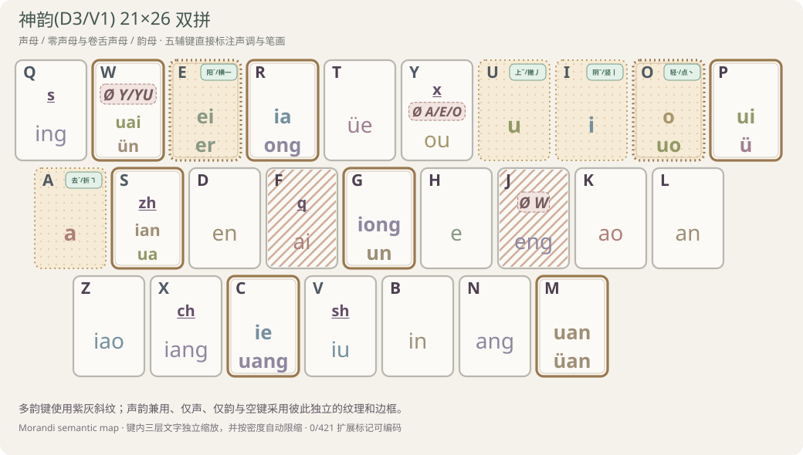
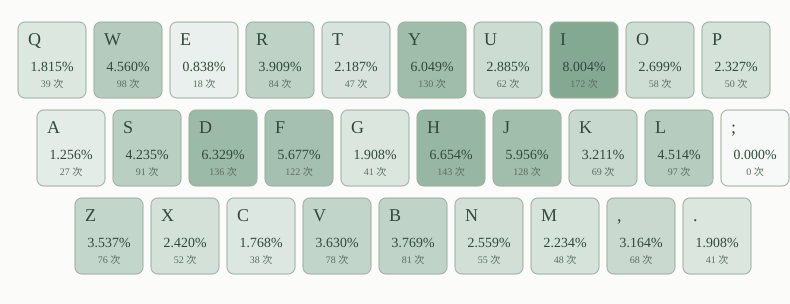
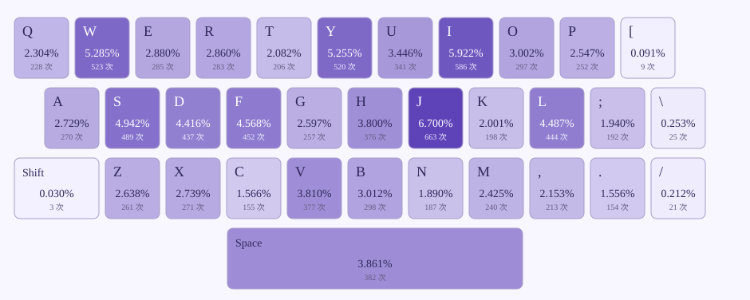
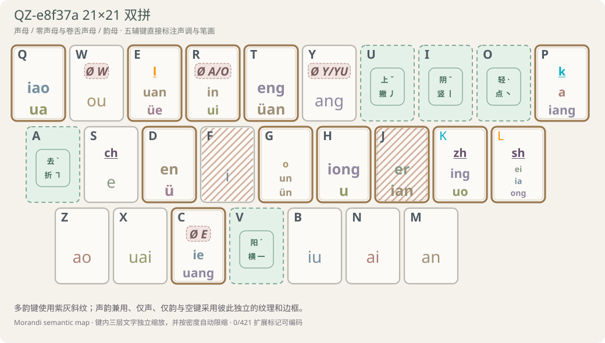
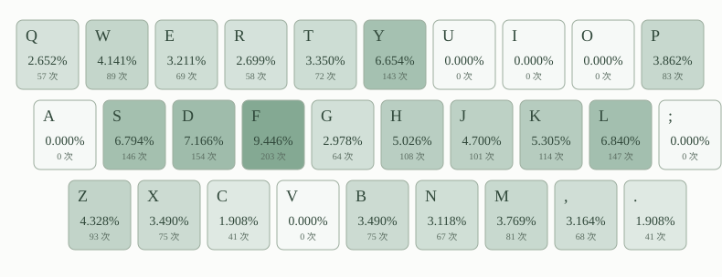
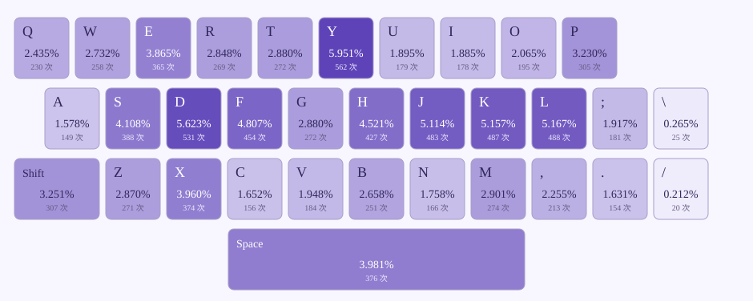

# [冰雪拼音](https://input.tansongchen.com)

> 优雅、高效、个性化的中文输入体验

[简体中文](#简体中文) · [English](#english) · [繁體中文](#繁體中文) · [下载 Release](https://github.com/ChenZhu-Xie/rime-snow-pinyin/releases/latest)

## 简体中文

配方： ℞ **snow-pinyin**

开发脚本与维护约定见 [AGENTS.md](AGENTS.md)。

[^zh-ckt5]: [CKT v5](research-notes/2026-11-01-ckt-v4-word-aux-order.md#方案级-ckt-v5)沿用 [CKT v4](https://github.com/more-14-different/shuangpin-layout-benchmark/blob/main/README_CN.md) 的运动与认知耗时，候选页改为 6 项；21×26 的形／调语义映射为“折横撇竖点→`AEUIO`、一二三四轻→`IEUAO`”，21×21 为“折横撇竖点→`AVUIO`、一二三四轻→`IVUAO`”，两者按形义序观察声调均为 `42310`。当前布局各成员的二／三／四字最优辅序为：神韵 `12/21/42`、`12/21/13`，U357 `12/23/24`、`12/21/23`；[S005](https://pingshunhuangalex.gitbook.io/rime-xkjd/learn-xkjd/layouts) 锚点固定为 `12/21/24`、`12/21/23`。[首道 B04](https://github.com/more-14-different/shuangpin-layout-benchmark/blob/main/README_CN.md) 按其原生 `AEUIO`／`IEUAO` 辅键，在五项认知系数 0%～500% 的独立扰动网格中对 144 套完整规则按平均名次取稳健综合第一，形辅／调辅分别为 `12/12/23`、`21/12/23`。八轨按单／二／三／四字 `1:3:1:1`、两个成员 `1:1`，逐轨相对 [S005](https://pingshunhuangalex.gitbook.io/rime-xkjd/learn-xkjd/layouts) 取四次幂均值并固定 [S005](https://pingshunhuangalex.gitbook.io/rime-xkjd/learn-xkjd/layouts)＝10。
[^en-ckt5]: [CKT v5](research-notes/2026-11-01-ckt-v4-word-aux-order.md#方案级-ckt-v5) retains the [CKT v4](https://github.com/more-14-different/shuangpin-layout-benchmark/blob/main/README_CN.md) motor and cognitive costs but uses six-candidate pages. The 21×26 semantic mappings are bend/horizontal/left-falling/vertical/dot→`AEUIO` and tones 1/2/3/4/neutral→`IEUAO`; 21×21 uses `AVUIO` and `IVUAO`, respectively. Both therefore read as `42310` tones in shape-meaning order. Layout-specific optimal two-/three-/four-character orders are Shenyun `12/21/42`, `12/21/13` and U357 `12/23/24`, `12/21/23`; the [S005](https://pingshunhuangalex.gitbook.io/rime-xkjd/learn-xkjd/layouts) anchor remains fixed at `12/21/24`, `12/21/23`. With its native `AEUIO`/`IEUAO` auxiliaries, Shoudao [B04](https://github.com/more-14-different/shuangpin-layout-benchmark/blob/main/README_CN.md) ranks all 144 complete policies over the independent 0%–500% five-coefficient perturbation grid and selects the lowest-mean-rank robust policies `12/12/23` for shape and `21/12/23` for tone. The eight tracks use `1:3:1:1` character-length weights and `1:1` member weights, then take a fourth-power mean of trackwise ratios anchored at [S005](https://pingshunhuangalex.gitbook.io/rime-xkjd/learn-xkjd/layouts)＝10.
[^zht-ckt5]: [CKT v5](research-notes/2026-11-01-ckt-v4-word-aux-order.md#方案级-ckt-v5)沿用 [CKT v4](https://github.com/more-14-different/shuangpin-layout-benchmark/blob/main/README_CN.md) 的運動與認知耗時，候選頁改為 6 項；21×26 的形／調語義映射為「折橫撇豎點→`AEUIO`、一二三四輕→`IEUAO`」，21×21 為「折橫撇豎點→`AVUIO`、一二三四輕→`IVUAO`」，兩者按形義序觀察聲調均為 `42310`。當前布局各成員的二／三／四字最優輔序為：神韻 `12/21/42`、`12/21/13`，U357 `12/23/24`、`12/21/23`；[S005](https://pingshunhuangalex.gitbook.io/rime-xkjd/learn-xkjd/layouts) 錨點固定為 `12/21/24`、`12/21/23`。[首道 B04](https://github.com/more-14-different/shuangpin-layout-benchmark/blob/main/README_CN.md) 按其原生 `AEUIO`／`IEUAO` 輔鍵，在五項認知係數 0%～500% 的獨立擾動網格中對 144 套完整規則按平均名次取穩健綜合第一，形輔／調輔分別為 `12/12/23`、`21/12/23`。八軌按單／二／三／四字 `1:3:1:1`、兩個成員 `1:1`，逐軌相對 [S005](https://pingshunhuangalex.gitbook.io/rime-xkjd/learn-xkjd/layouts) 取四次冪均值並固定 [S005](https://pingshunhuangalex.gitbook.io/rime-xkjd/learn-xkjd/layouts)＝10。

[^zh-ckt51]: [CKT v5.1](research-notes/2026-11-02-ckt-v5.1-six-code.md)保留各布局原生主码路由并统一最长六码：传统 21×21 三字词补足第三辅，四码顶仍为 `AAAU+BB`；六项参数在 0%～500% 的 `11⁶` 网格中选最低平均名次辅序。
[^en-ckt51]: [CKT v5.1](research-notes/2026-11-02-ckt-v5.1-six-code.md) preserves each layout family's native main-code route while making six the maximum length: traditional 21×21 three-character words gain a third auxiliary, whereas four-code-top remains `AAAU+BB`; source orders are selected by mean rank over the six-parameter `11⁶` grid from 0% to 500%.
[^zht-ckt51]: [CKT v5.1](research-notes/2026-11-02-ckt-v5.1-six-code.md)保留各布局原生主碼路由並統一最長六碼：傳統 21×21 三字詞補足第三輔，四碼頂仍為 `AAAU+BB`；六項參數在 0%～500% 的 `11⁶` 網格中選最低平均名次輔序。

[冰雪拼音](https://input.tansongchen.com)是一系列以普通话拼音为基础的中文输入方案。它们充分利用汉字的字音信息来实现自然优雅的编码；它们使用先进的离散优化技术和顶功技术来设计，使得编码十分高效；它们配备了智能算法，通过学习用户的语言习惯来个性化输入体验。

[冰雪拼音](https://input.tansongchen.com)的发布列表包括[冰雪四拼](https://input.tansongchen.com/snow4/)、[冰雪弎拼](https://input.tansongchen.com/snow3/)、[冰雪一拼](https://input.tansongchen.com/snow1/)、[冰雪健道](https://input.tansongchen.com/snow-jiandao/)、[冰雪清韵](https://input.tansongchen.com/snow-qingyun/)、[冰雪简道](snow_shenyun_shape.schema.yaml)、[冰雪散拼](snow_shenyun_tone.schema.yaml)，以及经典的[冰雪键道](snow_jiandao_classic.schema.yaml)和[冰雪三拼](snow_sanpin_classic.schema.yaml)。您可以阅读[冰雪奇缘](https://input.tansongchen.com/snow.html)来概览各个方案，了解它们的设计理念及优缺点。您还可以点击上述各个方案的链接以进一步了解并选择适合您的输入方案。

四套双拼顶功方案按合同分为两组：21×21 的冰雪健道与冰雪弎拼中，“健”取健步、矫健之意，突出击键效率与人体工学；“弎”兼具“三”与繁体形意，表示可简繁通打。21×26 的冰雪简道与冰雪散拼中，“简道”强调记忆更简单（M=40、无飞键、无音节重码、无 630）；“散拼”取“形散神不散”，不使用字形辅码，但保留声调与笔画辅码。schema_id 为兼容既有用户配置保持不变。

发布列表同时保留四份冻结的初代布局：[冰雪健道·初代](snow_jiandao_first.schema.yaml)、[冰雪弎拼·初代](snow_sanpin_first.schema.yaml)、[冰雪简道·初代](snow_shenyun_shape_first.schema.yaml)与[冰雪散拼·初代](snow_shenyun_tone_first.schema.yaml)。它们完整保留本版本的 U357 21×21 与 Overall-17 21×26 双拼规则、固定候选和键位图，使用独立的用户词典与输入统计，不跟随后续原方案的双拼升级。

双拼迁移前最后一个完整版本 `3658e22` 的冰雪键道与冰雪三拼已作为[经典 benchmark 快照](scripts/data/legacy-schemes/3658e22/README.md)纳入仓库，包含当时的 schema、fixed 表和影响动态码长、首选后置、辅码过滤及顶功的 Lua 合同；两者也以独立 schema_id 进入发布列表，与四套现行方案共享系统词典及对应的现有用户词典，并可按同一模型独立复算。

经典发布版只保留迁移前声韵布局，不冻结旧功能：冰雪键道与冰雪健道共用辅序 `12/231/24`，冰雪三拼与冰雪弎拼共用辅序 `12/213/23`；AA/AAB 动态空桶、三字及以上简拼大写补韵、630、字母、临时数字、生僻字补空及上游通用修复均按经典音码重新迁移，详见[上游迁移审计](reports/经典键道三拼上游迁移审计.md)。

发布页面同时提供同文（Android）的 `.trime.yaml` 皮肤包和元书（iOS、Android）的 `.cskin` 皮肤包；皮肤需与输入方案分别安装，布局预览、选择与导入说明见[手机皮肤](https://input.tansongchen.com/#手机皮肤)。触屏布局暂不提供冰雪一拼专用的并击键盘。

十一个需要记忆布局的方案内置[键位图](docs/keymaps.md)：桌面端在空输入时以独立的 `e`／`v` 切换 SVG 浮窗；本项目的元书皮肤上滑工具栏“中文”、同文主题长按“中文”即可进入十一方案 PNG 键位图页。桌面浮窗由无控制台的跨平台常驻 helper 显示，不再启动 PowerShell。

### 反查入口

以下引导键均为小写。拼音反查输入普通话全拼；笔画码按“横、竖、撇、点、折”的顺序列出；部件反查连续输入各部件的全拼，不加分隔符。反查码末尾可选加 `'` 结束当前反查段。

| 方案 | 拼音反查 | 笔画反查 | 部件全拼反查 |
| --- | --- | --- | --- |
| 冰雪四拼 | `a`＋全拼 | `u`＋`eiuoa` | `u`＋连续部件全拼 |
| 冰雪弎拼、冰雪三拼 | `a`＋全拼 | `u`＋`ivuao` | `u`＋连续部件全拼 |
| 冰雪健道、冰雪键道 | `a`＋全拼 | `u`＋`viuoa` | `u`＋连续部件全拼 |
| 冰雪简道、冰雪散拼及其初代 | `a`＋全拼 | `u`＋`eiuoa` | `u`＋连续部件全拼 |
| 冰雪清韵 | 反引号＋全拼 | 反引号＋`eiuoa` | 反引号＋连续部件全拼 |
| 冰雪一拼 | 不提供 | 不提供 | 不提供 |

例如，部件“王＋炎”连续写成 `wangyan`，在冰雪四拼、冰雪弎拼、冰雪健道、冰雪键道、冰雪三拼、冰雪简道、冰雪散拼及上述双拼方案的初代版本中输入 `uwangyan` 可查“琰”；冰雪清韵输入 `` `wangyan``。候选注释显示目标字拼音，如 `yan3`。上述以 `a` 引导的方案可输入 `ashi` 按拼音反查“是”；`ueiuoa` 是使用 `eiuoa` 笔画序方案的“横竖撇点折”反查。冰雪清韵对应输入 `` `shi`` 与 `` `eiuoa``。

部件词库来自 [rime-radical-pinyin](https://github.com/mirtlecn/rime-radical-pinyin)，发布包已包含所需文件。直接把源码仓库作为 Rime 用户目录时，先初始化子模块并运行 `bun scripts/link.ts link`，再重新部署以生成部件词典。

### D3/V1 21×26 双拼

冰雪简道（[`snow_shenyun_shape`](snow_shenyun_shape.schema.yaml)）与冰雪散拼（[`snow_shenyun_tone`](snow_shenyun_tone.schema.yaml)）现共用 [D3/V1 21×26 布局](https://github.com/more-14-different/shuangpin-layout-benchmark/blob/main/research/notes/2026-11-09-d3v1-ckt-v51-soft-balance-aux-order-robustness.md)，仓库标识为 `SNOW-SHENYUN-21X26-D3V1-BALANCED`。布局在 Common399 上无音节重码，M-R2 `40`，全声母／字母声母／传统声母／韵母乱序度 A/I/D/V `8/5/3/1`；按 21×26 原生四码封顶、跨词长联合候选池与 `soft-page-fill-v2` 计分，方案专属稳健结果为 CKT v5.1 `9.10299979136027`。

五辅语义保持“折横撇竖点→`AEUIO`、一二三四轻→`IEUAO`”，按形义序观察声调仍为 `42310`。冰雪简道的二／三／四字词形辅序为 `12/12/24`，冰雪散拼的调辅序为 `12/21/13`；记号表示从各字位依次取辅码，运行规则以方案文件为准。

**声母—韵母映射**

**日常八场景文稿纯双拼键频图（含标点）**

键频图由 benchmark 页面内置的 `r9MacroHeat` 从现行布局直接导出，使用 2149 击键的日常八场景文稿，只统计纯双拼与文稿标点，不含五辅键、空格和选重。

**十一场景 5500 字最优路径全按键键频**

5500 字十一场景的实际最优路径共 9,895 键，其中空格 382、Shift 3；原始统计见 [JSON](reports/神韵十一场景_5500字_最优路径全按键键频.json)。

#### 声韵编码规则

声母及零声母载体使用下列首键：

| 声母／载体 | 首键 | 声母／载体 | 首键 | 声母／载体 | 首键 |
| --- | :---: | --- | :---: | --- | :---: |
| `b` | `B` | `p` | `P` | `m` | `M` |
| `f` | `F` | `d` | `D` | `t` | `T` |
| `n` | `N` | `l` | `L` | `g` | `G` |
| `k` | `K` | `h` | `H` | `j` | `J` |
| `q` | `F` | `x` | `Y` | `zh` | `S` |
| `ch` | `X` | `sh` | `V` | `r` | `R` |
| `z` | `Z` | `c` | `C` | `s` | `Q` |
| `A` | `Y` | `E` | `Y` | `O` | `Y` |
| `W` | `J` | `Y` | `W` | `YU` | `W` |

韵母使用下列次键；`v/van/ve/vn` 表示 ü 系：

| 韵母 | 次键 | 韵母 | 次键 | 韵母 | 次键 |
| --- | :---: | --- | :---: | --- | :---: |
| `a` | `A` | `ai` | `F` | `an` | `L` |
| `ang` | `N` | `ao` | `K` | `e` | `H` |
| `ei` | `E` | `en` | `D` | `eng` | `J` |
| `er` | `E` | `i` | `I` | `ia` | `R` |
| `ian` | `S` | `iang` | `X` | `iao` | `Z` |
| `ie` | `C` | `in` | `B` | `ing` | `Q` |
| `iong` | `G` | `iu` | `V` | `o` | `O` |
| `ong` | `R` | `ou` | `Y` | `u` | `U` |
| `ua` | `S` | `uai` | `W` | `uan` | `M` |
| `uang` | `C` | `ui` | `P` | `un` | `G` |
| `uo` | `O` | `v` | `P` | `van` | `M` |
| `ve` | `T` | `vn` | `W` |  |  |

- Common399 的 399 个音节全部拥有唯一双拼码；静态 21×26 键域有 147 个空码。按当前系统词典的实际占用口径运行时有 144 个 `AU` 空码，其中 131 个为 `AA`、13 个为 `AB`。
- 单字主码为 `AU`。继续输入声母可进入 `AUA/AAA` 等词语路由，辅码只在相应阶段追加；二／三／四字词的方案专属辅序以上文 `12/12/24` 与 `12/21/13` 为准。
- 冰雪简道的形辅键为 `A/E/U/I/O = 折/横/撇/竖/点`；冰雪散拼的调辅键为 `I/E/U/A/O = 一/二/三/四/轻`。空码补字只查询系统词典，不受个人词频影响。

#### 英数入口

两个 21×26 方案共用同一套字母入口。21 个辅音字母通常使用“字母原键 + `n`”，其中 `D/J/X` 分别使用 `dd/jg/xo`；五个元音字母使用 `x` 载体。入口只借用已有汉字候选的占用桶，不消耗空码；原汉字保持首选，大写、小写字母固定为第 2、3 候选。下表的“原首选”由当前冻结词典与映射计算，完整审计数据见 [字母桶配置](config/shenyun-21x26-letter-buckets.json)。

| 字母 | 输入码 | 原首选 | 字母 | 输入码 | 原首选 |
| --- | :---: | :---: | --- | :---: | :---: |
| A | `xw` | 踹 | N | `nn` | 囊 |
| B | `bn` | 帮 | O | `xi` | 吃 |
| C | `cn` | 藏 | P | `pn` | 胖 |
| D | `dd` | 扽 | Q | `qn` | 桑 |
| E | `xp` | 吹 | R | `rn` | 让 |
| F | `fn` | 放 | S | `sn` | 张 |
| G | `gn` | 刚 | T | `tn` | 躺 |
| H | `hn` | 行 | U | `xc` | 床 |
| I | `xf` | 拆 | V | `vn` | 上 |
| J | `jg` | 炅 | W | `wn` | 养 |
| K | `kn` | 扛 | X | `xo` | 戳 |
| L | `ln` | 狼 | Y | `yn` | 昂 |
| M | `mn` | 忙 | Z | `zn` | 脏 |

数字入口已经按对应汉字的当前最短码完成计算，但配置状态仍为 `calculated-not-enabled`，尚未写入两个现行 fixed 表，所以下表是待启用映射，不是当前可用承诺。所有数字码均复用已有汉字码位，不占空码。

| 数字 | 冰雪简道 | 冰雪散拼 |
| --- | :---: | :---: |
| 零／0 | `lqe` | `lqe` |
| 一／1 | `w` | `w` |
| 二／2 | `ye` | `ye` |
| 三／3 | `q` | `q` |
| 四／4 | `qii` | `qia` |
| 五／5 | `jue` | `juu` |
| 六／6 | `lvo` | `lva` |
| 七／7 | `fie` | `fii` |
| 八／8 | `bau` | `bai` |
| 九／9 | `jvu` | `jvu` |
| 十／10 | `viu` | `vie` |

字母和待启用数字均不侵占 `ABA` 的 `21×5×21=2205` 个状态，既有 `AAB`、`AAAB` 路由也保持不变。

### QZ-e8f37a 21×21 双拼

冰雪健道（`snow_jiandao`）与冰雪弎拼（`snow_sanpin`）现共用 [QZ-e8f37a 21×21 布局](https://github.com/more-14-different/shuangpin-layout-benchmark/blob/main/research/notes/2026-11-09-e8f37a-ckt-v51-aux-order-robustness.md)，仓库标识为 `QZ-e8f37a0998f9`。布局指标为 M-R2 `42`、全声母／字母声母／传统声母／韵母乱序度 A/I/D/V `5/2/2/5`；按传统 21×21 原生路由与方案专属稳健辅序计分，CKT v5.1 `9.56789806405906`。

五辅语义保持“折横撇竖点→`AVUIO`、一二三四轻→`IVUAO`”，按形义序观察声调同为 `42310`。冰雪健道的二／三／四字词形辅序为 `12/213/24`，冰雪弎拼的调辅序为 `12/213/23`；三字词保留完整三辅键路由，二字词与四字词共享四码主码候选竞争池。

**声母—韵母映射**

**日常八场景文稿纯双拼键频图（含标点）**

键频图由 benchmark 页面内置的 `r9MacroHeat` 从现行布局直接导出，使用 2149 击键的日常八场景文稿，只统计纯双拼与文稿标点，不含五辅键、空格和选重。

**十一场景 5500 字最优路径全按键键频**

5500 字十一场景的实际最优路径共 9,444 键，其中空格 376、Shift 307；原始统计见 [JSON](reports/神韵十一场景_5500字_最优路径全按键键频.json)。

#### 声韵编码规则

声母及零声母载体使用下列首键：

| 声母／载体 | 首键 | 声母／载体 | 首键 | 声母／载体 | 首键 |
| --- | :---: | --- | :---: | --- | :---: |
| `A` | `R` | `E` | `C` | `O` | `R` |
| `W` | `W` | `Y` | `Y` | `YU` | `Y` |
| `b` | `B` | `c` | `C` | `ch` | `S` |
| `d` | `D` | `f` | `F` | `g` | `G` |
| `h` | `H` | `j` | `J` | `k` | `P` |
| `l` | `E` | `m` | `M` | `n` | `N` |
| `p` | `P` | `q` | `Q` | `r` | `R` |
| `s` | `S` | `sh` | `L` | `t` | `T` |
| `x` | `X` | `z` | `Z` | `zh` | `K` |

韵母使用下列次键；`v/van/ve/vn` 表示 ü 系：

| 韵母 | 次键 | 韵母 | 次键 | 韵母 | 次键 |
| --- | :---: | --- | :---: | --- | :---: |
| `a` | `P` | `ai` | `N` | `an` | `M` |
| `ang` | `Y` | `ao` | `Z` | `e` | `S` |
| `ei` | `L` | `en` | `D` | `eng` | `T` |
| `er` | `J` | `i` | `F` | `ia` | `L` |
| `ian` | `J` | `iang` | `P` | `iao` | `Q` |
| `ie` | `C` | `in` | `R` | `ing` | `K` |
| `iong` | `H` | `iu` | `B` | `o` | `G` |
| `ong` | `L` | `ou` | `W` | `u` | `H` |
| `ua` | `Q` | `uai` | `X` | `uan` | `E` |
| `uang` | `C` | `ui` | `R` | `un` | `G` |
| `uo` | `K` | `v` | `D` | `van` | `T` |
| `ve` | `E` | `vn` | `G` |  |  |

- Common399 形成 345 个唯一码和 54 个双音节重码桶，静态键域有 96 个空码；按当前系统词典的实际占用口径运行时有 94 个 `AA` 空码，包含保留码 `qz`、`zq`。
- 冰雪健道使用形辅键 `A/V/U/I/O = 折/横/撇/竖/点`，冰雪弎拼使用调辅键 `I/V/U/A/O = 一/二/三/四/轻`；`j/q/x` 后的 ü 系按 `v/van/ve/vn` 统一编码。
- 两个方案的 630 固顶区都完整覆盖 630 个码位且词项不重复；大写补韵、动态空桶和多字词辅码按各方案文件中的现行规则运行。

#### 英数入口

冰雪健道与冰雪弎拼共用字母基码：21 个辅音字母使用“字母原键 + `c`”，五个元音使用 `A=xw、I=xl、O=xd、U=xh、V=xg`。冰雪健道直接使用基码，原汉字保持首选，大写、小写字母为第 2、3 候选；冰雪弎拼在基码后追加轻声键 `o`，大写、小写字母为第 1、2 候选。即使字母码与真实音节重合，固定候选顺序也保持不变。

数字与对应汉字共用码位；存在汉字候选时数字追加在其后，不占用额外空码。

| 数字 | 冰雪健道 | 冰雪弎拼 |
| --- | :---: | :---: |
| 零／0 | `ekv` | `ekv` |
| 一／1 | `y` | `y` |
| 二／2 | `cj` | `cj` |
| 三／3 | `sm` | `sm` |
| 四／4 | `sfi` | `sfa` |
| 五／5 | `whv` | `whu` |
| 六／6 | `ebo` | `eba` |
| 七／7 | `qfv` | `qfi` |
| 八／8 | `bpu` | `bpi` |
| 九／9 | `jbu` | `jbu` |
| 十／10 | `lfu` | `lfv` |

### 固顶、空桶与逐级简码

- 冰雪简道、冰雪散拼的现行 fixed 表各含 21 个一级简码、376 个二码单字、108 个二简词和 26 个字母入口；二简词只占不与单字音节冲突的码位，两个方案没有 630 区。
- 冰雪健道、冰雪弎拼以 351 个二码单字和 90 个二简词完整覆盖 441 个 `AA` 位置。两方案的 630 区均由 105 个二码位与 525 个三码位组成，每码固定一个不重复词项。
- 冰雪健道、冰雪弎拼及对应经典方案的大写字母用于三字及以上简拼补韵：前三字可写成 `A[U]A[U]A[U]`，第四字起只取声母；已有四个小写声母后，大写字母恢复为下一字声母。
- [二字词逐级排序研究](reports/sipin-bigram-ranking-research.md)覆盖 133,205 条可编码读音及 1,372 个二简／630 槽位。它作为候选常用度证据保留，不把“完整码已是首选”的词重复塞入短码。

### 现行双拼与原键道 S005、首道 B04 benchmark

下表用当前 D3/V1 与 QZ-e8f37a 直接替代 README 历史表中的 Overall-17 与 U357，并继续以同一冻结 payload 和原键道 S005、首道 B04 作参照；初代布局只保留在后面的全量追加报告中。

表中在 D3/V1、QZ-e8f37a 与原键道 S005 三个方案间拉通排名：第 1 名数值加粗并标 ★★，第 2 名数值加粗并标 ★，第 3 名不加粗、不标星；首道 B04 不参与三方案名次。🥇 独立比较全部四方案，可以与星标同时出现在同一单元格。并列采用竞赛排名，例如并列第 1 名后的下一名为第 3 名；并列单元格使用相同格式。

| 指标 | D3/V1 21×26 | QZ-e8f37a 21×21 | 原键道 S005 | 首道 B04 | 何为好 |
| --- | ---: | ---: | ---: | ---: | --- |
| M-R2 记忆项 | **40** ★★ 🥇 | **42** ★ | 44 | 51 | 越低越好 |
| 全声母／字母声母／传统声母／韵母乱序度 A/I/D/V | **8 / 5 / 3 / 1** ★★ | 5 / 2 / 2 / 5 | **3 / 0 / 0 / 4** ★★ | 1 / 0 / 0 / 0 🥇 | A、I 为诊断；仍按 D+V 越低越好 |
| 飞键成分（声母／零声母组／韵母） | **0 / 0 / 0** ★★ 🥇 | **0 / 0 / 0** ★★ 🥇 | 2 / 0 / 1 | 0 / 1 / 7 | 越少越好 |
| FA-1 逻辑审计 | **98.759026** ★★ | **98.538896** ★ | 97.708694 | 99.763391 🥇 | 越高越一致 |
| LU-v1r 逻辑均匀度 | **81.165916** ★★ | 71.510417 | **78.897555** ★ | 83.107434 🥇 | 越高越统一 |
| Common399 唯一码／唯一率 | **399 / 100.000%** ★★ 🥇 | 345 / 86.466% | **372 / 93.233%** ★ | 399 / 100.000% 🥇 | 越高越好 |
| Common399 重码桶 | **0** ★★ 🥇 | 54 | **27** ★ | 0 🥇 | 越低越好 |
| Common399 受影响音节／占比 | **0 / 0.000%** ★★ 🥇 | 108 / 27.068% | **54 / 13.534%** ★ | 0 / 0.000% 🥇 | 越低越好 |
| 频率加权 S2 miss | **0.000%** ★★ 🥇 | 2.610% | **0.929%** ★ | 0.000% 🥇 | 越低越好 |
| S2 补全平均码长 | **2.000000** ★★ 🥇 | 2.109822 | **2.072546** ★ | 2.000000 🥇 | 越低越好 |
| S2 补全中心时间（ms） | **70.023** ★★ 🥇 | **86.219** ★ | 90.257 | 79.890 | 越低越好 |
| S2 异键同指率 | **5.346%** ★ | **4.059%** ★★ 🥇 | 11.638% | 11.343% | 越低越好 |
| 综合补全 CKT v3 | **9.586334** ★★ | **9.662072** ★ | 10.000000 | 9.461105 🥇 | 越低越好 |
| 综合补全 CKT v4 | **9.083575** ★★ 🥇 | **9.560735** ★ | 10.000000 | 9.184607 | 越低越好 |
| 综合补全 CKT v5 | **9.096336** ★★ 🥇 | **9.564806** ★ | 10.000000 | 9.195422 | 越低越好 |
| 综合补全 CKT v5.1 | **9.103000** ★★ 🥇 | **9.567898** ★ | 9.999357 | 9.202834 | 越低越好 |
| A7E-v3 系综当量 | **10.607264** ★★ | 10.749064 | **10.740028** ★ | 10.519452 🥇 | 越低越好 |
| A7E-v4 系综当量 | **10.670636** ★★ | 10.815673 | **10.805830** ★ | 10.583290 🥇 | 越低越好 |
| A7E-v5 系综当量 | **10.258404** ★★ 🥇 | **10.599488** ★ | 11.478960 | 11.091225 | 越低越好 |
| A7E-v6-CW150 | **9.263108** ★★ 🥇 | **9.587200** ★ | 10.000000 | 9.589632 | 越低越好 |
| 八轨综合选重率 | **0.623%** ★★ | **1.259%** ★ | 1.532% | 0.572% 🥇 | 越低越好 |
| 八轨第一辅键率 | **20.940%** ★★ | **25.162%** ★ | 26.413% | 19.746% 🥇 | 越低越好 |
| 八轨第二辅键率 | **4.490%** ★★ | **6.449%** ★ | 7.201% | 4.158% 🥇 | 越低越好 |
| 日常左右手负载／左手占比 | **1028:1121 / 47.836%** ★★ 🥇 | 1196:953 / 55.654% | **1121:1028 / 52.164%** ★★ 🥇 | 1004:1145 / 46.719% | 越接近 50% 越平衡 |
| 日常同手率 | **41.508%** ★★ 🥇 | 46.906% | **45.882%** ★ | 45.416% | 越低越好；非独立速度结论 |
| 日常平均有效距离 | **0.663015** ★★ 🥇 | 0.694670 | **0.679555** ★ | 0.701172 | 越低越好 |
| 20 合同 QAZ 左小指组峰值 | **17.048%** ★ | **16.717%** ★★ | 17.160% | 16.661% 🥇 | 越低越好 |
| 20 合同 P 区右小指组峰值 | **3.150%** ★ | 4.750% | **2.774%** ★★ | 1.888% 🥇 | 越低越好 |
| 20 合同最大单指峰值 | 34.439% | **26.392%** ★★ 🥇 | **29.531%** ★ | 29.271% | 越低越好 |
| 日常纯双拼移动手分数（含标点） | **142.322** ★★ 🥇 | 135.218 | **138.672** ★ | 135.310 | 越高越好 |
| S2 主键区占比 | 43.912% | **54.542%** ★★ 🥇 | **49.001%** ★ | 36.600% | 越高越好 |
| 20 合同 TYB 双食指组峰值 | **11.595%** ★★ 🥇 | **14.101%** ★ | 14.733% | 12.358% | 越低越好 |
| 20 合同主键区下限 | **32.519%** ★ | **34.733%** ★★ 🥇 | 30.815% | 24.243% | 越高越好 |

#### 初代兼容方案与完整报告

冰雪简道·初代、冰雪散拼·初代冻结 Overall-17·初代；冰雪健道·初代、冰雪弎拼·初代冻结 U357·初代。四份初代方案保留独立 schema、声韵映射、固顶数据库和输入统计，不跟随现行方案升级；标准学习词频与系统词典仍按冰雪系约定共享。新旧布局的可复算比较见 [五布局／六布局追加报告](reports/shenyun-comparison.md)。

- [500 字冰雪十二方案实战测评](reports/冰雪十二方案_500字_最短键码实战测评.txt)
- [5000 字冰雪十二方案全量报告](reports/十篇五百字_十二方案最优切分及字词比率报告.md)
- [5000 字十三方案报告（加入声笔小鹤）](reports/十篇五百字_十三方案最优切分及字词比率报告.md)
- [5000 字十四方案报告（再加入小鹤音形）](reports/十篇五百字_十四方案最优切分及字词比率报告.md)

### 快捷键

以下集中列出方案层快捷键；公共编辑与翻页键由各方案继承，历史和方案固定词等功能只在加载相应模块的方案中出现。

#### 候选选择与翻页

| 功能 | 快捷键 |
| --- | --- |
| 确认当前高亮候选 | `Space` |
| 选择当前页第 2～6 候选 | `2 / 3 / 8 / 9 / 0` |
| 上移/下移一个候选 | `Up` / `Down`，或 `Ctrl+K` / `Ctrl+J` |
| 上移/下移两个候选 | `Ctrl+H` / `Ctrl+L` |
| 下一页 | `Tab`、`Ctrl+,` 或 `Page_Down` |
| 上一页 | `Ctrl+M` 或 `Page_Up`；翻页后也可用 `Shift+Tab` |

#### 输入码编辑与定位

| 功能 | 快捷键 |
| --- | --- |
| 光标左移/右移一位 | `Left` / `Right` |
| 光标移到输入码开头/末尾 | `Home` / `End`，或 `Ctrl+N` / `Ctrl+E` |
| 从输入码开头右移两位 | `Ctrl+P`（`Home → Right → Right`） |
| 输入码物理左移/右移一位并在边界循环 | `Ctrl+Y` / `Ctrl+O` |
| 上一个/下一个逻辑字位或音节 | `Ctrl+U` / `Ctrl+I` |
| 定位或推进到第 1～4 字位/输入末尾 | `1 / 4 / 5 / 6 / 7` |
| 撤销最近一次选词，否则删除光标前一个输入码 | `BackSpace` |
| 回退一个音节 | `Ctrl+BackSpace` |
| 删除光标后的输入码 | `Delete` 或 `Ctrl+D` |
| 清空当前输入 | `Escape` |
| 以词定字：上屏当前多字候选的首字/末字 | `[` / `]` |

#### 上屏方式

| 功能 | 快捷键 |
| --- | --- |
| 上屏原始输入码 | `Enter` |
| 上屏转换后的脚本文本 | `Ctrl+Enter` |
| 上屏当前候选的注释 | `Ctrl+Shift+Enter` |
| 上屏当前首选并切换中/西文 | 单击左/右 `Shift`；右 `Shift` 与上游相同，左 `Shift` 相比上游由行内临时英文改为此功能，因而多了一个首选上屏入口 |

#### 输入模式与方案开关

| 功能 | 快捷键 |
| --- | --- |
| 切换结束/缓冲 | 所有方案用 `Ctrl+B`；除冰雪清韵、冰雪一拼外，也可输入 `o` 后选择「开启缓冲」或「关闭缓冲」；冰雪一拼的 `jio` 并击等效于 `Ctrl+B` |
| 切换到下一个输入方案 | `Ctrl+Shift+1` |
| 切换中/西文 | `Ctrl+Shift+2` |
| 切换半角/全角 | `Ctrl+Shift+3` |
| 切换简体/繁体 | `Ctrl+Shift+4` |
| 切换中文/西文标点 | `Ctrl+Shift+5` |

#### 历史、删词与方案固定词

| 功能 | 快捷键 |
| --- | --- |
| 在历史面板选择第 2～6 项 | `Ctrl+2/3/8/9/0` |
| 删除高亮的普通 Rime 用户词 | `Ctrl+Delete` |
| 固定/取消固定当前候选 | `Ctrl+/` |
| 开始手动加词；再次按下完成添加 | 所有方案使用 `Ctrl+.`；进入后方案状态显示「加词中」，过程中可按 `Escape` 取消 |
| 将已固定候选上移/下移一位 | `Ctrl+[` / `Ctrl+]` |
| 重置当前编码下的方案固定候选 | `Ctrl+\` |

普通 Rime 用户词和方案固定词是两套机制：前者使用 `Ctrl+Delete` 删除；通过 `Ctrl+.` 手动加入的方案固定词，选中后使用 `Ctrl+/` 取消或禁用。静态 YAML 词典中的正式词条不能通过快捷键删除。

手动加词是两段式操作：先输入以后用于查询新词的目标编码并按 `Ctrl+.`，再正常输入且上屏新词的全部文字，最后再次按 `Ctrl+.` 保存；第一下不是把当前候选直接加入词典，最后一段文字也须先上屏。

#### 方案专属编码键（含大写）

这些键属于编码规则而非 `Ctrl` 类快捷键，但会直接影响前四码内大写字母的含义，故与快捷键并列说明。

| 方案 | 大写字母在前四码附近的含义 |
| --- | --- |
| 冰雪四拼 | 保留结构略码：候选少于四字、当前输入尚未达到四个连续小写码时，`A/D/L/B/F/R/U/K/J/P/N/G/E/T/Y/I/O/W/Q` 等键可直接生成叠词或插字结构；达到四个小写码后，大写声母转为继续编码。 |
| 冰雪弎拼 | 不作结构略码。前三个声母后的大写字母用于补该字韵母；第四字起只取声母，已有四个小写声母后，大写字母作为下一字声母继续编码。 |
| 冰雪健道 | 与冰雪弎拼相同：大写用于三字及以上简拼补韵，不作结构略码。 |
| 冰雪三拼 | 与冰雪弎拼功能相同，但按经典双拼布局解释大写韵键。 |
| 冰雪键道 | 与冰雪健道功能相同，但按经典双拼布局解释大写韵键。 |
| 冰雪清韵 | 不作结构略码。大写声母或韵键用于四码后的继续编码及回头补码，随后按对应小写编码处理。 |

### 研究报告与审计资料

[`reports/`](reports/) 集中保存布局评测、固顶证据与功能审计，便于复核正文中的结论：

- [固顶候选语料摘要](reports/fixed-corpus-summary.md)：公开候选来源、独立家族、缺失来源和关注词覆盖情况。
- [神韵与原冰雪键道双拼碰撞对比](reports/shenyun-collision-comparison.md)：按 Top 500～全量比较二字内部、四字内部及跨词长碰撞。
- [神韵 R9 与原键道碰撞解读及双拼设计启发](reports/shenyun-collision-design-notes.md)：解释碰撞数据的取舍、结构原因和布局设计启发。
- [神韵 R9 固顶受约束选优报告](reports/shenyun-fixed-optimization.md)：记录二简、AA 单字、三拼/键道 630 和去冗余约束。
- [神韵四方案公平对比](reports/shenyun-comparison.md)：与 [S005](https://pingshunhuangalex.gitbook.io/rime-xkjd/learn-xkjd/layouts)、[B04](https://github.com/more-14-different/shuangpin-layout-benchmark/blob/main/README_CN.md) 的现行 [CKT v4](https://github.com/more-14-different/shuangpin-layout-benchmark/blob/main/README_CN.md)、人体工学及八轨非首选率比较。
- [神韵四方案公平对比原始 JSON](reports/shenyun-comparison.json)：上述现行对比的机器可复核数据。
- [神韵 R9 公平对比](reports/shenyun-r9-comparison.md)：与 [S005](https://pingshunhuangalex.gitbook.io/rime-xkjd/learn-xkjd/layouts)、[B04](https://github.com/more-14-different/shuangpin-layout-benchmark/blob/main/README_CN.md) 的历史 Benchmark 指标、分场景结果和边界说明。
- [神韵 R9 公平对比原始 JSON](reports/shenyun-r9-comparison.json)：上述对比的机器可复核数据快照。
- [当前方案快捷键审计与上游对照](reports/shortcut-audit.md)：七套方案的共享、专属及相对上游变化的快捷键。
- [四拼二字词逐级排序对神韵固顶的参考调研](reports/sipin-bigram-ranking-research.md)：以四拼逐级候选名次为键道、三拼固顶提供有限旁证，不把四拼视为 R9 的组成部分。
- [冰雪八方案 500 字最短键码实战测评](reports/冰雪八方案_500字_最短键码实战测评.txt)：同一篇 500 字赛文下八条仓库内可复算轨的实际按键比较，包含冰雪四拼与冰雪清韵；两条含已知错误的外部冻结轨不再导入或排名。
- [十方案 5000 字最优切分报告](reports/十篇五百字_十方案最优切分及字词比率报告.md)（[原始 JSON](reports/5000字_十方案最优切分实测结果.json)、[逐篇十轨回放](reports/十篇五百字_十方案逐键对齐回放/)、[十轨汇编](reports/十篇五百字_5000字_十方案最优切分实战测评对齐汇编.txt)）：在冰雪八方案同一基线上加入外部声笔小鹤与小鹤音形，分别使用自己的发布词库、编码规则和空白用户数据；这四项是当前完整成果，六、八、九方案报告及单方案回放仅为生成链中的子集。

### 关于词库的说明

[冰雪拼音](https://input.tansongchen.com)词库收词范围与[雾凇拼音](https://github.com/iDvel/rime-ice)相同。其特点为：

1. 大词库：与[雾凇拼音](https://github.com/iDvel/rime-ice)共享 180 万词库
2. 持续更新：上游[雾凇拼音](https://github.com/iDvel/rime-ice)更新后，本仓库也会随之更新
3. 单字读音遵循《通用规范汉字字典》规范
4. 词语读音尽可能使用单字已有的读音，便于自动造词。这意味着
    - 不考虑因弱化产生的轻声，如「知识」为 `zhī shí`，不为 `zhī shi`
    - 不考虑连读变调，如「一个」为 `yī gè`，不为 `yí gè`
    - 部分专有名词中的专用音允许例外，例如「冒顿」可以是 `mò dú`

---

## English

Recipe: ℞ **snow-pinyin**

[Snow Pinyin](https://input.tansongchen.com) is a family of Mandarin-based Chinese input methods. It combines phonetic information, discrete optimization, top-up coding, and adaptive learning for natural, efficient, and personalized input. The release includes [Snow Four-Code](https://input.tansongchen.com/snow4/), [冰雪弎拼](https://input.tansongchen.com/snow3/), [Snow One-Code](https://input.tansongchen.com/snow1/), [冰雪健道](https://input.tansongchen.com/snow-jiandao/), [Snow Qingyun](https://input.tansongchen.com/snow-qingyun/), [冰雪简道](snow_shenyun_shape.schema.yaml), [冰雪散拼](snow_shenyun_tone.schema.yaml), and the classic [冰雪键道](snow_jiandao_classic.schema.yaml) and [冰雪三拼](snow_sanpin_classic.schema.yaml).

### D3/V1 21×26 double pinyin

冰雪简道 ([`snow_shenyun_shape`](snow_shenyun_shape.schema.yaml)) and 冰雪散拼 ([`snow_shenyun_tone`](snow_shenyun_tone.schema.yaml)) now share the [D3/V1 21×26 layout](https://github.com/more-14-different/shuangpin-layout-benchmark/blob/main/research/notes/2026-11-09-d3v1-ckt-v51-soft-balance-aux-order-robustness.md), identified in this repository as `SNOW-SHENYUN-21X26-D3V1-BALANCED`. It has no Common399 syllable collisions, M-R2 `40`, and all/written/traditional-initial/final disorder A/I/D/V `8/5/3/1`. Under the native 21×26 four-code-top contract, cross-length candidate pool, and `soft-page-fill-v2`, its scheme-specific robust score is CKT v5.1 `9.10299979136027`.

The five auxiliary semantics remain bend/horizontal/left-falling/vertical/dot→`AEUIO` and tones 1/2/3/4/neutral→`IEUAO`, yielding `42310` in shape-meaning order. 冰雪简道 uses shape order `12/12/24` and 冰雪散拼 uses tone order `12/21/13` for two-/three-/four-character words.

**Initial–final mapping**

**Pure-double-pinyin key-frequency map over the daily eight-scenario corpus (punctuation included)**

The map is exported directly from the current layout through the benchmark page's built-in `r9MacroHeat`. It uses the 2,149-keystroke daily eight-scenario corpus and includes only double-pinyin keys and corpus punctuation, excluding auxiliaries, spaces, and candidate selection.

**Eleven-scenario optimal-path all-key frequency over 5,500 characters**

The eleven-scenario 5,500-character replay uses 9,895 keys, including 382 spaces and 3 Shift presses; see the [raw JSON](reports/神韵十一场景_5500字_最优路径全按键键频.json).

#### Initial and final coding rules

Initials and zero-initial carriers use these first keys:

| Initial/carrier | First key | Initial/carrier | First key | Initial/carrier | First key |
| --- | :---: | --- | :---: | --- | :---: |
| `b` | `B` | `p` | `P` | `m` | `M` |
| `f` | `F` | `d` | `D` | `t` | `T` |
| `n` | `N` | `l` | `L` | `g` | `G` |
| `k` | `K` | `h` | `H` | `j` | `J` |
| `q` | `F` | `x` | `Y` | `zh` | `S` |
| `ch` | `X` | `sh` | `V` | `r` | `R` |
| `z` | `Z` | `c` | `C` | `s` | `Q` |
| `A` | `Y` | `E` | `Y` | `O` | `Y` |
| `W` | `J` | `Y` | `W` | `YU` | `W` |

Finals use these second keys; `v/van/ve/vn` denote the ü series:

| Final | Second key | Final | Second key | Final | Second key |
| --- | :---: | --- | :---: | --- | :---: |
| `a` | `A` | `ai` | `F` | `an` | `L` |
| `ang` | `N` | `ao` | `K` | `e` | `H` |
| `ei` | `E` | `en` | `D` | `eng` | `J` |
| `er` | `E` | `i` | `I` | `ia` | `R` |
| `ian` | `S` | `iang` | `X` | `iao` | `Z` |
| `ie` | `C` | `in` | `B` | `ing` | `Q` |
| `iong` | `G` | `iu` | `V` | `o` | `O` |
| `ong` | `R` | `ou` | `Y` | `u` | `U` |
| `ua` | `S` | `uai` | `W` | `uan` | `M` |
| `uang` | `C` | `ui` | `P` | `un` | `G` |
| `uo` | `O` | `v` | `P` | `van` | `M` |
| `ve` | `T` | `vn` | `W` |  |  |

- All 399 Common399 syllables have unique double-pinyin codes. The static 21×26 domain has 147 vacant codes; under the current system-dictionary occupancy rule, 144 `AU` codes are vacant at runtime, comprising 131 `AA` and 13 `AB` codes.
- A single-character main code is `AU`. Further initials enter word routes such as `AUA/AAA`, and auxiliaries are appended only at the applicable stage; the scheme-specific two-/three-/four-character orders are `12/12/24` and `12/21/13` above.
- 冰雪简道 maps shape auxiliaries as `A/E/U/I/O = bend/horizontal/left-falling/vertical/dot`; 冰雪散拼 maps tone auxiliaries as `I/E/U/A/O = 1/2/3/4/neutral`. Vacant-code fallback queries system dictionaries only and is unaffected by personal frequency.

#### Letter and number entry

Both 21×26 schemes share one letter-entry map. The 21 consonant letters normally use their own key plus `n`; `D/J/X` instead use `dd/jg/xo`. The five vowels use the `x` carrier. These entries reuse occupied Han-character buckets and consume no vacant codes: the existing Han candidate stays first, with uppercase and lowercase in positions 2 and 3. “Original first” below is calculated from the current frozen dictionaries and mapping; see the complete [letter-bucket configuration](config/shenyun-21x26-letter-buckets.json).

| Letter | Input | Original first | Letter | Input | Original first |
| --- | :---: | :---: | --- | :---: | :---: |
| A | `xw` | 踹 | N | `nn` | 囊 |
| B | `bn` | 帮 | O | `xi` | 吃 |
| C | `cn` | 藏 | P | `pn` | 胖 |
| D | `dd` | 扽 | Q | `qn` | 桑 |
| E | `xp` | 吹 | R | `rn` | 让 |
| F | `fn` | 放 | S | `sn` | 张 |
| G | `gn` | 刚 | T | `tn` | 躺 |
| H | `hn` | 行 | U | `xc` | 床 |
| I | `xf` | 拆 | V | `vn` | 上 |
| J | `jg` | 炅 | W | `wn` | 养 |
| K | `kn` | 扛 | X | `xo` | 戳 |
| L | `ln` | 狼 | Y | `yn` | 昂 |
| M | `mn` | 忙 | Z | `zn` | 脏 |

Number codes have been calculated from each corresponding Han numeral's current shortest code, but the configuration status remains `calculated-not-enabled`. They have not been written to either current fixed table, so the following is a pending map rather than a currently available input contract. Every code reuses an occupied Han-character bucket.

| Number | 冰雪简道 | 冰雪散拼 |
| --- | :---: | :---: |
| 零／0 | `lqe` | `lqe` |
| 一／1 | `w` | `w` |
| 二／2 | `ye` | `ye` |
| 三／3 | `q` | `q` |
| 四／4 | `qii` | `qia` |
| 五／5 | `jue` | `juu` |
| 六／6 | `lvo` | `lva` |
| 七／7 | `fie` | `fii` |
| 八／8 | `bau` | `bai` |
| 九／9 | `jvu` | `jvu` |
| 十／10 | `viu` | `vie` |

Neither the letters nor the pending numbers consume the `21×5×21=2205` `ABA` states; the existing `AAB` and `AAAB` routes are also preserved.

### QZ-e8f37a 21×21 double pinyin

冰雪健道 (`snow_jiandao`) and 冰雪弎拼 (`snow_sanpin`) now share the [QZ-e8f37a 21×21 layout](https://github.com/more-14-different/shuangpin-layout-benchmark/blob/main/research/notes/2026-11-09-e8f37a-ckt-v51-aux-order-robustness.md), identified as `QZ-e8f37a0998f9`. Its layout metrics are M-R2 `42` and all/written/traditional-initial/final disorder A/I/D/V `5/2/2/5`; its traditional native 21×21 routing with scheme-specific robust auxiliary orders scores CKT v5.1 `9.56789806405906`.

The five auxiliary semantics remain bend/horizontal/left-falling/vertical/dot→`AVUIO` and tones 1/2/3/4/neutral→`IVUAO`, again yielding `42310`. 冰雪健道 uses shape order `12/213/24`, while 冰雪弎拼 uses tone order `12/213/23`; three-character words retain the complete three-auxiliary route.

**Initial–final mapping**

**Pure-double-pinyin key-frequency map over the daily eight-scenario corpus (punctuation included)**

The map is exported directly from the current layout through the benchmark page's built-in `r9MacroHeat`. It uses the 2,149-keystroke daily eight-scenario corpus and includes only double-pinyin keys and corpus punctuation, excluding auxiliaries, spaces, and candidate selection.

**Eleven-scenario optimal-path all-key frequency over 5,500 characters**

The eleven-scenario 5,500-character replay uses 9,444 keys, including 376 spaces and 307 Shift presses; see the [raw JSON](reports/神韵十一场景_5500字_最优路径全按键键频.json).

#### Initial and final coding rules

Initials and zero-initial carriers use these first keys:

| Initial/carrier | First key | Initial/carrier | First key | Initial/carrier | First key |
| --- | :---: | --- | :---: | --- | :---: |
| `A` | `R` | `E` | `C` | `O` | `R` |
| `W` | `W` | `Y` | `Y` | `YU` | `Y` |
| `b` | `B` | `c` | `C` | `ch` | `S` |
| `d` | `D` | `f` | `F` | `g` | `G` |
| `h` | `H` | `j` | `J` | `k` | `P` |
| `l` | `E` | `m` | `M` | `n` | `N` |
| `p` | `P` | `q` | `Q` | `r` | `R` |
| `s` | `S` | `sh` | `L` | `t` | `T` |
| `x` | `X` | `z` | `Z` | `zh` | `K` |

Finals use these second keys; `v/van/ve/vn` denote the ü series:

| Final | Second key | Final | Second key | Final | Second key |
| --- | :---: | --- | :---: | --- | :---: |
| `a` | `P` | `ai` | `N` | `an` | `M` |
| `ang` | `Y` | `ao` | `Z` | `e` | `S` |
| `ei` | `L` | `en` | `D` | `eng` | `T` |
| `er` | `J` | `i` | `F` | `ia` | `L` |
| `ian` | `J` | `iang` | `P` | `iao` | `Q` |
| `ie` | `C` | `in` | `R` | `ing` | `K` |
| `iong` | `H` | `iu` | `B` | `o` | `G` |
| `ong` | `L` | `ou` | `W` | `u` | `H` |
| `ua` | `Q` | `uai` | `X` | `uan` | `E` |
| `uang` | `C` | `ui` | `R` | `un` | `G` |
| `uo` | `K` | `v` | `D` | `van` | `T` |
| `ve` | `E` | `vn` | `G` |  |  |

- Common399 forms 345 unique codes and 54 two-syllable collision buckets. The static domain has 96 vacant codes; the current system-dictionary occupancy rule leaves 94 runtime-vacant `AA` codes, including reserved `qz` and `zq`.
- 冰雪健道 maps shape auxiliaries as `A/V/U/I/O = bend/horizontal/left-falling/vertical/dot`; 冰雪弎拼 maps tone auxiliaries as `I/V/U/A/O = 1/2/3/4/neutral`. The ü series after `j/q/x` is normalized to `v/van/ve/vn`.
- Both schemes fill all 630 fixed-candidate slots with no repeated entries. Uppercase final completion, dynamic vacant buckets, and multi-character auxiliary routes follow the current rules in each schema.

#### Letter and number entry

冰雪健道 and 冰雪弎拼 share the same letter base codes. The 21 consonants use their own key plus `c`; the five vowels use `A=xw, I=xl, O=xd, U=xh, V=xg`. 冰雪健道 uses each base code directly, keeping the original Han candidate first and uppercase/lowercase in positions 2/3. 冰雪弎拼 appends neutral-tone key `o`, with uppercase/lowercase in positions 1/2. The fixed order remains intact even when a letter code overlaps a real syllable.

Numbers share the codes of their corresponding Han numerals. When Han candidates exist, the digit follows them instead of consuming a separate vacant code.

| Number | 冰雪健道 | 冰雪弎拼 |
| --- | :---: | :---: |
| 零／0 | `ekv` | `ekv` |
| 一／1 | `y` | `y` |
| 二／2 | `cj` | `cj` |
| 三／3 | `sm` | `sm` |
| 四／4 | `sfi` | `sfa` |
| 五／5 | `whv` | `whu` |
| 六／6 | `ebo` | `eba` |
| 七／7 | `qfv` | `qfi` |
| 八／8 | `bpu` | `bpi` |
| 九／9 | `jbu` | `jbu` |
| 十／10 | `lfu` | `lfv` |

### Fixed candidates, vacant buckets, and staged abbreviations

- Each current 冰雪简道/冰雪散拼 fixed table contains 21 one-key abbreviations, 376 two-key characters, 108 two-key word abbreviations, and 26 letter entries. Word abbreviations use only codes that do not collide with single-character syllables; neither scheme has a 630 section.
- 冰雪健道 and 冰雪弎拼 cover all 441 `AA` positions with 351 two-key characters and 90 two-key word abbreviations. Each 630 section comprises 105 two-key and 525 three-key slots, with one non-repeated word fixed per code.
- In 冰雪健道, 冰雪弎拼, and their classic counterparts, uppercase letters complete finals only in three-or-more-character jianpin: the first three characters may use `A[U]A[U]A[U]`, later characters use initials only, and uppercase reverts to a following initial after four lowercase initials.
- The [staged bigram-ranking study](reports/sipin-bigram-ranking-research.md) covers 133,205 encodable readings and 1,372 two-key/630 slots. It remains frequency evidence without duplicating words that are already first at full code into shorter fixed slots.

### Current double-pinyin layouts versus KeyTao S005 and Shoudao B04

This table directly replaces Overall-17 and U357 in the historical README comparison with the current D3/V1 and QZ-e8f37a results, using the same frozen payload and the original KeyTao S005 and Shoudao B04 references. The first-generation layouts remain in the appended full report only.

The table ranks D3/V1, QZ-e8f37a, and the original KeyTao S005 together: first place is bold with ★★, second place is bold with ★, and third place is unbolded and unstarred. Shoudao B04 is excluded from this three-layout ranking. 🥇 independently compares all four layouts and may appear in the same cell as stars. Ties use competition ranking, so the next place after a tie for first is third; tied cells use the same format.

| Metric | D3/V1 21×26 | QZ-e8f37a 21×21 | KeyTao S005 | Shoudao B04 | Better |
| --- | ---: | ---: | ---: | ---: | --- |
| M-R2 memory items | **40** ★★ 🥇 | **42** ★ | 44 | 51 | Lower |
| All/written/traditional-initial/final disorder A/I/D/V | **8 / 5 / 3 / 1** ★★ | 5 / 2 / 2 / 5 | **3 / 0 / 0 / 4** ★★ | 1 / 0 / 0 / 0 🥇 | A/I diagnostic; ranking remains lower D+V |
| Flying-key components (initials/zero-initial groups/finals) | **0 / 0 / 0** ★★ 🥇 | **0 / 0 / 0** ★★ 🥇 | 2 / 0 / 1 | 0 / 1 / 7 | Lower |
| FA-1 logic audit | **98.759026** ★★ | **98.538896** ★ | 97.708694 | 99.763391 🥇 | Higher |
| LU-v1r logic uniformity | **81.165916** ★★ | 71.510417 | **78.897555** ★ | 83.107434 🥇 | Higher |
| Common399 unique codes/rate | **399 / 100.000%** ★★ 🥇 | 345 / 86.466% | **372 / 93.233%** ★ | 399 / 100.000% 🥇 | Higher |
| Common399 collision buckets | **0** ★★ 🥇 | 54 | **27** ★ | 0 🥇 | Lower |
| Common399 affected syllables/rate | **0 / 0.000%** ★★ 🥇 | 108 / 27.068% | **54 / 13.534%** ★ | 0 / 0.000% 🥇 | Lower |
| Frequency-weighted S2 miss | **0.000%** ★★ 🥇 | 2.610% | **0.929%** ★ | 0.000% 🥇 | Lower |
| S2 completion mean code length | **2.000000** ★★ 🥇 | 2.109822 | **2.072546** ★ | 2.000000 🥇 | Lower |
| S2 completion center time (ms) | **70.023** ★★ 🥇 | **86.219** ★ | 90.257 | 79.890 | Lower |
| S2 different-key same-finger rate | **5.346%** ★ | **4.059%** ★★ 🥇 | 11.638% | 11.343% | Lower |
| CKT v3 completion | **9.586334** ★★ | **9.662072** ★ | 10.000000 | 9.461105 🥇 | Lower |
| CKT v4 completion | **9.083575** ★★ 🥇 | **9.560735** ★ | 10.000000 | 9.184607 | Lower |
| CKT v5 completion | **9.096336** ★★ 🥇 | **9.564806** ★ | 10.000000 | 9.195422 | Lower |
| CKT v5.1 completion | **9.103000** ★★ 🥇 | **9.567898** ★ | 9.999357 | 9.202834 | Lower |
| A7E-v3 ensemble equivalent | **10.607264** ★★ | 10.749064 | **10.740028** ★ | 10.519452 🥇 | Lower |
| A7E-v4 ensemble equivalent | **10.670636** ★★ | 10.815673 | **10.805830** ★ | 10.583290 🥇 | Lower |
| A7E-v5 ensemble equivalent | **10.258404** ★★ 🥇 | **10.599488** ★ | 11.478960 | 11.091225 | Lower |
| A7E-v6-CW150 | **9.263108** ★★ 🥇 | **9.587200** ★ | 10.000000 | 9.589632 | Lower |
| Eight-track aggregate selection rate | **0.623%** ★★ | **1.259%** ★ | 1.532% | 0.572% 🥇 | Lower |
| Eight-track first-auxiliary rate | **20.940%** ★★ | **25.162%** ★ | 26.413% | 19.746% 🥇 | Lower |
| Eight-track second-auxiliary rate | **4.490%** ★★ | **6.449%** ★ | 7.201% | 4.158% 🥇 | Lower |
| Daily left/right load and left share | **1028:1121 / 47.836%** ★★ 🥇 | 1196:953 / 55.654% | **1121:1028 / 52.164%** ★★ 🥇 | 1004:1145 / 46.719% | Closer to 50% |
| Daily same-hand rate | **41.508%** ★★ 🥇 | 46.906% | **45.882%** ★ | 45.416% | Lower; not a standalone speed claim |
| Daily mean effective distance | **0.663015** ★★ 🥇 | 0.694670 | **0.679555** ★ | 0.701172 | Lower |
| 20-contract QAZ left-pinky peak | **17.048%** ★ | **16.717%** ★★ | 17.160% | 16.661% 🥇 | Lower |
| 20-contract P-area right-pinky peak | **3.150%** ★ | 4.750% | **2.774%** ★★ | 1.888% 🥇 | Lower |
| 20-contract maximum single-finger peak | 34.439% | **26.392%** ★★ 🥇 | **29.531%** ★ | 29.271% | Lower |
| Daily pure-double-pinyin moving-hand score (punctuation included) | **142.322** ★★ 🥇 | 135.218 | **138.672** ★ | 135.310 | Higher |
| S2 home-zone share | 43.912% | **54.542%** ★★ 🥇 | **49.001%** ★ | 36.600% | Higher |
| 20-contract TYB index-finger peak | **11.595%** ★★ 🥇 | **14.101%** ★ | 14.733% | 12.358% | Lower |
| 20-contract home-zone floor | **32.519%** ★ | **34.733%** ★★ 🥇 | 30.815% | 24.243% | Higher |

#### First-generation compatibility schemes and complete reports

冰雪简道·初代 and 冰雪散拼·初代 freeze Overall-17·初代; 冰雪健道·初代 and 冰雪弎拼·初代 freeze U357·初代. Each keeps an independent schema, mapping, fixed-candidate database, and statistics database, while the standard learned frequencies and system dictionaries remain shared across Snow schemes. Reproducible old/new layout comparisons are in the [appended five-/six-layout report](reports/shenyun-comparison.md).

- [500-character Snow twelve-scheme benchmark](reports/冰雪十二方案_500字_最短键码实战测评.txt)
- [5,000-character Snow twelve-scheme report](reports/十篇五百字_十二方案最优切分及字词比率报告.md)
- [5,000-character thirteen-scheme report with 声笔小鹤](reports/十篇五百字_十三方案最优切分及字词比率报告.md)
- [5,000-character fourteen-scheme report with 小鹤音形](reports/十篇五百字_十四方案最优切分及字词比率报告.md)

### Reports and audits

[`reports/`](reports/) collects reproducible layout measurements, fixed-candidate evidence, and feature audits:

- [Fixed-candidate corpus summary](reports/fixed-corpus-summary.md): public sources, independent families, missing inputs, and coverage of selected words.
- [Shenyun versus original 冰雪健道 collision comparison](reports/shenyun-collision-comparison.md): two-character, four-character, and cross-length collisions from Top 500 through the full corpus.
- [Shenyun R9 collision interpretation and design lessons](reports/shenyun-collision-design-notes.md): tradeoffs, structural causes, and implications for double-pinyin layout design.
- [Shenyun R9 constrained fixed-candidate optimization](reports/shenyun-fixed-optimization.md): two-key abbreviations, AA characters, Three-Code/KeyTao 630 spaces, and redundancy constraints.
- [Complete four-scheme Shenyun comparison](reports/shenyun-comparison.md): current [CKT v4](https://github.com/more-14-different/shuangpin-layout-benchmark/blob/main/README_CN.md), ergonomics, and eight-track non-first rates against [S005](https://pingshunhuangalex.gitbook.io/rime-xkjd/learn-xkjd/layouts) and [B04](https://github.com/more-14-different/shuangpin-layout-benchmark/blob/main/README_CN.md).
- [Raw four-scheme Shenyun comparison JSON](reports/shenyun-comparison.json): machine-reviewable data behind the current comparison.
- [Complete Shenyun R9 benchmark comparison](reports/shenyun-r9-comparison.md): historical metrics and scenario results against [S005](https://pingshunhuangalex.gitbook.io/rime-xkjd/learn-xkjd/layouts) and [B04](https://github.com/more-14-different/shuangpin-layout-benchmark/blob/main/README_CN.md), with scope limits.
- [Raw Shenyun R9 comparison JSON](reports/shenyun-r9-comparison.json): machine-reviewable snapshot underlying the comparison.
- [Shortcut audit and upstream comparison](reports/shortcut-audit.md): shared and scheme-specific shortcuts across all seven schemes plus local changes from upstream.
- [Four-Code staged bigram ranking study](reports/sipin-bigram-ranking-research.md): limited ranking evidence for KeyTao and Three-Code fixed candidates; Four-Code itself is not part of R9.
- [Eight-scheme 500-character shortest-code replay](reports/冰雪八方案_500字_最短键码实战测评.txt): actual keystroke comparison across eight locally reproducible schemes, including Four-Code and Clear Rhyme; two external frozen tracks with known errors are no longer imported or ranked.
- [Ten-scheme 5,000-character optimal-segmentation report](reports/十篇五百字_十方案最优切分及字词比率报告.md) ([raw JSON](reports/5000字_十方案最优切分实测结果.json), [per-article ten-track replays](reports/十篇五百字_十方案逐键对齐回放/), [combined ten-track alignment](reports/十篇五百字_5000字_十方案最优切分实战测评对齐汇编.txt)): adds external Stroke-Pinyin Xiaohe and Xiaohe Shape to the same eight-Snow-scheme baseline, each using its own published dictionaries, encoding rules, and blank user data. These four artifacts are the complete current result; the six-, eight-, and nine-scheme reports and single-scheme replays are generation-stage subsets.

### Dictionaries

[Snow Pinyin](https://input.tansongchen.com) follows the vocabulary scope of [Rime Ice](https://github.com/iDvel/rime-ice): roughly 1.8 million shared entries, continuous upstream synchronization, standard single-character readings, and predictable word pronunciations suitable for user-defined words.

---

## 繁體中文

配方： ℞ **snow-pinyin**

[冰雪拼音](https://input.tansongchen.com)是一系列以普通話拼音為基礎的中文輸入方案，結合字音資訊、離散最佳化、頂功技術與使用習慣學習，提供自然、高效且個人化的輸入體驗。發布列表包含[冰雪四拼](https://input.tansongchen.com/snow4/)、[冰雪弎拼](https://input.tansongchen.com/snow3/)、[冰雪一拼](https://input.tansongchen.com/snow1/)、[冰雪健道](https://input.tansongchen.com/snow-jiandao/)、[冰雪清韻](https://input.tansongchen.com/snow-qingyun/)、[冰雪簡道](snow_shenyun_shape.schema.yaml)、[冰雪散拼](snow_shenyun_tone.schema.yaml)，以及經典的[冰雪鍵道](snow_jiandao_classic.schema.yaml)與[冰雪三拼](snow_sanpin_classic.schema.yaml)。

### D3/V1 21×26 雙拼

冰雪簡道（[`snow_shenyun_shape`](snow_shenyun_shape.schema.yaml)）與冰雪散拼（[`snow_shenyun_tone`](snow_shenyun_tone.schema.yaml)）現共用 [D3/V1 21×26 布局](https://github.com/more-14-different/shuangpin-layout-benchmark/blob/main/research/notes/2026-11-09-d3v1-ckt-v51-soft-balance-aux-order-robustness.md)，倉庫標識為 `SNOW-SHENYUN-21X26-D3V1-BALANCED`。布局在 Common399 上無音節重碼，M-R2 `40`，全聲母／字母聲母／傳統聲母／韻母亂序度 A/I/D/V `8/5/3/1`；按 21×26 原生四碼封頂、跨詞長聯合候選池與 `soft-page-fill-v2` 計分，方案專屬穩健結果為 CKT v5.1 `9.10299979136027`。

五輔語義保持「折橫撇豎點→`AEUIO`、一二三四輕→`IEUAO`」，按形義序觀察聲調仍為 `42310`。冰雪簡道的二／三／四字詞形輔序為 `12/12/24`，冰雪散拼的調輔序為 `12/21/13`。

**聲母—韻母映射**

**日常八場景文稿純雙拼鍵頻圖（含標點）**

鍵頻圖由 benchmark 頁面內建的 `r9MacroHeat` 從現行布局直接匯出，使用 2149 擊鍵的日常八場景文稿，只統計純雙拼與文稿標點，不含五輔鍵、空格及選重。

**十一場景 5500 字最佳路徑全按鍵鍵頻**

5500 字十一場景的實際最佳路徑共 9,895 鍵，其中空格 382、Shift 3；原始統計見 [JSON](reports/神韵十一场景_5500字_最优路径全按键键频.json)。

#### 聲韻編碼規則

聲母及零聲母載體使用下列首鍵：

| 聲母／載體 | 首鍵 | 聲母／載體 | 首鍵 | 聲母／載體 | 首鍵 |
| --- | :---: | --- | :---: | --- | :---: |
| `b` | `B` | `p` | `P` | `m` | `M` |
| `f` | `F` | `d` | `D` | `t` | `T` |
| `n` | `N` | `l` | `L` | `g` | `G` |
| `k` | `K` | `h` | `H` | `j` | `J` |
| `q` | `F` | `x` | `Y` | `zh` | `S` |
| `ch` | `X` | `sh` | `V` | `r` | `R` |
| `z` | `Z` | `c` | `C` | `s` | `Q` |
| `A` | `Y` | `E` | `Y` | `O` | `Y` |
| `W` | `J` | `Y` | `W` | `YU` | `W` |

韻母使用下列次鍵；`v/van/ve/vn` 表示 ü 系：

| 韻母 | 次鍵 | 韻母 | 次鍵 | 韻母 | 次鍵 |
| --- | :---: | --- | :---: | --- | :---: |
| `a` | `A` | `ai` | `F` | `an` | `L` |
| `ang` | `N` | `ao` | `K` | `e` | `H` |
| `ei` | `E` | `en` | `D` | `eng` | `J` |
| `er` | `E` | `i` | `I` | `ia` | `R` |
| `ian` | `S` | `iang` | `X` | `iao` | `Z` |
| `ie` | `C` | `in` | `B` | `ing` | `Q` |
| `iong` | `G` | `iu` | `V` | `o` | `O` |
| `ong` | `R` | `ou` | `Y` | `u` | `U` |
| `ua` | `S` | `uai` | `W` | `uan` | `M` |
| `uang` | `C` | `ui` | `P` | `un` | `G` |
| `uo` | `O` | `v` | `P` | `van` | `M` |
| `ve` | `T` | `vn` | `W` |  |  |

- Common399 的 399 個音節全部擁有唯一雙拼碼；靜態 21×26 鍵域有 147 個空碼。按目前系統詞典的實際占用口徑執行時有 144 個 `AU` 空碼，其中 131 個為 `AA`、13 個為 `AB`。
- 單字主碼為 `AU`。繼續輸入聲母可進入 `AUA/AAA` 等詞語路由，輔碼只在相應階段追加；二／三／四字詞的方案專屬輔序以上文 `12/12/24` 與 `12/21/13` 為準。
- 冰雪簡道的形輔鍵為 `A/E/U/I/O = 折/橫/撇/豎/點`；冰雪散拼的調輔鍵為 `I/E/U/A/O = 一/二/三/四/輕`。空碼補字只查詢系統詞典，不受個人詞頻影響。

#### 英數入口

兩個 21×26 方案共用同一套字母入口。21 個輔音字母通常使用「字母原鍵 + `n`」，其中 `D/J/X` 分別使用 `dd/jg/xo`；五個母音字母使用 `x` 載體。入口只借用已有漢字候選的占用桶，不消耗空碼；原漢字保持首選，大寫、小寫字母固定為第 2、3 候選。下表的「原首選」由目前凍結詞典與映射計算，完整稽核資料見[字母桶設定](config/shenyun-21x26-letter-buckets.json)。

| 字母 | 輸入碼 | 原首選 | 字母 | 輸入碼 | 原首選 |
| --- | :---: | :---: | --- | :---: | :---: |
| A | `xw` | 踹 | N | `nn` | 囊 |
| B | `bn` | 帮 | O | `xi` | 吃 |
| C | `cn` | 藏 | P | `pn` | 胖 |
| D | `dd` | 扽 | Q | `qn` | 桑 |
| E | `xp` | 吹 | R | `rn` | 让 |
| F | `fn` | 放 | S | `sn` | 张 |
| G | `gn` | 刚 | T | `tn` | 躺 |
| H | `hn` | 行 | U | `xc` | 床 |
| I | `xf` | 拆 | V | `vn` | 上 |
| J | `jg` | 炅 | W | `wn` | 养 |
| K | `kn` | 扛 | X | `xo` | 戳 |
| L | `ln` | 狼 | Y | `yn` | 昂 |
| M | `mn` | 忙 | Z | `zn` | 脏 |

數字入口已按對應漢字的目前最短碼完成計算，但設定狀態仍為 `calculated-not-enabled`，尚未寫入兩個現行 fixed 表，因此下表是待啟用映射，不是目前可用承諾。所有數字碼均重用已有漢字碼位，不占空碼。

| 數字 | 冰雪簡道 | 冰雪散拼 |
| --- | :---: | :---: |
| 零／0 | `lqe` | `lqe` |
| 一／1 | `w` | `w` |
| 二／2 | `ye` | `ye` |
| 三／3 | `q` | `q` |
| 四／4 | `qii` | `qia` |
| 五／5 | `jue` | `juu` |
| 六／6 | `lvo` | `lva` |
| 七／7 | `fie` | `fii` |
| 八／8 | `bau` | `bai` |
| 九／9 | `jvu` | `jvu` |
| 十／10 | `viu` | `vie` |

字母和待啟用數字均不侵占 `ABA` 的 `21×5×21=2205` 個狀態，既有 `AAB`、`AAAB` 路由也保持不變。

### QZ-e8f37a 21×21 雙拼

冰雪健道（`snow_jiandao`）與冰雪弎拼（`snow_sanpin`）現共用 [QZ-e8f37a 21×21 布局](https://github.com/more-14-different/shuangpin-layout-benchmark/blob/main/research/notes/2026-11-09-e8f37a-ckt-v51-aux-order-robustness.md)，倉庫標識為 `QZ-e8f37a0998f9`。布局指標為 M-R2 `42`、全聲母／字母聲母／傳統聲母／韻母亂序度 A/I/D/V `5/2/2/5`；按傳統 21×21 原生路由與方案專屬穩健輔序計分，CKT v5.1 `9.56789806405906`。

五輔語義保持「折橫撇豎點→`AVUIO`、一二三四輕→`IVUAO`」，按形義序觀察聲調同為 `42310`。冰雪健道的二／三／四字詞形輔序為 `12/213/24`，冰雪弎拼的調輔序為 `12/213/23`；三字詞保留完整三輔鍵路由。

**聲母—韻母映射**

**日常八場景文稿純雙拼鍵頻圖（含標點）**

鍵頻圖由 benchmark 頁面內建的 `r9MacroHeat` 從現行布局直接匯出，使用 2149 擊鍵的日常八場景文稿，只統計純雙拼與文稿標點，不含五輔鍵、空格及選重。

**十一場景 5500 字最佳路徑全按鍵鍵頻**

5500 字十一場景的實際最佳路徑共 9,444 鍵，其中空格 376、Shift 307；原始統計見 [JSON](reports/神韵十一场景_5500字_最优路径全按键键频.json)。

#### 聲韻編碼規則

聲母及零聲母載體使用下列首鍵：

| 聲母／載體 | 首鍵 | 聲母／載體 | 首鍵 | 聲母／載體 | 首鍵 |
| --- | :---: | --- | :---: | --- | :---: |
| `A` | `R` | `E` | `C` | `O` | `R` |
| `W` | `W` | `Y` | `Y` | `YU` | `Y` |
| `b` | `B` | `c` | `C` | `ch` | `S` |
| `d` | `D` | `f` | `F` | `g` | `G` |
| `h` | `H` | `j` | `J` | `k` | `P` |
| `l` | `E` | `m` | `M` | `n` | `N` |
| `p` | `P` | `q` | `Q` | `r` | `R` |
| `s` | `S` | `sh` | `L` | `t` | `T` |
| `x` | `X` | `z` | `Z` | `zh` | `K` |

韻母使用下列次鍵；`v/van/ve/vn` 表示 ü 系：

| 韻母 | 次鍵 | 韻母 | 次鍵 | 韻母 | 次鍵 |
| --- | :---: | --- | :---: | --- | :---: |
| `a` | `P` | `ai` | `N` | `an` | `M` |
| `ang` | `Y` | `ao` | `Z` | `e` | `S` |
| `ei` | `L` | `en` | `D` | `eng` | `T` |
| `er` | `J` | `i` | `F` | `ia` | `L` |
| `ian` | `J` | `iang` | `P` | `iao` | `Q` |
| `ie` | `C` | `in` | `R` | `ing` | `K` |
| `iong` | `H` | `iu` | `B` | `o` | `G` |
| `ong` | `L` | `ou` | `W` | `u` | `H` |
| `ua` | `Q` | `uai` | `X` | `uan` | `E` |
| `uang` | `C` | `ui` | `R` | `un` | `G` |
| `uo` | `K` | `v` | `D` | `van` | `T` |
| `ve` | `E` | `vn` | `G` |  |  |

- Common399 形成 345 個唯一碼和 54 個雙音節重碼桶，靜態鍵域有 96 個空碼；按目前系統詞典的實際占用口徑執行時有 94 個 `AA` 空碼，包含保留碼 `qz`、`zq`。
- 冰雪健道使用形輔鍵 `A/V/U/I/O = 折/橫/撇/豎/點`，冰雪弎拼使用調輔鍵 `I/V/U/A/O = 一/二/三/四/輕`；`j/q/x` 後的 ü 系按 `v/van/ve/vn` 統一編碼。
- 兩個方案的 630 固頂區都完整覆蓋 630 個碼位且詞項不重複；大寫補韻、動態空桶和多字詞輔碼按各方案檔案中的現行規則執行。

#### 英數入口

冰雪健道與冰雪弎拼共用字母基碼：21 個輔音字母使用「字母原鍵 + `c`」，五個母音使用 `A=xw、I=xl、O=xd、U=xh、V=xg`。冰雪健道直接使用基碼，原漢字保持首選，大寫、小寫字母為第 2、3 候選；冰雪弎拼在基碼後追加輕聲鍵 `o`，大寫、小寫字母為第 1、2 候選。即使字母碼與真實音節重合，固定候選順序也保持不變。

數字與對應漢字共用碼位；存在漢字候選時數字追加在其後，不占用額外空碼。

| 數字 | 冰雪健道 | 冰雪弎拼 |
| --- | :---: | :---: |
| 零／0 | `ekv` | `ekv` |
| 一／1 | `y` | `y` |
| 二／2 | `cj` | `cj` |
| 三／3 | `sm` | `sm` |
| 四／4 | `sfi` | `sfa` |
| 五／5 | `whv` | `whu` |
| 六／6 | `ebo` | `eba` |
| 七／7 | `qfv` | `qfi` |
| 八／8 | `bpu` | `bpi` |
| 九／9 | `jbu` | `jbu` |
| 十／10 | `lfu` | `lfv` |

### 固頂、空桶與逐級簡碼

- 冰雪簡道、冰雪散拼的現行 fixed 表各含 21 個一級簡碼、376 個二碼單字、108 個二簡詞和 26 個字母入口；二簡詞只占不與單字音節衝突的碼位，兩個方案沒有 630 區。
- 冰雪健道、冰雪弎拼以 351 個二碼單字和 90 個二簡詞完整覆蓋 441 個 `AA` 位置。兩方案的 630 區均由 105 個二碼位與 525 個三碼位組成，每碼固定一個不重複詞項。
- 冰雪健道、冰雪弎拼及對應經典方案的大寫字母用於三字及以上簡拼補韻：前三字可寫成 `A[U]A[U]A[U]`，第四字起只取聲母；已有四個小寫聲母後，大寫字母恢復為下一字聲母。
- [二字詞逐級排序研究](reports/sipin-bigram-ranking-research.md)覆蓋 133,205 條可編碼讀音及 1,372 個二簡／630 槽位。它作為候選常用度證據保留，不把「完整碼已是首選」的詞重複放入短碼。

### 現行雙拼與原鍵道 S005、首道 B04 benchmark

下表以目前 D3/V1 與 QZ-e8f37a 直接替代 README 歷史表中的 Overall-17 與 U357，並繼續使用同一凍結 payload 和原鍵道 S005、首道 B04 作參照；初代布局只保留在後面的全量追加報告中。

表中在 D3/V1、QZ-e8f37a 與原鍵道 S005 三個方案間拉通排名：第 1 名數值加粗並標 ★★，第 2 名數值加粗並標 ★，第 3 名不加粗、不標星；首道 B04 不參與三方案名次。🥇 獨立比較全部四方案，可以與星標同時出現在同一單元格。並列採用競賽排名，例如並列第 1 名後的下一名為第 3 名；並列單元格使用相同格式。

| 指標 | D3/V1 21×26 | QZ-e8f37a 21×21 | 原鍵道 S005 | 首道 B04 | 何者為佳 |
| --- | ---: | ---: | ---: | ---: | --- |
| M-R2 記憶項 | **40** ★★ 🥇 | **42** ★ | 44 | 51 | 越低越好 |
| 全聲母／字母聲母／傳統聲母／韻母亂序度 A/I/D/V | **8 / 5 / 3 / 1** ★★ | 5 / 2 / 2 / 5 | **3 / 0 / 0 / 4** ★★ | 1 / 0 / 0 / 0 🥇 | A、I 為診斷；仍按 D+V 越低越好 |
| 飛鍵成分（聲母／零聲母組／韻母） | **0 / 0 / 0** ★★ 🥇 | **0 / 0 / 0** ★★ 🥇 | 2 / 0 / 1 | 0 / 1 / 7 | 越少越好 |
| FA-1 邏輯稽核 | **98.759026** ★★ | **98.538896** ★ | 97.708694 | 99.763391 🥇 | 越高越一致 |
| LU-v1r 邏輯均勻度 | **81.165916** ★★ | 71.510417 | **78.897555** ★ | 83.107434 🥇 | 越高越統一 |
| Common399 唯一碼／唯一率 | **399 / 100.000%** ★★ 🥇 | 345 / 86.466% | **372 / 93.233%** ★ | 399 / 100.000% 🥇 | 越高越好 |
| Common399 重碼桶 | **0** ★★ 🥇 | 54 | **27** ★ | 0 🥇 | 越低越好 |
| Common399 受影響音節／占比 | **0 / 0.000%** ★★ 🥇 | 108 / 27.068% | **54 / 13.534%** ★ | 0 / 0.000% 🥇 | 越低越好 |
| 頻率加權 S2 miss | **0.000%** ★★ 🥇 | 2.610% | **0.929%** ★ | 0.000% 🥇 | 越低越好 |
| S2 補全平均碼長 | **2.000000** ★★ 🥇 | 2.109822 | **2.072546** ★ | 2.000000 🥇 | 越低越好 |
| S2 補全中心時間（ms） | **70.023** ★★ 🥇 | **86.219** ★ | 90.257 | 79.890 | 越低越好 |
| S2 異鍵同指率 | **5.346%** ★ | **4.059%** ★★ 🥇 | 11.638% | 11.343% | 越低越好 |
| 綜合補全 CKT v3 | **9.586334** ★★ | **9.662072** ★ | 10.000000 | 9.461105 🥇 | 越低越好 |
| 綜合補全 CKT v4 | **9.083575** ★★ 🥇 | **9.560735** ★ | 10.000000 | 9.184607 | 越低越好 |
| 綜合補全 CKT v5 | **9.096336** ★★ 🥇 | **9.564806** ★ | 10.000000 | 9.195422 | 越低越好 |
| 綜合補全 CKT v5.1 | **9.103000** ★★ 🥇 | **9.567898** ★ | 9.999357 | 9.202834 | 越低越好 |
| A7E-v3 系綜當量 | **10.607264** ★★ | 10.749064 | **10.740028** ★ | 10.519452 🥇 | 越低越好 |
| A7E-v4 系綜當量 | **10.670636** ★★ | 10.815673 | **10.805830** ★ | 10.583290 🥇 | 越低越好 |
| A7E-v5 系綜當量 | **10.258404** ★★ 🥇 | **10.599488** ★ | 11.478960 | 11.091225 | 越低越好 |
| A7E-v6-CW150 | **9.263108** ★★ 🥇 | **9.587200** ★ | 10.000000 | 9.589632 | 越低越好 |
| 八軌綜合選重率 | **0.623%** ★★ | **1.259%** ★ | 1.532% | 0.572% 🥇 | 越低越好 |
| 八軌第一輔鍵率 | **20.940%** ★★ | **25.162%** ★ | 26.413% | 19.746% 🥇 | 越低越好 |
| 八軌第二輔鍵率 | **4.490%** ★★ | **6.449%** ★ | 7.201% | 4.158% 🥇 | 越低越好 |
| 日常左右手負載／左手占比 | **1028:1121 / 47.836%** ★★ 🥇 | 1196:953 / 55.654% | **1121:1028 / 52.164%** ★★ 🥇 | 1004:1145 / 46.719% | 越接近 50% 越平衡 |
| 日常同手率 | **41.508%** ★★ 🥇 | 46.906% | **45.882%** ★ | 45.416% | 越低越好；非獨立速度結論 |
| 日常平均有效距離 | **0.663015** ★★ 🥇 | 0.694670 | **0.679555** ★ | 0.701172 | 越低越好 |
| 20 合同 QAZ 左小指組峰值 | **17.048%** ★ | **16.717%** ★★ | 17.160% | 16.661% 🥇 | 越低越好 |
| 20 合同 P 區右小指組峰值 | **3.150%** ★ | 4.750% | **2.774%** ★★ | 1.888% 🥇 | 越低越好 |
| 20 合同最大單指峰值 | 34.439% | **26.392%** ★★ 🥇 | **29.531%** ★ | 29.271% | 越低越好 |
| 日常純雙拼移動手分數（含標點） | **142.322** ★★ 🥇 | 135.218 | **138.672** ★ | 135.310 | 越高越好 |
| S2 主鍵區占比 | 43.912% | **54.542%** ★★ 🥇 | **49.001%** ★ | 36.600% | 越高越好 |
| 20 合同 TYB 雙食指組峰值 | **11.595%** ★★ 🥇 | **14.101%** ★ | 14.733% | 12.358% | 越低越好 |
| 20 合同主鍵區下限 | **32.519%** ★ | **34.733%** ★★ 🥇 | 30.815% | 24.243% | 越高越好 |

#### 初代相容方案與完整報告

冰雪簡道·初代、冰雪散拼·初代凍結 Overall-17·初代；冰雪健道·初代、冰雪弎拼·初代凍結 U357·初代。四份初代方案保留獨立 schema、聲韻映射、固頂資料庫和輸入統計，不跟隨現行方案升級；標準學習詞頻與系統詞典仍按冰雪系約定共享。新舊布局的可復算比較見[五布局／六布局追加報告](reports/shenyun-comparison.md)。

- [500 字冰雪十二方案實戰測評](reports/冰雪十二方案_500字_最短键码实战测评.txt)
- [5000 字冰雪十二方案全量報告](reports/十篇五百字_十二方案最优切分及字词比率报告.md)
- [5000 字十三方案報告（加入聲筆小鶴）](reports/十篇五百字_十三方案最优切分及字词比率报告.md)
- [5000 字十四方案報告（再加入小鶴音形）](reports/十篇五百字_十四方案最优切分及字词比率报告.md)

### 研究報告與稽核資料

[`reports/`](reports/) 集中保存布局評測、固頂證據與功能稽核，方便複核正文結論：

- [固頂候選語料摘要](reports/fixed-corpus-summary.md)：公開候選來源、獨立家族、缺失來源與關注詞覆蓋。
- [神韻與原冰雪鍵道雙拼碰撞對比](reports/shenyun-collision-comparison.md)：按 Top 500 至全量比較二字內部、四字內部及跨詞長碰撞。
- [神韻 R9 與原鍵道碰撞解讀及雙拼設計啟發](reports/shenyun-collision-design-notes.md)：解釋碰撞資料的取捨、結構原因與布局設計啟發。
- [神韻 R9 固頂受約束選優報告](reports/shenyun-fixed-optimization.md)：記錄二簡、AA 單字、三拼/鍵道 630 與去冗餘約束。
- [神韻四方案公平比較](reports/shenyun-comparison.md)：與 [S005](https://pingshunhuangalex.gitbook.io/rime-xkjd/learn-xkjd/layouts)、[B04](https://github.com/more-14-different/shuangpin-layout-benchmark/blob/main/README_CN.md) 的現行 [CKT v4](https://github.com/more-14-different/shuangpin-layout-benchmark/blob/main/README_CN.md)、人體工學及八軌非首選率比較。
- [神韻四方案公平比較原始 JSON](reports/shenyun-comparison.json)：上述現行比較的機器可複核資料。
- [神韻 R9 公平對比](reports/shenyun-r9-comparison.md)：與 [S005](https://pingshunhuangalex.gitbook.io/rime-xkjd/learn-xkjd/layouts)、[B04](https://github.com/more-14-different/shuangpin-layout-benchmark/blob/main/README_CN.md) 的歷史 Benchmark 指標、分場景結果與邊界說明。
- [神韻 R9 公平對比原始 JSON](reports/shenyun-r9-comparison.json)：上述對比的機器可複核資料快照。
- [目前方案快捷鍵稽核與上游對照](reports/shortcut-audit.md)：七套方案的共用、專屬及相對上游變更的快捷鍵。
- [四拼二字詞逐級排序對神韻固頂的參考調研](reports/sipin-bigram-ranking-research.md)：以四拼逐級候選名次為鍵道、三拼固頂提供有限旁證，不把四拼視為 R9 的組成部分。
- [冰雪八方案 500 字最短鍵碼實戰測評](reports/冰雪八方案_500字_最短键码实战测评.txt)：同一篇 500 字賽文下八條倉庫內可復算軌的實際按鍵比較，包含冰雪四拼與冰雪清韻；兩條含已知錯誤的外部凍結軌不再匯入或排名。
- [十方案 5000 字最優切分報告](reports/十篇五百字_十方案最优切分及字词比率报告.md)（[原始 JSON](reports/5000字_十方案最优切分实测结果.json)、[逐篇十軌回放](reports/十篇五百字_十方案逐键对齐回放/)、[十軌彙編](reports/十篇五百字_5000字_十方案最优切分实战测评对齐汇编.txt)）：在冰雪八方案的同一基線上加入外部聲筆小鶴與小鶴音形，分別使用自身發布詞庫、編碼規則與空白使用者資料；這四項是目前完整成果，六、八、九方案報告及單方案回放僅為生成鏈中的子集。

### 詞庫說明

[冰雪拼音](https://input.tansongchen.com)的收詞範圍與[霧凇拼音](https://github.com/iDvel/rime-ice)相同，包含約 180 萬共享詞條、持續上游同步、規範單字讀音，以及適合自動造詞的穩定詞語讀音。
