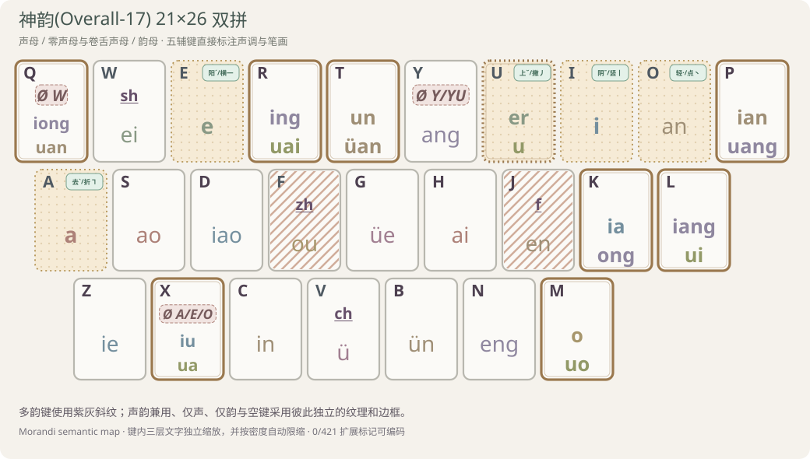
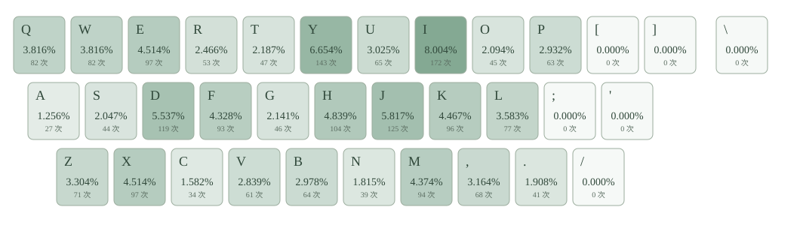
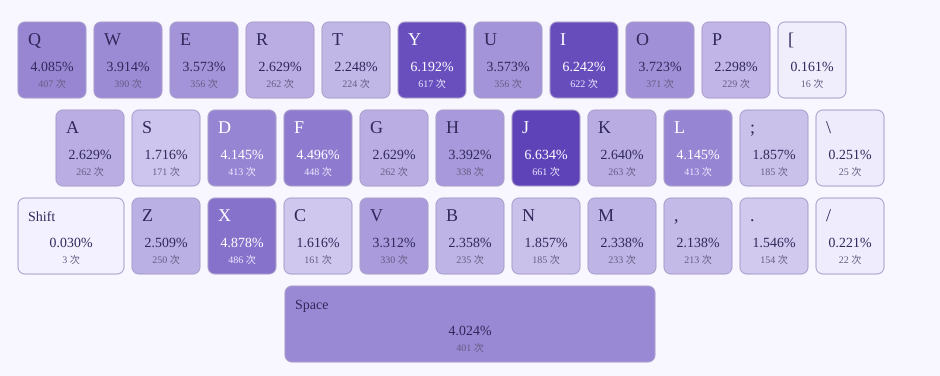
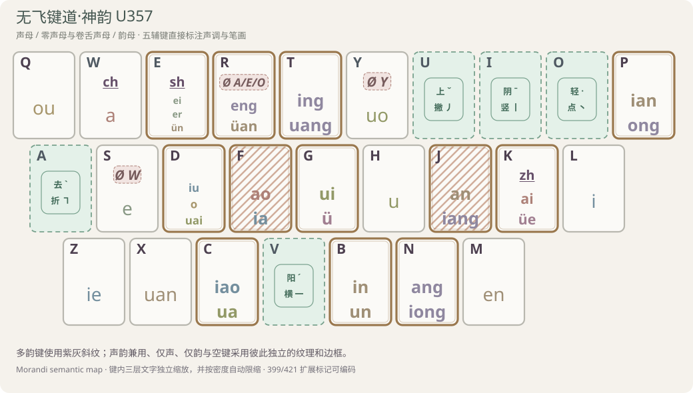
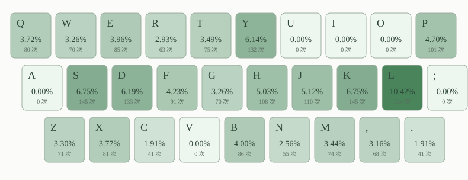
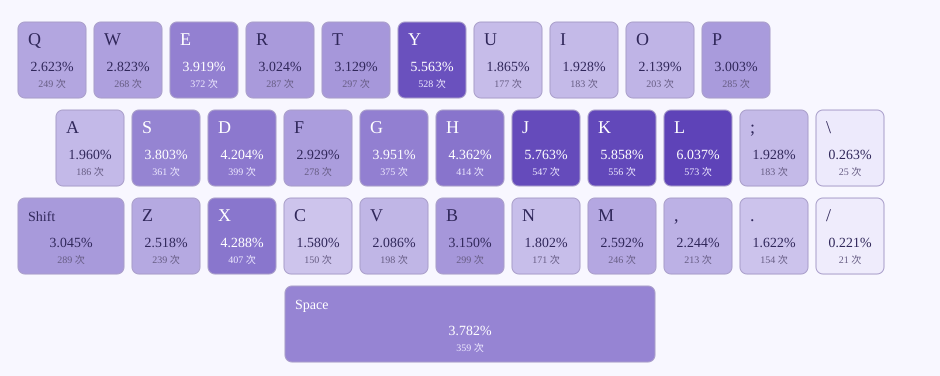

# [冰雪拼音](https://input.tansongchen.com)

> 优雅、高效、个性化的中文输入体验

[简体中文](#简体中文) · [English](#english) · [繁體中文](#繁體中文) · [下载 Release](https://github.com/ChenZhu-Xie/rime-snow-pinyin/releases/latest)

<a id="简体中文"></a>
## 简体中文

配方： ℞ **snow-pinyin**

开发脚本与维护约定见 [AGENTS.md](AGENTS.md)。

[^zh-ckt5]: [CKT v5](research-notes/2026-11-01-ckt-v4-word-aux-order.md#方案级-ckt-v5)沿用 [CKT v4](https://github.com/more-14-different/shuangpin-layout-benchmark/blob/main/README_CN.md) 的运动与认知耗时，候选页改为 6 项；21×26 的形／调语义映射为“折横撇竖点→`AEUIO`、一二三四轻→`IEUAO`”，21×21 为“折横撇竖点→`AVUIO`、一二三四轻→`IVUAO`”，两者按形义序观察声调均为 `42310`。当前布局各成员的二／三／四字最优辅序为：神韵 `12/21/42`、`12/21/13`，U357 `12/23/24`、`12/21/23`；[S005](https://pingshunhuangalex.gitbook.io/rime-xkjd/learn-xkjd/layouts) 锚点固定为 `12/21/24`、`12/21/23`。[首道 B04](https://github.com/more-14-different/shuangpin-layout-benchmark/blob/main/README_CN.md) 按其原生 `AEUIO`／`IEUAO` 辅键，在五项认知系数 0%～500% 的独立扰动网格中对 144 套完整规则按平均名次取稳健综合第一，形辅／调辅分别为 `12/12/23`、`21/12/23`。八轨按单／二／三／四字 `1:3:1:1`、两个成员 `1:1`，逐轨相对 [S005](https://pingshunhuangalex.gitbook.io/rime-xkjd/learn-xkjd/layouts) 取四次幂均值并固定 [S005](https://pingshunhuangalex.gitbook.io/rime-xkjd/learn-xkjd/layouts)＝10。
[^en-ckt5]: [CKT v5](research-notes/2026-11-01-ckt-v4-word-aux-order.md#方案级-ckt-v5) retains the [CKT v4](https://github.com/more-14-different/shuangpin-layout-benchmark/blob/main/README_CN.md) motor and cognitive costs but uses six-candidate pages. The 21×26 semantic mappings are bend/horizontal/left-falling/vertical/dot→`AEUIO` and tones 1/2/3/4/neutral→`IEUAO`; 21×21 uses `AVUIO` and `IVUAO`, respectively. Both therefore read as `42310` tones in shape-meaning order. Layout-specific optimal two-/three-/four-character orders are Shenyun `12/21/42`, `12/21/13` and U357 `12/23/24`, `12/21/23`; the [S005](https://pingshunhuangalex.gitbook.io/rime-xkjd/learn-xkjd/layouts) anchor remains fixed at `12/21/24`, `12/21/23`. With its native `AEUIO`/`IEUAO` auxiliaries, Shoudao [B04](https://github.com/more-14-different/shuangpin-layout-benchmark/blob/main/README_CN.md) ranks all 144 complete policies over the independent 0%–500% five-coefficient perturbation grid and selects the lowest-mean-rank robust policies `12/12/23` for shape and `21/12/23` for tone. The eight tracks use `1:3:1:1` character-length weights and `1:1` member weights, then take a fourth-power mean of trackwise ratios anchored at [S005](https://pingshunhuangalex.gitbook.io/rime-xkjd/learn-xkjd/layouts)＝10.
[^zht-ckt5]: [CKT v5](research-notes/2026-11-01-ckt-v4-word-aux-order.md#方案级-ckt-v5)沿用 [CKT v4](https://github.com/more-14-different/shuangpin-layout-benchmark/blob/main/README_CN.md) 的運動與認知耗時，候選頁改為 6 項；21×26 的形／調語義映射為「折橫撇豎點→`AEUIO`、一二三四輕→`IEUAO`」，21×21 為「折橫撇豎點→`AVUIO`、一二三四輕→`IVUAO`」，兩者按形義序觀察聲調均為 `42310`。當前布局各成員的二／三／四字最優輔序為：神韻 `12/21/42`、`12/21/13`，U357 `12/23/24`、`12/21/23`；[S005](https://pingshunhuangalex.gitbook.io/rime-xkjd/learn-xkjd/layouts) 錨點固定為 `12/21/24`、`12/21/23`。[首道 B04](https://github.com/more-14-different/shuangpin-layout-benchmark/blob/main/README_CN.md) 按其原生 `AEUIO`／`IEUAO` 輔鍵，在五項認知係數 0%～500% 的獨立擾動網格中對 144 套完整規則按平均名次取穩健綜合第一，形輔／調輔分別為 `12/12/23`、`21/12/23`。八軌按單／二／三／四字 `1:3:1:1`、兩個成員 `1:1`，逐軌相對 [S005](https://pingshunhuangalex.gitbook.io/rime-xkjd/learn-xkjd/layouts) 取四次冪均值並固定 [S005](https://pingshunhuangalex.gitbook.io/rime-xkjd/learn-xkjd/layouts)＝10。

[^zh-ckt51]: [CKT v5.1](research-notes/2026-11-02-ckt-v5.1-six-code.md)保留各布局原生主码路由并统一最长六码：传统 21×21 三字词补足第三辅，四码顶仍为 `AAAU+BB`；六项参数在 0%～500% 的 `11⁶` 网格中选最低平均名次辅序。
[^en-ckt51]: [CKT v5.1](research-notes/2026-11-02-ckt-v5.1-six-code.md) preserves each layout family's native main-code route while making six the maximum length: traditional 21×21 three-character words gain a third auxiliary, whereas four-code-top remains `AAAU+BB`; source orders are selected by mean rank over the six-parameter `11⁶` grid from 0% to 500%.
[^zht-ckt51]: [CKT v5.1](research-notes/2026-11-02-ckt-v5.1-six-code.md)保留各布局原生主碼路由並統一最長六碼：傳統 21×21 三字詞補足第三輔，四碼頂仍為 `AAAU+BB`；六項參數在 0%～500% 的 `11⁶` 網格中選最低平均名次輔序。

[冰雪拼音](https://input.tansongchen.com)是一系列以普通话拼音为基础的中文输入方案。它们充分利用汉字的字音信息来实现自然优雅的编码；它们使用先进的离散优化技术和顶功技术来设计，使得编码十分高效；它们配备了智能算法，通过学习用户的语言习惯来个性化输入体验。

[冰雪拼音](https://input.tansongchen.com)的发布列表包括[冰雪四拼](https://input.tansongchen.com/snow4/)、[冰雪弎拼](https://input.tansongchen.com/snow3/)、[冰雪一拼](https://input.tansongchen.com/snow1/)、[冰雪健道](https://input.tansongchen.com/snow-jiandao/)、[冰雪清韵](https://input.tansongchen.com/snow-qingyun/)、[冰雪简道](snow_shenyun_shape.schema.yaml)、[冰雪散拼](snow_shenyun_tone.schema.yaml)，以及经典的[冰雪键道](snow_jiandao_classic.schema.yaml)和[冰雪三拼](snow_sanpin_classic.schema.yaml)。您可以阅读[冰雪奇缘](https://input.tansongchen.com/snow.html)来概览各个方案，了解它们的设计理念及优缺点。您还可以点击上述各个方案的链接以进一步了解并选择适合您的输入方案。

四套双拼顶功方案按合同分为两组：21×21 的冰雪健道与冰雪弎拼中，“健”取健步、矫健之意，突出击键效率与人体工学；“弎”兼具“三”与繁体形意，表示可简繁通打。21×26 的冰雪简道与冰雪散拼中，“简道”强调记忆更简单（M=36、无飞键、无音节重码、无 630）；“散拼”取“形散神不散”，不使用字形辅码，但保留声调与笔画辅码。schema_id 为兼容既有用户配置保持不变。

发布列表同时保留四份冻结的初代布局：[冰雪健道·初代](snow_jiandao_first.schema.yaml)、[冰雪弎拼·初代](snow_sanpin_first.schema.yaml)、[冰雪简道·初代](snow_shenyun_shape_first.schema.yaml)与[冰雪散拼·初代](snow_shenyun_tone_first.schema.yaml)。它们完整保留本版本的 U357 21×21 与 Overall-17 21×26 双拼规则、固定候选和键位图，使用独立的用户词典与输入统计，不跟随后续原方案的双拼升级。

双拼迁移前最后一个完整版本 `3658e22` 的冰雪键道与冰雪三拼已作为[经典 benchmark 快照](scripts/data/legacy-schemes/3658e22/README.md)纳入仓库，包含当时的 schema、fixed 表和影响动态码长、首选后置、辅码过滤及顶功的 Lua 合同；两者也以独立 schema_id 进入发布列表，与四套现行方案共享系统词典及对应的现有用户词典，并可按同一模型独立复算。

经典发布版只保留迁移前声韵布局，不冻结旧功能：冰雪键道与冰雪健道共用辅序 `12/231/24`，冰雪三拼与冰雪弎拼共用辅序 `12/213/23`；AA/AAB 动态空桶、三字及以上简拼大写补韵、630、字母、临时数字、生僻字补空及上游通用修复均按经典音码重新迁移，详见[上游迁移审计](reports/经典键道三拼上游迁移审计.md)。

发布页面同时提供同文（Android）的 `.trime.yaml` 皮肤包和元书（iOS、Android）的 `.cskin` 皮肤包；皮肤需与输入方案分别安装，布局预览、选择与导入说明见[手机皮肤](https://input.tansongchen.com/#手机皮肤)。触屏布局暂不提供冰雪一拼专用的并击键盘。

七个需要记忆布局的方案内置[键位图](docs/keymaps.md)：桌面端在空输入时以独立的 `e`／`v` 切换 SVG 浮窗；本项目的元书皮肤上滑工具栏“中文”、同文主题长按“中文”即可进入七方案 PNG 键位图页。桌面浮窗由无控制台的跨平台常驻 helper 显示，不再启动 PowerShell。

### 反查入口

以下引导键均为小写。拼音反查输入普通话全拼；笔画码按“横、竖、撇、点、折”的顺序列出；部件反查连续输入各部件的全拼，不加分隔符。反查码末尾可选加 `'` 结束当前反查段。

| 方案 | 拼音反查 | 笔画反查 | 部件全拼反查 |
| --- | --- | --- | --- |
| 冰雪四拼 | `a`＋全拼 | `u`＋`eiuoa` | `u`＋连续部件全拼 |
| 冰雪弎拼、冰雪三拼 | `a`＋全拼 | `u`＋`ivuao` | `u`＋连续部件全拼 |
| 冰雪健道、冰雪键道 | `a`＋全拼 | `u`＋`viuoa` | `u`＋连续部件全拼 |
| 冰雪简道、冰雪散拼 | `a`＋全拼 | `u`＋`eiuoa` | 不提供 |
| 冰雪清韵 | 反引号＋全拼 | 反引号＋`eiuoa` | 反引号＋连续部件全拼 |
| 冰雪一拼 | 不提供 | 不提供 | 不提供 |

例如，部件“王＋炎”连续写成 `wangyan`，在冰雪四拼、冰雪弎拼、冰雪健道、冰雪键道和冰雪三拼中输入 `uwangyan` 可查“琰”；冰雪清韵输入 `` `wangyan``。候选注释显示目标字拼音，如 `yan3`。上述以 `a` 引导的七个方案可输入 `ashi` 按拼音反查“是”；`ueiuoa` 是使用 `eiuoa` 笔画序方案的“横竖撇点折”反查。冰雪清韵对应输入 `` `shi`` 与 `` `eiuoa``。

部件词库来自 [rime-radical-pinyin](https://github.com/mirtlecn/rime-radical-pinyin)，发布包已包含所需文件。直接把源码仓库作为 Rime 用户目录时，先初始化子模块并运行 `bun scripts/link.ts link`，再重新部署以生成部件词典。

### [神韵(Overall-17) 21×26 双拼](https://github.com/more-14-different/shuangpin-layout-benchmark/blob/7a7e154f3f7d0c86653ee15e755ccd72e866e5e2/research/milestones/strict-d0/2026-10-30-strict-d0-production-closure-report.md)

冰雪简道二／三／四字词当前运行的前两辅字位顺序为 `12/21/42`，冰雪散拼为 `12/21/13`；二／三／四字词均在四键主码后最多追加两辅。CKT v5.1 保留四码顶的两辅合同，第二辅后按选重计费；其宽网格稳健第一为形 `12/21/14`、调 `12/21/13`。

冰雪简道（[`snow_shenyun_shape`](snow_shenyun_shape.schema.yaml)）与冰雪散拼（[`snow_shenyun_tone`](snow_shenyun_tone.schema.yaml)）共用 **神韵(Overall-17) 21×26 双拼**。该方案出自双拼布局 Benchmark 的 `production/ckt-v4-2126-strict-d0-20261030` 分支，定稿于提交 [`7a7e154`](https://github.com/more-14-different/shuangpin-layout-benchmark/blob/7a7e154f3f7d0c86653ee15e755ccd72e866e5e2/research/milestones/strict-d0/2026-10-30-strict-d0-production-closure-report.md)；[`2026-10-30-strict-d0-production-closure-report.md`](https://github.com/more-14-different/shuangpin-layout-benchmark/blob/7a7e154f3f7d0c86653ee15e755ccd72e866e5e2/research/milestones/strict-d0/2026-10-30-strict-d0-production-closure-report.md) 记录了搜索约束、得来过程和冠军声韵映射。本仓库将其固化为 [`SNOW-SHENYUN-21X26-PRODUCTION`](config/shenyun-21x26-mapping.json)，本节映射与键盘图均以该定稿方案为准。

#### 英数入口

两个 21×26 方案已经启用同一套占用桶字母方案。它按当前五部系统词典计算，不使用任何运行时空桶：每码保留现有汉字首选，大写固定为第 2、小写固定为第 3。21 个辅音字母优先共用尾键 `y`；为避免把高价值自然候选后移，`D/Q/V` 改用各自行最低影响的 `dj/qq/vm`，`X` 保留 `xy`，五个元音从 `x` 行其余占用桶中选出。完整审计见[机器可读字母映射](config/shenyun-21x26-letter-buckets.json)。

| 字母 | 输入码 | 汉字首选 | 字母 | 输入码 | 汉字首选 |
| --- | :---: | :---: | --- | :---: | :---: |
| A | `xw` | 欸 | N | `ny` | 囊 |
| B | `by` | 帮 | O | `xf` | 偶 |
| C | `cy` | 藏 | P | `py` | 胖 |
| D | `dj` | 扽 | Q | `qq` | 穷 |
| E | `xj` | 恩 | R | `ry` | 让 |
| F | `fy` | 张 | S | `sy` | 桑 |
| G | `gy` | 刚 | T | `ty` | 躺 |
| H | `hy` | 行 | U | `xx` | 秀 |
| I | `xb` | 寻 | V | `vm` | 戳 |
| J | `jy` | 放 | W | `wy` | 上 |
| K | `ky` | 扛 | X | `xy` | 昂 |
| L | `ly` | 狼 | Y | `yy` | 养 |
| M | `my` | 忙 | Z | `zy` | 脏 |

数字码已按四个 21×21 方案的现行合同计算，但尚未写入两份 fixed 表：阿拉伯数字跟随对应汉字数字当前最短的既有合法码；`1/2/3` 因而沿用 `一/二/三` 的 `y/xu/s`，其余数字使用该汉字的首个形辅／调辅消歧码，不占无关空桶。机器可读结果见[数字码映射](config/shenyun-21x26-number-codes.json)。

| 数字 | 冰雪简道 | 冰雪散拼 |
| --- | :---: | :---: |
| 零／0 | `lre` | `lre` |
| 一／1 | `y` | `y` |
| 二／2 | `xu` | `xu` |
| 三／3 | `s` | `s` |
| 四／4 | `sii` | `sia` |
| 五／5 | `que` | `quu` |
| 六／6 | `lxo` | `lxa` |
| 七／7 | `qie` | `qii` |
| 八／8 | `bau` | `bai` |
| 九／9 | `jxu` | `jxu` |
| 十／10 | `wiu` | `wie` |

恰好三码的 `ABA`（`U=A⊔B`、`|A|=21`、`|B|=5`）共 `21×5×21=2205` 个状态，暂时完整保留，等有足以利用其五类结构的功能再启用；`AAB` 与 `AAAB` 的既定路由同样不改。

> [!NOTE]
> 由于作者也是[冰雪四拼](https://input.tansongchen.com/snow4/)用户，因此[冰雪散拼](snow_shenyun_tone.schema.yaml)的五调辅键，直接按[冰雪四拼](https://input.tansongchen.com/snow4/)的顺序排列。

**声韵辅-键 映射**



**日常八场景文稿纯双拼键频图（含标点）**



两图由 benchmark 页面中的定稿方案导出：声韵图调用页面内置 `keyboardSVG` 后裁出 26 个字母键；键频图调用页面内置 `r9MacroHeat`，使用同一篇 2149 击键日常八场景文稿。键频图不含五辅键、空格和选重。

**十一场景 5500 字最优路径全按键键频图**



新图直接复算十方案最优切分逐键回放，共 11 个 benchmark 场景、5500 汉字和 392 个标点；独立赛文与第 10 篇相同，按两个场景计两遍。冰雪简道共 9964 次实际按键，其中 Space 401、Shift 3、选重 0；短码、五辅键、空格、定字键、标点及其他所有非 0 按键均已纳入，计数为 0 的数字选重键不绘制。[原始键频数据](reports/神韵十一场景_5500字_最优路径全按键键频.json)可供复核。

#### 声韵编码规则

普通声母首键为：

| 声母 | 首键 | 声母 | 首键 | 声母 | 首键 |
| --- | :---: | --- | :---: | --- | :---: |
| b | B | p | P | m | M |
| f | J | d | D | t | T |
| n | N | l | L | g | G |
| k | K | h | H | j | J |
| q | Q | x | X | zh | F |
| ch | V | sh | W | r | R |
| z | Z | c | C | s | S |

零声母载体为 `AOE→X`、`W→Q`、`Y/YU→Y`。韵母使用全部 26 个字母键：

| 第二键 | 韵母 | 第二键 | 韵母 | 第二键 | 韵母 |
| :---: | --- | :---: | --- | :---: | --- |
| A | a | H | ai | O | an |
| Y | ang | S | ao | E | e |
| W | ei | J | en | N | eng |
| U | er / u | I | i | K | ia / ong |
| P | ian / uang | L | iang / ui | D | iao |
| Z | ie | C | in | R | ing / uai |
| Q | iong / uan | X | iu / ua | M | o / uo |
| F | ou | T | un / van | V | v（ü） |
| G | ve（üe） | B | vn |  |  |

- Common399 全覆盖且 399 个二键码全部唯一，21×26 共保留 147 个空码；M-R2 为 36，普通声母仅 `f→J` 偏移，基础元音仅 `o→M` 偏移。
- 冰雪简道辅键为 `A/E/U/I/O`，冰雪散拼声调键为 `I/E/U/A/O → 一/二/三/四/轻`。
- 小写输入遵循飞花式顶功：单字为 `A_ / AU_ / AUB / AUBB / AUBBB / AUBBBB`，即双拼主码后最多追加四辅；二／三／四字词的四键主码分别为 `A₁U₁A₂U₂`、`A₁A₂A₃U₃`、`A₁A₂A₃A₄`，主码后最多追加两辅，具体辅码字位顺序见本节首段。完整码之后输入下一字声码才顶屏，未完成主码直接续写；若第三音节的 `AU` 为运行时空桶，三字词还可在三个声码后直接追加辅码。
- 完成编码后按 `;` 或 `/` 会先顶出当前候选，再分别追加“的”或“了”，与 21×21 方案的强制上屏尾字键一致。
- 两组 21×26 方案的空桶均在运行时查询系统词典：完整单字词频大于 1 才占桶，个人词频不参与。当前词典实际得到 143 个空 `AU`，其中 134 个为空 `AA`、9 个为空 `AB`；单键只固顶一个一简字，其余候选先按词典权重排序，编码逐级延长时会将此前出现过的首选后置，因此字词可停在目标首次升为首选的最短合法编码，不必默认补满最长码。

### [无飞键道(U357) 21×21 双拼](https://github.com/more-14-different/shuangpin-layout-benchmark/blob/11713b652cd6a2350d8bf6d0a16d3383d8f0038f/research/notes/2026-10-29-prodgate-directed-repair-final-report.md)

冰雪健道的二／三／四字前两位形辅字位顺序为 `12/23/24`，冰雪弎拼的前两位调码字位顺序为 `12/21/23`；运行时三字词按剩余字位补第三辅，四字词最多两辅。CKT v5.1 将三字词第三辅纳入优化和计分，完整辅序为冰雪健道 `12/231/24`、冰雪弎拼 `12/213/23`；三字词第三辅后、四字词第二辅后按选重计费。

[冰雪健道](https://input.tansongchen.com/snow-jiandao/)和[冰雪弎拼](https://input.tansongchen.com/snow3/)现共用 **无飞键道(U357) 21×21 双拼**，使用 21×21 声韵键域和 5 个互斥辅键 `IVUAO`。该方案出自双拼布局 Benchmark 的 `production/ckt-v4-2121-strict-avuio-20261024` 分支，定稿于提交 [`11713b6`](https://github.com/more-14-different/shuangpin-layout-benchmark/blob/11713b652cd6a2350d8bf6d0a16d3383d8f0038f/research/notes/2026-10-29-prodgate-directed-repair-final-report.md)；[`2026-10-29-prodgate-directed-repair-final-report.md`](https://github.com/more-14-different/shuangpin-layout-benchmark/blob/11713b652cd6a2350d8bf6d0a16d3383d8f0038f/research/notes/2026-10-29-prodgate-directed-repair-final-report.md) 给出了 U=357 候选的搜索过程、完整映射、指标和投产推荐。本仓库采用并实现该候选，本节映射与键盘图均以报告中的 U=357 方案为准。

#### 英数入口

本节同时列出采用 U357 的冰雪健道、冰雪弎拼及其经典声韵对应方案冰雪键道、冰雪三拼。四个 21×21 方案已经启用同一套字母结构：冰雪健道与冰雪键道使用二键基码；冰雪弎拼与冰雪三拼都在基码后追加轻声键 `o`。除 `A/I/O/U/V` 外的 21 个字母使用“字母小写＋`c`”，五个例外使用 `A=xw、I=xl、O=xd、U=xh、V=xg`。键道类保留原汉字首选，大写、小写固定为第 2、3 候选；三拼类的完整字母码固定大写第 1、小写第 2，即使与真实轻声音节重合也保持字母固顶。

阿拉伯数字与对应汉字数字同码，不另占空桶；原码已有更重要首选时继续保留，例如冰雪健道 `qlv → 妻、七、7`、冰雪键道 `qkv → 其、七、7`。

| 数字 | 冰雪健道 | 冰雪弎拼 | 冰雪键道 | 冰雪三拼 |
| --- | :---: | :---: | :---: | :---: |
| 零／0 | `ltv` | `ltv` | `lgv` | `lgv` |
| 一／1 | `y` | `y` | `y` | `y` |
| 二／2 | `re` | `re` | `xj` | `xj` |
| 三／3 | `sj` | `sj` | `s` | `s` |
| 四／4 | `sli` | `sla` | `sk` | `sk` |
| 五／5 | `shv` | `shu` | `wjv` | `wju` |
| 六／6 | `ldo` | `lda` | `lqo` | `lqa` |
| 七／7 | `qlv` | `qli` | `qkv` | `qki` |
| 八／8 | `bwu` | `bwi` | `bsu` | `bsi` |
| 九／9 | `jdu` | `jdu` | `jqu` | `jqu` |
| 十／10 | `elu` | `elv` | `eku` | `ekv` |

> [!NOTE]
> 由于作者也是[冰雪四拼](https://input.tansongchen.com/snow4/)用户，因此[冰雪弎拼](https://input.tansongchen.com/snow3/)的五调辅键按照与[冰雪四拼](https://input.tansongchen.com/snow4/)相近的顺序排列。

**声韵辅-键 映射**

[](https://github.com/more-14-different/shuangpin-layout-benchmark/blob/11713b652cd6a2350d8bf6d0a16d3383d8f0038f/research/notes/2026-10-29-prodgate-directed-repair-final-report.md)

**日常八场景文稿纯双拼键频图（含标点）**



双拼热力图基于日常八场景文稿的 2149 次击键。

> [!NOTE]
> 注意：只包含双拼部分，5 辅键未参与评估。

**十一场景 5500 字最优路径全按键键频图**



新图直接复算十方案最优切分逐键回放，共 11 个 benchmark 场景、5500 汉字和 392 个标点；独立赛文与第 10 篇相同，按两个场景计两遍。冰雪健道共 9492 次实际按键，其中 Space 359、Shift 289、选重 0；短码、五辅键、空格、标点及其他所有非 0 按键均已纳入，计数为 0 的数字选重键不绘制。[原始键频数据](reports/神韵十一场景_5500字_最优路径全按键键频.json)可供复核。

#### 声韵编码规则

普通声母均使用固定首键：

| 声母 | 首键 | 声母 | 首键 | 声母 | 首键 |
| --- | :---: | --- | :---: | --- | :---: |
| b | B | p | P | m | M |
| f | F | d | D | t | T |
| n | N | l | L | g | G |
| k | K | h | H | j | J |
| q | Q | x | X | zh | K |
| ch | W | sh | E | r | R |
| z | Z | c | C | s | S |

零声母完整码如下：

| 前导组 | 首键 | 完整音节编码 |
| --- | :---: | --- |
| ØA | R | a=RW · ai=RK · an=RJ · ang=RN · ao=RF |
| ØE | R | e=RS · ei=RE · en=RM · eng=RR · er=RE |
| ØO | R | o=RD · ou=RQ |
| ØY | Y | ya=YW · yan=YJ · yang=YN · yao=YF · ye=YS · yi=YL · yin=YB · ying=YT · yo=YD · yong=YP · you=YQ · yu=YG · yuan=YR · yue=YK · yun=YE |
| ØW | S | wa=SW · wai=SK · wan=SJ · wang=SN · wei=SE · wen=SM · weng=SR · wo=SD · wu=SH |

韵母使用第二键；`v` 表示 `ü`，`ve` 表示 `üe`：

| 第二键 | 韵母 | 第二键 | 韵母 | 第二键 | 韵母 |
| :---: | --- | :---: | --- | :---: | --- |
| W | a | K | ai / ve（üe） | J | an / iang |
| N | ang / iong | F | ao / ia | S | e |
| E | ei / er / vn | M | en | R | eng / van |
| L | i | P | ian / ong | C | iao / ua |
| Z | ie | B | in / un | T | ing / uang |
| D | iu / o / uai | Q | ou | H | u |
| X | uan | G | ui / v（ü） | Y | uo |

- `zh/ch/sh → K/W/E`；零声母载体 `AOE/Y/W → R/Y/S`。
- `j/q/x` 的 `u/uan/ue/un` 与零声母 YU 系列统一按 `v/van/ve/vn` 编码；所有来源中以 `ue` 书写的 `üe` 也先规范化为 `ve`，不另设韵母。
- 三拼声调 `I/V/U/A/O → 一/二/三/四/轻`；键道形码 `A/V/U/I/O → 折/横/撇/竖/点`。
- [无飞键道(U357) 21×21 双拼](https://github.com/more-14-different/shuangpin-layout-benchmark/blob/11713b652cd6a2350d8bf6d0a16d3383d8f0038f/research/notes/2026-10-29-prodgate-directed-repair-final-report.md)的 [Common399](https://wwwhomes.uni-bielefeld.de/gibbon/Syllables/Mandarin) 全覆盖，形成 357 个唯一音节码与 42 个二元重码桶；实现另按同一规则推导 17 个扩展音节，扩展域共有 366 个唯一音码与 75 个空码。`hng、m、n、ng、ê` 不编码。

### 两代神韵与 [S005](https://pingshunhuangalex.gitbook.io/rime-xkjd/learn-xkjd/layouts)、[B04](https://github.com/more-14-different/shuangpin-layout-benchmark/blob/main/README_CN.md) 的四方案公平比较

四方案共用 Common399、冻结 20 合同、字词／形码数据、CKT v4 模型和日常八场景文稿；无飞键道(U357)与 S005 按传统 21×21 合同计分；神韵(Overall-17)原生遵循飞花式四码顶；B04 采用原资料记录的 `AEUIO` 形辅与 `IEUAO` 调辅，本比较为其套用同一飞花式四码顶路由和统一字形／笔画源。

表中在神韵(Overall-17)、无飞键道(U357)与原键道 S005 三个方案间拉通排名：第 1 名数值加粗并标 ★★，第 2 名数值加粗并标 ★，第 3 名不加粗、不标星；首道 B04 不参与三方案名次。🥇 独立比较全部四方案，可以与星标同时出现在同一单元格。并列采用竞赛排名，例如并列第 1 名后的下一名为第 3 名；并列单元格使用相同格式。

| 指标 | [神韵(Overall-17) 21×26 双拼](https://github.com/more-14-different/shuangpin-layout-benchmark/blob/7a7e154f3f7d0c86653ee15e755ccd72e866e5e2/research/milestones/strict-d0/2026-10-30-strict-d0-production-closure-report.md) | [无飞键道(U357) 21×21 双拼](https://github.com/more-14-different/shuangpin-layout-benchmark/blob/11713b652cd6a2350d8bf6d0a16d3383d8f0038f/research/notes/2026-10-29-prodgate-directed-repair-final-report.md) | 原键道 [S005](https://pingshunhuangalex.gitbook.io/rime-xkjd/learn-xkjd/layouts) | [首道 B04](https://github.com/more-14-different/shuangpin-layout-benchmark/blob/main/README_CN.md) | 何为好 |
| --- | ---: | ---: | ---: | ---: | --- |
| [M-R2](https://github.com/more-14-different/shuangpin-layout-benchmark/blob/main/README_CN.md) 记忆项[^zh-mr2] | **36** ★★ 🥇 | **40** ★ | 44 | 51 | 越低越好 |
| 声母／韵母乱序度 D/V[^zh-dv] | **1 / 1** ★★ | 0 / 5 | **0 / 4** ★ | 0 / 0 🥇 | 越低越接近字母原键 |
| 飞键成分（声母／零声母组／韵母）[^zh-fly] | **0 / 0 / 0** ★★ 🥇 | **0 / 0 / 0** ★★ 🥇 | 2 / 0 / 1 | 0 / 1 / 7 | 越少越好 |
| [FA-1](https://github.com/more-14-different/shuangpin-layout-benchmark/blob/main/README_CN.md) 逻辑审计[^zh-logic] | **98.298315** ★★ | **98.298315** ★★ | 97.708694 | 99.763391 🥇 | 越高越一致 |
| [LU-v1r](https://github.com/more-14-different/shuangpin-layout-benchmark/blob/main/README_CN.md) 逻辑均匀度[^zh-logic] | **81.043390** ★★ | 73.529803 | **78.897555** ★ | 83.107434 🥇 | 越高越统一 |
| [Common399](https://github.com/more-14-different/shuangpin-layout-benchmark/blob/main/README_CN.md) 唯一码／唯一率[^zh-collision] | **399 / 100%** ★★ 🥇 | 357 / 89.474% | **372 / 93.233%** ★ | 399 / 100% 🥇 | 越高越少重码 |
| 重码盈余／盈余率[^zh-collision] | **0 / 0%** ★★ 🥇 | 42 / 10.526% | **27 / 6.767%** ★ | 0 / 0% 🥇 | 越低越好 |
| 重码桶／受影响音节[^zh-collision] | **0 / 0（0%）** ★★ 🥇 | 42×二元 / 84（21.053%） | **27×二元 / 54（13.534%）** ★ | 0 / 0（0%） 🥇 | 越少越好 |
| 频率加权 S2 miss[^zh-s2] | **0%** ★★ 🥇 | 3.270% | **0.929%** ★ | 0% 🥇 | 越低越好 |
| S2 补全平均码长[^zh-s2] | **2.0000** ★★ 🥇 | 2.1474 | **2.0725** ★ | 2.0000 🥇 | 越低越好 |
| S2 补全中心时间（ms）[^zh-s2] | **75.672** ★★ 🥇 | **89.917** ★ | 90.257 | 79.890 | 越低越好 |
| S2 异键同指率[^zh-sfb] | **9.252%** ★ | **4.255%** ★★ 🥇 | 11.638% | 11.343% | 越低越好 |
| 综合补全 [CKT v3](https://github.com/more-14-different/shuangpin-layout-benchmark/blob/main/README_CN.md)[^zh-ckt3] | **9.630039** ★★ | **9.782135** ★ | 10.000000 | 9.461105 🥇 | 越低越好；历史固定延迟情景 |
| 综合补全 [CKT v4](https://github.com/more-14-different/shuangpin-layout-benchmark/blob/main/README_CN.md)[^zh-ckt4] | **9.185254** ★★ | **9.716421** ★ | 10.000000 | 9.184607 🥇 | 越低越好；现行主指标 |
| 综合补全 [CKT v5](research-notes/2026-11-01-ckt-v4-word-aux-order.md#方案级-ckt-v5)[^zh-ckt5] | **9.195026** ★★ 🥇 | **9.715587** ★ | 10.000000 | 9.195422 | 越低越好；方案专属辅键与辅序 |
| 综合补全 [CKT v5.1](research-notes/2026-11-02-ckt-v5.1-six-code.md)[^zh-ckt51] | **9.204752** ★★ | **9.717167** ★ | 9.999357 | 9.202834 🥇 | 越低越好；原生路由最长六码 |
| [A7E-v3](https://github.com/more-14-different/shuangpin-layout-benchmark/blob/main/README_CN.md) 系综当量[^zh-ensemble34] | **10.620559** ★★ | **10.737188** ★ | 10.740028 | 10.519452 🥇 | 越低越好；冻结历史轴 |
| [A7E-v4](https://github.com/more-14-different/shuangpin-layout-benchmark/blob/main/README_CN.md) 系综当量[^zh-ensemble34] | **10.684702** ★★ | **10.804598** ★ | 10.805830 | 10.583290 🥇 | 越低越好；冻结历史轴 |
| [A7E-v5](https://github.com/more-14-different/shuangpin-layout-benchmark/blob/main/README_CN.md) 系综当量[^zh-ensemble5] | **10.821925** ★ | **10.473306** ★★ 🥇 | 11.478960 | 11.091225 | 越低越好；CKT-only |
| [A7E-v6-CW150](https://github.com/more-14-different/shuangpin-layout-benchmark/blob/main/README_CN.md)[^zh-ensemble6] | **9.534119** ★ | **9.512904** ★★ 🥇 | 10.000000 | 9.589632 | 越低越好；情景指标 |
| 八轨综合选重率[^zh-rates] | **0.609%** ★★ | **1.443%** ★ | 1.532% | 0.572% 🥇 | 越低越好 |
| 八轨第一辅键率[^zh-rates] | **20.831%** ★★ | **26.150%** ★ | 26.413% | 19.746% 🥇 | 越低额外击键越少 |
| 八轨第二辅键率[^zh-rates] | **4.459%** ★★ | **7.040%** ★ | 7.201% | 4.158% 🥇 | 越低额外击键越少 |
| 日常左右手负载／左手占比[^zh-daily] | 1017:1132 / 47.324% | **1091:1058 / 50.768%** ★★ 🥇 | **1121:1028 / 52.164%** ★ | 1004:1145 / 46.719% | 越接近 50% 越平衡 |
| 日常同手率[^zh-daily] | **45.882%** ★★ | 46.533% | **45.882%** ★★ | 45.416% 🥇 | 越低越好；非独立速度结论 |
| 日常平均有效距离[^zh-daily] | 0.7118 | **0.6555** ★★ 🥇 | **0.6796** ★ | 0.7012 | 同模型越低越好 |
| 20 合同 QAZ 左小指组峰值[^zh-load] | 18.8952% | **16.3119%** ★★ 🥇 | **17.1601%** ★ | 16.6615% | 越低越好 |
| 20 合同 P 区右小指组峰值[^zh-load] | **3.5164%** ★ | 5.1045% | **2.7738%** ★★ | 1.8881% 🥇 | 越低越好 |
| 20 合同最大单指峰值[^zh-load] | **27.6709%** ★ | **25.2149%** ★★ 🥇 | 29.5312% | 29.2707% | 越低越好 |
| S2 主键区占比[^zh-home] | 37.0249% | **52.0307%** ★★ 🥇 | **49.0006%** ★ | 36.5996% | 越高越集中 |
| 20 合同主键区下限[^zh-load] | 24.7331% | **37.6204%** ★★ 🥇 | **30.8146%** ★ | 24.2427% | 越高越好 |
| 20 合同 TYB 双食指组峰值[^zh-load] | **12.4215%** ★★ | **14.0920%** ★ | 14.7331% | 12.3581% 🥇 | 越低越好 |
| 日常纯双拼移动手分数（含标点）[^zh-daily] | 132.219 | **143.380** ★★ 🥇 | **138.672** ★ | 135.310 | 同文稿越高越好 |

[^zh-mr2]: [M-R2](https://github.com/more-14-different/shuangpin-layout-benchmark/blob/main/README_CN.md) 在 [Common399](https://github.com/more-14-different/shuangpin-layout-benchmark/blob/main/README_CN.md) 口径下逐项计数非原键声韵映射和额外路由规则，是记忆／路由复杂度账本。
[^zh-fly]: 飞键按 [Common399](https://github.com/more-14-different/shuangpin-layout-benchmark/blob/main/README_CN.md) 实际二键码统计：同一逻辑成分分布在两个或更多物理键上时计 1；不同成分共用一个键、或成分整体移到非本位键均不计。韵母沿用 [M-R2](https://github.com/more-14-different/shuangpin-layout-benchmark/blob/main/README_CN.md) 的规范化书写韵尾，`j/q/x/Y` 后的 `u` 还原为 `v`。[无飞键道(U357) 21×21 双拼](https://github.com/more-14-different/shuangpin-layout-benchmark/blob/11713b652cd6a2350d8bf6d0a16d3383d8f0038f/research/notes/2026-10-29-prodgate-directed-repair-final-report.md)无飞键；[S005](https://pingshunhuangalex.gitbook.io/rime-xkjd/learn-xkjd/layouts) 为声母 `ch→J/W`、`zh→F/Q` 与韵母 `uang→M/X`；[B04](https://github.com/more-14-different/shuangpin-layout-benchmark/blob/main/README_CN.md) 的普通声母无飞键，零声母 `E→E/U`，韵母为 `ai→I/L`、`an→J/N`、`ao→D/O`、`en→K/N`、`ou→S/U`、`v→U/V`、`ve→B/L`，其中 `v/ve` 即 `ü/üe` 规范组。
[^zh-logic]: [FA-1 与 LU-v1r](https://github.com/more-14-different/shuangpin-layout-benchmark/blob/main/README_CN.md) 分别衡量映射可因式分解的一致性，以及声韵拆分、韵类规则支持和声母规律性的综合统一度；两者不是速度分。
[^zh-collision]: [Common399](https://wwwhomes.uni-bielefeld.de/gibbon/Syllables/Mandarin) 的“重码盈余”为 `399−U`；“受影响音节”按所有非单例桶成员计数。[无飞键道(U357) 21×21 双拼](https://github.com/more-14-different/shuangpin-layout-benchmark/blob/11713b652cd6a2350d8bf6d0a16d3383d8f0038f/research/notes/2026-10-29-prodgate-directed-repair-final-report.md)与 [S005](https://pingshunhuangalex.gitbook.io/rime-xkjd/learn-xkjd/layouts) 的重码桶均为二元桶；[神韵(Overall-17) 21×26 双拼](https://github.com/more-14-different/shuangpin-layout-benchmark/blob/7a7e154f3f7d0c86653ee15e755ccd72e866e5e2/research/milestones/strict-d0/2026-10-30-strict-d0-production-closure-report.md)与 [B04](https://github.com/more-14-different/shuangpin-layout-benchmark/blob/main/README_CN.md) 没有 [Common399](https://github.com/more-14-different/shuangpin-layout-benchmark/blob/main/README_CN.md) 重码桶。
[^zh-s2]: [S2 补全](https://github.com/more-14-different/shuangpin-layout-benchmark/blob/main/README_CN.md) 按音节频率给桶成员追加固定宽度五进制后缀；miss 是非首项频率权重，平均码长和中心时间只描述该规则补全情景。
[^zh-dv]: 声母／韵母乱序度 D/V 沿用 benchmark 的移位口径：D 是未落在同名字母键上的普通声母数；V 是未落在 `A/E/I/O/U` 原键上的基础韵母 `a/e/i/o/u` 数。两项均越低越接近字母原键，表中按 D+V 合计排名；它与按实际二键码统计的飞键不同。
[^zh-sfb]: S2 异键同指率按相邻键对的频率权重统计：两键不同、但由同一物理手指负责的码内与边界键对权重，除以全部键对权重；同键重复不计入此项。
[^zh-ckt3]: [CKT v3](https://github.com/more-14-different/shuangpin-layout-benchmark/blob/main/README_CN.md) 在八条字词轨上采用固定 `τ=600 ms`、第一／第二辅键各 `300 ms` 的历史敏感性情景；仍可横向复算，但不作为现行主排名。
[^zh-ckt4]: [CKT v4](https://github.com/more-14-different/shuangpin-layout-benchmark/blob/main/README_CN.md) 是当前补全主指标：默认第一／第二辅键各 `300 ms`；非首选时固定决策 `600 ms`、每排除一个更高位候选 `50 ms`、每跨 9 个候选翻页 `300 ms`，独立选重动作项当前为 `0 ms`。八轨按单／二／三／四字 `1:3:1:1`、两模式等权后，以 [S005](https://pingshunhuangalex.gitbook.io/rime-xkjd/learn-xkjd/layouts)＝10 做四次幂聚合。[神韵(Overall-17)](https://github.com/more-14-different/shuangpin-layout-benchmark/blob/7a7e154f3f7d0c86653ee15e755ccd72e866e5e2/research/milestones/strict-d0/2026-10-30-strict-d0-production-closure-report.md)按原生[飞花式四码顶](https://input.tansongchen.com/snow-feihua/basic.html)合同、[B04](https://github.com/more-14-different/shuangpin-layout-benchmark/blob/main/README_CN.md)按本比较套用的同一合同计分，[无飞键道(U357)](https://github.com/more-14-different/shuangpin-layout-benchmark/blob/11713b652cd6a2350d8bf6d0a16d3383d8f0038f/research/notes/2026-10-29-prodgate-directed-repair-final-report.md)与 [S005](https://pingshunhuangalex.gitbook.io/rime-xkjd/learn-xkjd/layouts)按传统 21×21 合同计分，因此 [B04](https://github.com/more-14-different/shuangpin-layout-benchmark/blob/main/README_CN.md) 不是同键域基线。
[^zh-ensemble34]: [A7E-v3/v4](https://github.com/more-14-different/shuangpin-layout-benchmark/blob/main/README_CN.md) 是冻结的公开击键当量＋几何模型历史轴；v4 在 v3 上补齐至对称的 20 合同。它们保留作模型敏感性对照，不覆盖 v5/v6/[CKT v4](https://github.com/more-14-different/shuangpin-layout-benchmark/blob/main/README_CN.md)。
[^zh-ensemble5]: [A7E-v5](https://github.com/more-14-different/shuangpin-layout-benchmark/blob/main/README_CN.md) 在冻结 20 合同上只以 CKT 计时模型归一并取四次幂均值；分数越低越好，但不含候选名次决策成本。
[^zh-ensemble6]: [A7E-v6-CW150](https://github.com/more-14-different/shuangpin-layout-benchmark/blob/main/README_CN.md) 排除抽象 S2，在 19 合同的 CKT 上加入 `150 ms × 非首选率`，以 [S005](https://pingshunhuangalex.gitbook.io/rime-xkjd/learn-xkjd/layouts)＝10 归一化；是情景指数，不是真人标定速度。
[^zh-rates]: 八轨综合率在冰雪健道／冰雪弎拼各四条单字、二／三／四字词轨上按 `1:3:1:1` 加权，两种模式等权；“第一／第二辅键率”是进入相应辅键阶段的加权比例。
[^zh-daily]: 日常指标在同一八场景、2149 击键文稿上回放纯双拼与标点；不含五辅键、空格和选重。移动手分数、同手率及有效距离都只在该冻结文稿和同一 [moving-hand](https://github.com/macroxue/shuangpin) 模型内比较。
[^zh-load]: 负载指标先在每个冻结合同内合计相应键／手指，再取 20 合同峰值；`QAZ` 为左小指组，P 区沿用 `P[]\\;'/`，`TYB` 为双食指组。它们衡量最差合同负载，不等同日常平均。
[^zh-home]: S2 主键区占比只看 [Common399](https://github.com/more-14-different/shuangpin-layout-benchmark/blob/main/README_CN.md) 裸声韵二键；“20 合同主键区下限”则取所有含辅字词合同的最低主行占比，二者不可混用。

`QAZ`、`TYB` 均取三键负载之和在冻结 20 合同中的最大值；P 区右小指组沿用 HTML 原始定义 `P[]\;'/`。[CKT v4](https://github.com/more-14-different/shuangpin-layout-benchmark/blob/main/README_CN.md) 的 [B04](https://github.com/more-14-different/shuangpin-layout-benchmark/blob/main/README_CN.md) 键道轨使用统一 `snowshape` 字形源，三拼轨使用统一笔画源，并非首道自身辅码；但 [神韵(Overall-17)](https://github.com/more-14-different/shuangpin-layout-benchmark/blob/7a7e154f3f7d0c86653ee15e755ccd72e866e5e2/research/milestones/strict-d0/2026-10-30-strict-d0-production-closure-report.md)按原生[飞花式四码顶](https://input.tansongchen.com/snow-feihua/basic.html)合同、[B04](https://github.com/more-14-different/shuangpin-layout-benchmark/blob/main/README_CN.md)按本比较套用的同一合同计分，[无飞键道(U357)](https://github.com/more-14-different/shuangpin-layout-benchmark/blob/11713b652cd6a2350d8bf6d0a16d3383d8f0038f/research/notes/2026-10-29-prodgate-directed-repair-final-report.md)与 [S005](https://pingshunhuangalex.gitbook.io/rime-xkjd/learn-xkjd/layouts)按传统 21×21 合同计分，因此 [B04](https://github.com/more-14-different/shuangpin-layout-benchmark/blob/main/README_CN.md) 保留更大双拼码域和三字词 AAA/AAAU 路由的结构优势。

[CKT v4](https://github.com/more-14-different/shuangpin-layout-benchmark/blob/main/README_CN.md) 不是八条重码率的简单平均。[S005](https://pingshunhuangalex.gitbook.io/rime-xkjd/learn-xkjd/layouts) 虽在单字、二字词终局选重率略低，U357 在键道／三拼三字词却分别低约 `0.550/0.662` 个百分点，远大于二字词约 `0.066/0.068` 个百分点的劣势，再加上四字词优势，即使二字词权重为 3，八轨综合仍为 `1.443% < 1.532%`。主因是字词候选池的残余碰撞与排名；对 21×21 两方案，二字词与四字词共享联合池，三字词使用独立池。冻结主分实际纳入键道／三拼单字 `6,233/6,238` 条、二字词全量 `132,814` 条、三字词 99% 频率质量 `72,923` 条、四字词 99% 频率质量 `77,674` 条。[完整对比](reports/shenyun-comparison.md#ckt-v4-成本分解)给出逐轨贡献、语料规模、终局碰撞桶和 [CKT v4](https://github.com/more-14-different/shuangpin-layout-benchmark/blob/main/README_CN.md) 成本分解。

日常八场景移动手分数不含五辅键、空格和选重。[无飞键道(U357) 21×21 双拼](https://github.com/more-14-different/shuangpin-layout-benchmark/blob/11713b652cd6a2350d8bf6d0a16d3383d8f0038f/research/notes/2026-10-29-prodgate-directed-repair-final-report.md)的优势集中在记忆项、QAZ 左小指组峰值、合同主键区下限和日常文稿路径，TYB 双食指组峰值低于 [S005](https://pingshunhuangalex.gitbook.io/rime-xkjd/learn-xkjd/layouts)、高于 [B04](https://github.com/more-14-different/shuangpin-layout-benchmark/blob/main/README_CN.md)；代价是音节重码与 P 区右小指负载。[B04](https://github.com/more-14-different/shuangpin-layout-benchmark/blob/main/README_CN.md) 的 [CKT v4](https://github.com/more-14-different/shuangpin-layout-benchmark/blob/main/README_CN.md) 领先不是同键域下的辅码胜负；[S005](https://pingshunhuangalex.gitbook.io/rime-xkjd/learn-xkjd/layouts) 才提供同键域直接参照。U357 是面向冰雪健道与冰雪弎拼的综合折中，不是全指标支配；模型分数也不等同真人测速。

[完整公平对比](reports/shenyun-comparison.md)另列冰雪健道、冰雪弎拼的八轨加权非首选率；[原始 JSON](reports/shenyun-comparison.json)可供机器复核。

```powershell
bun scripts/生成神韵键盘图.ts "路径/a7_CKT_R11.html"
bun scripts/生成神韵键盘图.ts "路径/a7_CKT_R11.html" --21x26
bun scripts/导出神韵热力图.ts "路径/a7_CKT_R11.html"
bun scripts/导出神韵热力图.ts "路径/a7_CKT_R11.html" --21x26
```

#### 神韵固顶与二字词简码

固顶表与简码概况：

- `AA` 的 441 个位置由 366 个二码单字和 75 个二简完整覆盖；75 个二简全部使用 U357 扩展域的天然空码，不再让音码下沉。
- 三拼与键道的 630 均完整覆盖 105 个二码位＋525 个三码位。生成器优先使用词频不低于 1000 的候选，再以低频候选补齐仅余空槽；每码只固定一个候选，父子码不重复固定同一词。
- 三拼二字词二、三码候选清单见 [`snow_sanpin.fixed.630.txt`](snow_sanpin.fixed.630.txt)：630 个理论码位中 550 个有合法候选，每码最多列 10 项，供逐级选词复核，不直接替代一码一候选的固顶表。
- 声声二字词入口不再读取固定空码正则，而是在运行时查询不含用户词典的系统词典；完整单字词频大于 1 才占桶，当前词典得到 80 个空 `AA`。冰雪弎拼按词条实际读音的第二字声调用 `I/V/U/A/O` 筛选，冰雪健道按首字首形码筛选；辅码不进入上屏文本。
- 冰雪弎拼、冰雪健道以及采用经典声韵布局的冰雪三拼、冰雪键道，大写字母均用于三字及以上简拼的韵母补全：前三字可写成 `A[U]A[U]A[U]`，第四字起只取声母；已有四个小写声母后，大写字母恢复为下一字声母。
- [二字词逐级排序结果](reports/sipin-bigram-ranking-research.md)覆盖 133,205 条可编码读音。
- 多字轻声 `de/le` 尾词改走 `;`/`/` 尾字键；已有等长或更短打法、完整码首选或日常收益不足的词不强占固顶位。

```powershell
bun scripts/生成神韵固顶词.ts
bun scripts/生成神韵固顶词.ts --check
bun scripts/生成神韵映射.ts --check
bun scripts/生成三拼简词.ts
bun scripts/生成三拼简词.ts --check
bun scripts/验证神韵双拼.ts
```

批量校验覆盖布局快照、421 音节、规则分支、空间数量、编码公式、一码一候选、父子码/词语重复、生成结果时效，以及尾字键和等长或更短替代路径约束。

### 快捷键

以下集中列出方案层快捷键；公共编辑与翻页键由各方案继承，历史和方案固定词等功能只在加载相应模块的方案中出现。

#### 候选选择与翻页

| 功能 | 快捷键 |
| --- | --- |
| 确认当前高亮候选 | `Space` |
| 选择当前页第 2～6 候选 | `2 / 3 / 8 / 9 / 0` |
| 上移/下移一个候选 | `Up` / `Down`，或 `Ctrl+K` / `Ctrl+J` |
| 上移/下移两个候选 | `Ctrl+H` / `Ctrl+L` |
| 下一页 | `Tab`、`Ctrl+,` 或 `Page_Down` |
| 上一页 | `Ctrl+M` 或 `Page_Up`；翻页后也可用 `Shift+Tab` |

#### 输入码编辑与定位

| 功能 | 快捷键 |
| --- | --- |
| 光标左移/右移一位 | `Left` / `Right` |
| 光标移到输入码开头/末尾 | `Home` / `End`，或 `Ctrl+N` / `Ctrl+E` |
| 从输入码开头右移两位 | `Ctrl+P`（`Home → Right → Right`） |
| 输入码物理左移/右移一位并在边界循环 | `Ctrl+Y` / `Ctrl+O` |
| 上一个/下一个逻辑字位或音节 | `Ctrl+U` / `Ctrl+I` |
| 定位或推进到第 1～4 字位/输入末尾 | `1 / 4 / 5 / 6 / 7` |
| 撤销最近一次选词，否则删除光标前一个输入码 | `BackSpace` |
| 回退一个音节 | `Ctrl+BackSpace` |
| 删除光标后的输入码 | `Delete` 或 `Ctrl+D` |
| 清空当前输入 | `Escape` |
| 以词定字：上屏当前多字候选的首字/末字 | `[` / `]` |

#### 上屏方式

| 功能 | 快捷键 |
| --- | --- |
| 上屏原始输入码 | `Enter` |
| 上屏转换后的脚本文本 | `Ctrl+Enter` |
| 上屏当前候选的注释 | `Ctrl+Shift+Enter` |
| 上屏当前首选并切换中/西文 | 单击左/右 `Shift`；右 `Shift` 与上游相同，左 `Shift` 相比上游由行内临时英文改为此功能，因而多了一个首选上屏入口 |

#### 输入模式与方案开关

| 功能 | 快捷键 |
| --- | --- |
| 切换结束/缓冲 | 所有方案用 `Ctrl+B`；除冰雪清韵、冰雪一拼外，也可输入 `o` 后选择「开启缓冲」或「关闭缓冲」；冰雪一拼的 `jio` 并击等效于 `Ctrl+B` |
| 切换到下一个输入方案 | `Ctrl+Shift+1` |
| 切换中/西文 | `Ctrl+Shift+2` |
| 切换半角/全角 | `Ctrl+Shift+3` |
| 切换简体/繁体 | `Ctrl+Shift+4` |
| 切换中文/西文标点 | `Ctrl+Shift+5` |

#### 历史、删词与方案固定词

| 功能 | 快捷键 |
| --- | --- |
| 在历史面板选择第 2～6 项 | `Ctrl+2/3/8/9/0` |
| 删除高亮的普通 Rime 用户词 | `Ctrl+Delete` |
| 固定/取消固定当前候选 | `Ctrl+/` |
| 开始手动加词；再次按下完成添加 | 所有方案使用 `Ctrl+.`；进入后方案状态显示「加词中」，过程中可按 `Escape` 取消 |
| 将已固定候选上移/下移一位 | `Ctrl+[` / `Ctrl+]` |
| 重置当前编码下的方案固定候选 | `Ctrl+\` |

普通 Rime 用户词和方案固定词是两套机制：前者使用 `Ctrl+Delete` 删除；通过 `Ctrl+.` 手动加入的方案固定词，选中后使用 `Ctrl+/` 取消或禁用。静态 YAML 词典中的正式词条不能通过快捷键删除。

手动加词是两段式操作：先输入以后用于查询新词的目标编码并按 `Ctrl+.`，再正常输入且上屏新词的全部文字，最后再次按 `Ctrl+.` 保存；第一下不是把当前候选直接加入词典，最后一段文字也须先上屏。

#### 方案专属编码键（含大写）

这些键属于编码规则而非 `Ctrl` 类快捷键，但会直接影响前四码内大写字母的含义，故与快捷键并列说明。

| 方案 | 大写字母在前四码附近的含义 |
| --- | --- |
| 冰雪四拼 | 保留结构略码：候选少于四字、当前输入尚未达到四个连续小写码时，`A/D/L/B/F/R/U/K/J/P/N/G/E/T/Y/I/O/W/Q` 等键可直接生成叠词或插字结构；达到四个小写码后，大写声母转为继续编码。 |
| 冰雪弎拼 | 不作结构略码。前三个声母后的大写字母用于补该字韵母；第四字起只取声母，已有四个小写声母后，大写字母作为下一字声母继续编码。 |
| 冰雪健道 | 与冰雪弎拼相同：大写用于三字及以上简拼补韵，不作结构略码。 |
| 冰雪三拼 | 与冰雪弎拼功能相同，但按经典双拼布局解释大写韵键。 |
| 冰雪键道 | 与冰雪健道功能相同，但按经典双拼布局解释大写韵键。 |
| 冰雪清韵 | 不作结构略码。大写声母或韵键用于四码后的继续编码及回头补码，随后按对应小写编码处理。 |

### 研究报告与审计资料

[`reports/`](reports/) 集中保存布局评测、固顶证据与功能审计，便于复核正文中的结论：

- [固顶候选语料摘要](reports/fixed-corpus-summary.md)：公开候选来源、独立家族、缺失来源和关注词覆盖情况。
- [神韵与原冰雪键道双拼碰撞对比](reports/shenyun-collision-comparison.md)：按 Top 500～全量比较二字内部、四字内部及跨词长碰撞。
- [神韵 R9 与原键道碰撞解读及双拼设计启发](reports/shenyun-collision-design-notes.md)：解释碰撞数据的取舍、结构原因和布局设计启发。
- [神韵 R9 固顶受约束选优报告](reports/shenyun-fixed-optimization.md)：记录二简、AA 单字、三拼/键道 630 和去冗余约束。
- [神韵四方案公平对比](reports/shenyun-comparison.md)：与 [S005](https://pingshunhuangalex.gitbook.io/rime-xkjd/learn-xkjd/layouts)、[B04](https://github.com/more-14-different/shuangpin-layout-benchmark/blob/main/README_CN.md) 的现行 [CKT v4](https://github.com/more-14-different/shuangpin-layout-benchmark/blob/main/README_CN.md)、人体工学及八轨非首选率比较。
- [神韵四方案公平对比原始 JSON](reports/shenyun-comparison.json)：上述现行对比的机器可复核数据。
- [神韵 R9 公平对比](reports/shenyun-r9-comparison.md)：与 [S005](https://pingshunhuangalex.gitbook.io/rime-xkjd/learn-xkjd/layouts)、[B04](https://github.com/more-14-different/shuangpin-layout-benchmark/blob/main/README_CN.md) 的历史 Benchmark 指标、分场景结果和边界说明。
- [神韵 R9 公平对比原始 JSON](reports/shenyun-r9-comparison.json)：上述对比的机器可复核数据快照。
- [当前方案快捷键审计与上游对照](reports/shortcut-audit.md)：七套方案的共享、专属及相对上游变化的快捷键。
- [四拼二字词逐级排序对神韵固顶的参考调研](reports/sipin-bigram-ranking-research.md)：以四拼逐级候选名次为键道、三拼固顶提供有限旁证，不把四拼视为 R9 的组成部分。
- [冰雪八方案 500 字最短键码实战测评](reports/冰雪八方案_500字_最短键码实战测评.txt)：同一篇 500 字赛文下八条仓库内可复算轨的实际按键比较，包含冰雪四拼与冰雪清韵；两条含已知错误的外部冻结轨不再导入或排名。
- [十方案 5000 字最优切分报告](reports/十篇五百字_十方案最优切分及字词比率报告.md)（[原始 JSON](reports/5000字_十方案最优切分实测结果.json)、[逐篇十轨回放](reports/十篇五百字_十方案逐键对齐回放/)、[十轨汇编](reports/十篇五百字_5000字_十方案最优切分实战测评对齐汇编.txt)）：在冰雪八方案同一基线上加入外部声笔小鹤与小鹤音形，分别使用自己的发布词库、编码规则和空白用户数据；这四项是当前完整成果，六、八、九方案报告及单方案回放仅为生成链中的子集。

### 关于词库的说明

[冰雪拼音](https://input.tansongchen.com)词库收词范围与[雾凇拼音](https://github.com/iDvel/rime-ice)相同。其特点为：

1. 大词库：与[雾凇拼音](https://github.com/iDvel/rime-ice)共享 180 万词库
2. 持续更新：上游[雾凇拼音](https://github.com/iDvel/rime-ice)更新后，本仓库也会随之更新
3. 单字读音遵循《通用规范汉字字典》规范
4. 词语读音尽可能使用单字已有的读音，便于自动造词。这意味着
    - 不考虑因弱化产生的轻声，如「知识」为 `zhī shí`，不为 `zhī shi`
    - 不考虑连读变调，如「一个」为 `yī gè`，不为 `yí gè`
    - 部分专有名词中的专用音允许例外，例如「冒顿」可以是 `mò dú`

---

<a id="english"></a>
## English

Recipe: ℞ **snow-pinyin**

[Snow Pinyin](https://input.tansongchen.com) is a family of Mandarin-based Chinese input methods. It combines phonetic information, discrete optimization, top-up coding, and adaptive learning for natural, efficient, and personalized input. The release includes [Snow Four-Code](https://input.tansongchen.com/snow4/), [冰雪弎拼](https://input.tansongchen.com/snow3/), [Snow One-Code](https://input.tansongchen.com/snow1/), [冰雪健道](https://input.tansongchen.com/snow-jiandao/), [Snow Qingyun](https://input.tansongchen.com/snow-qingyun/), [冰雪简道](snow_shenyun_shape.schema.yaml), [冰雪散拼](snow_shenyun_tone.schema.yaml), and the classic [冰雪键道](snow_jiandao_classic.schema.yaml) and [冰雪三拼](snow_sanpin_classic.schema.yaml).

### [Shenyun(Overall-17) 21×26 double pinyin](https://github.com/more-14-different/shuangpin-layout-benchmark/blob/7a7e154f3f7d0c86653ee15e755ccd72e866e5e2/research/milestones/strict-d0/2026-10-30-strict-d0-production-closure-report.md)

冰雪简道 currently uses first-two auxiliary-source orders `12/21/42` for two-/three-/four-character words, while 冰雪散拼 uses `12/21/13`; all three word lengths append at most two auxiliaries after their four-key main code. CKT v5.1 retains this two-auxiliary four-code-top contract and charges selection after the second auxiliary; its wide-grid robust policies are `12/21/14` for Shape and `12/21/13` for Tone.

冰雪简道 ([`snow_shenyun_shape`](snow_shenyun_shape.schema.yaml)) and 冰雪散拼 ([`snow_shenyun_tone`](snow_shenyun_tone.schema.yaml)) share **Shenyun(Overall-17) 21×26 double pinyin**. The layout comes from the Shuangpin Layout Benchmark branch `production/ckt-v4-2126-strict-d0-20261030` and was finalized in commit [`7a7e154`](https://github.com/more-14-different/shuangpin-layout-benchmark/blob/7a7e154f3f7d0c86653ee15e755ccd72e866e5e2/research/milestones/strict-d0/2026-10-30-strict-d0-production-closure-report.md); [`2026-10-30-strict-d0-production-closure-report.md`](https://github.com/more-14-different/shuangpin-layout-benchmark/blob/7a7e154f3f7d0c86653ee15e755ccd72e866e5e2/research/milestones/strict-d0/2026-10-30-strict-d0-production-closure-report.md) records the search constraints, derivation, and winning mapping. This repository freezes it as [`SNOW-SHENYUN-21X26-PRODUCTION`](config/shenyun-21x26-mapping.json), and this section's mapping and keyboard figures use that finalized layout.

#### Letter and number entry

Both 21×26 schemes have enabled the same occupied-bucket letter mapping. It is calculated against the current five system dictionaries and consumes no runtime-vacant bucket: each code preserves its existing Han first choice, with uppercase second and lowercase third. Twenty-one consonant letters preferentially share final key `y`; to avoid displacing high-value natural candidates, `D/Q/V` use their lowest-impact row codes `dj/qq/vm`, `X` keeps `xy`, and the five vowels use the least-impact remaining occupied buckets in the `x` row. See the [machine-readable letter mapping](config/shenyun-21x26-letter-buckets.json) for the full audit.

| Letter | Input | Han first choice | Letter | Input | Han first choice |
| --- | :---: | :---: | --- | :---: | :---: |
| A | `xw` | 欸 | N | `ny` | 囊 |
| B | `by` | 帮 | O | `xf` | 偶 |
| C | `cy` | 藏 | P | `py` | 胖 |
| D | `dj` | 扽 | Q | `qq` | 穷 |
| E | `xj` | 恩 | R | `ry` | 让 |
| F | `fy` | 张 | S | `sy` | 桑 |
| G | `gy` | 刚 | T | `ty` | 躺 |
| H | `hy` | 行 | U | `xx` | 秀 |
| I | `xb` | 寻 | V | `vm` | 戳 |
| J | `jy` | 放 | W | `wy` | 上 |
| K | `ky` | 扛 | X | `xy` | 昂 |
| L | `ly` | 狼 | Y | `yy` | 养 |
| M | `my` | 忙 | Z | `zy` | 脏 |

The number mapping has been calculated under the same contract as the four 21×21 schemes but has not yet been written to the two fixed tables. Each Arabic numeral follows the shortest current legal code of its corresponding Han numeral; `1/2/3` therefore keep `y/xu/s` from `一/二/三`, while every other numeral uses that Han character's first shape or tone auxiliary for disambiguation. No unrelated vacant bucket is consumed. See the [machine-readable number mapping](config/shenyun-21x26-number-codes.json).

| Number | 冰雪简道 | 冰雪散拼 |
| --- | :---: | :---: |
| 零／0 | `lre` | `lre` |
| 一／1 | `y` | `y` |
| 二／2 | `xu` | `xu` |
| 三／3 | `s` | `s` |
| 四／4 | `sii` | `sia` |
| 五／5 | `que` | `quu` |
| 六／6 | `lxo` | `lxa` |
| 七／7 | `qie` | `qii` |
| 八／8 | `bau` | `bai` |
| 九／9 | `jxu` | `jxu` |
| 十／10 | `wiu` | `wie` |

All `21×5×21=2205` exact three-key `ABA` states (`U=A⊔B`, `|A|=21`, `|B|=5`) remain reserved until a feature can make meaningful use of all five structural classes. Existing `AAB` and `AAAB` routes are unchanged as well.

> [!NOTE]
> Because the author also uses [Snow Four-Code](https://input.tansongchen.com/snow4/), [冰雪散拼](snow_shenyun_tone.schema.yaml)'s five tone auxiliary keys are arranged directly in the order of [Snow Four-Code](https://input.tansongchen.com/snow4/).

**Initial/final/auxiliary-key mapping**


**Pure-double-pinyin key-frequency map over the daily eight-scenario corpus (punctuation included)**


Both SVGs are exported from the finalized entry in the benchmark page: the first uses its built-in `keyboardSVG`, while the second uses `r9MacroHeat` over the same 2,149-keystroke daily corpus. The heat map excludes auxiliaries, spaces, and candidate selection.

**All-key frequency map for optimal paths over eleven benchmark scenarios and 5,500 Chinese characters**


The map is recomputed directly from the ten-scheme optimal-path replays over eleven benchmark scenarios, 5,500 Chinese characters, and 392 punctuation marks; the standalone article duplicates article 10 as a separate scenario. Snow Simple-Tao uses 9,964 actual keystrokes, including 401 Spaces, 3 Shifts, and zero candidate selections. Short codes, all five auxiliary keys, spaces, character-selection keys, punctuation, and every other nonzero key are included; zero-count numeric candidate-selection keys are not drawn. The [raw frequency data](reports/神韵十一场景_5500字_最优路径全按键键频.json) is available for verification.

#### Coding rules

Ordinary initials use their own letter except `f→J` and `zh/ch/sh→F/V/W`; zero-onset carriers are `AOE→X`, `W→Q`, and `Y/YU→Y`. The final keys are `a:A, ai:H, an:O, ang:Y, ao:S, e:E, ei:W, en:J, eng:N, er/u:U, i:I, ia/ong:K, ian/uang:P, iang/ui:L, iao:D, ie:Z, in:C, ing/uai:R, iong/uan:Q, iu/ua:X, o/uo:M, ou:F, un/van:T, v:V, ve:G, vn:B`.

Common399 has 399 distinct two-key codes, leaving 147 vacancies in the 21×26 domain; M-R2 is 36. Shape auxiliaries are `A/E/U/I/O`, and tone auxiliaries are `I/E/U/A/O → 1/2/3/4/neutral`. Lowercase input follows the Feihua popping contract: characters use `A_ / AU_ / AUB / AUBB / AUBBB / AUBBBB`, with at most four auxiliaries after the double-pinyin main code; the four-key main codes for two-, three-, and four-character words are `A₁U₁A₂U₂`, `A₁A₂A₃U₃`, and `A₁A₂A₃A₄`, followed by at most two auxiliaries in the source orders stated in this section's opening paragraph. A following initial commits only after a complete code, while an incomplete main code continues directly; if the third syllable's `AU` is a runtime-vacant bucket, a three-character word may append auxiliaries immediately after its three initials. After a completed code, `;` or `/` first commits the current candidate and then appends “的” or “了”, matching the forced tail-character keys in the 21×21 schemes. System-dictionary single-character entries with frequency above 1 occupy a bucket; user frequency does not, so the current dictionary yields 143 runtime `AU` vacancies: 134 vacant `AA` codes and 9 vacant `AB` codes. Only one one-key character is pinned per initial. Other candidates start in dictionary-weight order; as a legal code grows, previous first choices are postponed, so a character or word can stop at the shortest prefix that first promotes it instead of filling its maximum code.

### [Wufei KeyTao(U357) 21×21 double pinyin](https://github.com/more-14-different/shuangpin-layout-benchmark/blob/11713b652cd6a2350d8bf6d0a16d3383d8f0038f/research/notes/2026-10-29-prodgate-directed-repair-final-report.md)

冰雪健道 uses first-two shape-source orders `12/23/24` for two-/three-/four-character words; 冰雪弎拼 uses first-two tone-source orders `12/21/23`. At runtime, three-character words append the remaining third auxiliary, while four-character words use at most two auxiliaries. CKT v5.1 includes the third auxiliary in three-character-word optimization and scoring, giving full policies `12/231/24` for 冰雪健道 and `12/213/23` for 冰雪弎拼; selection is charged after the third auxiliary for three-character words and after the second for four-character words.

[冰雪健道](https://input.tansongchen.com/snow-jiandao/) and [冰雪弎拼](https://input.tansongchen.com/snow3/) now share **Wufei KeyTao(U357) 21×21 double pinyin**, using a 21×21 sound-code domain and five disjoint auxiliary keys, `IVUAO`. The layout comes from the Shuangpin Layout Benchmark branch `production/ckt-v4-2121-strict-avuio-20261024` and was finalized in commit [`11713b6`](https://github.com/more-14-different/shuangpin-layout-benchmark/blob/11713b652cd6a2350d8bf6d0a16d3383d8f0038f/research/notes/2026-10-29-prodgate-directed-repair-final-report.md); [`2026-10-29-prodgate-directed-repair-final-report.md`](https://github.com/more-14-different/shuangpin-layout-benchmark/blob/11713b652cd6a2350d8bf6d0a16d3383d8f0038f/research/notes/2026-10-29-prodgate-directed-repair-final-report.md) records the U=357 candidate's search, full mapping, metrics, and production recommendation. This repository implements that candidate, and this section's mapping and keyboard figures use the reported U=357 layout.

#### Letter and number entry

This subsection also lists the classic sound-layout counterparts of the U357 schemes: 冰雪键道 and 冰雪三拼. All four 21×21 schemes have enabled the same letter structure. 冰雪健道 and 冰雪键道 use the two-key base; both 冰雪弎拼 and 冰雪三拼 append neutral-tone key `o`. The 21 consonant letters other than `A/I/O/U/V` use “lowercase letter + `c`”; the five exceptions are `A=xw, I=xl, O=xd, U=xh, V=xg`. KeyTao schemes preserve the existing Han first choice and pin uppercase/lowercase to positions 2/3. Three-Code schemes pin uppercase/lowercase to positions 1/2 at the full letter code, even where it overlaps a real neutral-tone syllable.

Arabic numerals share the code of the corresponding Han numeral and consume no separate vacant bucket. An existing higher-priority first choice is preserved, for example `qlv → 妻、七、7` in 冰雪健道 and `qkv → 其、七、7` in 冰雪键道.

| Number | 冰雪健道 | 冰雪弎拼 | 冰雪键道 | 冰雪三拼 |
| --- | :---: | :---: | :---: | :---: |
| 零／0 | `ltv` | `ltv` | `lgv` | `lgv` |
| 一／1 | `y` | `y` | `y` | `y` |
| 二／2 | `re` | `re` | `xj` | `xj` |
| 三／3 | `sj` | `sj` | `s` | `s` |
| 四／4 | `sli` | `sla` | `sk` | `sk` |
| 五／5 | `shv` | `shu` | `wjv` | `wju` |
| 六／6 | `ldo` | `lda` | `lqo` | `lqa` |
| 七／7 | `qlv` | `qli` | `qkv` | `qki` |
| 八／8 | `bwu` | `bwi` | `bsu` | `bsi` |
| 九／9 | `jdu` | `jdu` | `jqu` | `jqu` |
| 十／10 | `elu` | `elv` | `eku` | `ekv` |

> [!NOTE]
> Because the author also uses [Snow Four-Code](https://input.tansongchen.com/snow4/), [冰雪弎拼](https://input.tansongchen.com/snow3/)'s five tone auxiliary keys are arranged in an order similar to [Snow Four-Code](https://input.tansongchen.com/snow4/)'s.

**Initial/final/auxiliary-key mapping**

[](https://github.com/more-14-different/shuangpin-layout-benchmark/blob/11713b652cd6a2350d8bf6d0a16d3383d8f0038f/research/notes/2026-10-29-prodgate-directed-repair-final-report.md)

**Pure-double-pinyin key-frequency map over the daily eight-scenario corpus (punctuation included)**


The heat map contains 2,149 double-pinyin keystrokes from the daily eight-scenario prose corpus.

> [!NOTE]
> Only the double-pinyin layer is included; the five auxiliary keys are excluded.

**All-key frequency map for optimal paths over eleven benchmark scenarios and 5,500 Chinese characters**


The map is recomputed directly from the ten-scheme optimal-path replays over eleven benchmark scenarios, 5,500 Chinese characters, and 392 punctuation marks; the standalone article duplicates article 10 as a separate scenario. Snow KeyTao uses 9,492 actual keystrokes, including 359 Spaces, 289 Shifts, and zero candidate selections. Short codes, all five auxiliary keys, spaces, punctuation, and every other nonzero key are included; zero-count numeric candidate-selection keys are not drawn. The [raw frequency data](reports/神韵十一场景_5500字_最优路径全按键键频.json) is available for verification.

#### Coding rules

All ordinary initials have a fixed first key; the exceptions to the letter itself are `zh/ch/sh → K/W/E`. Zero-onset carriers are `AOE/Y/W → R/Y/S`. Finals are mapped as follows (`v` means `ü`):

| Key | Finals | Key | Finals | Key | Finals |
| :---: | --- | :---: | --- | :---: | --- |
| W | a | K | ai / ve | J | an / iang |
| N | ang / iong | F | ao / ia | S | e |
| E | ei / er / vn | M | en | R | eng / van |
| L | i | P | ian / ong | C | iao / ua |
| Z | ie | B | in / un | T | ing / uang |
| D | iu / o / uai | Q | ou | H | u |
| X | uan | G | ui / v | Y | uo |

The `j/q/x` u-series and the zero-onset YU series normalize to `v/van/ve/vn`; every source spelling `üe` as `ue` is likewise canonicalized to `ve`, never treated as a separate final. [Three-Code](https://input.tansongchen.com/snow3/) tone keys are `I/V/U/A/O → 1/2/3/4/neutral`; [KeyTao](https://input.tansongchen.com/snow-jiandao/) shape keys are `A/V/U/I/O → bend/horizontal/left-falling/vertical/dot`. [Common399](https://wwwhomes.uni-bielefeld.de/gibbon/Syllables/Mandarin) is fully covered with 357 unique codes and 42 collision buckets. The 17 derived extension syllables bring the implementation domain to 366 unique sound codes and 75 vacant codes; `hng/m/n/ng/ê` remain unencoded.

### Four-scheme comparison of both Shenyun layouts, [S005](https://pingshunhuangalex.gitbook.io/rime-xkjd/learn-xkjd/layouts), and [B04](https://github.com/more-14-different/shuangpin-layout-benchmark/blob/main/README_CN.md)

All four layouts use Common399, the frozen 20 contracts, the same word/shape data, CKT v4, and the daily corpus. Wufei KeyTao(U357) and S005 are scored under the traditional 21×21 contract. Shenyun(Overall-17) natively follows the Feihua four-code-top contract; B04 uses its documented `AEUIO` shape and `IEUAO` tone keys, while this comparison supplies the same Feihua four-code-top routing and shared shape/stroke sources.

The tables rank Shenyun(Overall-17), Wufei KeyTao(U357), and the original KeyTao S005 together: first place is bold with ★★, second place is bold with ★, and third place is unbolded and unstarred. Shoudao B04 is excluded from this three-layout ranking. 🥇 independently compares all four layouts and may appear in the same cell as stars. Ties use competition ranking, so the next place after a tie for first is third; tied cells use the same format.

| Metric | [Shenyun(Overall-17) 21×26 double pinyin](https://github.com/more-14-different/shuangpin-layout-benchmark/blob/7a7e154f3f7d0c86653ee15e755ccd72e866e5e2/research/milestones/strict-d0/2026-10-30-strict-d0-production-closure-report.md) | [Wufei KeyTao(U357) 21×21 double pinyin](https://github.com/more-14-different/shuangpin-layout-benchmark/blob/11713b652cd6a2350d8bf6d0a16d3383d8f0038f/research/notes/2026-10-29-prodgate-directed-repair-final-report.md) | KeyTao [S005](https://pingshunhuangalex.gitbook.io/rime-xkjd/learn-xkjd/layouts) | Shoudao [B04](https://github.com/more-14-different/shuangpin-layout-benchmark/blob/main/README_CN.md) | Better |
| --- | ---: | ---: | ---: | ---: | --- |
| [M-R2](https://github.com/more-14-different/shuangpin-layout-benchmark/blob/main/README_CN.md) memory items[^en-mr2] | **36** ★★ 🥇 | **40** ★ | 44 | 51 | Lower |
| Initial/final disorder D/V[^en-dv] | **1 / 1** ★★ | 0 / 5 | **0 / 4** ★ | 0 / 0 🥇 | Lower; closer to alphabetic home keys |
| Flying-key components (initials / zero-initial groups / finals)[^en-fly] | **0 / 0 / 0** ★★ 🥇 | **0 / 0 / 0** ★★ 🥇 | 2 / 0 / 1 | 0 / 1 / 7 | Fewer is better |
| [FA-1](https://github.com/more-14-different/shuangpin-layout-benchmark/blob/main/README_CN.md) logic audit[^en-logic] | **98.298315** ★★ | **98.298315** ★★ | 97.708694 | 99.763391 🥇 | Higher consistency |
| [LU-v1r](https://github.com/more-14-different/shuangpin-layout-benchmark/blob/main/README_CN.md) logic uniformity[^en-logic] | **81.043390** ★★ | 73.529803 | **78.897555** ★ | 83.107434 🥇 | Higher uniformity |
| [Common399](https://github.com/more-14-different/shuangpin-layout-benchmark/blob/main/README_CN.md) unique codes / rate[^en-collision] | **399 / 100%** ★★ 🥇 | 357 / 89.474% | **372 / 93.233%** ★ | 399 / 100% 🥇 | Higher, fewer collisions |
| Collision excess / rate[^en-collision] | **0 / 0%** ★★ 🥇 | 42 / 10.526% | **27 / 6.767%** ★ | 0 / 0% 🥇 | Lower |
| Collision buckets / affected syllables[^en-collision] | **0 / 0（0%）** ★★ 🥇 | 42 binary / 84 (21.053%) | **27 binary / 54 (13.534%)** ★ | 0 / 0 (0%) 🥇 | Lower |
| Frequency-weighted S2 miss[^en-s2] | **0%** ★★ 🥇 | 3.270% | **0.929%** ★ | 0% 🥇 | Lower |
| S2-completion mean code length[^en-s2] | **2.0000** ★★ 🥇 | 2.1474 | **2.0725** ★ | 2.0000 🥇 | Lower |
| S2-completion center time (ms)[^en-s2] | **75.672** ★★ 🥇 | **89.917** ★ | 90.257 | 79.890 | Lower |
| S2 different-key same-finger rate[^en-sfb] | **9.252%** ★ | **4.255%** ★★ 🥇 | 11.638% | 11.343% | Lower |
| Completion [CKT v3](https://github.com/more-14-different/shuangpin-layout-benchmark/blob/main/README_CN.md)[^en-ckt3] | **9.630039** ★★ | **9.782135** ★ | 10.000000 | 9.461105 🥇 | Lower; historical fixed-delay scenario |
| Completion [CKT v4](https://github.com/more-14-different/shuangpin-layout-benchmark/blob/main/README_CN.md)[^en-ckt4] | **9.185254** ★★ | **9.716421** ★ | 10.000000 | 9.184607 🥇 | Lower; current primary metric |
| Completion [CKT v5](research-notes/2026-11-01-ckt-v4-word-aux-order.md#方案级-ckt-v5)[^en-ckt5] | **9.195026** ★★ 🥇 | **9.715587** ★ | 10.000000 | 9.195422 | Lower; scheme-specific auxiliaries and source orders |
| Completion [CKT v5.1](research-notes/2026-11-02-ckt-v5.1-six-code.md)[^en-ckt51] | **9.204752** ★★ | **9.717167** ★ | 9.999357 | 9.202834 🥇 | Lower; native routes with a six-code maximum |
| [A7E-v3](https://github.com/more-14-different/shuangpin-layout-benchmark/blob/main/README_CN.md) ensemble equivalent[^en-ensemble34] | **10.620559** ★★ | **10.737188** ★ | 10.740028 | 10.519452 🥇 | Lower; frozen historical axis |
| [A7E-v4](https://github.com/more-14-different/shuangpin-layout-benchmark/blob/main/README_CN.md) ensemble equivalent[^en-ensemble34] | **10.684702** ★★ | **10.804598** ★ | 10.805830 | 10.583290 🥇 | Lower; frozen historical axis |
| [A7E-v5](https://github.com/more-14-different/shuangpin-layout-benchmark/blob/main/README_CN.md) ensemble equivalent[^en-ensemble5] | **10.821925** ★ | **10.473306** ★★ 🥇 | 11.478960 | 11.091225 | Lower; CKT-only |
| [A7E-v6-CW150](https://github.com/more-14-different/shuangpin-layout-benchmark/blob/main/README_CN.md)[^en-ensemble6] | **9.534119** ★ | **9.512904** ★★ 🥇 | 10.000000 | 9.589632 | Lower; scenario index |
| Eight-track aggregate selection rate[^en-rates] | **0.609%** ★★ | **1.443%** ★ | 1.532% | 0.572% 🥇 | Lower |
| Eight-track first-auxiliary rate[^en-rates] | **20.831%** ★★ | **26.150%** ★ | 26.413% | 19.746% 🥇 | Lower means fewer extra keys |
| Eight-track second-auxiliary rate[^en-rates] | **4.459%** ★★ | **7.040%** ★ | 7.201% | 4.158% 🥇 | Lower means fewer extra keys |
| Daily left:right load / left share[^en-daily] | 1017:1132 / 47.324% | **1091:1058 / 50.768%** ★★ 🥇 | **1121:1028 / 52.164%** ★ | 1004:1145 / 46.719% | Closer to 50% is more balanced |
| Daily same-hand rate[^en-daily] | **45.882%** ★★ | 46.533% | **45.882%** ★★ | 45.416% 🥇 | Lower; not a standalone speed result |
| Daily mean effective distance[^en-daily] | 0.7118 | **0.6555** ★★ 🥇 | **0.6796** ★ | 0.7012 | Lower in the same model |
| 20-contract QAZ left-pinky-group peak[^en-load] | 18.8952% | **16.3119%** ★★ 🥇 | **17.1601%** ★ | 16.6615% | Lower; W6-Snow for all three |
| 20-contract P-zone right-pinky-group peak[^en-load] | **3.5164%** ★ | 5.1045% | **2.7738%** ★★ | 1.8881% 🥇 | Lower |
| 20-contract maximum single-finger peak[^en-load] | **27.6709%** ★ | **25.2149%** ★★ 🥇 | 29.5312% | 29.2707% | Lower |
| S2 home-row share[^en-home] | 37.0249% | **52.0307%** ★★ 🥇 | **49.0006%** ★ | 36.5996% | Higher concentration |
| 20-contract home-row floor[^en-load] | 24.7331% | **37.6204%** ★★ 🥇 | **30.8146%** ★ | 24.2427% | Higher |
| 20-contract TYB two-index-finger peak[^en-load] | **12.4215%** ★★ | **14.0920%** ★ | 14.7331% | 12.3581% 🥇 | Lower |
| Daily pure-double-pinyin moving-hand score, with punctuation[^en-daily] | 132.219 | **143.380** ★★ 🥇 | **138.672** ★ | 135.310 | Higher on the same corpus |

[^en-mr2]: [M-R2](https://github.com/more-14-different/shuangpin-layout-benchmark/blob/main/README.md) counts non-native initial/final mappings and extra routing rules under [Common399](https://github.com/more-14-different/shuangpin-layout-benchmark/blob/main/README_CN.md); it is a memory/routing-complexity ledger.
[^en-fly]: Flying-key components are counted from the actual [Common399](https://github.com/more-14-different/shuangpin-layout-benchmark/blob/main/README_CN.md) two-key codes: one logical component counts once when it uses two or more physical keys. Co-locating different components on one key, or moving an entire component away from its native key, does not count. Finals follow [M-R2](https://github.com/more-14-different/shuangpin-layout-benchmark/blob/main/README_CN.md) normalized written tails, with `u` after `j/q/x/Y` restored to `v`. [Wufei KeyTao(U357) 21×21 double pinyin](https://github.com/more-14-different/shuangpin-layout-benchmark/blob/11713b652cd6a2350d8bf6d0a16d3383d8f0038f/research/notes/2026-10-29-prodgate-directed-repair-final-report.md) has none; [S005](https://pingshunhuangalex.gitbook.io/rime-xkjd/learn-xkjd/layouts) splits initials `ch→J/W` and `zh→F/Q` plus final `uang→M/X`; [B04](https://github.com/more-14-different/shuangpin-layout-benchmark/blob/main/README_CN.md) has no split ordinary initial, but splits zero-initial group `E→E/U` and finals `ai→I/L`, `an→J/N`, `ao→D/O`, `en→K/N`, `ou→S/U`, `v→U/V`, and `ve→B/L`. Here `v/ve` are the normalized `ü/üe` groups.
[^en-logic]: [FA-1 and LU-v1r](https://github.com/more-14-different/shuangpin-layout-benchmark/blob/main/README.md) measure mapping factorization consistency and broader uniformity across sound/rhyme decomposition, rhyme-rule support, and onset regularity. Neither is a speed score.
[^en-collision]: Under [Common399](https://wwwhomes.uni-bielefeld.de/gibbon/Syllables/Mandarin), collision excess is `399−U`; affected syllables count every member of a non-singleton bucket. Every collision bucket here is binary.
[^en-s2]: [S2 completion](https://github.com/more-14-different/shuangpin-layout-benchmark/blob/main/README.md) appends fixed-width base-5 suffixes to collision-bucket members. Miss is the frequency weight outside the first item; mean length and center time describe only this rule-completion scenario.
[^en-dv]: The initial/final disorder D/V follows the benchmark's displacement definition: D counts ordinary initials not placed on their same-letter keys; V counts base finals `a/e/i/o/u` not placed on `A/E/I/O/U`. Lower values stay closer to the alphabetic home keys, and the table ranks by D+V; this differs from fly-key branching over actual two-key codes.
[^en-sfb]: The S2 different-key same-finger rate is the frequency-weighted share of within-code and boundary key pairs that use different keys assigned to the same physical finger, divided by all key-pair mass; exact-key repeats are excluded.
[^en-ckt3]: [CKT v3](https://github.com/more-14-different/shuangpin-layout-benchmark/blob/main/README.md) uses the historical fixed `τ=600 ms` and `300 ms` first-/second-auxiliary penalties over eight character/word tracks. It remains reproducible as a sensitivity axis, not the current primary ranking.
[^en-ckt4]: [CKT v4](https://github.com/more-14-different/shuangpin-layout-benchmark/blob/main/README.md) is the current primary completion metric. Its defaults charge `300 ms` for each auxiliary stage; a non-first terminal candidate incurs a fixed `600 ms`, `50 ms` per higher-ranked candidate rejected, and `300 ms` per nine-candidate page crossed, while the separate selection-action term is currently `0 ms`. Character/two-/three-/four-character tracks are weighted `1:3:1:1`, the two modes equally, then aggregated by a fourth-power mean anchored at [S005](https://pingshunhuangalex.gitbook.io/rime-xkjd/learn-xkjd/layouts)＝10. [Shenyun(Overall-17)](https://github.com/more-14-different/shuangpin-layout-benchmark/blob/7a7e154f3f7d0c86653ee15e755ccd72e866e5e2/research/milestones/strict-d0/2026-10-30-strict-d0-production-closure-report.md) uses its native [Feihua four-code-top](https://input.tansongchen.com/snow-feihua/basic.html) contract and [B04](https://github.com/more-14-different/shuangpin-layout-benchmark/blob/main/README_CN.md) is scored under the same contract for this comparison, while [Wufei KeyTao(U357)](https://github.com/more-14-different/shuangpin-layout-benchmark/blob/11713b652cd6a2350d8bf6d0a16d3383d8f0038f/research/notes/2026-10-29-prodgate-directed-repair-final-report.md) and [S005](https://pingshunhuangalex.gitbook.io/rime-xkjd/learn-xkjd/layouts) use the traditional 21×21 contract, so [B04](https://github.com/more-14-different/shuangpin-layout-benchmark/blob/main/README_CN.md) is not a same-domain baseline.
[^en-ensemble34]: [A7E-v3/v4](https://github.com/more-14-different/shuangpin-layout-benchmark/blob/main/README.md) are frozen historical axes combining public keystroke equivalents and geometry; v4 extends v3 to symmetric 20-contract coverage. They are model-sensitivity references, not replacements for v5/v6/[CKT v4](https://github.com/more-14-different/shuangpin-layout-benchmark/blob/main/README_CN.md).
[^en-ensemble5]: [A7E-v5](https://github.com/more-14-different/shuangpin-layout-benchmark/blob/main/README.md) aggregates CKT-only timing over the frozen 20 contracts with a fourth-power mean. It omits rank-dependent candidate-choice costs.
[^en-ensemble6]: [A7E-v6-CW150](https://github.com/more-14-different/shuangpin-layout-benchmark/blob/main/README.md) excludes abstract S2, adds `150 ms × non-first rate` to CKT over 19 contracts, and normalizes [S005](https://pingshunhuangalex.gitbook.io/rime-xkjd/learn-xkjd/layouts) to 10. It is a scenario index, not human-calibrated speed.
[^en-rates]: Aggregate rates weight character/two-/three-/four-character tracks `1:3:1:1` within both 冰雪健道 and 冰雪弎拼, with the two modes weighted equally. First-/second-auxiliary rates are the weighted proportions reaching those stages.
[^en-daily]: Daily metrics replay the same 2,149-keystroke eight-scenario corpus with double pinyin and punctuation, excluding the five auxiliaries, spaces, and selection. Score, same-hand rate, and effective distance are comparable only within that corpus and the same [moving-hand](https://github.com/macroxue/shuangpin) model.
[^en-load]: Load metrics sum the responsible keys/finger inside each frozen contract, then take the peak over 20 contracts: `QAZ` is the left-pinky group, the P zone is `P[]\\;'/`, and `TYB` is the two-index-finger group. They measure worst-contract load, not daily average.
[^en-home]: S2 home-row share covers only bare [Common399](https://github.com/more-14-different/shuangpin-layout-benchmark/blob/main/README_CN.md) sound pairs; the 20-contract home-row floor is the minimum across auxiliary-bearing character/word contracts. They are distinct metrics.

`QAZ` and `TYB` are each the maximum, over the frozen 20 contracts, of the summed load of those three keys. The P-zone group follows the HTML's original `P[]\;'/` definition. For [CKT v4](https://github.com/more-14-different/shuangpin-layout-benchmark/blob/main/README_CN.md), [B04](https://github.com/more-14-different/shuangpin-layout-benchmark/blob/main/README_CN.md)'s KeyTao track uses the shared `snowshape` source and its Three-Code track uses the shared stroke source, not Shoudao's native auxiliary code. [Shenyun(Overall-17)](https://github.com/more-14-different/shuangpin-layout-benchmark/blob/7a7e154f3f7d0c86653ee15e755ccd72e866e5e2/research/milestones/strict-d0/2026-10-30-strict-d0-production-closure-report.md) uses its native [Feihua four-code-top](https://input.tansongchen.com/snow-feihua/basic.html) contract and [B04](https://github.com/more-14-different/shuangpin-layout-benchmark/blob/main/README_CN.md) is scored under the same contract for this comparison, while [Wufei KeyTao(U357)](https://github.com/more-14-different/shuangpin-layout-benchmark/blob/11713b652cd6a2350d8bf6d0a16d3383d8f0038f/research/notes/2026-10-29-prodgate-directed-repair-final-report.md) and [S005](https://pingshunhuangalex.gitbook.io/rime-xkjd/learn-xkjd/layouts) use the traditional 21×21 contract, preserving [B04](https://github.com/more-14-different/shuangpin-layout-benchmark/blob/main/README_CN.md)'s larger double-pinyin domain and AAA/AAAU routing advantage for three-character words.

[CKT v4](https://github.com/more-14-different/shuangpin-layout-benchmark/blob/main/README_CN.md) is not a simple average of eight collision rates. [S005](https://pingshunhuangalex.gitbook.io/rime-xkjd/learn-xkjd/layouts) is slightly better on terminal character and two-character-word selection, but U357 is about `0.550/0.662` percentage points better on KeyTao/Three-Code three-character words—far larger than its roughly `0.066/0.068`-point two-character deficits—and also leads on four-character words. Hence U357 still reaches `1.443%` versus [S005](https://pingshunhuangalex.gitbook.io/rime-xkjd/learn-xkjd/layouts)'s `1.532%` after the threefold two-character weight. Residual word-pool competition and rank are the main cause: for the two 21×21 layouts, two- and four-character words share joint pools, while three-character words use a separate pool. The frozen score includes `6,233/6,238` KeyTao/Three-Code character entries, all `132,814` two-character entries, `72,923` three-character entries covering 99% frequency mass, and `77,674` four-character entries covering 99%. The [full comparison](reports/shenyun-comparison.md#ckt-v4-成本分解) provides per-track contributions, corpus sizes, terminal collision buckets, and the [CKT v4](https://github.com/more-14-different/shuangpin-layout-benchmark/blob/main/README_CN.md) cost decomposition.

The daily moving-hand score excludes the five auxiliary keys, spaces, and candidate selection. U357 leads in memory cost, the QAZ left-pinky-group peak, home-area floor, and the daily-prose path; its TYB peak is below [S005](https://pingshunhuangalex.gitbook.io/rime-xkjd/learn-xkjd/layouts) but above [B04](https://github.com/more-14-different/shuangpin-layout-benchmark/blob/main/README_CN.md), at the cost of more syllable collisions and higher P-zone right-pinky load. [B04](https://github.com/more-14-different/shuangpin-layout-benchmark/blob/main/README_CN.md)'s [CKT v4](https://github.com/more-14-different/shuangpin-layout-benchmark/blob/main/README_CN.md) lead is therefore not an auxiliary-code contest within the same key domain; [S005](https://pingshunhuangalex.gitbook.io/rime-xkjd/learn-xkjd/layouts) supplies the direct same-domain baseline. U357 is a balanced choice for 冰雪健道 and 冰雪弎拼, not an all-metric dominator, and model scores are not human typing-speed results.

The [full comparison](reports/shenyun-comparison.md) also lists the eight weighted non-first rates for 冰雪健道 and 冰雪弎拼; the [raw JSON](reports/shenyun-comparison.json) is machine-reviewable.

```powershell
bun scripts/生成神韵键盘图.ts "path/to/a7_CKT_R11.html"
bun scripts/生成神韵键盘图.ts "path/to/a7_CKT_R11.html" --21x26
bun scripts/导出神韵热力图.ts "path/to/a7_CKT_R11.html"
bun scripts/导出神韵热力图.ts "path/to/a7_CKT_R11.html" --21x26
```

#### Fixed candidates and staged two-character abbreviations

The current layout fills all 441 AA positions with 366 two-key characters and 75 two-key abbreviations; all abbreviations use naturally vacant U357 extension-domain codes. Three-Code and KeyTao both fill all 105 two-key and 525 three-key positions in their 630 spaces. The generator prefers candidates with a frequency of at least 1,000, then uses lower-frequency candidates only to fill the remaining empty slots. [`snow_sanpin.fixed.630.txt`](snow_sanpin.fixed.630.txt) separately records up to ten two-character candidates for each populated two- and three-key Three-Code slot: 550 of 630 theoretical slots are populated. This audit list does not replace the one-candidate-per-code fixed tables.

Vacant two-initial pairs are now detected at runtime from a system-dictionary-only translator; a complete single-character entry occupies the bucket only when its frequency is above 1. The current dictionary yields 80 vacant `AA` pairs. Three-Code filters them by the second character's actual dictionary-reading tone through `I/V/U/A/O`, while KeyTao filters by the first character's first shape code. The auxiliary remains outside committed text. In both schemes, uppercase letters complete finals only in three-or-more-character jianpin: the first three characters may use `A[U]A[U]A[U]`, later characters use initials only, and uppercase reverts to a following initial after four lowercase initials are already present.

The [staged bigram ranking study](reports/sipin-bigram-ranking-research.md) also checks 133,205 encodable readings along the real [Four-Code](https://input.tansongchen.com/snow4/) completion path. It found no automatic replacement that both improves multiple stages and remains non-first at full code, so the evidence is retained without forcing extra fixed-candidate changes.

```powershell
bun scripts/生成神韵固顶词.ts --check
bun scripts/生成三拼简词.ts --check
bun scripts/验证神韵双拼.ts
```

### Reports and audits

[`reports/`](reports/) collects reproducible layout measurements, fixed-candidate evidence, and feature audits:

- [Fixed-candidate corpus summary](reports/fixed-corpus-summary.md): public sources, independent families, missing inputs, and coverage of selected words.
- [Shenyun versus original 冰雪健道 collision comparison](reports/shenyun-collision-comparison.md): two-character, four-character, and cross-length collisions from Top 500 through the full corpus.
- [Shenyun R9 collision interpretation and design lessons](reports/shenyun-collision-design-notes.md): tradeoffs, structural causes, and implications for double-pinyin layout design.
- [Shenyun R9 constrained fixed-candidate optimization](reports/shenyun-fixed-optimization.md): two-key abbreviations, AA characters, Three-Code/KeyTao 630 spaces, and redundancy constraints.
- [Complete four-scheme Shenyun comparison](reports/shenyun-comparison.md): current [CKT v4](https://github.com/more-14-different/shuangpin-layout-benchmark/blob/main/README_CN.md), ergonomics, and eight-track non-first rates against [S005](https://pingshunhuangalex.gitbook.io/rime-xkjd/learn-xkjd/layouts) and [B04](https://github.com/more-14-different/shuangpin-layout-benchmark/blob/main/README_CN.md).
- [Raw four-scheme Shenyun comparison JSON](reports/shenyun-comparison.json): machine-reviewable data behind the current comparison.
- [Complete Shenyun R9 benchmark comparison](reports/shenyun-r9-comparison.md): historical metrics and scenario results against [S005](https://pingshunhuangalex.gitbook.io/rime-xkjd/learn-xkjd/layouts) and [B04](https://github.com/more-14-different/shuangpin-layout-benchmark/blob/main/README_CN.md), with scope limits.
- [Raw Shenyun R9 comparison JSON](reports/shenyun-r9-comparison.json): machine-reviewable snapshot underlying the comparison.
- [Shortcut audit and upstream comparison](reports/shortcut-audit.md): shared and scheme-specific shortcuts across all seven schemes plus local changes from upstream.
- [Four-Code staged bigram ranking study](reports/sipin-bigram-ranking-research.md): limited ranking evidence for KeyTao and Three-Code fixed candidates; Four-Code itself is not part of R9.
- [Eight-scheme 500-character shortest-code replay](reports/冰雪八方案_500字_最短键码实战测评.txt): actual keystroke comparison across eight locally reproducible schemes, including Four-Code and Clear Rhyme; two external frozen tracks with known errors are no longer imported or ranked.
- [Ten-scheme 5,000-character optimal-segmentation report](reports/十篇五百字_十方案最优切分及字词比率报告.md) ([raw JSON](reports/5000字_十方案最优切分实测结果.json), [per-article ten-track replays](reports/十篇五百字_十方案逐键对齐回放/), [combined ten-track alignment](reports/十篇五百字_5000字_十方案最优切分实战测评对齐汇编.txt)): adds external Stroke-Pinyin Xiaohe and Xiaohe Shape to the same eight-Snow-scheme baseline, each using its own published dictionaries, encoding rules, and blank user data. These four artifacts are the complete current result; the six-, eight-, and nine-scheme reports and single-scheme replays are generation-stage subsets.

### Dictionaries

[Snow Pinyin](https://input.tansongchen.com) follows the vocabulary scope of [Rime Ice](https://github.com/iDvel/rime-ice): roughly 1.8 million shared entries, continuous upstream synchronization, standard single-character readings, and predictable word pronunciations suitable for user-defined words.

---

<a id="繁體中文"></a>
## 繁體中文

配方： ℞ **snow-pinyin**

[冰雪拼音](https://input.tansongchen.com)是一系列以普通話拼音為基礎的中文輸入方案，結合字音資訊、離散最佳化、頂功技術與使用習慣學習，提供自然、高效且個人化的輸入體驗。發布列表包含[冰雪四拼](https://input.tansongchen.com/snow4/)、[冰雪弎拼](https://input.tansongchen.com/snow3/)、[冰雪一拼](https://input.tansongchen.com/snow1/)、[冰雪健道](https://input.tansongchen.com/snow-jiandao/)、[冰雪清韻](https://input.tansongchen.com/snow-qingyun/)、[冰雪簡道](snow_shenyun_shape.schema.yaml)、[冰雪散拼](snow_shenyun_tone.schema.yaml)，以及經典的[冰雪鍵道](snow_jiandao_classic.schema.yaml)與[冰雪三拼](snow_sanpin_classic.schema.yaml)。

### [神韻(Overall-17) 21×26 雙拼](https://github.com/more-14-different/shuangpin-layout-benchmark/blob/7a7e154f3f7d0c86653ee15e755ccd72e866e5e2/research/milestones/strict-d0/2026-10-30-strict-d0-production-closure-report.md)

冰雪簡道二／三／四字詞當前運行的前兩輔字位順序為 `12/21/42`，冰雪散拼為 `12/21/13`；二／三／四字詞均在四鍵主碼後最多追加兩輔。CKT v5.1 保留四碼頂的兩輔合同，第二輔後按選重計費；其寬網格穩健第一為形 `12/21/14`、調 `12/21/13`。

冰雪簡道（[`snow_shenyun_shape`](snow_shenyun_shape.schema.yaml)）與冰雪散拼（[`snow_shenyun_tone`](snow_shenyun_tone.schema.yaml)）共用 **神韻(Overall-17) 21×26 雙拼**。該方案出自雙拼布局 Benchmark 的 `production/ckt-v4-2126-strict-d0-20261030` 分支，定稿於提交 [`7a7e154`](https://github.com/more-14-different/shuangpin-layout-benchmark/blob/7a7e154f3f7d0c86653ee15e755ccd72e866e5e2/research/milestones/strict-d0/2026-10-30-strict-d0-production-closure-report.md)；[`2026-10-30-strict-d0-production-closure-report.md`](https://github.com/more-14-different/shuangpin-layout-benchmark/blob/7a7e154f3f7d0c86653ee15e755ccd72e866e5e2/research/milestones/strict-d0/2026-10-30-strict-d0-production-closure-report.md) 記錄了搜尋約束、得來過程及冠軍聲韻映射。本倉庫將其固化為 [`SNOW-SHENYUN-21X26-PRODUCTION`](config/shenyun-21x26-mapping.json)，本節映射與鍵盤圖均以該定稿方案為準。

#### 英數入口

兩個 21×26 方案已啟用同一套占用桶字母方案。它按目前五部系統詞典計算，不使用任何運行時空桶：每碼保留既有漢字首選，大寫固定為第 2、小寫固定為第 3。21 個輔音字母優先共用尾鍵 `y`；為避免把高價值自然候選後移，`D/Q/V` 改用各自行最低影響的 `dj/qq/vm`，`X` 保留 `xy`，五個母音從 `x` 行其餘占用桶中選出。完整稽核見[機器可讀字母映射](config/shenyun-21x26-letter-buckets.json)。

| 字母 | 輸入碼 | 漢字首選 | 字母 | 輸入碼 | 漢字首選 |
| --- | :---: | :---: | --- | :---: | :---: |
| A | `xw` | 欸 | N | `ny` | 囊 |
| B | `by` | 幫 | O | `xf` | 偶 |
| C | `cy` | 藏 | P | `py` | 胖 |
| D | `dj` | 扽 | Q | `qq` | 窮 |
| E | `xj` | 恩 | R | `ry` | 讓 |
| F | `fy` | 張 | S | `sy` | 桑 |
| G | `gy` | 剛 | T | `ty` | 躺 |
| H | `hy` | 行 | U | `xx` | 秀 |
| I | `xb` | 尋 | V | `vm` | 戳 |
| J | `jy` | 放 | W | `wy` | 上 |
| K | `ky` | 扛 | X | `xy` | 昂 |
| L | `ly` | 狼 | Y | `yy` | 養 |
| M | `my` | 忙 | Z | `zy` | 髒 |

數字碼已按四個 21×21 方案的現行合同計算，但尚未寫入兩份 fixed 表：阿拉伯數字跟隨對應漢字數字目前最短的既有合法碼；`1/2/3` 因而沿用 `一/二/三` 的 `y/xu/s`，其餘數字使用該漢字的首個形輔／調輔消歧碼，不占無關空桶。機器可讀結果見[數字碼映射](config/shenyun-21x26-number-codes.json)。

| 數字 | 冰雪簡道 | 冰雪散拼 |
| --- | :---: | :---: |
| 零／0 | `lre` | `lre` |
| 一／1 | `y` | `y` |
| 二／2 | `xu` | `xu` |
| 三／3 | `s` | `s` |
| 四／4 | `sii` | `sia` |
| 五／5 | `que` | `quu` |
| 六／6 | `lxo` | `lxa` |
| 七／7 | `qie` | `qii` |
| 八／8 | `bau` | `bai` |
| 九／9 | `jxu` | `jxu` |
| 十／10 | `wiu` | `wie` |

恰好三碼的 `ABA`（`U=A⊔B`、`|A|=21`、`|B|=5`）共 `21×5×21=2205` 個狀態，暫時完整保留，等有足以利用其五類結構的功能再啟用；`AAB` 與 `AAAB` 的既定路由同樣不改。

> [!NOTE]
> 由於作者也是[冰雪四拼](https://input.tansongchen.com/snow4/)使用者，因此[冰雪散拼](snow_shenyun_tone.schema.yaml)的五調輔鍵，直接按[冰雪四拼](https://input.tansongchen.com/snow4/)的順序排列。

**聲韻輔-鍵 映射**


**日常八場景文稿純雙拼鍵頻圖（含標點）**


兩圖由 benchmark 頁面中的定稿方案匯出：聲韻圖使用頁面內建 `keyboardSVG`，鍵頻圖使用 `r9MacroHeat` 與同一篇 2149 擊鍵日常文稿；鍵頻圖不含五輔鍵、空格及選重。

**十一場景 5500 字最優路徑全按鍵鍵頻圖**


新圖直接復算十方案最優切分逐鍵回放，共 11 個 benchmark 場景、5500 漢字和 392 個標點；獨立賽文與第 10 篇相同，按兩個場景計兩遍。冰雪簡道共 9964 次實際按鍵，其中 Space 401、Shift 3、選重 0；短碼、五輔鍵、空格、定字鍵、標點及其他所有非 0 按鍵均已納入，計數為 0 的數字選重鍵不繪製。[原始鍵頻資料](reports/神韵十一场景_5500字_最优路径全按键键频.json)可供複核。

#### 聲韻規則

普通聲母除 `f→J`、`zh/ch/sh→F/V/W` 外使用本字母；零聲母載體為 `AOE→X`、`W→Q`、`Y/YU→Y`。韻母鍵為 `a:A, ai:H, an:O, ang:Y, ao:S, e:E, ei:W, en:J, eng:N, er/u:U, i:I, ia/ong:K, ian/uang:P, iang/ui:L, iao:D, ie:Z, in:C, ing/uai:R, iong/uan:Q, iu/ua:X, o/uo:M, ou:F, un/van:T, v:V, ve:G, vn:B`。

Common399 形成 399 個唯一二鍵碼，21×26 鍵域保留 147 個空碼；M-R2 為 36。形輔鍵為 `A/E/U/I/O`，聲調鍵為 `I/E/U/A/O → 一/二/三/四/輕`。小寫輸入遵循飛花式頂功：單字為 `A_ / AU_ / AUB / AUBB / AUBBB / AUBBBB`，即雙拼主碼後最多追加四輔；二／三／四字詞的四鍵主碼分別為 `A₁U₁A₂U₂`、`A₁A₂A₃U₃`、`A₁A₂A₃A₄`，主碼後最多追加兩輔，具體輔碼字位順序見本節首段。完整碼之後輸入下一字聲碼才頂屏，未完成主碼直接續寫；若第三音節的 `AU` 為運行時空桶，三字詞還可在三個聲碼後直接追加輔碼。完成編碼後按 `;` 或 `/` 會先頂出當前候選，再分別追加「的」或「了」，與 21×21 方案的強制上屏尾字鍵一致。空桶只查系統詞典，完整單字詞頻大於 1 才占桶，當前詞典有 143 個運行時空 `AU`，其中 134 個為空 `AA`、9 個為空 `AB`；每個聲鍵只固頂一個一簡字。其餘候選先按詞典權重排序，編碼逐級延長時會將此前出現過的首選後置，因此字詞可停在目標首次升為首選的最短合法編碼，不必預設補滿最長碼。

### [無飛鍵道(U357) 21×21 雙拼](https://github.com/more-14-different/shuangpin-layout-benchmark/blob/11713b652cd6a2350d8bf6d0a16d3383d8f0038f/research/notes/2026-10-29-prodgate-directed-repair-final-report.md)

冰雪健道的二／三／四字前兩位形輔字位順序為 `12/23/24`，冰雪弎拼的前兩位調碼字位順序為 `12/21/23`；運行時三字詞按剩餘字位補第三輔，四字詞最多兩輔。CKT v5.1 將三字詞第三輔納入優化和計分，完整輔序為冰雪健道 `12/231/24`、冰雪弎拼 `12/213/23`；三字詞第三輔後、四字詞第二輔後按選重計費。

[冰雪健道](https://input.tansongchen.com/snow-jiandao/)與[冰雪弎拼](https://input.tansongchen.com/snow3/)現共用 **無飛鍵道(U357) 21×21 雙拼**，使用 21×21 聲韻鍵域與 5 個互斥輔鍵 `IVUAO`。該方案出自雙拼布局 Benchmark 的 `production/ckt-v4-2121-strict-avuio-20261024` 分支，定稿於提交 [`11713b6`](https://github.com/more-14-different/shuangpin-layout-benchmark/blob/11713b652cd6a2350d8bf6d0a16d3383d8f0038f/research/notes/2026-10-29-prodgate-directed-repair-final-report.md)；[`2026-10-29-prodgate-directed-repair-final-report.md`](https://github.com/more-14-different/shuangpin-layout-benchmark/blob/11713b652cd6a2350d8bf6d0a16d3383d8f0038f/research/notes/2026-10-29-prodgate-directed-repair-final-report.md) 給出了 U=357 候選的搜尋過程、完整映射、指標及投產建議。本倉庫採用並實作該候選，本節映射與鍵盤圖均以報告中的 U=357 方案為準。

#### 英數入口

本節同時列出採用 U357 的冰雪健道、冰雪弎拼及其經典聲韻對應方案冰雪鍵道、冰雪三拼。四個 21×21 方案已啟用同一套字母結構：冰雪健道與冰雪鍵道使用二鍵基碼；冰雪弎拼與冰雪三拼都在基碼後追加輕聲鍵 `o`。除 `A/I/O/U/V` 外的 21 個字母使用「字母小寫＋`c`」，五個例外使用 `A=xw、I=xl、O=xd、U=xh、V=xg`。鍵道類保留原漢字首選，大寫、小寫固定為第 2、3 候選；三拼類的完整字母碼固定大寫第 1、小寫第 2，即使與真實輕聲音節重合也保持字母固頂。

阿拉伯數字與對應漢字數字同碼，不另占空桶；原碼已有更重要首選時繼續保留，例如冰雪健道 `qlv → 妻、七、7`、冰雪鍵道 `qkv → 其、七、7`。

| 數字 | 冰雪健道 | 冰雪弎拼 | 冰雪鍵道 | 冰雪三拼 |
| --- | :---: | :---: | :---: | :---: |
| 零／0 | `ltv` | `ltv` | `lgv` | `lgv` |
| 一／1 | `y` | `y` | `y` | `y` |
| 二／2 | `re` | `re` | `xj` | `xj` |
| 三／3 | `sj` | `sj` | `s` | `s` |
| 四／4 | `sli` | `sla` | `sk` | `sk` |
| 五／5 | `shv` | `shu` | `wjv` | `wju` |
| 六／6 | `ldo` | `lda` | `lqo` | `lqa` |
| 七／7 | `qlv` | `qli` | `qkv` | `qki` |
| 八／8 | `bwu` | `bwi` | `bsu` | `bsi` |
| 九／9 | `jdu` | `jdu` | `jqu` | `jqu` |
| 十／10 | `elu` | `elv` | `eku` | `ekv` |

> [!NOTE]
> 由於作者也是[冰雪四拼](https://input.tansongchen.com/snow4/)使用者，因此[冰雪弎拼](https://input.tansongchen.com/snow3/)的五調輔鍵按照與[冰雪四拼](https://input.tansongchen.com/snow4/)相近的順序排列。

**聲韻輔-鍵 映射**

[](https://github.com/more-14-different/shuangpin-layout-benchmark/blob/11713b652cd6a2350d8bf6d0a16d3383d8f0038f/research/notes/2026-10-29-prodgate-directed-repair-final-report.md)

**日常八場景文稿純雙拼鍵頻圖（含標點）**


雙拼熱力圖基於日常八場景文稿的 2149 次擊鍵。

> [!NOTE]
> 注意：只包含雙拼部分，5 輔鍵未參與評估。

**十一場景 5500 字最優路徑全按鍵鍵頻圖**


新圖直接復算十方案最優切分逐鍵回放，共 11 個 benchmark 場景、5500 漢字和 392 個標點；獨立賽文與第 10 篇相同，按兩個場景計兩遍。冰雪健道共 9492 次實際按鍵，其中 Space 359、Shift 289、選重 0；短碼、五輔鍵、空格、標點及其他所有非 0 按鍵均已納入，計數為 0 的數字選重鍵不繪製。[原始鍵頻資料](reports/神韵十一场景_5500字_最优路径全按键键频.json)可供複核。

#### 聲韻規則

普通聲母均使用固定首鍵，`zh/ch/sh → K/W/E`；零聲母載體為 `AOE/Y/W → R/Y/S`。韻母映射如下（`v` 表示 `ü`）：

| 第二鍵 | 韻母 | 第二鍵 | 韻母 | 第二鍵 | 韻母 |
| :---: | --- | :---: | --- | :---: | --- |
| W | a | K | ai / ve | J | an / iang |
| N | ang / iong | F | ao / ia | S | e |
| E | ei / er / vn | M | en | R | eng / van |
| L | i | P | ian / ong | C | iao / ua |
| Z | ie | B | in / un | T | ing / uang |
| D | iu / o / uai | Q | ou | H | u |
| X | uan | G | ui / v | Y | uo |

`j/q/x` 的 u 系列與零聲母 YU 系列統一成 `v/van/ve/vn`；所有來源中以 `ue` 書寫的 `üe` 也先規範化為 `ve`，不另設韻母。[三拼](https://input.tansongchen.com/snow3/)聲調鍵為 `I/V/U/A/O → 一/二/三/四/輕`，[鍵道](https://input.tansongchen.com/snow-jiandao/)形碼鍵為 `A/V/U/I/O → 折/橫/撇/豎/點`。[Common399](https://github.com/more-14-different/shuangpin-layout-benchmark/blob/main/README_CN.md) 全覆蓋並形成 357 個唯一碼、42 個重碼桶；加上 17 個擴充音節後共有 366 個唯一音碼與 75 個空碼。`hng、m、n、ng、ê` 不編碼。

### 兩代神韻與 [S005](https://pingshunhuangalex.gitbook.io/rime-xkjd/learn-xkjd/layouts)、[B04](https://github.com/more-14-different/shuangpin-layout-benchmark/blob/main/README_CN.md) 的四方案公平比較

四方案共用 Common399、凍結 20 合同、字詞／形碼資料、CKT v4 模型及日常八場景文稿；無飛鍵道(U357)與 S005 按傳統 21×21 合同計分；神韻(Overall-17)原生遵循飛花式四碼頂；B04 採用原資料記錄的 `AEUIO` 形輔與 `IEUAO` 調輔，本比較為其套用同一飛花式四碼頂路由和統一字形／筆畫源。

表中在神韻(Overall-17)、無飛鍵道(U357)與原鍵道 S005 三個方案間拉通排名：第 1 名數值加粗並標 ★★，第 2 名數值加粗並標 ★，第 3 名不加粗、不標星；首道 B04 不參與三方案名次。🥇 獨立比較全部四方案，可以與星標同時出現在同一單元格。並列採用競賽排名，例如並列第 1 名後的下一名為第 3 名；並列單元格使用相同格式。

| 指標 | [神韻(Overall-17) 21×26 雙拼](https://github.com/more-14-different/shuangpin-layout-benchmark/blob/7a7e154f3f7d0c86653ee15e755ccd72e866e5e2/research/milestones/strict-d0/2026-10-30-strict-d0-production-closure-report.md) | [無飛鍵道(U357) 21×21 雙拼](https://github.com/more-14-different/shuangpin-layout-benchmark/blob/11713b652cd6a2350d8bf6d0a16d3383d8f0038f/research/notes/2026-10-29-prodgate-directed-repair-final-report.md) | 原鍵道 [S005](https://pingshunhuangalex.gitbook.io/rime-xkjd/learn-xkjd/layouts) | [首道 B04](https://github.com/more-14-different/shuangpin-layout-benchmark/blob/main/README_CN.md) | 何為好 |
| --- | ---: | ---: | ---: | ---: | --- |
| [M-R2](https://github.com/more-14-different/shuangpin-layout-benchmark/blob/main/README_CN.md) 記憶項[^zht-mr2] | **36** ★★ 🥇 | **40** ★ | 44 | 51 | 越低越好 |
| 聲母／韻母亂序度 D/V[^zht-dv] | **1 / 1** ★★ | 0 / 5 | **0 / 4** ★ | 0 / 0 🥇 | 越低越接近字母原鍵 |
| 飛鍵成分（聲母／零聲母組／韻母）[^zht-fly] | **0 / 0 / 0** ★★ 🥇 | **0 / 0 / 0** ★★ 🥇 | 2 / 0 / 1 | 0 / 1 / 7 | 越少越好 |
| [FA-1](https://github.com/more-14-different/shuangpin-layout-benchmark/blob/main/README_CN.md) 邏輯審計[^zht-logic] | **98.298315** ★★ | **98.298315** ★★ | 97.708694 | 99.763391 🥇 | 越高越一致 |
| [LU-v1r](https://github.com/more-14-different/shuangpin-layout-benchmark/blob/main/README_CN.md) 邏輯均勻度[^zht-logic] | **81.043390** ★★ | 73.529803 | **78.897555** ★ | 83.107434 🥇 | 越高越統一 |
| [Common399](https://github.com/more-14-different/shuangpin-layout-benchmark/blob/main/README_CN.md) 唯一碼／唯一率[^zht-collision] | **399 / 100%** ★★ 🥇 | 357 / 89.474% | **372 / 93.233%** ★ | 399 / 100% 🥇 | 越高越少重碼 |
| 重碼盈餘／盈餘率[^zht-collision] | **0 / 0%** ★★ 🥇 | 42 / 10.526% | **27 / 6.767%** ★ | 0 / 0% 🥇 | 越低越好 |
| 重碼桶／受影響音節[^zht-collision] | **0 / 0（0%）** ★★ 🥇 | 42×二元 / 84（21.053%） | **27×二元 / 54（13.534%）** ★ | 0 / 0（0%） 🥇 | 越少越好 |
| 頻率加權 S2 miss[^zht-s2] | **0%** ★★ 🥇 | 3.270% | **0.929%** ★ | 0% 🥇 | 越低越好 |
| S2 補全平均碼長[^zht-s2] | **2.0000** ★★ 🥇 | 2.1474 | **2.0725** ★ | 2.0000 🥇 | 越低越好 |
| S2 補全中心時間（ms）[^zht-s2] | **75.672** ★★ 🥇 | **89.917** ★ | 90.257 | 79.890 | 越低越好 |
| S2 異鍵同指率[^zht-sfb] | **9.252%** ★ | **4.255%** ★★ 🥇 | 11.638% | 11.343% | 越低越好 |
| 綜合補全 [CKT v3](https://github.com/more-14-different/shuangpin-layout-benchmark/blob/main/README_CN.md)[^zht-ckt3] | **9.630039** ★★ | **9.782135** ★ | 10.000000 | 9.461105 🥇 | 越低越好；歷史固定延遲情景 |
| 綜合補全 [CKT v4](https://github.com/more-14-different/shuangpin-layout-benchmark/blob/main/README_CN.md)[^zht-ckt4] | **9.185254** ★★ | **9.716421** ★ | 10.000000 | 9.184607 🥇 | 越低越好；現行主指標 |
| 綜合補全 [CKT v5](research-notes/2026-11-01-ckt-v4-word-aux-order.md#方案级-ckt-v5)[^zht-ckt5] | **9.195026** ★★ 🥇 | **9.715587** ★ | 10.000000 | 9.195422 | 越低越好；方案專屬輔鍵與輔序 |
| 綜合補全 [CKT v5.1](research-notes/2026-11-02-ckt-v5.1-six-code.md)[^zht-ckt51] | **9.204752** ★★ | **9.717167** ★ | 9.999357 | 9.202834 🥇 | 越低越好；原生路由最長六碼 |
| [A7E-v3](https://github.com/more-14-different/shuangpin-layout-benchmark/blob/main/README_CN.md) 系綜當量[^zht-ensemble34] | **10.620559** ★★ | **10.737188** ★ | 10.740028 | 10.519452 🥇 | 越低越好；凍結歷史軸 |
| [A7E-v4](https://github.com/more-14-different/shuangpin-layout-benchmark/blob/main/README_CN.md) 系綜當量[^zht-ensemble34] | **10.684702** ★★ | **10.804598** ★ | 10.805830 | 10.583290 🥇 | 越低越好；凍結歷史軸 |
| [A7E-v5](https://github.com/more-14-different/shuangpin-layout-benchmark/blob/main/README_CN.md) 系綜當量[^zht-ensemble5] | **10.821925** ★ | **10.473306** ★★ 🥇 | 11.478960 | 11.091225 | 越低越好；CKT-only |
| [A7E-v6-CW150](https://github.com/more-14-different/shuangpin-layout-benchmark/blob/main/README_CN.md)[^zht-ensemble6] | **9.534119** ★ | **9.512904** ★★ 🥇 | 10.000000 | 9.589632 | 越低越好；情景指標 |
| 八軌綜合選重率[^zht-rates] | **0.609%** ★★ | **1.443%** ★ | 1.532% | 0.572% 🥇 | 越低越好 |
| 八軌第一輔鍵率[^zht-rates] | **20.831%** ★★ | **26.150%** ★ | 26.413% | 19.746% 🥇 | 越低額外擊鍵越少 |
| 八軌第二輔鍵率[^zht-rates] | **4.459%** ★★ | **7.040%** ★ | 7.201% | 4.158% 🥇 | 越低額外擊鍵越少 |
| 日常左右手負載／左手占比[^zht-daily] | 1017:1132 / 47.324% | **1091:1058 / 50.768%** ★★ 🥇 | **1121:1028 / 52.164%** ★ | 1004:1145 / 46.719% | 越接近 50% 越平衡 |
| 日常同手率[^zht-daily] | **45.882%** ★★ | 46.533% | **45.882%** ★★ | 45.416% 🥇 | 越低越好；非獨立速度結論 |
| 日常平均有效距離[^zht-daily] | 0.7118 | **0.6555** ★★ 🥇 | **0.6796** ★ | 0.7012 | 同模型越低越好 |
| 20 合同 QAZ 左小指組峰值[^zht-load] | 18.8952% | **16.3119%** ★★ 🥇 | **17.1601%** ★ | 16.6615% | 越低越好 |
| 20 合同 P 區右小指組峰值[^zht-load] | **3.5164%** ★ | 5.1045% | **2.7738%** ★★ | 1.8881% 🥇 | 越低越好 |
| 20 合同最大單指峰值[^zht-load] | **27.6709%** ★ | **25.2149%** ★★ 🥇 | 29.5312% | 29.2707% | 越低越好 |
| S2 主鍵區占比[^zht-home] | 37.0249% | **52.0307%** ★★ 🥇 | **49.0006%** ★ | 36.5996% | 越高越集中 |
| 20 合同主鍵區下限[^zht-load] | 24.7331% | **37.6204%** ★★ 🥇 | **30.8146%** ★ | 24.2427% | 越高越好 |
| 20 合同 TYB 雙食指組峰值[^zht-load] | **12.4215%** ★★ | **14.0920%** ★ | 14.7331% | 12.3581% 🥇 | 越低越好 |
| 日常純雙拼移動手分數（含標點）[^zht-daily] | 132.219 | **143.380** ★★ 🥇 | **138.672** ★ | 135.310 | 同文稿越高越好 |

[^zht-mr2]: [M-R2](https://github.com/more-14-different/shuangpin-layout-benchmark/blob/main/README_CN.md) 在 [Common399](https://github.com/more-14-different/shuangpin-layout-benchmark/blob/main/README_CN.md) 口徑下逐項計數非原鍵聲韻映射與額外路由規則，是記憶／路由複雜度帳本。
[^zht-fly]: 飛鍵按 [Common399](https://github.com/more-14-different/shuangpin-layout-benchmark/blob/main/README_CN.md) 實際二鍵碼統計：同一邏輯成分分佈在兩個或更多物理鍵上時計 1；不同成分共用一鍵，或成分整體移到非本位鍵均不計。韻母沿用 [M-R2](https://github.com/more-14-different/shuangpin-layout-benchmark/blob/main/README_CN.md) 的規範化書寫韻尾，`j/q/x/Y` 後的 `u` 還原為 `v`。[無飛鍵道(U357) 21×21 雙拼](https://github.com/more-14-different/shuangpin-layout-benchmark/blob/11713b652cd6a2350d8bf6d0a16d3383d8f0038f/research/notes/2026-10-29-prodgate-directed-repair-final-report.md)無飛鍵；[S005](https://pingshunhuangalex.gitbook.io/rime-xkjd/learn-xkjd/layouts) 為聲母 `ch→J/W`、`zh→F/Q` 與韻母 `uang→M/X`；[B04](https://github.com/more-14-different/shuangpin-layout-benchmark/blob/main/README_CN.md) 的普通聲母無飛鍵，零聲母 `E→E/U`，韻母為 `ai→I/L`、`an→J/N`、`ao→D/O`、`en→K/N`、`ou→S/U`、`v→U/V`、`ve→B/L`，其中 `v/ve` 即 `ü/üe` 規範組。
[^zht-logic]: [FA-1 與 LU-v1r](https://github.com/more-14-different/shuangpin-layout-benchmark/blob/main/README_CN.md) 分別衡量映射可因式分解的一致性，以及聲韻拆分、韻類規則支援與聲母規律性的綜合統一度；兩者不是速度分。
[^zht-collision]: [Common399](https://wwwhomes.uni-bielefeld.de/gibbon/Syllables/Mandarin) 的「重碼盈餘」為 `399−U`；「受影響音節」按所有非單例桶成員計數。[無飛鍵道(U357) 21×21 雙拼](https://github.com/more-14-different/shuangpin-layout-benchmark/blob/11713b652cd6a2350d8bf6d0a16d3383d8f0038f/research/notes/2026-10-29-prodgate-directed-repair-final-report.md)與 [S005](https://pingshunhuangalex.gitbook.io/rime-xkjd/learn-xkjd/layouts) 的重碼桶均為二元桶；[神韻(Overall-17) 21×26 雙拼](https://github.com/more-14-different/shuangpin-layout-benchmark/blob/7a7e154f3f7d0c86653ee15e755ccd72e866e5e2/research/milestones/strict-d0/2026-10-30-strict-d0-production-closure-report.md)與 [B04](https://github.com/more-14-different/shuangpin-layout-benchmark/blob/main/README_CN.md) 沒有 [Common399](https://github.com/more-14-different/shuangpin-layout-benchmark/blob/main/README_CN.md) 重碼桶。
[^zht-s2]: [S2 補全](https://github.com/more-14-different/shuangpin-layout-benchmark/blob/main/README_CN.md) 按音節頻率為桶成員追加固定寬度五進位後綴；miss 是非首項頻率權重，平均碼長與中心時間只描述此規則補全情景。
[^zht-dv]: 聲母／韻母亂序度 D/V 沿用 benchmark 的移位口徑：D 是未落在同名字母鍵上的普通聲母數；V 是未落在 `A/E/I/O/U` 原鍵上的基礎韻母 `a/e/i/o/u` 數。兩項均越低越接近字母原鍵，表中按 D+V 合計排名；它與按實際二鍵碼統計的飛鍵不同。
[^zht-sfb]: S2 異鍵同指率按相鄰鍵對的頻率權重統計：兩鍵不同、但由同一物理手指負責的碼內與邊界鍵對權重，除以全部鍵對權重；同鍵重複不計入此項。
[^zht-ckt3]: [CKT v3](https://github.com/more-14-different/shuangpin-layout-benchmark/blob/main/README_CN.md) 在八條字詞軌採用固定 `τ=600 ms`、第一／第二輔鍵各 `300 ms` 的歷史敏感性情景；仍可橫向複算，但不作現行主排名。
[^zht-ckt4]: [CKT v4](https://github.com/more-14-different/shuangpin-layout-benchmark/blob/main/README_CN.md) 是現行補全主指標：預設第一／第二輔鍵各 `300 ms`；非首選時固定決策 `600 ms`、每排除一個較高位候選 `50 ms`、每跨 9 個候選翻頁 `300 ms`，獨立選重動作項目前為 `0 ms`。八軌按單／二／三／四字 `1:3:1:1`、兩模式等權後，以 [S005](https://pingshunhuangalex.gitbook.io/rime-xkjd/learn-xkjd/layouts)＝10 作四次冪聚合。[神韻(Overall-17)](https://github.com/more-14-different/shuangpin-layout-benchmark/blob/7a7e154f3f7d0c86653ee15e755ccd72e866e5e2/research/milestones/strict-d0/2026-10-30-strict-d0-production-closure-report.md)按原生[飛花式四碼頂](https://input.tansongchen.com/snow-feihua/basic.html)合同、[B04](https://github.com/more-14-different/shuangpin-layout-benchmark/blob/main/README_CN.md)按本比較套用的同一合同計分，[無飛鍵道(U357)](https://github.com/more-14-different/shuangpin-layout-benchmark/blob/11713b652cd6a2350d8bf6d0a16d3383d8f0038f/research/notes/2026-10-29-prodgate-directed-repair-final-report.md)與 [S005](https://pingshunhuangalex.gitbook.io/rime-xkjd/learn-xkjd/layouts)按傳統 21×21 合同計分，故 [B04](https://github.com/more-14-different/shuangpin-layout-benchmark/blob/main/README_CN.md) 不是同鍵域基線。
[^zht-ensemble34]: [A7E-v3/v4](https://github.com/more-14-different/shuangpin-layout-benchmark/blob/main/README_CN.md) 是凍結的公開擊鍵當量＋幾何模型歷史軸；v4 在 v3 上補齊對稱 20 合同，保留作模型敏感性對照。
[^zht-ensemble5]: [A7E-v5](https://github.com/more-14-different/shuangpin-layout-benchmark/blob/main/README_CN.md) 在凍結 20 合同上只以 CKT 計時模型歸一並取四次冪均值，不含候選名次決策成本。
[^zht-ensemble6]: [A7E-v6-CW150](https://github.com/more-14-different/shuangpin-layout-benchmark/blob/main/README_CN.md) 排除抽象 S2，在 19 合同 CKT 上加入 `150 ms × 非首選率` 並以 [S005](https://pingshunhuangalex.gitbook.io/rime-xkjd/learn-xkjd/layouts)＝10 歸一化；它是情景指數，不是真人標定速度。
[^zht-rates]: 八軌綜合率在冰雪健道／冰雪弎拼各四條單字、二／三／四字詞軌按 `1:3:1:1` 加權，兩模式等權；第一／第二輔鍵率是進入相應階段的加權比例。
[^zht-daily]: 日常指標以同一八場景、2149 擊鍵文稿回放純雙拼與標點，不含五輔鍵、空格及選重；只可在該文稿與同一 [moving-hand](https://github.com/macroxue/shuangpin) 模型內比較。
[^zht-load]: 負載指標先在每個凍結合同合計相應鍵／手指，再取 20 合同峰值；`QAZ` 為左小指組，P 區沿用 `P[]\\;'/`，`TYB` 為雙食指組。
[^zht-home]: S2 主鍵區占比只看 [Common399](https://github.com/more-14-different/shuangpin-layout-benchmark/blob/main/README_CN.md) 裸聲韻二鍵；20 合同主鍵區下限則取所有含輔字詞合同的最低主行占比，兩者不可混用。

`QAZ`、`TYB` 均取三鍵負載之和在凍結 20 合同中的最大值；P 區右小指組沿用 HTML 原始定義 `P[]\;'/`。[CKT v4](https://github.com/more-14-different/shuangpin-layout-benchmark/blob/main/README_CN.md) 的 [B04](https://github.com/more-14-different/shuangpin-layout-benchmark/blob/main/README_CN.md) 鍵道軌使用統一 `snowshape` 字形源，三拼軌使用統一筆畫源，並非首道自身輔碼；但 [神韻(Overall-17)](https://github.com/more-14-different/shuangpin-layout-benchmark/blob/7a7e154f3f7d0c86653ee15e755ccd72e866e5e2/research/milestones/strict-d0/2026-10-30-strict-d0-production-closure-report.md)按原生[飛花式四碼頂](https://input.tansongchen.com/snow-feihua/basic.html)合同、[B04](https://github.com/more-14-different/shuangpin-layout-benchmark/blob/main/README_CN.md)按本比較套用的同一合同計分，[無飛鍵道(U357)](https://github.com/more-14-different/shuangpin-layout-benchmark/blob/11713b652cd6a2350d8bf6d0a16d3383d8f0038f/research/notes/2026-10-29-prodgate-directed-repair-final-report.md)與 [S005](https://pingshunhuangalex.gitbook.io/rime-xkjd/learn-xkjd/layouts)按傳統 21×21 合同計分，因此 [B04](https://github.com/more-14-different/shuangpin-layout-benchmark/blob/main/README_CN.md) 保留更大雙拼碼域和三字詞 AAA/AAAU 路由的結構優勢。

[CKT v4](https://github.com/more-14-different/shuangpin-layout-benchmark/blob/main/README_CN.md) 不是八條重碼率的簡單平均。[S005](https://pingshunhuangalex.gitbook.io/rime-xkjd/learn-xkjd/layouts) 雖在單字、二字詞終局選重率略低，U357 在鍵道／三拼三字詞卻分別低約 `0.550/0.662` 個百分點，遠大於二字詞約 `0.066/0.068` 個百分點的劣勢，再加上四字詞優勢，即使二字詞權重為 3，八軌綜合仍為 `1.443% < 1.532%`。主因是字詞候選池的殘餘碰撞與排名；對 21×21 兩方案，二字詞與四字詞共享聯合池，三字詞使用獨立池。凍結主分實際納入鍵道／三拼單字 `6,233/6,238` 條、二字詞全量 `132,814` 條、三字詞 99% 頻率質量 `72,923` 條、四字詞 99% 頻率質量 `77,674` 條。[完整比較](reports/shenyun-comparison.md#ckt-v4-成本分解)列出逐軌貢獻、語料規模、終局碰撞桶與 [CKT v4](https://github.com/more-14-different/shuangpin-layout-benchmark/blob/main/README_CN.md) 成本分解。

日常八場景移動手分數不含五輔鍵、空格和選重。[無飛鍵道(U357) 21×21 雙拼](https://github.com/more-14-different/shuangpin-layout-benchmark/blob/11713b652cd6a2350d8bf6d0a16d3383d8f0038f/research/notes/2026-10-29-prodgate-directed-repair-final-report.md)的優勢集中在記憶項、QAZ 左小指組峰值、合同主鍵區下限和日常文稿路徑，TYB 雙食指組峰值低於 [S005](https://pingshunhuangalex.gitbook.io/rime-xkjd/learn-xkjd/layouts)、高於 [B04](https://github.com/more-14-different/shuangpin-layout-benchmark/blob/main/README_CN.md)；代價是音節重碼與 P 區右小指負載。[B04](https://github.com/more-14-different/shuangpin-layout-benchmark/blob/main/README_CN.md) 的 [CKT v4](https://github.com/more-14-different/shuangpin-layout-benchmark/blob/main/README_CN.md) 領先不是同鍵域下的輔碼勝負；[S005](https://pingshunhuangalex.gitbook.io/rime-xkjd/learn-xkjd/layouts) 才提供同鍵域直接參照。U357 是面向冰雪健道與冰雪弎拼的綜合折中，不是全指標支配；模型分數也不等同真人測速。

[完整公平比較](reports/shenyun-comparison.md)另列冰雪健道、冰雪弎拼的八軌加權非首選率；[原始 JSON](reports/shenyun-comparison.json)可供機器複核。

```powershell
bun scripts/生成神韵键盘图.ts "路徑/a7_CKT_R11.html"
bun scripts/生成神韵键盘图.ts "路徑/a7_CKT_R11.html" --21x26
bun scripts/导出神韵热力图.ts "路徑/a7_CKT_R11.html"
bun scripts/导出神韵热力图.ts "路徑/a7_CKT_R11.html" --21x26
```

#### 固頂與二字詞逐級簡碼

目前方案以 366 個二碼單字與 75 個二簡完整覆蓋 441 個 AA 位置，二簡全部使用 U357 擴充域的自然空碼；三拼與鍵道的 630 均完整覆蓋 105 個二碼位＋525 個三碼位。生成器優先採用詞頻不低於 1000 的候選，再以低頻候選補齊僅餘空槽。[`snow_sanpin.fixed.630.txt`](snow_sanpin.fixed.630.txt)另列三拼二字詞二、三碼候選：630 個理論碼位中 550 個有候選，每碼最多 10 項，供逐級複核，不取代「一碼一候選」固頂表。

聲聲二字詞空碼改為運行時查詢不含用戶詞典的系統詞典，完整單字詞頻大於 1 才占桶，當前詞典得到 80 個空 `AA`。冰雪弎拼按詞條實際讀音的第二字聲調以 `I/V/U/A/O` 篩選，冰雪健道按首字首形碼篩選；輔碼不進入上屏文字。冰雪弎拼、冰雪健道及採用經典聲韻布局的冰雪三拼、冰雪鍵道，大寫字母均用於三字及以上簡拼的韻母補全：前三字可寫成 `A[U]A[U]A[U]`，第四字起只取聲母；已有四個小寫聲母後，大寫字母恢復為下一字聲母。

#### 方案專屬編碼鍵（含大寫）

| 方案 | 大寫字母在前四碼附近的含義 |
| --- | --- |
| 冰雪四拼 | 保留結構略碼：候選少於四字、目前輸入尚未達到四個連續小寫碼時，大寫結構鍵可直接生成疊詞或插字結構；達到四個小寫碼後，大寫聲母轉為繼續編碼。 |
| 冰雪弎拼 | 不作結構略碼。前三個聲母後的大寫字母用於補該字韻母；第四字起只取聲母，已有四個小寫聲母後，大寫字母作為下一字聲母繼續編碼。 |
| 冰雪健道 | 與冰雪弎拼相同：大寫用於三字及以上簡拼補韻，不作結構略碼。 |
| 冰雪清韻 | 不作結構略碼。大寫聲母或韻鍵用於四碼後的繼續編碼及回頭補碼，隨後按對應小寫編碼處理。 |

[二字詞逐級排序結果](reports/sipin-bigram-ranking-research.md)覆蓋 133,205 條可編碼讀音。

```powershell
bun scripts/生成神韵固顶词.ts --check
bun scripts/生成三拼简词.ts --check
bun scripts/验证神韵双拼.ts
```

### 研究報告與稽核資料

[`reports/`](reports/) 集中保存布局評測、固頂證據與功能稽核，方便複核正文結論：

- [固頂候選語料摘要](reports/fixed-corpus-summary.md)：公開候選來源、獨立家族、缺失來源與關注詞覆蓋。
- [神韻與原冰雪鍵道雙拼碰撞對比](reports/shenyun-collision-comparison.md)：按 Top 500 至全量比較二字內部、四字內部及跨詞長碰撞。
- [神韻 R9 與原鍵道碰撞解讀及雙拼設計啟發](reports/shenyun-collision-design-notes.md)：解釋碰撞資料的取捨、結構原因與布局設計啟發。
- [神韻 R9 固頂受約束選優報告](reports/shenyun-fixed-optimization.md)：記錄二簡、AA 單字、三拼/鍵道 630 與去冗餘約束。
- [神韻四方案公平比較](reports/shenyun-comparison.md)：與 [S005](https://pingshunhuangalex.gitbook.io/rime-xkjd/learn-xkjd/layouts)、[B04](https://github.com/more-14-different/shuangpin-layout-benchmark/blob/main/README_CN.md) 的現行 [CKT v4](https://github.com/more-14-different/shuangpin-layout-benchmark/blob/main/README_CN.md)、人體工學及八軌非首選率比較。
- [神韻四方案公平比較原始 JSON](reports/shenyun-comparison.json)：上述現行比較的機器可複核資料。
- [神韻 R9 公平對比](reports/shenyun-r9-comparison.md)：與 [S005](https://pingshunhuangalex.gitbook.io/rime-xkjd/learn-xkjd/layouts)、[B04](https://github.com/more-14-different/shuangpin-layout-benchmark/blob/main/README_CN.md) 的歷史 Benchmark 指標、分場景結果與邊界說明。
- [神韻 R9 公平對比原始 JSON](reports/shenyun-r9-comparison.json)：上述對比的機器可複核資料快照。
- [目前方案快捷鍵稽核與上游對照](reports/shortcut-audit.md)：七套方案的共用、專屬及相對上游變更的快捷鍵。
- [四拼二字詞逐級排序對神韻固頂的參考調研](reports/sipin-bigram-ranking-research.md)：以四拼逐級候選名次為鍵道、三拼固頂提供有限旁證，不把四拼視為 R9 的組成部分。
- [冰雪八方案 500 字最短鍵碼實戰測評](reports/冰雪八方案_500字_最短键码实战测评.txt)：同一篇 500 字賽文下八條倉庫內可復算軌的實際按鍵比較，包含冰雪四拼與冰雪清韻；兩條含已知錯誤的外部凍結軌不再匯入或排名。
- [十方案 5000 字最優切分報告](reports/十篇五百字_十方案最优切分及字词比率报告.md)（[原始 JSON](reports/5000字_十方案最优切分实测结果.json)、[逐篇十軌回放](reports/十篇五百字_十方案逐键对齐回放/)、[十軌彙編](reports/十篇五百字_5000字_十方案最优切分实战测评对齐汇编.txt)）：在冰雪八方案的同一基線上加入外部聲筆小鶴與小鶴音形，分別使用自身發布詞庫、編碼規則與空白使用者資料；這四項是目前完整成果，六、八、九方案報告及單方案回放僅為生成鏈中的子集。

### 詞庫說明

[冰雪拼音](https://input.tansongchen.com)的收詞範圍與[霧凇拼音](https://github.com/iDvel/rime-ice)相同，包含約 180 萬共享詞條、持續上游同步、規範單字讀音，以及適合自動造詞的穩定詞語讀音。
