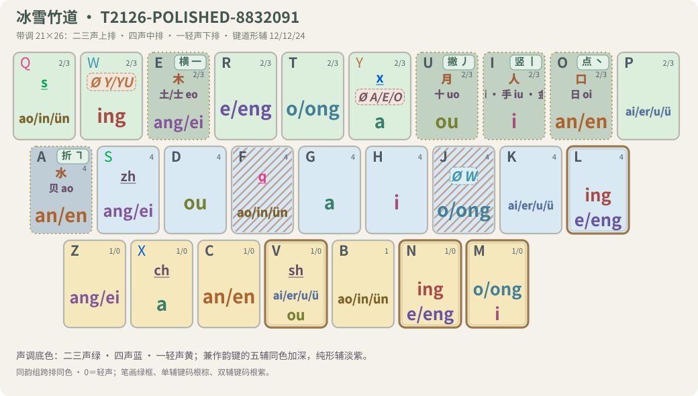

# 冰雪竹道

冰雪竹道（`snow_zhudao`）是生产方案，使用 21×26 键域的带调双拼＋键道形辅。布局来自本机双拼布局 Benchmark 的 `T2126-POLISHED-8832091`（「21×26 带调 · 精修冠军 10/9/7」，布局 ID `T2126-SA-4b977c2d7f2e1837`）；冻结数据及来源校验值见 [配置](../config/snow-zhudao-mapping.json)。冠军页面的 1,407 个实际带调音节已独立保留并逐条验证。`10/9/7` 表示上、中、下排分别使用的次键数。

## 声韵调

声母布局与冰雪鹤道一致：普通声母按字母本键，例外为 `q→f`、`s→q`、`x→y`；`zh/ch/sh→s/x/v`。零声母 `a/e/o` 用 `y` 作首键，拼音 `w` 用 `j`，拼音 `y`（含 `yu`）用 `w`。下表将 ü 写成 `v`，`uen/uei/iou` 对应缩写 `un/ui/iu`；`y/w` 拼写先还原为完整韵母，`j/q/x` 后的 `u` 归入 ü 系。

第二码同时表示韵母组和声调：二、三声在上排，四声在中排，一声和轻声在下排。声调不再占用后置形辅。

| 韵母组 | 二／三声（上排） | 四声（中排） | 一／轻声（下排） |
| --- | --- | --- | --- |
| `a/ia/ua` | `y` | `g` | `x` |
| `ai/uai/er/u/v` | `p` | `k` | `v` |
| `an/en/ian/uan/uen/van` | `o` | `a` | `c` |
| `ang/iang/uang/ei/uei` | `e` | `s` | `z` |
| `ao/iao/in/vn` | `q` | `f` | `b` |
| `e/ie/ve/eng/ueng` | `r` | `l` | `n` |
| `i` | `i` | `h` | `m` |
| `ing` | `w` | `l` | `n` |
| `o/io/uo/ong/iong` | `t` | `j` | `m` |
| `ou/iou` | `u` | `d` | `v` |

例如 `bing1/bing2/bing3/bing4/bing5` 分别编码为 `bn/bw/bw/bl/bn`。二、三声共码，一声与轻声共码；共享韵母组也会合码，使用后置形辅筛选。独立鼻音和 `ê` 不进入十韵组。

## 飞码与形辅

除上述声韵调布局外，沿用冰雪鹤道的共用翻译器、飞花／飞码式四码顶、空桶回收、候选排序、学习、固顶、缓冲、反查和快捷键。形辅仍是键道字根，折、横、撇、竖、点按 `aeuio`；源字根表中的 `avuio` 按语义转换。五辅配置保留 `AEUIO ↔ IEUAO` 和 `42310` 往返不变式，其中 `IEUAO` 是共用五辅语义的调序，实际声调已由第二码承载。

| 字数／路由 | 主码 | 后置形辅 | 最长 |
| --- | --- | --- | --- |
| 单字 | `AU` | 本字最多四辅 | 六码 |
| 标准二字词 | `A₁U₁A₂U₂` | 第一字首辅、第二字首辅（`12`） | 六码 |
| 三字词 | `A₁A₂A₃U₃`，兼容 `AAA` | 第一字首辅、第二字首辅（`12`） | 六码 |
| 四字词 | `A₁A₂A₃A₄` | 第二字首辅、第四字首辅（`24`） | 六码 |
| 声声空桶二字词 | `A₁A₂` | 标准辅序的反序，每字连续两辅（`2211`） | 六码 |

声声入口仅在对应双拼桶为空时启用；占用桶继续显示单字。标准辅序可用 `translator/word_auxiliary_order` 改为 `21`，声声四辅随之反向成为 `1122`。第三音节对应双拼桶为空时，沿用鹤道的 `AAA+B` 回收路径。

| 词 | 可输入的码 |
| --- | --- |
| 冰 | `bn`、`bno`、`bnoe`、`bnoea` |
| 冰雪 | `bnyr`、`bnyro`、`bnyroe` |
| 输入法 | `vrf`、`vrfy`、`vrfye`、`vrfyeu` |
| 人工智能 | `rgsn`、`rgsne`、`rgsnea` |
| 不到（声声） | `bd`、`bde`、`bdea`、`bdeae`、`bdeaeu` |

「不到」先取「到」的 `ea`，再取「不」的 `eu`。输入第七码前顶出当前完整候选并重放新键；退格仍能逐码恢复筛选。上屏后的学习状态由独立的棱镜和 `snow_zhudao_polished_8832091` 用户固顶库隔离。

字母沿用「汉字首选、大写第二、小写第三」的候选合同，按当前带调布局重新计算 26 个占用桶，例如 `bq` 输入字母 `B/b`；详见 [字母桶配置](../config/snow-zhudao-letter-buckets.json)。不占用声声空桶。

单字固顶先保留冰雪四拼显式固顶的优先级，兜底候选按「字＋当前读音」的权重分配，不按同字其他读音的频率排序。例如 `qz` 对应的「虽／sui1」权重为 2532，应优先于「尿／sui1」的 199；「尿／niao4」的 9771 不参与 `qz` 桶的比较。「尿」的 `suī` 异读仍然保留为合法候选。

重建通用固顶表时使用与 CI 一致的 Bun 1.3.14：在仓库根目录运行 `bun run --cwd scripts fixed:generate`，随后运行 `bun scripts/align-fixed-with-sipin.ts` 和 `bun scripts/generate-shenyun-hints.ts`；检查时用 `bun run --cwd scripts fixed:check`。通用编译器的生成与检查入口统一使用 Bun，避免混用 Node 后造成产物差异。

## 安装与验证

先在输入法的方案设置中启用冰雪竹道，或在用户 `default.custom.yaml` 现有的 `patch/schema_list` 中追加 `- {schema: snow_zhudao}`，保留其他方案，然后重新部署。仅复制方案文件或在自带菜单中看到名称，不会让部署器编译它。部署后应生成 `build/snow_zhudao.schema.yaml` 和 `build/snow_zhudao.prism.bin`；缺少已编译方案时，自带菜单显示「未部署：请加入方案列表后重新部署」，选择它不会切换到空方案。

部署完成后，在方案菜单中输入 `zd` 或 `bxzd` 选择冰雪竹道。空输入中文模式按 `e` 显示键位图；移动端使用含竹道入口的新版元书／同文皮肤。拼音反查为 `a`＋全拼，笔画与部件全拼反查共用 `u`，笔画顺序横竖撇点折为 `eiuoa`。`;`、`/` 分别在顶出候选后追加「的」「了」。

冠军评测的 1,407 个带调音节占用 516／546 桶，剩余 30 桶；本仓库现行完整词典另有扩展读音，实际占用 522 桶、剩余 24 桶，其中 19 个是声声空桶。冰雪鹤道在同一完整词典口径下剩余 142 桶，其中声声空桶 129 个。两个口径不混用，扩展词典更新后以生成检查结果为准。

本地运行 `bun scripts/generate-zhudao.ts --check`、`bun scripts/research/calculate_shenyun_21x26_letter_buckets.ts --zhudao --check`、`bun scripts/align-fixed-with-sipin.ts --check`、`bun scripts/generate-shenyun-hints.ts --check` 和 `bun test --cwd scripts fixed-corpus/test/zhudao.test.ts`。真实候选测试仅由 GitHub Actions 在 librime 1.13.1 与 1.17 上运行，见 [候选用例](../spec/snow_zhudao.test.yaml)；性能场景复用全部方案的统一预算。
