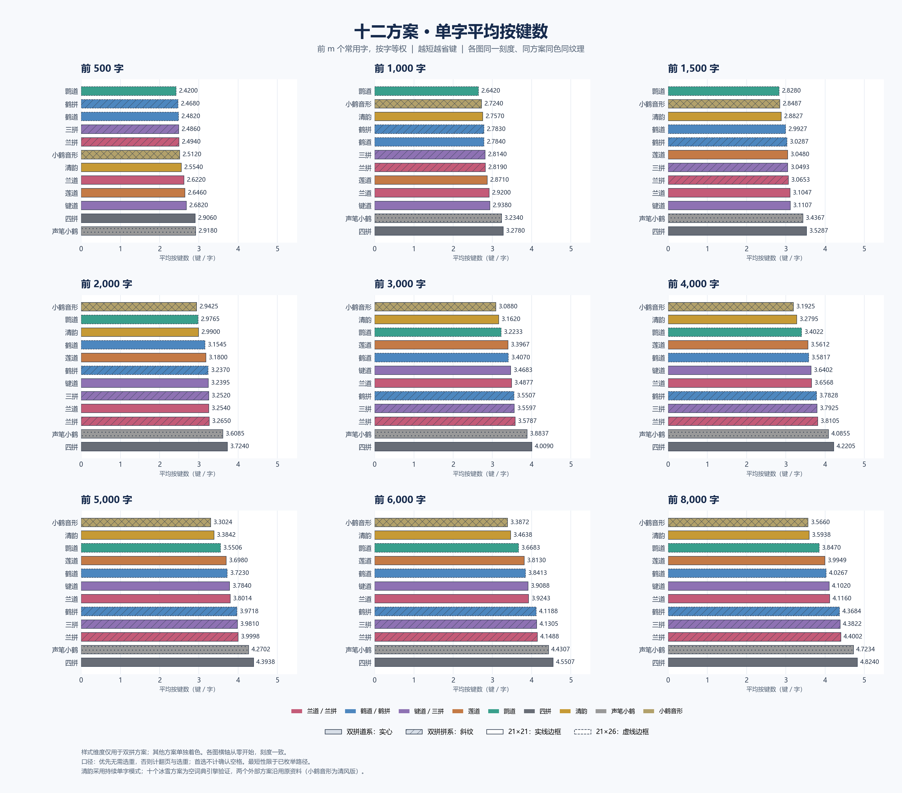

# 十二方案单字键数（优先无选重，计入翻页）

优先无选重：只要在枚举路径中找到首选，就使用最短首选路径，即使选重路径更短；仅未找到首选时，采用已验证候选中最短的选重路径。选重加一键，翻页每次加一键（六候选页），首选不计确认空格。均键按字等权，选重比例以当前前m字为分母。冰雪方案无候选证据的字记为 NA，不用词典码路估算；含此类字的总体均键显示待核实，键数分布之和也相应少于 m。外部方案保留原资料来源。最短性限于已枚举路径。原始首选 TSV 保留。

十个冰雪方案各 8000 字均有空词典逐键引擎证据，声笔小鹤、小鹤音形沿用原资料；共 96000 个方案—字记录。首选实测 79300 条，首页选重实测 682 条，后续页选重实测 18 条。采集生产提交：c21efd84ac2f1d334fa77c2e4919d982c8c3dcf4。

[查看可缩放 SVG 大图](8000字_十二方案含选重键数_均键对比.svg)。同布局同色，道系实心、拼系斜纹；双拼 21×21 实线边框、21×26 虚线边框。各图横轴刻度一致，按均键升序。

清韵本轮采用持续「单字」模式（character=true）；其他方案沿用原观测。

## 前 500 字

| 方案 | 均键 | 选重 | 1键 | 2键 | 3键 | 4键 | 5键 | 6键 | 7键 |
| --- | ---: | ---: | ---: | ---: | ---: | ---: | ---: | ---: | ---: |
| 冰雪鹮道 | 2.4200 | 0／0.00% | 23／4.60% | 267／53.40% | 187／37.40% | 23／4.60% | 0／0.00% | 0／0.00% | 0／0.00% |
| 冰雪鹤拼 | 2.4680 | 0／0.00% | 23／4.60% | 242／48.40% | 213／42.60% | 22／4.40% | 0／0.00% | 0／0.00% | 0／0.00% |
| 冰雪鹤道 | 2.4820 | 0／0.00% | 23／4.60% | 242／48.40% | 206／41.20% | 29／5.80% | 0／0.00% | 0／0.00% | 0／0.00% |
| 冰雪三拼 | 2.4860 | 0／0.00% | 23／4.60% | 235／47.00% | 219／43.80% | 22／4.40% | 1／0.20% | 0／0.00% | 0／0.00% |
| 冰雪兰拼 | 2.4940 | 0／0.00% | 23／4.60% | 229／45.80% | 226／45.20% | 22／4.40% | 0／0.00% | 0／0.00% | 0／0.00% |
| 小鹤音形（清风版） | 2.5120 | 0／0.00% | 25／5.00% | 223／44.60% | 223／44.60% | 29／5.80% | 0／0.00% | 0／0.00% | 0／0.00% |
| 冰雪清韵 | 2.5540 | 0／0.00% | 28／5.60% | 217／43.40% | 205／41.00% | 50／10.00% | 0／0.00% | 0／0.00% | 0／0.00% |
| 冰雪兰道 | 2.6220 | 0／0.00% | 22／4.40% | 228／45.60% | 168／33.60% | 81／16.20% | 1／0.20% | 0／0.00% | 0／0.00% |
| 冰雪莲道 | 2.6460 | 0／0.00% | 23／4.60% | 240／48.00% | 128／25.60% | 109／21.80% | 0／0.00% | 0／0.00% | 0／0.00% |
| 冰雪键道 | 2.6820 | 0／0.00% | 23／4.60% | 233／46.60% | 127／25.40% | 114／22.80% | 3／0.60% | 0／0.00% | 0／0.00% |
| 冰雪四拼 | 2.9060 | 0／0.00% | 23／4.60% | 90／18.00% | 302／60.40% | 81／16.20% | 4／0.80% | 0／0.00% | 0／0.00% |
| 声笔小鹤 | 2.9180 | 0／0.00% | 20／4.00% | 187／37.40% | 187／37.40% | 44／8.80% | 46／9.20% | 14／2.80% | 2／0.40% |

## 前 1000 字

| 方案 | 均键 | 选重 | 1键 | 2键 | 3键 | 4键 | 5键 | 6键 | 7键 | 8键 |
| --- | ---: | ---: | ---: | ---: | ---: | ---: | ---: | ---: | ---: | ---: |
| 冰雪鹮道 | 2.6420 | 0／0.00% | 23／2.30% | 405／40.50% | 481／48.10% | 89／8.90% | 2／0.20% | 0／0.00% | 0／0.00% | 0／0.00% |
| 小鹤音形（清风版） | 2.7240 | 0／0.00% | 26／2.60% | 312／31.20% | 578／57.80% | 82／8.20% | 0／0.00% | 2／0.20% | 0／0.00% | 0／0.00% |
| 冰雪清韵 | 2.7570 | 2／0.20% | 28／2.80% | 352／35.20% | 456／45.60% | 163／16.30% | 1／0.10% | 0／0.00% | 0／0.00% | 0／0.00% |
| 冰雪鹤拼 | 2.7830 | 0／0.00% | 23／2.30% | 329／32.90% | 499／49.90% | 140／14.00% | 9／0.90% | 0／0.00% | 0／0.00% | 0／0.00% |
| 冰雪鹤道 | 2.7840 | 0／0.00% | 23／2.30% | 329／32.90% | 496／49.60% | 145／14.50% | 7／0.70% | 0／0.00% | 0／0.00% | 0／0.00% |
| 冰雪三拼 | 2.8140 | 0／0.00% | 23／2.30% | 308／30.80% | 511／51.10% | 148／14.80% | 10／1.00% | 0／0.00% | 0／0.00% | 0／0.00% |
| 冰雪兰拼 | 2.8190 | 0／0.00% | 23／2.30% | 297／29.70% | 527／52.70% | 144／14.40% | 9／0.90% | 0／0.00% | 0／0.00% | 0／0.00% |
| 冰雪莲道 | 2.8710 | 0／0.00% | 23／2.30% | 355／35.50% | 361／36.10% | 250／25.00% | 11／1.10% | 0／0.00% | 0／0.00% | 0／0.00% |
| 冰雪兰道 | 2.9200 | 0／0.00% | 22／2.20% | 299／29.90% | 431／43.10% | 234／23.40% | 13／1.30% | 1／0.10% | 0／0.00% | 0／0.00% |
| 冰雪键道 | 2.9380 | 0／0.00% | 23／2.30% | 306／30.60% | 389／38.90% | 274／27.40% | 8／0.80% | 0／0.00% | 0／0.00% | 0／0.00% |
| 声笔小鹤 | 3.2340 | 0／0.00% | 21／2.10% | 272／27.20% | 401／40.10% | 123／12.30% | 133／13.30% | 43／4.30% | 5／0.50% | 2／0.20% |
| 冰雪四拼 | 3.2780 | 0／0.00% | 23／2.30% | 103／10.30% | 491／49.10% | 340／34.00% | 42／4.20% | 1／0.10% | 0／0.00% | 0／0.00% |

## 前 1500 字

| 方案 | 均键 | 选重 | 1键 | 2键 | 3键 | 4键 | 5键 | 6键 | 7键 | 8键 |
| --- | ---: | ---: | ---: | ---: | ---: | ---: | ---: | ---: | ---: | ---: |
| 冰雪鹮道 | 2.8280 | 0／0.00% | 23／1.53% | 455／30.33% | 788／52.53% | 225／15.00% | 9／0.60% | 0／0.00% | 0／0.00% | 0／0.00% |
| 小鹤音形（清风版） | 2.8487 | 4／0.27% | 26／1.73% | 347／23.13% | 970／64.67% | 151／10.07% | 0／0.00% | 4／0.27% | 1／0.07% | 1／0.07% |
| 冰雪清韵 | 2.8827 | 3／0.20% | 28／1.87% | 437／29.13% | 720／48.00% | 313／20.87% | 2／0.13% | 0／0.00% | 0／0.00% | 0／0.00% |
| 冰雪鹤道 | 2.9927 | 0／0.00% | 23／1.53% | 370／24.67% | 735／49.00% | 339／22.60% | 33／2.20% | 0／0.00% | 0／0.00% | 0／0.00% |
| 冰雪鹤拼 | 3.0287 | 0／0.00% | 23／1.53% | 370／24.67% | 699／46.60% | 360／24.00% | 45／3.00% | 3／0.20% | 0／0.00% | 0／0.00% |
| 冰雪莲道 | 3.0480 | 0／0.00% | 23／1.53% | 387／25.80% | 617／41.13% | 442／29.47% | 30／2.00% | 1／0.07% | 0／0.00% | 0／0.00% |
| 冰雪三拼 | 3.0493 | 0／0.00% | 23／1.53% | 343／22.87% | 718／47.87% | 370／24.67% | 45／3.00% | 1／0.07% | 0／0.00% | 0／0.00% |
| 冰雪兰拼 | 3.0653 | 0／0.00% | 23／1.53% | 327／21.80% | 725／48.33% | 380／25.33% | 44／2.93% | 1／0.07% | 0／0.00% | 0／0.00% |
| 冰雪兰道 | 3.1047 | 0／0.00% | 22／1.47% | 330／22.00% | 665／44.33% | 437／29.13% | 44／2.93% | 2／0.13% | 0／0.00% | 0／0.00% |
| 冰雪键道 | 3.1107 | 0／0.00% | 23／1.53% | 340／22.67% | 616／41.07% | 490／32.67% | 31／2.07% | 0／0.00% | 0／0.00% | 0／0.00% |
| 声笔小鹤 | 3.4367 | 0／0.00% | 21／1.40% | 315／21.00% | 600／40.00% | 216／14.40% | 265／17.67% | 69／4.60% | 11／0.73% | 3／0.20% |
| 冰雪四拼 | 3.5287 | 0／0.00% | 23／1.53% | 105／7.00% | 574／38.27% | 654／43.60% | 142／9.47% | 2／0.13% | 0／0.00% | 0／0.00% |

## 前 2000 字

| 方案 | 均键 | 选重 | 1键 | 2键 | 3键 | 4键 | 5键 | 6键 | 7键 | 8键 | 9键 |
| --- | ---: | ---: | ---: | ---: | ---: | ---: | ---: | ---: | ---: | ---: | ---: |
| 小鹤音形（清风版） | 2.9425 | 8／0.40% | 26／1.30% | 360／18.00% | 1341／67.05% | 263／13.15% | 1／0.05% | 6／0.30% | 1／0.05% | 2／0.10% | 0／0.00% |
| 冰雪鹮道 | 2.9765 | 0／0.00% | 23／1.15% | 480／24.00% | 1045／52.25% | 425／21.25% | 27／1.35% | 0／0.00% | 0／0.00% | 0／0.00% | 0／0.00% |
| 冰雪清韵 | 2.9900 | 8／0.40% | 28／1.40% | 490／24.50% | 960／48.00% | 518／25.90% | 4／0.20% | 0／0.00% | 0／0.00% | 0／0.00% | 0／0.00% |
| 冰雪鹤道 | 3.1545 | 0／0.00% | 23／1.15% | 383／19.15% | 937／46.85% | 579／28.95% | 75／3.75% | 3／0.15% | 0／0.00% | 0／0.00% | 0／0.00% |
| 冰雪莲道 | 3.1800 | 0／0.00% | 23／1.15% | 404／20.20% | 836／41.80% | 665／33.25% | 71／3.55% | 1／0.05% | 0／0.00% | 0／0.00% | 0／0.00% |
| 冰雪鹤拼 | 3.2370 | 0／0.00% | 23／1.15% | 383／19.15% | 828／41.40% | 638／31.90% | 119／5.95% | 9／0.45% | 0／0.00% | 0／0.00% | 0／0.00% |
| 冰雪键道 | 3.2395 | 0／0.00% | 23／1.15% | 355／17.75% | 821／41.05% | 725／36.25% | 73／3.65% | 3／0.15% | 0／0.00% | 0／0.00% | 0／0.00% |
| 冰雪三拼 | 3.2520 | 0／0.00% | 23／1.15% | 355／17.75% | 852／42.60% | 644／32.20% | 118／5.90% | 7／0.35% | 1／0.05% | 0／0.00% | 0／0.00% |
| 冰雪兰道 | 3.2540 | 0／0.00% | 22／1.10% | 339／16.95% | 860／43.00% | 674／33.70% | 98／4.90% | 7／0.35% | 0／0.00% | 0／0.00% | 0／0.00% |
| 冰雪兰拼 | 3.2650 | 0／0.00% | 23／1.15% | 340／17.00% | 854／42.70% | 657／32.85% | 119／5.95% | 7／0.35% | 0／0.00% | 0／0.00% | 0／0.00% |
| 声笔小鹤 | 3.6085 | 0／0.00% | 21／1.05% | 338／16.90% | 765／38.25% | 327／16.35% | 409／20.45% | 114／5.70% | 21／1.05% | 4／0.20% | 1／0.05% |
| 冰雪四拼 | 3.7240 | 0／0.00% | 23／1.15% | 105／5.25% | 623／31.15% | 919／45.95% | 310／15.50% | 20／1.00% | 0／0.00% | 0／0.00% | 0／0.00% |

## 前 3000 字

| 方案 | 均键 | 选重 | 1键 | 2键 | 3键 | 4键 | 5键 | 6键 | 7键 | 8键 | 9键 |
| --- | ---: | ---: | ---: | ---: | ---: | ---: | ---: | ---: | ---: | ---: | ---: |
| 小鹤音形（清风版） | 3.0880 | 28／0.93% | 26／0.87% | 368／12.27% | 1982／66.07% | 599／19.97% | 3／0.10% | 14／0.47% | 3／0.10% | 5／0.17% | 0／0.00% |
| 冰雪清韵 | 3.1620 | 28／0.93% | 28／0.93% | 552／18.40% | 1337／44.57% | 1072／35.73% | 11／0.37% | 0／0.00% | 0／0.00% | 0／0.00% | 0／0.00% |
| 冰雪鹮道 | 3.2233 | 1／0.03% | 23／0.77% | 498／16.60% | 1401／46.70% | 948／31.60% | 124／4.13% | 6／0.20% | 0／0.00% | 0／0.00% | 0／0.00% |
| 冰雪莲道 | 3.3967 | 0／0.00% | 23／0.77% | 418／13.93% | 1146／38.20% | 1187／39.57% | 211／7.03% | 15／0.50% | 0／0.00% | 0／0.00% | 0／0.00% |
| 冰雪鹤道 | 3.4070 | 0／0.00% | 23／0.77% | 393／13.10% | 1206／40.20% | 1108／36.93% | 258／8.60% | 12／0.40% | 0／0.00% | 0／0.00% | 0／0.00% |
| 冰雪键道 | 3.4683 | 0／0.00% | 23／0.77% | 362／12.07% | 1099／36.63% | 1231／41.03% | 273／9.10% | 12／0.40% | 0／0.00% | 0／0.00% | 0／0.00% |
| 冰雪兰道 | 3.4877 | 0／0.00% | 22／0.73% | 349／11.63% | 1116／37.20% | 1190／39.67% | 303／10.10% | 20／0.67% | 0／0.00% | 0／0.00% | 0／0.00% |
| 冰雪鹤拼 | 3.5507 | 1／0.03% | 23／0.77% | 393／13.10% | 985／32.83% | 1168／38.93% | 375／12.50% | 52／1.73% | 3／0.10% | 1／0.03% | 0／0.00% |
| 冰雪三拼 | 3.5597 | 1／0.03% | 23／0.77% | 363／12.10% | 1007／33.57% | 1189／39.63% | 362／12.07% | 50／1.67% | 5／0.17% | 1／0.03% | 0／0.00% |
| 冰雪兰拼 | 3.5787 | 1／0.03% | 23／0.77% | 347／11.57% | 994／33.13% | 1206／40.20% | 373／12.43% | 52／1.73% | 4／0.13% | 1／0.03% | 0／0.00% |
| 声笔小鹤 | 3.8837 | 0／0.00% | 21／0.70% | 362／12.07% | 996／33.20% | 581／19.37% | 725／24.17% | 245／8.17% | 62／2.07% | 7／0.23% | 1／0.03% |
| 冰雪四拼 | 4.0090 | 0／0.00% | 23／0.77% | 105／3.50% | 668／22.27% | 1339／44.63% | 763／25.43% | 96／3.20% | 5／0.17% | 1／0.03% | 0／0.00% |

## 前 4000 字

| 方案 | 均键 | 选重 | 1键 | 2键 | 3键 | 4键 | 5键 | 6键 | 7键 | 8键 | 9键 | 10键 |
| --- | ---: | ---: | ---: | ---: | ---: | ---: | ---: | ---: | ---: | ---: | ---: | ---: |
| 小鹤音形（清风版） | 3.1925 | 47／1.18% | 26／0.65% | 372／9.30% | 2576／64.40% | 957／23.93% | 7／0.17% | 42／1.05% | 3／0.07% | 17／0.42% | 0／0.00% | 0／0.00% |
| 冰雪清韵 | 3.2795 | 64／1.60% | 28／0.70% | 586／14.65% | 1653／41.33% | 1706／42.65% | 27／0.68% | 0／0.00% | 0／0.00% | 0／0.00% | 0／0.00% | 0／0.00% |
| 冰雪鹮道 | 3.4022 | 1／0.03% | 23／0.57% | 507／12.68% | 1644／41.10% | 1507／37.67% | 302／7.55% | 17／0.42% | 0／0.00% | 0／0.00% | 0／0.00% | 0／0.00% |
| 冰雪莲道 | 3.5612 | 0／0.00% | 23／0.57% | 424／10.60% | 1343／33.58% | 1741／43.52% | 433／10.82% | 36／0.90% | 0／0.00% | 0／0.00% | 0／0.00% | 0／0.00% |
| 冰雪鹤道 | 3.5817 | 0／0.00% | 23／0.57% | 400／10.00% | 1381／34.52% | 1658／41.45% | 499／12.47% | 39／0.97% | 0／0.00% | 0／0.00% | 0／0.00% | 0／0.00% |
| 冰雪键道 | 3.6402 | 0／0.00% | 23／0.57% | 370／9.25% | 1269／31.73% | 1740／43.50% | 557／13.93% | 41／1.02% | 0／0.00% | 0／0.00% | 0／0.00% | 0／0.00% |
| 冰雪兰道 | 3.6568 | 0／0.00% | 22／0.55% | 353／8.82% | 1288／32.20% | 1699／42.48% | 589／14.72% | 49／1.23% | 0／0.00% | 0／0.00% | 0／0.00% | 0／0.00% |
| 冰雪鹤拼 | 3.7828 | 1／0.03% | 23／0.57% | 400／10.00% | 1058／26.45% | 1647／41.17% | 706／17.65% | 150／3.75% | 13／0.33% | 2／0.05% | 1／0.03% | 0／0.00% |
| 冰雪三拼 | 3.7925 | 1／0.03% | 23／0.57% | 370／9.25% | 1073／26.82% | 1670／41.75% | 697／17.43% | 150／3.75% | 14／0.35% | 2／0.05% | 1／0.03% | 0／0.00% |
| 冰雪兰拼 | 3.8105 | 1／0.03% | 23／0.57% | 353／8.82% | 1057／26.43% | 1686／42.15% | 711／17.77% | 152／3.80% | 14／0.35% | 3／0.07% | 1／0.03% | 0／0.00% |
| 声笔小鹤 | 4.0855 | 1／0.03% | 21／0.53% | 368／9.20% | 1164／29.10% | 818／20.45% | 1102／27.55% | 402／10.05% | 105／2.62% | 17／0.42% | 2／0.05% | 1／0.03% |
| 冰雪四拼 | 4.2205 | 0／0.00% | 23／0.57% | 105／2.62% | 688／17.20% | 1604／40.10% | 1327／33.17% | 238／5.95% | 14／0.35% | 1／0.03% | 0／0.00% | 0／0.00% |

## 前 5000 字

| 方案 | 均键 | 选重 | 1键 | 2键 | 3键 | 4键 | 5键 | 6键 | 7键 | 8键 | 9键 | 10键 |
| --- | ---: | ---: | ---: | ---: | ---: | ---: | ---: | ---: | ---: | ---: | ---: | ---: |
| 小鹤音形（清风版） | 3.3024 | 90／1.80% | 26／0.52% | 372／7.44% | 3061／61.22% | 1386／27.72% | 11／0.22% | 84／1.68% | 26／0.52% | 32／0.64% | 2／0.04% | 0／0.00% |
| 冰雪清韵 | 3.3842 | 131／2.62% | 28／0.56% | 590／11.80% | 1883／37.66% | 2433／48.66% | 64／1.28% | 2／0.04% | 0／0.00% | 0／0.00% | 0／0.00% | 0／0.00% |
| 冰雪鹮道 | 3.5506 | 1／0.02% | 23／0.46% | 513／10.26% | 1806／36.12% | 2046／40.92% | 570／11.40% | 42／0.84% | 0／0.00% | 0／0.00% | 0／0.00% | 0／0.00% |
| 冰雪莲道 | 3.6980 | 1／0.02% | 23／0.46% | 428／8.56% | 1504／30.08% | 2200／44.00% | 771／15.42% | 74／1.48% | 0／0.00% | 0／0.00% | 0／0.00% | 0／0.00% |
| 冰雪鹤道 | 3.7230 | 4／0.08% | 23／0.46% | 400／8.00% | 1511／30.22% | 2157／43.14% | 823／16.46% | 86／1.72% | 0／0.00% | 0／0.00% | 0／0.00% | 0／0.00% |
| 冰雪键道 | 3.7840 | 5／0.10% | 23／0.46% | 370／7.40% | 1402／28.04% | 2173／43.46% | 933／18.66% | 99／1.98% | 0／0.00% | 0／0.00% | 0／0.00% | 0／0.00% |
| 冰雪兰道 | 3.8014 | 5／0.10% | 22／0.44% | 353／7.06% | 1415／28.30% | 2123／42.46% | 980／19.60% | 107／2.14% | 0／0.00% | 0／0.00% | 0／0.00% | 0／0.00% |
| 冰雪鹤拼 | 3.9718 | 2／0.04% | 23／0.46% | 400／8.00% | 1105／22.10% | 2042／40.84% | 1092／21.84% | 285／5.70% | 44／0.88% | 6／0.12% | 3／0.06% | 0／0.00% |
| 冰雪三拼 | 3.9810 | 2／0.04% | 23／0.46% | 370／7.40% | 1122／22.44% | 2066／41.32% | 1073／21.46% | 288／5.76% | 48／0.96% | 7／0.14% | 3／0.06% | 0／0.00% |
| 冰雪兰拼 | 3.9998 | 2／0.04% | 23／0.46% | 353／7.06% | 1097／21.94% | 2080／41.60% | 1094／21.88% | 295／5.90% | 48／0.96% | 7／0.14% | 3／0.06% | 0／0.00% |
| 声笔小鹤 | 4.2702 | 1／0.02% | 21／0.42% | 369／7.38% | 1265／25.30% | 1052／21.04% | 1461／29.22% | 606／12.12% | 178／3.56% | 35／0.70% | 8／0.16% | 5／0.10% |
| 冰雪四拼 | 4.3938 | 0／0.00% | 23／0.46% | 105／2.10% | 698／13.96% | 1798／35.96% | 1884／37.68% | 431／8.62% | 49／0.98% | 8／0.16% | 3／0.06% | 1／0.02% |

## 前 6000 字

| 方案 | 均键 | 选重 | 1键 | 2键 | 3键 | 4键 | 5键 | 6键 | 7键 | 8键 | 9键 | 10键 |
| --- | ---: | ---: | ---: | ---: | ---: | ---: | ---: | ---: | ---: | ---: | ---: | ---: |
| 小鹤音形（清风版） | 3.3872 | 139／2.32% | 26／0.43% | 372／6.20% | 3495／58.25% | 1858／30.97% | 15／0.25% | 128／2.13% | 59／0.98% | 43／0.72% | 4／0.07% | 0／0.00% |
| 冰雪清韵 | 3.4638 | 244／4.07% | 28／0.47% | 592／9.87% | 2087／34.78% | 3157／52.62% | 134／2.23% | 2／0.03% | 0／0.00% | 0／0.00% | 0／0.00% | 0／0.00% |
| 冰雪鹮道 | 3.6683 | 4／0.07% | 23／0.38% | 514／8.57% | 1948／32.47% | 2547／42.45% | 881／14.68% | 87／1.45% | 0／0.00% | 0／0.00% | 0／0.00% | 0／0.00% |
| 冰雪莲道 | 3.8130 | 4／0.07% | 23／0.38% | 430／7.17% | 1624／27.07% | 2631／43.85% | 1153／19.22% | 139／2.32% | 0／0.00% | 0／0.00% | 0／0.00% | 0／0.00% |
| 冰雪鹤道 | 3.8413 | 9／0.15% | 23／0.38% | 400／6.67% | 1609／26.82% | 2607／43.45% | 1196／19.93% | 165／2.75% | 0／0.00% | 0／0.00% | 0／0.00% | 0／0.00% |
| 冰雪键道 | 3.9088 | 12／0.20% | 23／0.38% | 370／6.17% | 1499／24.98% | 2557／42.62% | 1341／22.35% | 210／3.50% | 0／0.00% | 0／0.00% | 0／0.00% | 0／0.00% |
| 冰雪兰道 | 3.9243 | 14／0.23% | 22／0.37% | 354／5.90% | 1505／25.08% | 2512／41.87% | 1389／23.15% | 218／3.63% | 0／0.00% | 0／0.00% | 0／0.00% | 0／0.00% |
| 冰雪鹤拼 | 4.1188 | 2／0.03% | 23／0.38% | 400／6.67% | 1149／19.15% | 2385／39.75% | 1487／24.78% | 445／7.42% | 96／1.60% | 10／0.17% | 4／0.07% | 1／0.02% |
| 冰雪三拼 | 4.1305 | 2／0.03% | 23／0.38% | 370／6.17% | 1159／19.32% | 2402／40.03% | 1476／24.60% | 455／7.58% | 100／1.67% | 11／0.18% | 3／0.05% | 1／0.02% |
| 冰雪兰拼 | 4.1488 | 2／0.03% | 23／0.38% | 354／5.90% | 1127／18.78% | 2416／40.27% | 1503／25.05% | 458／7.63% | 103／1.72% | 12／0.20% | 3／0.05% | 1／0.02% |
| 声笔小鹤 | 4.4307 | 3／0.05% | 21／0.35% | 370／6.17% | 1335／22.25% | 1233／20.55% | 1829／30.48% | 853／14.22% | 278／4.63% | 60／1.00% | 13／0.22% | 8／0.13% |
| 冰雪四拼 | 4.5507 | 0／0.00% | 23／0.38% | 105／1.75% | 703／11.72% | 1916／31.93% | 2382／39.70% | 735／12.25% | 116／1.93% | 15／0.25% | 4／0.07% | 1／0.02% |

## 前 8000 字

| 方案 | 均键 | 选重 | 1键 | 2键 | 3键 | 4键 | 5键 | 6键 | 7键 | 8键 | 9键 | 10键 |
| --- | ---: | ---: | ---: | ---: | ---: | ---: | ---: | ---: | ---: | ---: | ---: | ---: |
| 小鹤音形（清风版） | 3.5660 | 275／3.44% | 26／0.33% | 372／4.65% | 4089／51.11% | 2964／37.05% | 17／0.21% | 263／3.29% | 187／2.34% | 75／0.94% | 7／0.09% | 0／0.00% |
| 冰雪清韵 | 3.5938 | 562／7.03% | 28／0.35% | 593／7.41% | 2363／29.54% | 4645／58.06% | 361／4.51% | 8／0.10% | 2／0.03% | 0／0.00% | 0／0.00% | 0／0.00% |
| 冰雪鹮道 | 3.8470 | 14／0.17% | 23／0.29% | 514／6.42% | 2138／26.73% | 3515／43.94% | 1609／20.11% | 201／2.51% | 0／0.00% | 0／0.00% | 0／0.00% | 0／0.00% |
| 冰雪莲道 | 3.9949 | 19／0.24% | 23／0.29% | 431／5.39% | 1769／22.11% | 3438／42.98% | 2019／25.24% | 320／4.00% | 0／0.00% | 0／0.00% | 0／0.00% | 0／0.00% |
| 冰雪鹤道 | 4.0267 | 22／0.28% | 23／0.29% | 400／5.00% | 1718／21.48% | 3440／43.00% | 2037／25.46% | 382／4.78% | 0／0.00% | 0／0.00% | 0／0.00% | 0／0.00% |
| 冰雪键道 | 4.1020 | 37／0.46% | 23／0.29% | 370／4.62% | 1599／19.99% | 3271／40.89% | 2250／28.12% | 487／6.09% | 0／0.00% | 0／0.00% | 0／0.00% | 0／0.00% |
| 冰雪兰道 | 4.1160 | 40／0.50% | 22／0.28% | 354／4.42% | 1610／20.12% | 3194／39.92% | 2328／29.10% | 492／6.15% | 0／0.00% | 0／0.00% | 0／0.00% | 0／0.00% |
| 冰雪鹤拼 | 4.3684 | 2／0.03% | 23／0.29% | 400／5.00% | 1192／14.90% | 2910／36.38% | 2291／28.64% | 906／11.32% | 228／2.85% | 33／0.41% | 13／0.16% | 4／0.05% |
| 冰雪三拼 | 4.3822 | 2／0.03% | 23／0.29% | 370／4.62% | 1197／14.96% | 2908／36.35% | 2293／28.66% | 925／11.56% | 233／2.91% | 36／0.45% | 12／0.15% | 3／0.04% |
| 冰雪兰拼 | 4.4002 | 2／0.03% | 23／0.29% | 354／4.42% | 1162／14.53% | 2903／36.29% | 2333／29.16% | 938／11.72% | 234／2.92% | 38／0.47% | 12／0.15% | 3／0.04% |
| 声笔小鹤 | 4.7234 | 16／0.20% | 21／0.26% | 370／4.62% | 1404／17.55% | 1538／19.23% | 2464／30.80% | 1405／17.56% | 553／6.91% | 179／2.24% | 51／0.64% | 15／0.19% |
| 冰雪四拼 | 4.8240 | 0／0.00% | 23／0.29% | 105／1.31% | 704／8.80% | 2032／25.40% | 3234／40.42% | 1473／18.41% | 344／4.30% | 65／0.81% | 17／0.21% | 3／0.04% |
