# 十一场景 5500 字：当前十二方案最优切分对比

按每个方案自身规则枚举合法编码，在独立会话、空白用户词典并关闭学习的候选顺序下，先最少化选重次数，再最少化实际按键；总按键相同时优先最短标准码。Shift、Space、标点和选重均计键。候选枚举按物理键数比较，不能因较短编码含 Shift 而漏掉实际更省键的较长小写码。结果为规则内最优切分模型，不代表真人速度。

本轮已作废旧候选缓存并校正查询协议：逐键读取候选、发送真实 Shift 修饰键、分方案隔离会话、关闭学习，并排除中途上屏的编码。旧回放误将冰雪莲道 `xkd`、冰雪鹮道 `yvd` 记作「新时代」首选；干净部署中两者均为「形式的」首选，「新时代」排第五。本报告使用校正后重新求解的全部路径。

语料：十篇各 500 字，加与第十篇相同的独立 500 字赛文，按两个场景计入。 共 5500 汉字、392 标点。5000 字部分另见[十篇完整报告](./十篇五百字_当前十二方案最优切分及字词比率报告.md)。

| 排名 | 方案 | 总按键 | 总平均码长（键／字） | Space | Shift | `[` | `]` | `;` | `/` | `<` | `>` | 选重 |
| ---: | --- | ---: | ---: | ---: | ---: | ---: | ---: | ---: | ---: | ---: | ---: | ---: |
| 1 | 冰雪兰道（UED-3158ce08b5bc 21×21） | 9404 | 1.7098 | 343 | 259 | 0 | 0 | 180 | 19 | 0 | 4 | 0 |
| 2 | 冰雪莲道（CR-REF-7e650f7a4c 21×21 带调） | 9437 | 1.7158 | 341 | 301 | 0 | 0 | 178 | 18 | 0 | 4 | 0 |
| 3 | 冰雪兰拼（UED-3158ce08b5bc 21×21） | 9471 | 1.7220 | 365 | 271 | 0 | 0 | 171 | 19 | 0 | 5 | 0 |
| 4 | 冰雪键道 | 9492 | 1.7258 | 352 | 308 | 0 | 0 | 180 | 21 | 0 | 4 | 0 |
| 5 | 冰雪三拼 | 9584 | 1.7425 | 355 | 320 | 0 | 0 | 172 | 20 | 0 | 5 | 0 |
| 6 | 冰雪鹮道（T2126-V52-M4-ec60a3637a99 21×26 带调） | 9598 | 1.7451 | 387 | 177 | 10 | 0 | 169 | 21 | 26 | 18 | 0 |
| 7 | 冰雪鹤道（RC26-39a5bfdc045342cd 21×26） | 9615 | 1.7482 | 395 | 158 | 7 | 0 | 182 | 21 | 15 | 9 | 0 |
| 8 | 冰雪鹤拼（RC26-39a5bfdc045342cd 21×26） | 9684 | 1.7607 | 374 | 168 | 4 | 0 | 179 | 20 | 21 | 11 | 0 |
| 9 | 冰雪四拼 | 9685 | 1.7609 | 288 | 139 | 5 | 0 | 184 | 17 | 0 | 0 | 1 |
| 10 | 声笔小鹤 | 10334 | 1.8789 | 406 | 0 | 0 | 0 | 0 | 0 | 0 | 0 | 0 |
| 11 | 冰雪清韵 | 11761 | 2.1384 | 1288 | 153 | 0 | 0 | 217 | 180 | 0 | 0 | 2 |
| 12 | 小鹤音形（清风版） | 12246 | 2.2265 | 1324 | 0 | 0 | 0 | 0 | 0 | 0 | 0 | 2 |

功能键按回放分别列出 `[`、`]`、`;`、`/`、`<`、`>` 的使用次数，零次也显示。`《`／`》` 功能以 `<`／`>` 表示，每次只在对应栏计一个基础键，配套的另一次击键已计入 Shift；这些栏均为总按键的子集，不再额外累加。选重标记 `[3]`、`[候选2]`、`[Space]` 中的方括号属于排版，不计功能键；热力图仍将 `<`／`>` 的基础键分别归入物理逗号／句号键。

## 词长、码长与选重统计

按十一场景最优路径的实际汉字输出段统计，重复出现重复计数，标点不计词次。输出段包括结构略码及追加「的／了」，不再按另一套词典重新分词；五字及以上合并为多字词。第十一场景的额外 500 字同样计入。

先按总按键从少到多给出十二方案汇总，再逐方案给出六列小表。每张小表以单字、二字、三字、四字、五字及以上为列，以实际键数为行；分布格为「次数／该词长类别占比」，空格表示零次。存在短码长词等规则，矩阵不强制为严格三角形。

各词长小表同时列出 Space、Shift 及六个功能键的使用次数，按该键所在的实际汉字输出段归类；汇总表中的对应次数为这些类别之和。

「输出段数／占比」统计的是字词输出段的出现次数，分母为本方案全部汉字输出段数，不是汉字数；所有方案输入的汉字均为 5500 字。「选重率」为选重次数除以对应类别的输出段数，汇总表给出全方案选重个数及比率。百分比保留两位小数，四舍五入后之和可能略偏离 100%。

方案总平均码长、各词长类别的平均码长及码长分布均按实际按键统计，包含编码键、额外 Shift、Space、选重键；大写字母需要的 Shift 另计一键，排版标记不计。「总均码／字」＝含标点的全方案总按键／5500 汉字，保留四位小数；「均码／段」＝对应行汉字输出段的实际按键总数／输出段数，保留三位小数。标点段不属于字词，单独计入方案总按键；没有输出段的类别以「—」表示均码。

例如，冰雪清韵将 5500 字切为 3705 个输出段，小鹤音形（清风版）切为 3316 段；含 Shift、Space、选重的平均每段实际按键分别为 3.069 和 3.575。拆账为纯编码＋Space＋Shift＋选重＋标点，分别为 9926＋1288＋153＋2＋392＝11761 键、10528＋1324＋0＋2＋392＝12246 键，故按总按键排序与按输出段数排序可以不同。

| 方案 | 总按键 | 总均码／字 | 输出段数 | 均码／段 | Space | Shift | `[` | `]` | `;` | `/` | `<` | `>` | 选重次数／率 |
| --- | ---: | ---: | ---: | ---: | ---: | ---: | ---: | ---: | ---: | ---: | ---: | ---: | ---: |
| **冰雪兰道** | **9404** | **1.7098** | **2170** | **4.153** | 343 | 259 | 0 | 0 | 180 | 19 | 0 | 4 | **0／0.00%** |
| **冰雪莲道** | **9437** | **1.7158** | **2155** | **4.197** | 341 | 301 | 0 | 0 | 178 | 18 | 0 | 4 | **0／0.00%** |
| **冰雪兰拼** | **9471** | **1.7220** | **2175** | **4.174** | 365 | 271 | 0 | 0 | 171 | 19 | 0 | 5 | **0／0.00%** |
| **冰雪键道** | **9492** | **1.7258** | **2170** | **4.194** | 352 | 308 | 0 | 0 | 180 | 21 | 0 | 4 | **0／0.00%** |
| **冰雪三拼** | **9584** | **1.7425** | **2165** | **4.246** | 355 | 320 | 0 | 0 | 172 | 20 | 0 | 5 | **0／0.00%** |
| **冰雪鹮道** | **9598** | **1.7451** | **2161** | **4.260** | 387 | 177 | 10 | 0 | 169 | 21 | 26 | 18 | **0／0.00%** |
| **冰雪鹤道** | **9615** | **1.7482** | **2183** | **4.225** | 395 | 158 | 7 | 0 | 182 | 21 | 15 | 9 | **0／0.00%** |
| **冰雪鹤拼** | **9684** | **1.7607** | **2215** | **4.195** | 374 | 168 | 4 | 0 | 179 | 20 | 21 | 11 | **0／0.00%** |
| **冰雪四拼** | **9685** | **1.7609** | **2226** | **4.175** | 288 | 139 | 5 | 0 | 184 | 17 | 0 | 0 | **1／0.04%** |
| **声笔小鹤** | **10334** | **1.8789** | **2531** | **3.928** | 406 | 0 | 0 | 0 | 0 | 0 | 0 | 0 | **0／0.00%** |
| **冰雪清韵** | **11761** | **2.1384** | **3705** | **3.069** | 1288 | 153 | 0 | 0 | 217 | 180 | 0 | 0 | **2／0.05%** |
| **小鹤音形（清风版）** | **12246** | **2.2265** | **3316** | **3.575** | 1324 | 0 | 0 | 0 | 0 | 0 | 0 | 0 | **2／0.06%** |

**冰雪兰道**

| 指标／实际键数 | 单字 | 二字 | 三字 | 四字 | 五字及以上 |
| --- | ---: | ---: | ---: | ---: | ---: |
| 输出段数／占比 | 328／15.12% | 1018／46.91% | 333／15.35% | 349／16.08% | 142／6.54% |
| 平均码长／段 | 2.866 | 3.808 | 4.634 | 4.997 | 6.394 |
| 选重次数／率 | 0／0.00% | 0／0.00% | 0／0.00% | 0／0.00% | 0／0.00% |
| Space 次数 | 225 | 18 | 92 | 0 | 8 |
| Shift 次数 | 0 | 0 | 50 | 92 | 117 |
| `[` 次数 | 0 | 0 | 0 | 0 | 0 |
| `]` 次数 | 0 | 0 | 0 | 0 | 0 |
| `;` 次数 | 1 | 18 | 74 | 20 | 67 |
| `/` 次数 | 0 | 4 | 10 | 4 | 1 |
| `<` 次数 | 0 | 0 | 0 | 0 | 0 |
| `>` 次数 | 0 | 0 | 0 | 0 | 4 |
| 1键 | 2／0.61% |  |  |  |  |
| 2键 | 79／24.09% | 76／7.47% |  |  |  |
| 3键 | 217／66.16% | 172／16.90% | 12／3.60% |  |  |
| 4键 | 23／7.01% | 649／63.75% | 149／44.74% | 121／34.67% |  |
| 5键 | 5／1.52% | 113／11.10% | 123／36.94% | 119／34.10% | 24／16.90% |
| 6键 | 2／0.61% | 8／0.79% | 47／14.11% | 100／28.65% | 77／54.23% |
| 7键 |  |  | 2／0.60% | 7／2.01% | 17／11.97% |
| 8键 |  |  |  | 2／0.57% | 11／7.75% |
| 9键 |  |  |  |  | 11／7.75% |
| 10键 |  |  |  |  | 2／1.41% |

**冰雪莲道**

| 指标／实际键数 | 单字 | 二字 | 三字 | 四字 | 五字及以上 |
| --- | ---: | ---: | ---: | ---: | ---: |
| 输出段数／占比 | 323／14.99% | 1007／46.73% | 328／15.22% | 349／16.19% | 148／6.87% |
| 平均码长／段 | 2.780 | 3.835 | 4.668 | 5.092 | 6.601 |
| 选重次数／率 | 0／0.00% | 0／0.00% | 0／0.00% | 0／0.00% | 0／0.00% |
| Space 次数 | 242 | 0 | 92 | 0 | 7 |
| Shift 次数 | 0 | 0 | 60 | 99 | 142 |
| `[` 次数 | 0 | 0 | 0 | 0 | 0 |
| `]` 次数 | 0 | 0 | 0 | 0 | 0 |
| `;` 次数 | 1 | 20 | 68 | 21 | 68 |
| `/` 次数 | 0 | 4 | 9 | 4 | 1 |
| `<` 次数 | 0 | 0 | 0 | 0 | 0 |
| `>` 次数 | 0 | 0 | 0 | 0 | 4 |
| 1键 | 8／2.48% |  |  |  |  |
| 2键 | 83／25.70% | 72／7.15% |  |  |  |
| 3键 | 210／65.02% | 111／11.02% | 10／3.05% |  |  |
| 4键 | 16／4.95% | 741／73.58% | 142／43.29% | 102／29.23% |  |
| 5键 | 6／1.86% | 77／7.65% | 126／38.41% | 125／35.82% | 20／13.51% |
| 6键 |  | 6／0.60% | 47／14.33% | 111／31.81% | 74／50.00% |
| 7键 |  |  | 3／0.91% | 10／2.87% | 25／16.89% |
| 8键 |  |  |  | 1／0.29% | 14／9.46% |
| 9键 |  |  |  |  | 8／5.41% |
| 10键 |  |  |  |  | 5／3.38% |
| 11键 |  |  |  |  | 1／0.68% |
| 12键 |  |  |  |  |  |
| 13键 |  |  |  |  | 1／0.68% |

**冰雪兰拼**

| 指标／实际键数 | 单字 | 二字 | 三字 | 四字 | 五字及以上 |
| --- | ---: | ---: | ---: | ---: | ---: |
| 输出段数／占比 | 333／15.31% | 1024／47.08% | 338／15.54% | 340／15.63% | 140／6.44% |
| 平均码长／段 | 2.796 | 3.836 | 4.669 | 5.047 | 6.614 |
| 选重次数／率 | 0／0.00% | 0／0.00% | 0／0.00% | 0／0.00% | 0／0.00% |
| Space 次数 | 240 | 21 | 93 | 0 | 11 |
| Shift 次数 | 0 | 0 | 51 | 88 | 132 |
| `[` 次数 | 0 | 0 | 0 | 0 | 0 |
| `]` 次数 | 0 | 0 | 0 | 0 | 0 |
| `;` 次数 | 1 | 21 | 73 | 16 | 60 |
| `/` 次数 | 0 | 3 | 10 | 4 | 2 |
| `<` 次数 | 0 | 0 | 0 | 0 | 0 |
| `>` 次数 | 0 | 0 | 0 | 0 | 5 |
| 1键 | 5／1.50% |  |  |  |  |
| 2键 | 87／26.13% | 71／6.93% | 1／0.30% |  |  |
| 3键 | 216／64.86% | 165／16.11% | 15／4.44% |  |  |
| 4键 | 21／6.31% | 665／64.94% | 130／38.46% | 119／35.00% |  |
| 5键 | 4／1.20% | 107／10.45% | 143／42.31% | 104／30.59% | 21／15.00% |
| 6键 |  | 16／1.56% | 48／14.20% | 105／30.88% | 73／52.14% |
| 7键 |  |  |  | 6／1.76% | 17／12.14% |
| 8键 |  |  | 1／0.30% | 6／1.76% | 10／7.14% |
| 9键 |  |  |  |  | 13／9.29% |
| 10键 |  |  |  |  | 3／2.14% |
| 11键 |  |  |  |  | 1／0.71% |
| 12键 |  |  |  |  |  |
| 13键 |  |  |  |  | 2／1.43% |

**冰雪键道**

| 指标／实际键数 | 单字 | 二字 | 三字 | 四字 | 五字及以上 |
| --- | ---: | ---: | ---: | ---: | ---: |
| 输出段数／占比 | 337／15.53% | 1014／46.73% | 335／15.44% | 332／15.30% | 152／7.00% |
| 平均码长／段 | 2.837 | 3.810 | 4.699 | 5.151 | 6.559 |
| 选重次数／率 | 0／0.00% | 0／0.00% | 0／0.00% | 0／0.00% | 0／0.00% |
| Space 次数 | 230 | 20 | 88 | 0 | 14 |
| Shift 次数 | 0 | 0 | 56 | 115 | 137 |
| `[` 次数 | 0 | 0 | 0 | 0 | 0 |
| `]` 次数 | 0 | 0 | 0 | 0 | 0 |
| `;` 次数 | 1 | 21 | 72 | 18 | 68 |
| `/` 次数 | 0 | 4 | 11 | 4 | 2 |
| `<` 次数 | 0 | 0 | 0 | 0 | 0 |
| `>` 次数 | 0 | 0 | 0 | 0 | 4 |
| 1键 | 6／1.78% |  |  |  |  |
| 2键 | 79／23.44% | 77／7.59% |  |  |  |
| 3键 | 221／65.58% | 173／17.06% | 11／3.28% |  |  |
| 4键 | 26／7.72% | 640／63.12% | 140／41.79% | 95／28.61% |  |
| 5键 | 5／1.48% | 114／11.24% | 125／37.31% | 108／32.53% | 19／12.50% |
| 6键 |  | 10／0.99% | 57／17.01% | 114／34.34% | 79／51.97% |
| 7键 |  |  | 2／0.60% | 14／4.22% | 24／15.79% |
| 8键 |  |  |  | 1／0.30% | 11／7.24% |
| 9键 |  |  |  |  | 18／11.84% |
| 10键 |  |  |  |  | 1／0.66% |

**冰雪三拼**

| 指标／实际键数 | 单字 | 二字 | 三字 | 四字 | 五字及以上 |
| --- | ---: | ---: | ---: | ---: | ---: |
| 输出段数／占比 | 324／14.97% | 1030／47.58% | 333／15.38% | 328／15.15% | 150／6.93% |
| 平均码长／段 | 2.812 | 3.867 | 4.718 | 5.207 | 6.793 |
| 选重次数／率 | 0／0.00% | 0／0.00% | 0／0.00% | 0／0.00% | 0／0.00% |
| Space 次数 | 229 | 24 | 85 | 0 | 17 |
| Shift 次数 | 0 | 0 | 63 | 103 | 154 |
| `[` 次数 | 0 | 0 | 0 | 0 | 0 |
| `]` 次数 | 0 | 0 | 0 | 0 | 0 |
| `;` 次数 | 1 | 20 | 74 | 15 | 62 |
| `/` 次数 | 0 | 3 | 11 | 4 | 2 |
| `<` 次数 | 0 | 0 | 0 | 0 | 0 |
| `>` 次数 | 0 | 0 | 0 | 0 | 5 |
| 1键 | 5／1.54% |  |  |  |  |
| 2键 | 79／24.38% | 73／7.09% |  |  |  |
| 3键 | 217／66.98% | 131／12.72% | 16／4.80% |  |  |
| 4键 | 19／5.86% | 700／67.96% | 124／37.24% | 93／28.35% |  |
| 5键 | 3／0.93% | 112／10.87% | 136／40.84% | 110／33.54% | 17／11.33% |
| 6键 | 1／0.31% | 14／1.36% | 54／16.22% | 100／30.49% | 75／50.00% |
| 7键 |  |  | 1／0.30% | 15／4.57% | 21／14.00% |
| 8键 |  |  | 2／0.60% | 9／2.74% | 12／8.00% |
| 9键 |  |  |  | 1／0.30% | 19／12.67% |
| 10键 |  |  |  |  | 2／1.33% |
| 11键 |  |  |  |  | 1／0.67% |
| 12键 |  |  |  |  |  |
| 13键 |  |  |  |  | 3／2.00% |

**冰雪鹮道**

| 指标／实际键数 | 单字 | 二字 | 三字 | 四字 | 五字及以上 |
| --- | ---: | ---: | ---: | ---: | ---: |
| 输出段数／占比 | 356／16.47% | 1009／46.69% | 334／15.46% | 295／13.65% | 167／7.73% |
| 平均码长／段 | 2.812 | 4.026 | 4.743 | 5.105 | 6.305 |
| 选重次数／率 | 0／0.00% | 0／0.00% | 0／0.00% | 0／0.00% | 0／0.00% |
| Space 次数 | 307 | 8 | 72 | 0 | 0 |
| Shift 次数 | 0 | 1 | 16 | 27 | 133 |
| `[` 次数 | 0 | 10 | 0 | 0 | 0 |
| `]` 次数 | 0 | 0 | 0 | 0 | 0 |
| `;` 次数 | 7 | 22 | 69 | 10 | 61 |
| `/` 次数 | 0 | 3 | 12 | 4 | 2 |
| `<` 次数 | 0 | 0 | 0 | 26 | 0 |
| `>` 次数 | 0 | 0 | 16 | 0 | 2 |
| 1键 | 12／3.37% |  |  |  |  |
| 2键 | 101／28.37% | 16／1.59% |  |  |  |
| 3键 | 187／52.53% | 29／2.87% | 6／1.80% |  |  |
| 4键 | 54／15.17% | 879／87.12% | 117／35.03% | 98／33.22% |  |
| 5键 | 2／0.56% | 83／8.23% | 171／51.20% | 77／26.10% | 15／8.98% |
| 6键 |  | 2／0.20% | 37／11.08% | 113／38.31% | 107／64.07% |
| 7键 |  |  | 3／0.90% | 5／1.69% | 26／15.57% |
| 8键 |  |  |  | 2／0.68% | 18／10.78% |
| 9键 |  |  |  |  |  |
| 10键 |  |  |  |  | 1／0.60% |

**冰雪鹤道**

| 指标／实际键数 | 单字 | 二字 | 三字 | 四字 | 五字及以上 |
| --- | ---: | ---: | ---: | ---: | ---: |
| 输出段数／占比 | 338／15.48% | 1077／49.34% | 337／15.44% | 270／12.37% | 161／7.38% |
| 平均码长／段 | 2.879 | 3.966 | 4.724 | 5.030 | 6.391 |
| 选重次数／率 | 0／0.00% | 0／0.00% | 0／0.00% | 0／0.00% | 0／0.00% |
| Space 次数 | 283 | 49 | 63 | 0 | 0 |
| Shift 次数 | 0 | 1 | 7 | 15 | 135 |
| `[` 次数 | 0 | 7 | 0 | 0 | 0 |
| `]` 次数 | 0 | 0 | 0 | 0 | 0 |
| `;` 次数 | 7 | 21 | 76 | 17 | 61 |
| `/` 次数 | 0 | 5 | 14 | 2 | 0 |
| `<` 次数 | 0 | 0 | 0 | 15 | 0 |
| `>` 次数 | 0 | 0 | 7 | 0 | 2 |
| 1键 | 12／3.55% |  |  |  |  |
| 2键 | 81／23.96% | 15／1.39% |  |  |  |
| 3键 | 185／54.73% | 152／14.11% | 10／2.97% |  |  |
| 4键 | 56／16.57% | 780／72.42% | 124／36.80% | 94／34.81% | 1／0.62% |
| 5键 | 4／1.18% | 115／10.68% | 152／45.10% | 84／31.11% | 14／8.70% |
| 6键 |  | 15／1.39% | 51／15.13% | 84／31.11% | 96／59.63% |
| 7键 |  |  |  | 6／2.22% | 24／14.91% |
| 8键 |  |  |  | 2／0.74% | 24／14.91% |
| 9键 |  |  |  |  | 1／0.62% |
| 10键 |  |  |  |  | 1／0.62% |

**冰雪鹤拼**

| 指标／实际键数 | 单字 | 二字 | 三字 | 四字 | 五字及以上 |
| --- | ---: | ---: | ---: | ---: | ---: |
| 输出段数／占比 | 366／16.52% | 1104／49.84% | 329／14.85% | 255／11.51% | 161／7.27% |
| 平均码长／段 | 2.787 | 3.974 | 4.733 | 5.071 | 6.429 |
| 选重次数／率 | 0／0.00% | 0／0.00% | 0／0.00% | 0／0.00% | 0／0.00% |
| Space 次数 | 260 | 50 | 64 | 0 | 0 |
| Shift 次数 | 0 | 1 | 9 | 21 | 137 |
| `[` 次数 | 0 | 4 | 0 | 0 | 0 |
| `]` 次数 | 0 | 0 | 0 | 0 | 0 |
| `;` 次数 | 10 | 22 | 74 | 13 | 60 |
| `/` 次数 | 0 | 3 | 13 | 3 | 1 |
| `<` 次数 | 0 | 0 | 0 | 21 | 0 |
| `>` 次数 | 0 | 0 | 9 | 0 | 2 |
| 1键 | 15／4.10% |  |  |  |  |
| 2键 | 82／22.40% | 15／1.36% |  |  |  |
| 3键 | 241／65.85% | 153／13.86% | 10／3.04% |  |  |
| 4键 | 22／6.01% | 798／72.28% | 125／37.99% | 93／36.47% | 1／0.62% |
| 5键 | 6／1.64% | 122／11.05% | 139／42.25% | 65／25.49% | 14／8.70% |
| 6键 |  | 16／1.45% | 53／16.11% | 87／34.12% | 91／56.52% |
| 7键 |  |  | 2／0.61% | 6／2.35% | 28／17.39% |
| 8键 |  |  |  | 4／1.57% | 25／15.53% |
| 9键 |  |  |  |  | 1／0.62% |
| 10键 |  |  |  |  | 1／0.62% |

**冰雪四拼**

| 指标／实际键数 | 单字 | 二字 | 三字 | 四字 | 五字及以上 |
| --- | ---: | ---: | ---: | ---: | ---: |
| 输出段数／占比 | 437／19.63% | 998／44.83% | 302／13.57% | 337／15.14% | 152／6.83% |
| 平均码长／段 | 2.897 | 3.970 | 4.662 | 4.890 | 6.638 |
| 选重次数／率 | 1／0.23% | 0／0.00% | 0／0.00% | 0／0.00% | 0／0.00% |
| Space 次数 | 70 | 148 | 70 | 0 | 0 |
| Shift 次数 | 0 | 1 | 3 | 1 | 134 |
| `[` 次数 | 0 | 5 | 0 | 0 | 0 |
| `]` 次数 | 0 | 0 | 0 | 0 | 0 |
| `;` 次数 | 0 | 20 | 75 | 19 | 70 |
| `/` 次数 | 0 | 6 | 8 | 2 | 1 |
| `<` 次数 | 0 | 0 | 0 | 0 | 0 |
| `>` 次数 | 0 | 0 | 0 | 0 | 0 |
| 1键 | 6／1.37% |  |  |  |  |
| 2键 | 213／48.74% | 25／2.51% |  |  |  |
| 3键 | 115／26.32% | 424／42.48% | 17／5.63% |  |  |
| 4键 | 44／10.07% | 225／22.55% | 149／49.34% | 157／46.59% |  |
| 5键 | 44／10.07% | 204／20.44% | 68／22.52% | 99／29.38% | 27／17.76% |
| 6键 | 12／2.75% | 120／12.02% | 55／18.21% | 46／13.65% | 63／41.45% |
| 7键 | 3／0.69% |  | 13／4.30% | 31／9.20% | 22／14.47% |
| 8键 |  |  |  | 4／1.19% | 31／20.39% |
| 9键 |  |  |  |  | 2／1.32% |
| 10键 |  |  |  |  | 3／1.97% |
| 11键 |  |  |  |  | 2／1.32% |
| 12键 |  |  |  |  | 2／1.32% |

**声笔小鹤**

| 指标／实际键数 | 单字 | 二字 | 三字 | 四字 | 五字及以上 |
| --- | ---: | ---: | ---: | ---: | ---: |
| 输出段数／占比 | 565／22.32% | 1375／54.33% | 283／11.18% | 255／10.08% | 53／2.09% |
| 平均码长／段 | 2.595 | 4.042 | 4.809 | 4.984 | 5.396 |
| 选重次数／率 | 0／0.00% | 0／0.00% | 0／0.00% | 0／0.00% | 0／0.00% |
| Space 次数 | 387 | 19 | 0 | 0 | 0 |
| Shift 次数 | 0 | 0 | 0 | 0 | 0 |
| `[` 次数 | 0 | 0 | 0 | 0 | 0 |
| `]` 次数 | 0 | 0 | 0 | 0 | 0 |
| `;` 次数 | 0 | 0 | 0 | 0 | 0 |
| `/` 次数 | 0 | 0 | 0 | 0 | 0 |
| `<` 次数 | 0 | 0 | 0 | 0 | 0 |
| `>` 次数 | 0 | 0 | 0 | 0 | 0 |
| 1键 | 6／1.06% |  |  |  |  |
| 2键 | 269／47.61% | 6／0.44% |  |  |  |
| 3键 | 260／46.02% | 168／12.22% |  |  |  |
| 4键 | 14／2.48% | 998／72.58% | 98／34.63% | 98／38.43% | 14／26.42% |
| 5键 | 11／1.95% | 172／12.51% | 144／50.88% | 92／36.08% | 20／37.74% |
| 6键 | 4／0.71% | 27／1.96% | 38／13.43% | 43／16.86% | 7／13.21% |
| 7键 | 1／0.18% | 4／0.29% | 3／1.06% | 16／6.27% | 8／15.09% |
| 8键 |  |  |  | 5／1.96% | 4／7.55% |
| 9键 |  |  |  | 1／0.39% |  |

**冰雪清韵**

| 指标／实际键数 | 单字 | 二字 | 三字 | 四字 | 五字及以上 |
| --- | ---: | ---: | ---: | ---: | ---: |
| 输出段数／占比 | 2772／74.82% | 486／13.12% | 185／4.99% | 170／4.59% | 92／2.48% |
| 平均码长／段 | 2.827 | 2.963 | 3.989 | 4.000 | 7.326 |
| 选重次数／率 | 2／0.07% | 0／0.00% | 0／0.00% | 0／0.00% | 0／0.00% |
| Space 次数 | 1204 | 0 | 84 | 0 | 0 |
| Shift 次数 | 0 | 0 | 0 | 0 | 153 |
| `[` 次数 | 0 | 0 | 0 | 0 | 0 |
| `]` 次数 | 0 | 0 | 0 | 0 | 0 |
| `;` 次数 | 131 | 67 | 19 | 0 | 0 |
| `/` 次数 | 101 | 75 | 4 | 0 | 0 |
| `<` 次数 | 0 | 0 | 0 | 0 | 0 |
| `>` 次数 | 0 | 0 | 0 | 0 | 0 |
| 1键 | 288／10.39% |  |  |  |  |
| 2键 | 734／26.48% | 18／3.70% |  |  |  |
| 3键 | 920／33.19% | 468／96.30% | 2／1.08% |  |  |
| 4键 | 829／29.91% |  | 183／98.92% | 170／100.00% |  |
| 5键 | 1／0.04% |  |  |  |  |
| 6键 |  |  |  |  | 49／53.26% |
| 7键 |  |  |  |  |  |
| 8键 |  |  |  |  | 32／34.78% |
| 9键 |  |  |  |  |  |
| 10键 |  |  |  |  | 5／5.43% |
| 11键 |  |  |  |  |  |
| 12键 |  |  |  |  | 5／5.43% |
| 13键 |  |  |  |  |  |
| 14键 |  |  |  |  | 1／1.09% |

**小鹤音形（清风版）**

| 指标／实际键数 | 单字 | 二字 | 三字 | 四字 | 五字及以上 |
| --- | ---: | ---: | ---: | ---: | ---: |
| 输出段数／占比 | 1331／40.14% | 1854／55.91% | 63／1.90% | 68／2.05% | 0／0.00% |
| 平均码长／段 | 3.055 | 3.919 | 3.984 | 4.000 | — |
| 选重次数／率 | 2／0.15% | 0／0.00% | 0／0.00% | 0／0.00% | 0／0.00% |
| Space 次数 | 1161 | 152 | 11 | 0 | 0 |
| Shift 次数 | 0 | 0 | 0 | 0 | 0 |
| `[` 次数 | 0 | 0 | 0 | 0 | 0 |
| `]` 次数 | 0 | 0 | 0 | 0 | 0 |
| `;` 次数 | 0 | 0 | 0 | 0 | 0 |
| `/` 次数 | 0 | 0 | 0 | 0 | 0 |
| `<` 次数 | 0 | 0 | 0 | 0 | 0 |
| `>` 次数 | 0 | 0 | 0 | 0 | 0 |
| 1键 | 10／0.75% |  |  |  |  |
| 2键 | 385／28.93% | 19／1.02% |  |  |  |
| 3键 | 466／35.01% | 113／6.09% | 1／1.59% |  |  |
| 4键 | 467／35.09% | 1722／92.88% | 62／98.41% | 68／100.00% |  |
| 5键 | 1／0.08% |  |  |  |  |
| 6键 |  |  |  |  |  |
| 7键 | 1／0.08% |  |  |  |  |
| 8键 | 1／0.08% |  |  |  |  |

## 实际击键热力图

按上述 5500 字最优路径的全部实际按键绘制，延续历史紫色键频图样式。每键显示次数及占总按键的百分比，颜色按本图最高键频归一化。包括辅码、定位、略码、词长直选、Space、Shift、标点和选重；计数为零的键不绘制。Shift 不区分左右手；清风版 CandidateN 单列为逻辑选重，不假定物理键位。第十篇与独立赛文按两个场景计入。

### 冰雪兰道（UED-3158ce08b5bc 21×21）

共 9404 键，Space 343、Shift 259、选重 0。

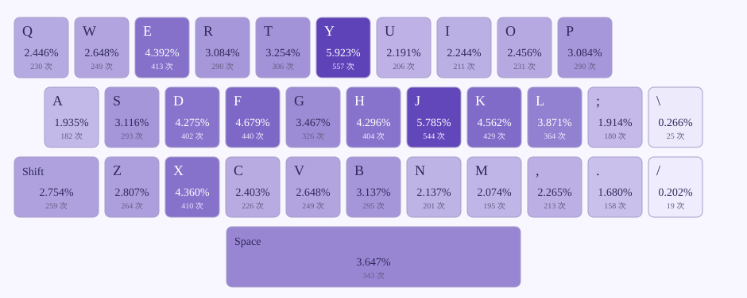

### 冰雪莲道（CR-REF-7e650f7a4c 21×21 带调）

共 9437 键，Space 341、Shift 301、选重 0。

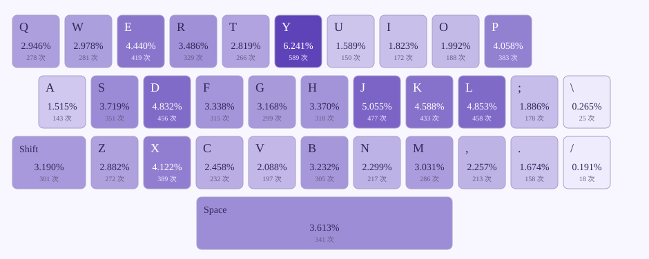

### 冰雪兰拼（UED-3158ce08b5bc 21×21）

共 9471 键，Space 365、Shift 271、选重 0。

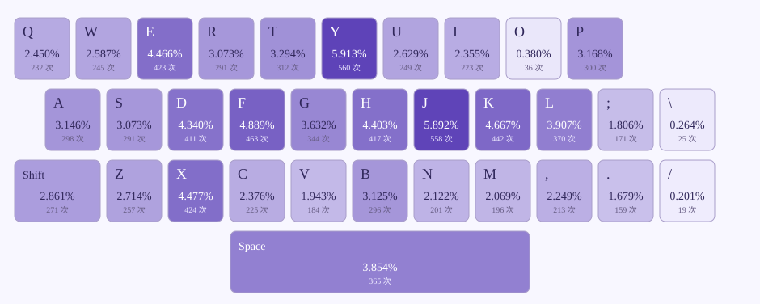

### 冰雪键道

共 9492 键，Space 352、Shift 308、选重 0。

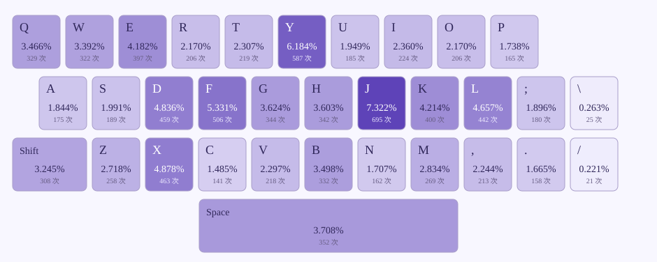

### 冰雪三拼

共 9584 键，Space 355、Shift 320、选重 0。

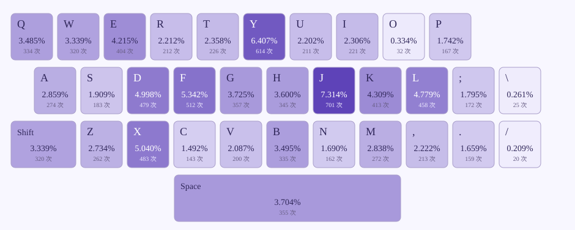

### 冰雪鹮道（T2126-V52-M4-ec60a3637a99 21×26 带调）

共 9598 键，Space 387、Shift 177、选重 0。

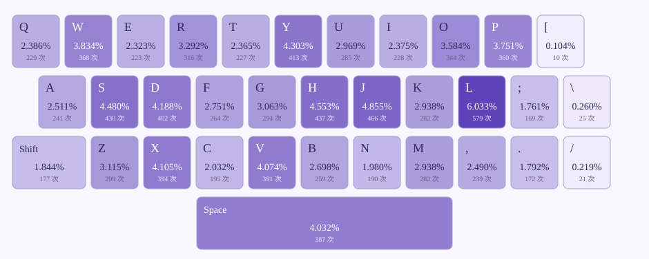

### 冰雪鹤道（RC26-39a5bfdc045342cd 21×26）

共 9615 键，Space 395、Shift 158、选重 0。

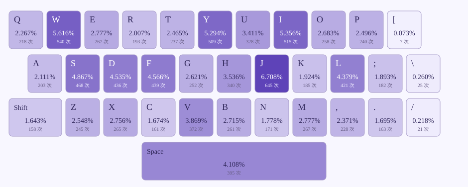

### 冰雪鹤拼（RC26-39a5bfdc045342cd 21×26）

共 9684 键，Space 374、Shift 168、选重 0。

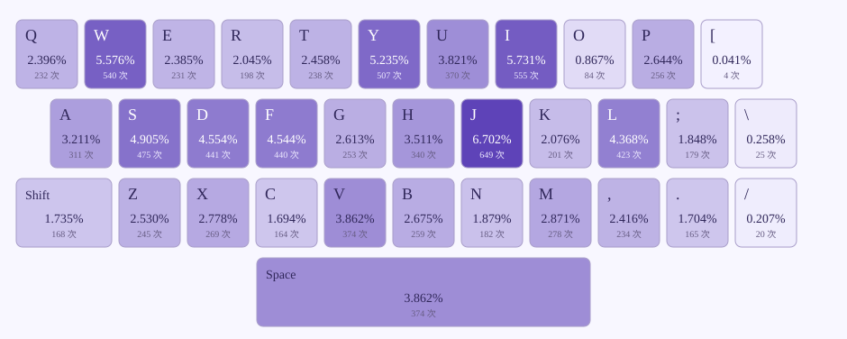

### 冰雪四拼

共 9685 键，Space 288、Shift 139、选重 1。

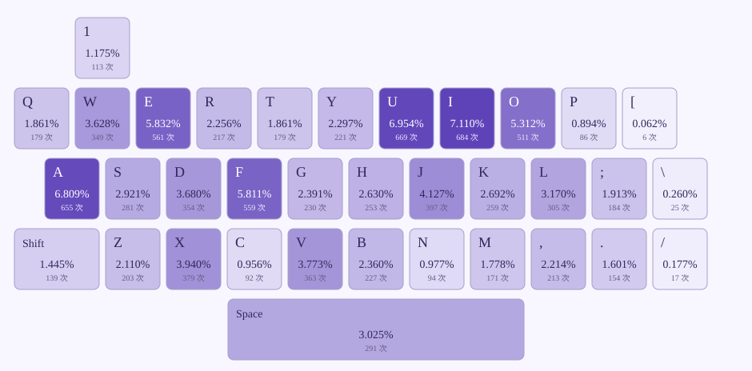

### 声笔小鹤

共 10334 键，Space 406、Shift 0、选重 0。

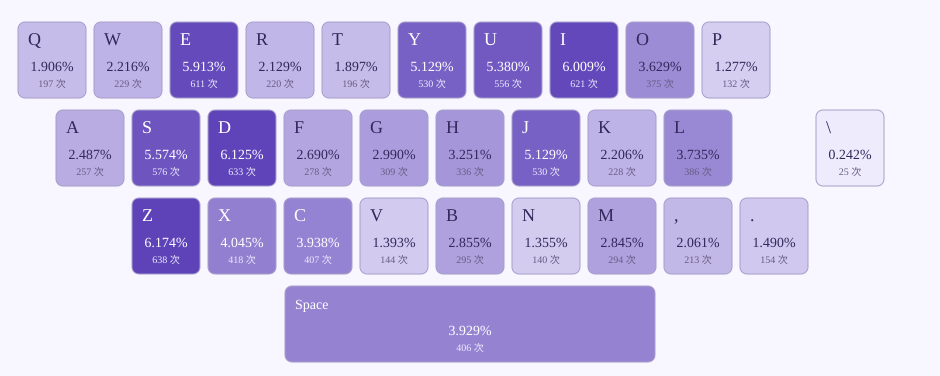

### 冰雪清韵

共 11761 键，Space 1288、Shift 153、选重 2。

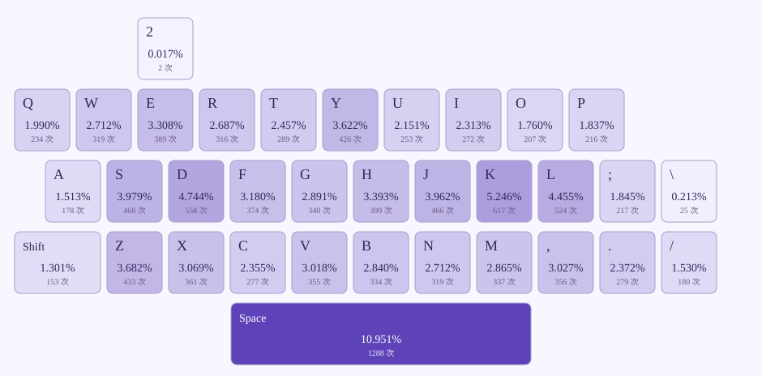

### 小鹤音形（清风版）

共 12246 键，Space 1324、Shift 0、选重 2。

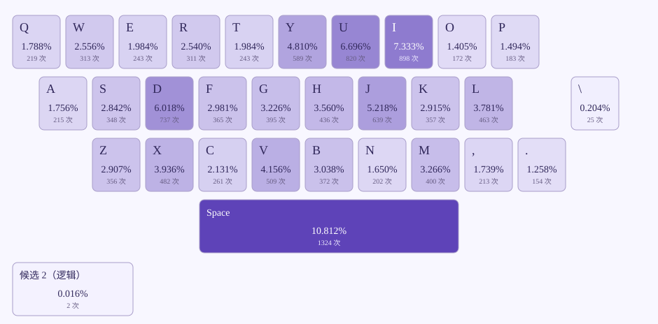

## 带调方案规则

冰雪莲道使用 CR-REF-7e650f7a4c 的带调 21×21 主码、纯形辅序 21/231/14，声声空桶按反序 12 每字取两辅；三字以上保留前三字大写补韵与长词大写声母。冰雪鹮道使用 T2126-V52-M4-ec60a3637a99 的带调 21×26 主码、纯形辅序 21/12/23，声声空桶同样反序 12；三字词按自身四码／空桶三码路径处理，保留继承的结构略码。两者声调已进入第二码，后续不重复补调辅。

其他方案分别沿用当前发布的声韵、辅序、固顶、空桶、略码和顶屏规则。声笔小鹤使用本机安装方案的独立空白部署；小鹤音形（清风版）使用本机 WindInput 的发布词库及候选顺序。外部方案版本与来源见 5000 字 JSON。

八个双拼方案另外枚举四主码词长直选：回放 `<` 表示 Shift＋逗号，`>` 表示 Shift＋句号，每次均计两键；成功直选立即提交，不追加 Space。该入口选取类别内首词，单独记录使用次数，不计入数字选重。探针以真实处理器最终提交文本验证词长优先级、补辅边界、全段消费和中途顶屏。三套 21×26 同时枚举四声母原生长词补全与逐级大写声母续写；Shift 同样逐次计键。结构略码与追加尾字的组合也实按验证，避免长词续写新规则使旧组合失效。

本轮移除了旧冰雪脚本针对「数字化」「与数字」「化转型」的人工分词限制，只从实际词典取得读音和合法候选。各方案按原文连续子串（最多 12 字）枚举自身可用词，再求最优切分；本轮冰雪词典在赛文中没有超过 12 字的匹配词。

## 回放

- [场景 1：政论时事](./十一场景_5500字_当前十二方案逐键对齐回放/场景01_政论时事_500字.md)
- [场景 2：科技科普](./十一场景_5500字_当前十二方案逐键对齐回放/场景02_科技科普_500字.md)
- [场景 3：现代散文](./十一场景_5500字_当前十二方案逐键对齐回放/场景03_现代散文_500字.md)
- [场景 4：财经分析](./十一场景_5500字_当前十二方案逐键对齐回放/场景04_财经分析_500字.md)
- [场景 5：日常口语](./十一场景_5500字_当前十二方案逐键对齐回放/场景05_日常口语_500字.md)
- [场景 6：法律公文](./十一场景_5500字_当前十二方案逐键对齐回放/场景06_法律公文_500字.md)
- [场景 7：历史社科](./十一场景_5500字_当前十二方案逐键对齐回放/场景07_历史社科_500字.md)
- [场景 8：教育心理](./十一场景_5500字_当前十二方案逐键对齐回放/场景08_教育心理_500字.md)
- [场景 9：体育竞技](./十一场景_5500字_当前十二方案逐键对齐回放/场景09_体育竞技_500字.md)
- [场景 10：输入法赛文](./十一场景_5500字_当前十二方案逐键对齐回放/场景10_输入法赛文_500字.md)
- [场景 11：独立输入法赛文](./十一场景_5500字_当前十二方案逐键对齐回放/场景11_独立赛文_500字.md)

## 缓存与复跑

运行 `just benchmark-5500`（或 `bun scripts/run-5500-benchmark.ts`），按十个冰雪方案、声笔小鹤、小鹤音形、5500 字汇总顺序串行执行。

真实候选缓存位于 `output/benchmark-rime-cache/<源文件与运行库 SHA-256>/<schema_id>.jsonl`，逐条追加，允许中断后续跑；冰雪莲道与冰雪鹮道各自独立保存。源方案、字典、Lua、共享数据或 Rime 库变化会使对应指纹失效。声笔反查缓存位于 `output/benchmark-sbxh-reverse-cache/`，清风词库缓存位于 `output/benchmark-flypy-cache/`，回放位于 `output/benchmark-replays/`。运行日志和本轮输入指纹位于 `output/benchmark-runs/`。缓存不提交 Git，重新运行会重新验证源文件并复用匹配的记录。

仅在已核对方案和外部词库来源未变化后，可用 `just benchmark-5500 --reuse-unchanged` 复用冰雪四拼、冰雪清韵和声笔小鹤的已验证候选，并从清风词库缓存重新汇总；缺少任何候选记录即失败。八个双拼方案仍查询当前独立只读部署；旧切分不能作为更新后规则的最优解直接沿用。

缓存指纹也包含查询实现与只读部署补丁。v3 每条记录保存候选、提交文本和是否完成全部输入；中途提交不能用于候选或直选，只有最后一键提交的完整目标词才可用于直选。重新测量的方案在缓存命中后仍绕过缓存实查首尾各八条记录，并额外检查 `xkd`／`yvd`；不一致或日志出现 Lua／词典运行错误时整轮失败，不能仅凭重复回放一致宣布缓存正确。

逐篇回放按键、Space、Shift、选重与 5000 字原始统计逐项核对，再加独立赛文；全按键键频随 5500 字 JSON 保存。清风回放若只给候选序号，键频使用 CandidateN 逻辑名称，不假定物理选重键。
